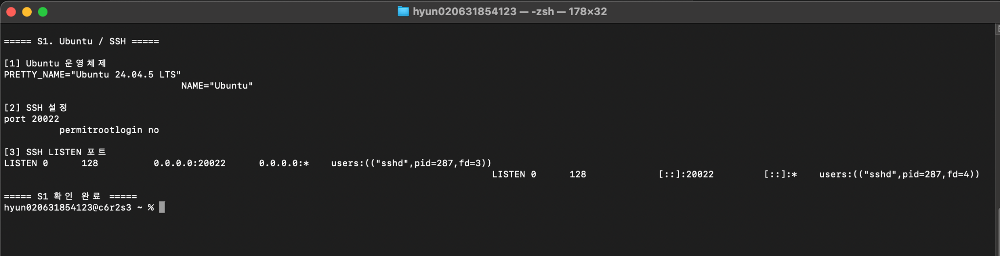
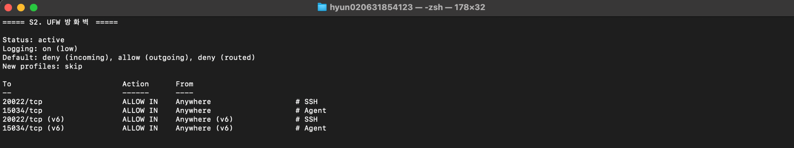
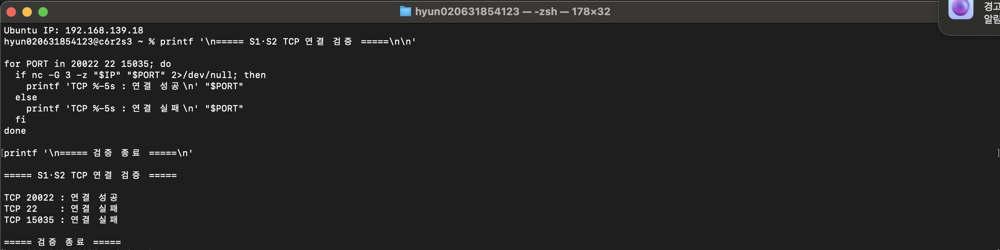

# B4-1 Owner 화면 증빙 — S1·S2 (2026-11-14)

> 제출용 캡처의 **원본 화면을 변경하지 않고** 등록한 자료입니다. 촬영 당시 교육장 Mac 터미널에서 OrbStack Ubuntu Machine `b4-lab`의 설정을 조회했습니다. 스크린샷 자체에 SSH 개인키·비밀번호·Agent 비밀키 값은 표시되지 않습니다.
>
> **검수 구분:** 설정·LISTEN·UFW 규칙 화면(S1·S2)과 Mac→Ubuntu **TCP 포트 연결 시험(아래 "S1·S2 — TCP 연결 시험")**을 등록했습니다. 다만 공식 `docs/b4-1-final-evidence.md` §4 체크리스트의 **SSH 배너(`SSH-2.0-OpenSSH_…`) 출력 화면은 아직 없어** 배너 확인은 PASS로 처리하지 않습니다.

## S1 — Ubuntu / SSH



촬영 원본은 터미널 글자 정렬이 일부 밀렸지만, 필요한 값은 판독할 수 있습니다. 화면 가독성 개선이 필요하면 Mac에서 재촬영하고 새 버전을 별도로 검수합니다. 이 원본을 편집·합성하지 않습니다.

### 화면에 표시된 조회 명령과 결과

```bash
orb -m b4-lab cat /etc/os-release | head -2
B sshd -T | grep -E '^(port|permitrootlogin) '
B ss -tlnp | grep sshd
```

`B()` 함수는 Mac 셸에서 `B() { orb -m b4-lab sudo "$@"; }`로 정의했습니다.

확인 사항:
- Ubuntu `24.04.5 LTS`
- `port 20022`
- `permitrootlogin no`
- `sshd`가 `0.0.0.0:20022`와 `[::]:20022`에서 LISTEN
- 표시된 PID `287`은 촬영 시점의 예시이며 재실행 때 달라질 수 있음

**남은 검증:** Mac에서 TCP 20022 연결 성공은 아래 "TCP 연결 시험"에서 확인했습니다. SSH 배너(`SSH-2.0-OpenSSH_…`) 출력은 아직 화면으로 증빙되지 않았습니다.

## S2 — UFW 방화벽



### 화면 조회 명령

```bash
B ufw status verbose | awk '{printf "%s\r\n", $0}'
```

`awk`는 출력 줄바꿈만 정렬하며 UFW 규칙을 바꾸지 않습니다.

확인 사항:
- `Status: active`
- `Default: deny (incoming), allow (outgoing), deny (routed)`
- TCP 20022 (`# SSH`)와 15034 (`# Agent`) 인바운드 ALLOW
- 동일 허용 규칙의 IPv6 `(v6)` 항목

**남은 검증:** Mac에서 20022 연결 성공, 22·15035 연결 실패는 아래 "TCP 연결 시험"에서 확인했습니다(timeout/refused 구분은 화면에 없음).

## S1·S2 — TCP 연결 시험 (Mac → Ubuntu)



2026-11-14 Owner가 교육장 Mac 터미널에서 Ubuntu(`b4-lab`, IP `192.168.139.18`)로 직접 TCP 연결을 시험한 화면입니다. 원본을 편집·합성하지 않았습니다(창 오른쪽 위의 macOS 알림 일부가 함께 찍혀 있음).

### 화면에 표시된 시험 방식

```bash
for PORT in 20022 22 15035; do
  if nc -G 3 -z "$IP" "$PORT" 2>/dev/null; then
    printf 'TCP %-5s : 연결 성공 \n' "$PORT"
  else
    printf 'TCP %-5s : 연결 실패 \n' "$PORT"
  fi
done
```

`nc -z`는 데이터를 보내지 않고 연결만 시도하며, `-G 3`은 3초 안에 연결되지 않으면 실패로 봅니다.

### 실측 결과와 의미

| 포트 | 결과 | 의미 |
|---|---|---|
| TCP 20022 | 연결 성공 | sshd가 LISTEN 중이고 UFW가 허용(S1·S2 화면과 일치) |
| TCP 22 | 연결 실패 | 기본 SSH 포트를 쓰지 않으며 UFW에서도 허용되지 않음 |
| TCP 15035 | 연결 실패 | 허용 목록(20022·15034)에 없는 포트가 차단됨 |

이 결과는 S1·S2 화면의 설정(sshd 20022 LISTEN, UFW deny incoming + 20022·15034 허용)과 모순 없이 일치합니다.

**이 시험이 증명하지 않는 것**
- `nc -z`는 "연결 성공/실패"만 알려 주므로 실패 원인이 timeout(UFW 차단)인지 connection refused(포트 미사용)인지 화면에서 구분되지 않습니다. 허용 외 포트가 "차단"되었다는 해석은 UFW 규칙 화면과 함께 볼 때의 결론입니다.
- **SSH 배너(`SSH-2.0-OpenSSH_9.6p1…`)는 이 화면에 출력되지 않았습니다.** 20022에서 SSH 프로토콜이 응답한다는 점은 배너 출력 화면이 등록될 때 PASS로 처리합니다. 그 전까지는 "TCP 연결 성공"까지만 인정합니다.
- 15034 포트는 Agent가 실행 중일 때만 응답하므로 이 시험 대상이 아닙니다.

## 증빙 관리 기준

- 참조: [`docs/b4-1-final-evidence.md`](../../b4-1-final-evidence.md) §4 (S1·S2 제출 체크리스트)
- 범위: 설정 조회 화면 2장과 TCP 연결 시험 화면 1장의 등록. SSH 배너 출력, 다른 S3~S10 화면 캡처 및 공식 제출 승인은 별도
- 형식: PNG 원본; 인위적 수정 없음
- 학습자료 2강(SSH·포트·UFW)은 학습 초안 단계이며 이 증빙 등록으로 자동 확정하지 않음
