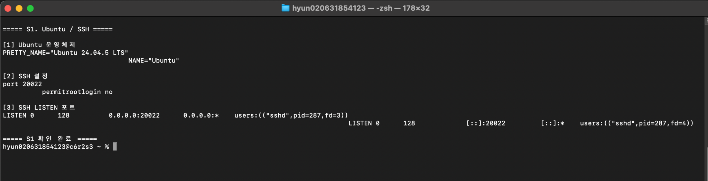
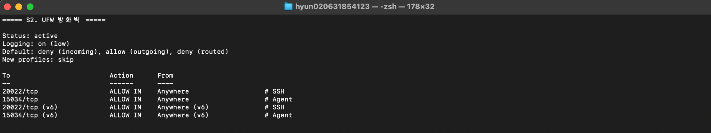
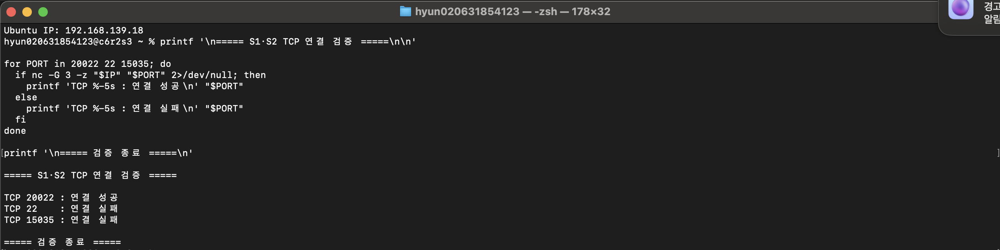
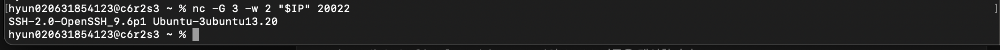
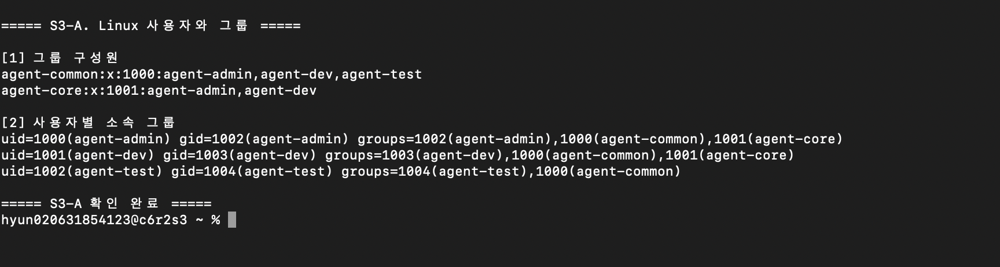

# B4-1 Owner 화면 증빙 — S1·S2 (2026-11-14)

> 제출용 캡처의 **원본 화면을 변경하지 않고** 등록한 자료입니다. 촬영 당시 교육장 Mac 터미널에서 OrbStack Ubuntu Machine `b4-lab`의 설정을 조회했습니다. 스크린샷 자체에 SSH 개인키·비밀번호·Agent 비밀키 값은 표시되지 않습니다.
>
> **검수 구분:** 설정·LISTEN·UFW 규칙 화면(S1·S2)과 Mac→Ubuntu **TCP 포트 연결 시험(아래 "S1·S2 — TCP 연결 시험")**을 등록했습니다. 또한 **SSH 배너 응답 화면(아래 "S1 — SSH 배너 확인")**을 등록해 S1의 배너 확인을 PASS로 처리합니다. 단 배너 확인은 SSH 서버의 응답 확인일 뿐 **SSH 로그인 인증 성공을 뜻하지 않습니다.**

## S1 — Ubuntu / SSH



촬영 원본은 터미널 글자 정렬이 일부 밀렸지만, 필요한 값은 판독할 수 있습니다. 화면 가독성 개선이 필요하면 Mac에서 재촬영하고 새 버전을 별도로 검수합니다. 이 원본을 편집·합성하지 않습니다.

### 화면에 표시된 조회 명령과 결과

```bash
orb -m b4-lab cat /etc/os-release | head -2
B sshd -T | grep -E '^(port|permitrootlogin) '
B ss -tlnp | grep sshd
```

`B()` 함수는 Mac 셸에서 `B() { orb -m b4-lab sudo "$@"; }`로 정의했습니다.

확인 사항:
- Ubuntu `24.04.5 LTS`
- `port 20022`
- `permitrootlogin no`
- `sshd`가 `0.0.0.0:20022`와 `[::]:20022`에서 LISTEN
- 표시된 PID `287`은 촬영 시점의 예시이며 재실행 때 달라질 수 있음

**남은 검증:** Mac에서 TCP 20022 연결 성공은 아래 "TCP 연결 시험"에서 확인했습니다. SSH 배너 응답은 아래 "S1 — SSH 배너 확인"에서 확인했습니다.

## S2 — UFW 방화벽



### 화면 조회 명령

```bash
B ufw status verbose | awk '{printf "%s\r\n", $0}'
```

`awk`는 출력 줄바꿈만 정렬하며 UFW 규칙을 바꾸지 않습니다.

확인 사항:
- `Status: active`
- `Default: deny (incoming), allow (outgoing), deny (routed)`
- TCP 20022 (`# SSH`)와 15034 (`# Agent`) 인바운드 ALLOW
- 동일 허용 규칙의 IPv6 `(v6)` 항목

**남은 검증:** Mac에서 20022 연결 성공, 22·15035 연결 실패는 아래 "TCP 연결 시험"에서 확인했습니다(timeout/refused 구분은 화면에 없음).

## S1·S2 — TCP 연결 시험 (Mac → Ubuntu)



2026-11-14 Owner가 교육장 Mac 터미널에서 Ubuntu(`b4-lab`, IP `192.168.139.18`)로 직접 TCP 연결을 시험한 화면입니다. 원본을 편집·합성하지 않았습니다(창 오른쪽 위의 macOS 알림 일부가 함께 찍혀 있음).

### 화면에 표시된 시험 방식

```bash
for PORT in 20022 22 15035; do
  if nc -G 3 -z "$IP" "$PORT" 2>/dev/null; then
    printf 'TCP %-5s : 연결 성공 \n' "$PORT"
  else
    printf 'TCP %-5s : 연결 실패 \n' "$PORT"
  fi
done
```

`nc -z`는 데이터를 보내지 않고 연결만 시도하며, `-G 3`은 3초 안에 연결되지 않으면 실패로 봅니다.

### 실측 결과와 의미

| 포트 | 결과 | 의미 |
|---|---|---|
| TCP 20022 | 연결 성공 | sshd가 LISTEN 중이고 UFW가 허용(S1·S2 화면과 일치) |
| TCP 22 | 연결 실패 | 기본 SSH 포트를 쓰지 않으며 UFW에서도 허용되지 않음 |
| TCP 15035 | 연결 실패 | 허용 목록(20022·15034)에 없는 포트가 차단됨 |

이 결과는 S1·S2 화면의 설정(sshd 20022 LISTEN, UFW deny incoming + 20022·15034 허용)과 모순 없이 일치합니다.

**이 시험이 증명하지 않는 것**
- `nc -z`는 "연결 성공/실패"만 알려 주므로 실패 원인이 timeout(UFW 차단)인지 connection refused(포트 미사용)인지 화면에서 구분되지 않습니다. 허용 외 포트가 "차단"되었다는 해석은 UFW 규칙 화면과 함께 볼 때의 결론입니다.
- 이 화면에는 SSH 배너가 출력되지 않습니다. SSH 프로토콜 응답은 별도 캡처(아래 "S1 — SSH 배너 확인")로 증빙합니다.
- 15034 포트는 Agent가 실행 중일 때만 응답하므로 이 시험 대상이 아닙니다.

## S1 — SSH 배너 확인



2026-11-14 오후 4:20:26, Owner가 교육장 Mac 터미널에서 촬영한 원본입니다(편집·합성 없음). `$IP`는 위 TCP 시험과 같은 Ubuntu IP `192.168.139.18`입니다.

```bash
nc -G 3 -w 2 "$IP" 20022
```

출력:

```text
SSH-2.0-OpenSSH_9.6p1 Ubuntu-3ubuntu13.20
```

의미:
- Mac에서 Ubuntu의 TCP 20022에 접속하자 **sshd가 SSH 프로토콜 식별 문자열(배너)로 응답**했습니다. 즉 20022의 서비스가 SSH 서버(OpenSSH 9.6p1, Ubuntu 24.04 패키지)임이 확인됩니다.
- 앞선 S1 화면(`port 20022`, `permitrootlogin no`, LISTEN)과 TCP 20022 연결 성공 결과와 일치합니다.

**한계(중요):** 배너 확인은 **SSH 서버가 응답한다는 사실**의 확인입니다. SSH 키 교환·사용자 인증·로그인을 수행하지 않았으므로 **SSH 로그인 인증 성공의 증빙이 아닙니다.** `permitrootlogin no`의 실제 로그인 거부 동작도 이 화면으로는 시험하지 않았습니다. 사용한 명령은 `nc`이며, 공식 체크리스트(§4)에 예시된 `perl` 명령과 방식은 다르지만 같은 목적(배너 수신)의 조회입니다.

## 증빙 관리 기준

- 참조: [`docs/b4-1-final-evidence.md`](../../b4-1-final-evidence.md) §4 (S1·S2 제출 체크리스트)
- 범위: 설정 조회 화면 2장, TCP 연결 시험 화면 1장, SSH 배너 화면 1장의 등록. 다른 S3~S10 화면 캡처 및 공식 제출 승인은 별도
- 형식: PNG 원본; 인위적 수정 없음
- 학습자료 2강(SSH·포트·UFW)은 학습 초안 단계이며 이 증빙 등록으로 자동 확정하지 않음

---

# S3 — 사용자·그룹·ACL (2026-11-16)

> 2026-11-16 Owner가 교육장 Mac 터미널에서 직접 실행·촬영한 원본 3장입니다(편집·합성 없음). 모두 조회 전용이며 `chmod`·`chown`·`setfacl`·`usermod` 등 설정 변경은 하지 않았습니다. 화면에는 비밀번호·키 내용이 표시되지 않습니다(S3-A 하단에 Mac 셸 프롬프트의 사용자명·호스트명이 보입니다).
>
> **화면에서 확인되는 것과 아닌 것:** 각 화면에는 `===== S3-… =====` 제목과 명령 출력이 찍혀 있으며, **실행 명령 문장 자체는 화면에 보이지 않습니다.** 아래 "명령"은 [`b4-1-final-evidence.md`](../../b4-1-final-evidence.md) §4의 S3 체크리스트와 출력 형식에서 대응되는 조회 명령이며, 실제 촬영 스크립트의 문장은 이 저장소에서 확인하지 않았습니다.

| 파일 | 촬영 시각 | 내용 |
|---|---|---|
| `S3-A-users-groups-2026-11-16.png` | 오후 8:42:40 | 사용자와 그룹 |
| `S3-B1-folder-permissions-2026-11-16.png` | 오후 8:46:18 | 폴더 소유권과 권한 |
| `S3-B2-acl-sudo-2026-11-16.png` | 오후 8:47:04 | ACL과 sudo 권한 |

## S3-A — 사용자와 그룹



대응 명령: `B getent group agent-common agent-core` ; `B id agent-admin` / `agent-dev` / `agent-test`

실측값:

```text
agent-common:x:1000:agent-admin,agent-dev,agent-test
agent-core:x:1001:agent-admin,agent-dev
uid=1000(agent-admin) gid=1002(agent-admin) groups=1002(agent-admin),1000(agent-common),1001(agent-core)
uid=1001(agent-dev) gid=1003(agent-dev) groups=1003(agent-dev),1000(agent-common),1001(agent-core)
uid=1002(agent-test) gid=1004(agent-test) groups=1004(agent-test),1000(agent-common)
```

해석: `agent-common`은 세 계정 모두, `agent-core`는 `agent-admin`·`agent-dev`만 포함합니다. `agent-test`는 `agent-core`에 속하지 않습니다.

## S3-B1 — 폴더 소유권과 권한


대응 명령: `B stat -c '%U:%G %a %n' /opt/agent-app /opt/agent-app/upload_files /opt/agent-app/api_keys /var/log/agent-app`

실측값:

```text
root:root 755 /opt/agent-app
agent-admin:agent-common 2770 /opt/agent-app/upload_files
root:agent-core 2770 /opt/agent-app/api_keys
root:agent-core 2770 /var/log/agent-app
```

해석: `upload_files`는 세 계정이 속한 `agent-common`, `api_keys`와 로그 폴더는 `agent-core` 그룹 소유이며, 세 폴더 모두 `2770`(setgid + 소유자·그룹 `rwx`, 그 외 접근 없음)입니다.

## S3-B2 — ACL과 sudo 권한


대응 명령: `B getfacl -p /opt/agent-app/api_keys` ; `B sudo -l -U agent-admin`(`B`가 이미 `sudo`를 포함하므로 `B -l -U agent-admin`과 같은 결과)

실측값(핵심):

```text
# owner: root
# group: agent-core
# flags: -s-
user::rwx
group::rwx
group:agent-core:rwx
mask::rwx
other::---
default:user::rwx
default:group::rwx
default:group:agent-core:rwx
default:mask::rwx
default:other::---
...
User agent-admin may run the following commands on b4-lab:
    (root) NOPASSWD: /usr/sbin/ufw status
```

해석:
- `flags: -s-`는 setgid가 설정되었음을 보여 줍니다(S3-B1의 `2770`과 일치).
- 소유 그룹이 `agent-core`이므로 `group::rwx`와 `group:agent-core:rwx`는 같은 그룹을 가리키며 내용이 겹칩니다. 두 항목을 둔 이유는 이 화면만으로 알 수 없습니다.
- `agent-admin`은 `/usr/sbin/ufw status` 한 명령만 비밀번호 없이 root 권한으로 실행할 수 있습니다.

## S3 — 이 화면이 증명하지 않는 것

- **사용자별 실제 읽기·쓰기 결과**(`agent-test`가 `upload_files`는 R/W, `api_keys`·로그는 접근 거부)는 이 화면 3장에 나오지 않습니다. 그 결과는 2026-11-14 회귀 기록 [`task22-closeout-regression.txt`](../task22-closeout-regression.txt)의 `## RW matrix`(임시 파일 생성·삭제 시험)에 근거합니다.
- `agent-dev`·`agent-test`의 sudo 거부 결과도 같은 회귀 기록의 `## sudo`에 근거하며, 이 화면에는 `agent-admin`만 표시됩니다.
- `monitor.sh`·`secret.key`의 파일 단위 권한은 이 화면에 포함되지 않습니다.
- 화면의 값은 2026-11-14 회귀 기록의 같은 항목(그룹·`id`·`stat`·ACL·sudo)과 일치합니다.
