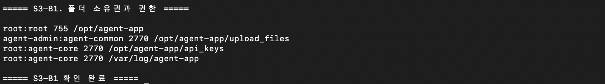
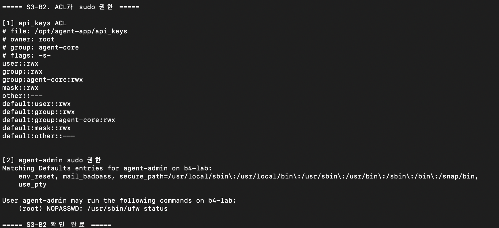
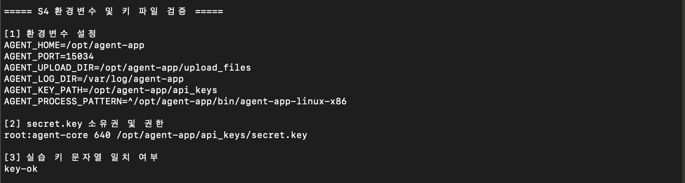
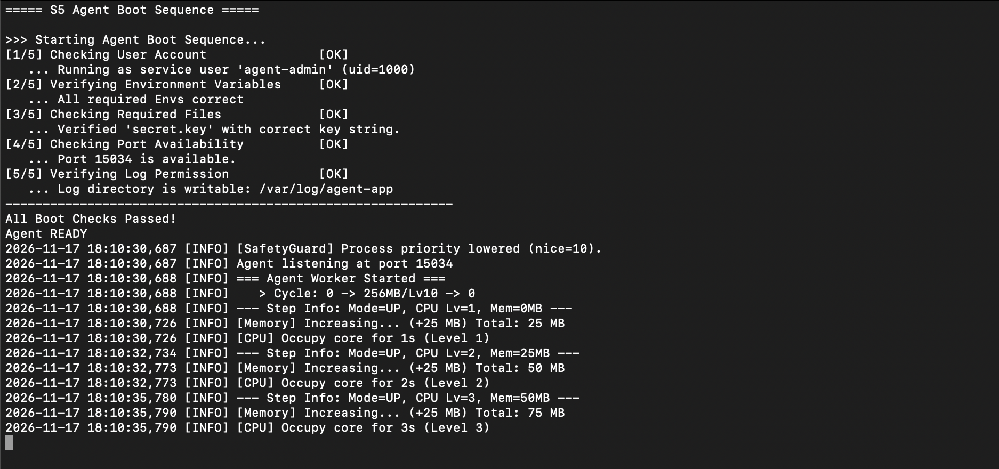
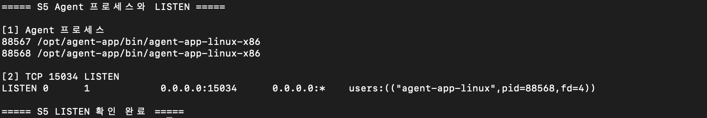

# B4-1 Owner 화면 증빙 — S1~S5

> **촬영 일자·범위:** S1·S2는 2026-11-14, S3는 2026-11-16, S4·S5는 2026-11-17에 Owner가 촬영했습니다. S6~S10은 Owner 촬영 대기입니다. S3~S5는 문서 아래쪽 "S3 — 사용자·그룹·ACL", "S4 — 환경변수·키 파일", "S5 — Agent Boot Sequence·LISTEN" 절에 있습니다.
>
> 제출용 캡처의 **원본 화면을 변경하지 않고** 등록한 자료입니다. 촬영 당시 교육장 Mac 터미널에서 OrbStack Ubuntu Machine `b4-lab`의 설정을 조회했습니다. 스크린샷 자체에 SSH 개인키·비밀번호·Agent 비밀키 값은 표시되지 않습니다.
>
> **검수 구분:** 설정·LISTEN·UFW 규칙 화면(S1·S2)과 Mac→Ubuntu **TCP 포트 연결 시험(아래 "S1·S2 — TCP 연결 시험")**을 등록했습니다. 또한 **SSH 배너 응답 화면(아래 "S1 — SSH 배너 확인")**을 등록해 S1의 배너 확인을 PASS로 처리합니다. 단 배너 확인은 SSH 서버의 응답 확인일 뿐 **SSH 로그인 인증 성공을 뜻하지 않습니다.**

## S1 — Ubuntu / SSH


촬영 원본은 터미널 글자 정렬이 일부 밀렸지만, 필요한 값은 판독할 수 있습니다. 화면 가독성 개선이 필요하면 Mac에서 재촬영하고 새 버전을 별도로 검수합니다. 이 원본을 편집·합성하지 않습니다.

### 화면에 표시된 조회 명령과 결과

```bash
orb -m b4-lab cat /etc/os-release | head -2
B sshd -T | grep -E '^(port|permitrootlogin) '
B ss -tlnp | grep sshd
```

`B()` 함수는 Mac 셸에서 `B() { orb -m b4-lab sudo "$@"; }`로 정의했습니다.

확인 사항:
- Ubuntu `24.04.5 LTS`
- `port 20022`
- `permitrootlogin no`
- `sshd`가 `0.0.0.0:20022`와 `[::]:20022`에서 LISTEN
- 표시된 PID `287`은 촬영 시점의 예시이며 재실행 때 달라질 수 있음

**남은 검증:** Mac에서 TCP 20022 연결 성공은 아래 "TCP 연결 시험"에서 확인했습니다. SSH 배너 응답은 아래 "S1 — SSH 배너 확인"에서 확인했습니다.

## S2 — UFW 방화벽


### 화면 조회 명령

```bash
B ufw status verbose | awk '{printf "%s\r\n", $0}'
```

`awk`는 출력 줄바꿈만 정렬하며 UFW 규칙을 바꾸지 않습니다.

확인 사항:
- `Status: active`
- `Default: deny (incoming), allow (outgoing), deny (routed)`
- TCP 20022 (`# SSH`)와 15034 (`# Agent`) 인바운드 ALLOW
- 동일 허용 규칙의 IPv6 `(v6)` 항목

**남은 검증:** Mac에서 20022 연결 성공, 22·15035 연결 실패는 아래 "TCP 연결 시험"에서 확인했습니다(timeout/refused 구분은 화면에 없음).

## S1·S2 — TCP 연결 시험 (Mac → Ubuntu)


2026-11-14 Owner가 교육장 Mac 터미널에서 Ubuntu(`b4-lab`, IP `192.168.139.18`)로 직접 TCP 연결을 시험한 화면입니다. 원본을 편집·합성하지 않았습니다(창 오른쪽 위의 macOS 알림 일부가 함께 찍혀 있음).

### 화면에 표시된 시험 방식

```bash
for PORT in 20022 22 15035; do
  if nc -G 3 -z "$IP" "$PORT" 2>/dev/null; then
    printf 'TCP %-5s : 연결 성공 \n' "$PORT"
  else
    printf 'TCP %-5s : 연결 실패 \n' "$PORT"
  fi
done
```

`nc -z`는 데이터를 보내지 않고 연결만 시도하며, `-G 3`은 3초 안에 연결되지 않으면 실패로 봅니다.

### 실측 결과와 의미

| 포트 | 결과 | 의미 |
|---|---|---|
| TCP 20022 | 연결 성공 | sshd가 LISTEN 중이고 UFW가 허용(S1·S2 화면과 일치) |
| TCP 22 | 연결 실패 | 기본 SSH 포트를 쓰지 않으며 UFW에서도 허용되지 않음 |
| TCP 15035 | 연결 실패 | 허용 목록(20022·15034)에 없는 포트가 차단됨 |

이 결과는 S1·S2 화면의 설정(sshd 20022 LISTEN, UFW deny incoming + 20022·15034 허용)과 모순 없이 일치합니다.

**이 시험이 증명하지 않는 것**
- `nc -z`는 "연결 성공/실패"만 알려 주므로 실패 원인이 timeout(UFW 차단)인지 connection refused(포트 미사용)인지 화면에서 구분되지 않습니다. 허용 외 포트가 "차단"되었다는 해석은 UFW 규칙 화면과 함께 볼 때의 결론입니다.
- 이 화면에는 SSH 배너가 출력되지 않습니다. SSH 프로토콜 응답은 별도 캡처(아래 "S1 — SSH 배너 확인")로 증빙합니다.
- 15034 포트는 Agent가 실행 중일 때만 응답하므로 이 시험 대상이 아닙니다.

## S1 — SSH 배너 확인


2026-11-14 오후 4:20:26, Owner가 교육장 Mac 터미널에서 촬영한 원본입니다(편집·합성 없음). `$IP`는 위 TCP 시험과 같은 Ubuntu IP `192.168.139.18`입니다.

```bash
nc -G 3 -w 2 "$IP" 20022
```

출력:

```text
SSH-2.0-OpenSSH_9.6p1 Ubuntu-3ubuntu13.20
```

의미:
- Mac에서 Ubuntu의 TCP 20022에 접속하자 **sshd가 SSH 프로토콜 식별 문자열(배너)로 응답**했습니다. 즉 20022의 서비스가 SSH 서버(OpenSSH 9.6p1, Ubuntu 24.04 패키지)임이 확인됩니다.
- 앞선 S1 화면(`port 20022`, `permitrootlogin no`, LISTEN)과 TCP 20022 연결 성공 결과와 일치합니다.

**한계(중요):** 배너 확인은 **SSH 서버가 응답한다는 사실**의 확인입니다. SSH 키 교환·사용자 인증·로그인을 수행하지 않았으므로 **SSH 로그인 인증 성공의 증빙이 아닙니다.** `permitrootlogin no`의 실제 로그인 거부 동작도 이 화면으로는 시험하지 않았습니다. 사용한 명령은 `nc`이며, 공식 체크리스트(§4)에 예시된 `perl` 명령과 방식은 다르지만 같은 목적(배너 수신)의 조회입니다.

## 증빙 관리 기준

- 참조: [`docs/b4-1-final-evidence.md`](../../b4-1-final-evidence.md) §4 (S1~S10 제출 체크리스트)
- 범위: S1·S2(2026-11-14) — 설정 조회 화면 2장, TCP 연결 시험 화면 1장, SSH 배너 화면 1장. S3(2026-11-16) — 화면 3장(아래 "S3" 절). S4(2026-11-17) — 화면 1장(아래 "S4" 절). S5(2026-11-17) — 화면 2장(아래 "S5" 절). S6~S10 화면 캡처 및 공식 제출 승인은 별도(Owner 촬영 대기)
- 형식: PNG 원본; 인위적 수정 없음
- 학습자료 2강(SSH·포트·UFW)은 학습 초안 단계이며 이 증빙 등록으로 자동 확정하지 않음

---

# S3 — 사용자·그룹·ACL (2026-11-16)

> 2026-11-16 Owner가 교육장 Mac 터미널에서 직접 실행·촬영한 원본 3장입니다(편집·합성 없음). 모두 조회 전용이며 `chmod`·`chown`·`setfacl`·`usermod` 등 설정 변경은 하지 않았습니다. 화면에는 비밀번호·키 내용이 표시되지 않습니다(S3-A 하단에 Mac 셸 프롬프트의 사용자명·호스트명이 보입니다).
>
> **화면에서 확인되는 것과 아닌 것:** 각 화면에는 `===== S3-… =====` 제목과 명령 출력이 찍혀 있으며, **실행 명령 문장 자체는 화면에 보이지 않습니다.** 아래 "명령"은 [`b4-1-final-evidence.md`](../../b4-1-final-evidence.md) §4의 S3 체크리스트와 출력 형식에서 대응되는 조회 명령이며, 실제 촬영 스크립트의 문장은 이 저장소에서 확인하지 않았습니다.

| 파일 | 촬영 시각 | 내용 |
|---|---|---|
| `S3-A-users-groups-2026-11-16.png` | 오후 8:42:40 | 사용자와 그룹 |
| `S3-B1-folder-permissions-2026-11-16.png` | 오후 8:46:18 | 폴더 소유권과 권한 |
| `S3-B2-acl-sudo-2026-11-16.png` | 오후 8:47:04 | ACL과 sudo 권한 |

## S3-A — 사용자와 그룹


대응 명령: `B getent group agent-common agent-core` ; `B id agent-admin` / `agent-dev` / `agent-test`

실측값:

```text
agent-common:x:1000:agent-admin,agent-dev,agent-test
agent-core:x:1001:agent-admin,agent-dev
uid=1000(agent-admin) gid=1002(agent-admin) groups=1002(agent-admin),1000(agent-common),1001(agent-core)
uid=1001(agent-dev) gid=1003(agent-dev) groups=1003(agent-dev),1000(agent-common),1001(agent-core)
uid=1002(agent-test) gid=1004(agent-test) groups=1004(agent-test),1000(agent-common)
```

해석: `agent-common`은 세 계정 모두, `agent-core`는 `agent-admin`·`agent-dev`만 포함합니다. `agent-test`는 `agent-core`에 속하지 않습니다.

## S3-B1 — 폴더 소유권과 권한



대응 명령: `B stat -c '%U:%G %a %n' /opt/agent-app /opt/agent-app/upload_files /opt/agent-app/api_keys /var/log/agent-app`

실측값:

```text
root:root 755 /opt/agent-app
agent-admin:agent-common 2770 /opt/agent-app/upload_files
root:agent-core 2770 /opt/agent-app/api_keys
root:agent-core 2770 /var/log/agent-app
```

해석: `upload_files`는 세 계정이 속한 `agent-common`, `api_keys`와 로그 폴더는 `agent-core` 그룹 소유이며, 세 폴더 모두 `2770`(setgid + 소유자·그룹 `rwx`, 그 외 접근 없음)입니다.

## S3-B2 — ACL과 sudo 권한



대응 명령: `B getfacl -p /opt/agent-app/api_keys` ; `B -l -U agent-admin`(`B`가 이미 `sudo`를 포함하므로 `B` 뒤에 `sudo`를 다시 쓰지 않는다)

실측값(핵심):

```text
# owner: root
# group: agent-core
# flags: -s-
user::rwx
group::rwx
group:agent-core:rwx
mask::rwx
other::---
default:user::rwx
default:group::rwx
default:group:agent-core:rwx
default:mask::rwx
default:other::---
...
User agent-admin may run the following commands on b4-lab:
    (root) NOPASSWD: /usr/sbin/ufw status
```

해석:
- `flags: -s-`는 setgid가 설정되었음을 보여 줍니다(S3-B1의 `2770`과 일치).
- 소유 그룹이 `agent-core`이므로 `group::rwx`와 `group:agent-core:rwx`는 같은 그룹을 가리키며 내용이 겹칩니다. 두 항목을 둔 이유는 이 화면만으로 알 수 없습니다.
- `agent-admin`은 `/usr/sbin/ufw status` 한 명령만 비밀번호 없이 root 권한으로 실행할 수 있습니다.

## S3 — 이 화면이 증명하지 않는 것

- **사용자별 실제 읽기·쓰기 결과**(`agent-test`가 `upload_files`는 R/W, `api_keys`·로그는 접근 거부)는 이 화면 3장에 나오지 않습니다. 그 결과는 2026-11-14 회귀 기록 [`task22-closeout-regression.txt`](../task22-closeout-regression.txt)의 `## RW matrix`(임시 파일 생성·삭제 시험)에 근거합니다.
- `agent-dev`·`agent-test`의 sudo 거부 결과도 같은 회귀 기록의 `## sudo`에 근거하며, 이 화면에는 `agent-admin`만 표시됩니다.
- `monitor.sh`·`secret.key`의 파일 단위 권한은 이 화면에 포함되지 않습니다.
- 화면의 값은 2026-11-14 회귀 기록의 같은 항목(그룹·`id`·`stat`·ACL·sudo)과 일치합니다.

---

# S4 — 환경변수·키 파일 (2026-11-17)

> 2026-11-17 오후 5:36에 Owner가 교육장 Mac 터미널에서 직접 실행·촬영한 원본 1장입니다(편집·합성 없음). 조회 전용이며 설정 변경은 하지 않았습니다. 화면에는 키 파일의 내용이 표시되지 않고, 일치 여부(`key-ok`)만 표시됩니다.
>
> **화면에서 확인되는 것과 아닌 것:** 화면에는 `===== S4 환경변수 및 키 파일 검증 =====` 제목과 세 구역의 출력이 찍혀 있으며, **실행 명령 문장 자체는 화면에 보이지 않습니다.** 아래 "대응 명령"은 [`b4-1-final-evidence.md`](../../b4-1-final-evidence.md) §4의 S4 체크리스트에 적힌 조회 명령이며, 실제 촬영 스크립트의 문장은 이 저장소에서 확인하지 않았습니다.

| 파일 | 촬영 시각 | 내용 |
|---|---|---|
| `S4-env-key-2026-11-17.png` | 오후 5:36 | 환경변수 설정, 키 파일 소유권·권한, 실습 키 문자열 일치 여부 |



대응 명령(공식 체크리스트의 S4 항목; `B`는 `orb -m b4-lab sudo`):

```bash
B grep -v '^#' /etc/default/agent-app
B stat -c '%U:%G %a %n' /opt/agent-app/api_keys/secret.key
B bash -c '[ "$(cat /opt/agent-app/api_keys/secret.key)" = agent_api_key_test ] && echo key-ok'
```

실측값(화면 출력):

```text
[1] 환경변수 설정
AGENT_HOME=/opt/agent-app
AGENT_PORT=15034
AGENT_UPLOAD_DIR=/opt/agent-app/upload_files
AGENT_LOG_DIR=/var/log/agent-app
AGENT_KEY_PATH=/opt/agent-app/api_keys
AGENT_PROCESS_PATTERN=^/opt/agent-app/bin/agent-app-linux-x86

[2] secret.key 소유권 및 권한
root:agent-core 640 /opt/agent-app/api_keys/secret.key

[3] 실습 키 문자열 일치 여부
key-ok
```

해석:
- [1] 환경변수 5개와 모니터링용 `AGENT_PROCESS_PATTERN` 1개가 설정 파일에 있습니다. `AGENT_PORT=15034`, `AGENT_KEY_PATH=/opt/agent-app/api_keys`(키 **디렉터리**)입니다.
- [2] 키 파일은 `root:agent-core 640`입니다(소유자 `rw-`, `agent-core` 그룹 `r--`, 그 외 접근 없음).
- [3] 키 파일 내용이 공식 실습 문자열과 같다는 판정입니다. 키 내용 자체는 화면에 출력되지 않습니다. 이 문자열은 실제 서비스 비밀키가 아닌 공식 실습 문자열입니다.

## S4 — 이 화면이 증명하지 않는 것

- **Agent 프로세스의 실제 환경변수 수신 여부.** 화면은 설정 **파일**의 내용이며, 실행 중인 프로세스가 그 값을 받았는지는 보여 주지 않습니다.
- **`agent-admin` 계정의 키 파일 실제 읽기 성공 여부.** [2]는 권한 설정이고, [3]의 비교는 `B`(Ubuntu 안의 `sudo`)로 실행되므로 root 권한으로 읽은 결과입니다. `agent-admin`이 읽을 수 있다는 동작 시험(`agent-test`는 거부)은 2026-11-14 회귀 기록의 `## RW matrix`와 공식 정합성 기록에 근거합니다.
- **Agent Boot Sequence 실행 성공 여부.** 이 화면에는 Agent 실행이 없습니다. 과거 실행 검증(Boot 5/5, `Agent READY`)은 [`task22-closeout-regression.txt`](../task22-closeout-regression.txt)의 `## agent run`에 근거하며, S4 화면 자체에는 Agent 실행 결과가 없습니다. 2026-11-17에 별도로 촬영한 S5-A·S5-B 증빙은 아래 S5 절에서 확인할 수 있습니다.
- **파일 전체에 비밀값이 없다는 것.** `grep -v '^#'`는 주석 줄을 출력하지 않으므로, 출력된 활성 설정 항목에 비밀값이 없다는 것까지만 확인됩니다.
- 화면의 값은 2026-11-14 회귀 기록의 `## env`·`## perms`(환경변수 값, `root:agent-core 640`, `secret.key content ok: yes`)와 일치합니다. 이번 Owner 캡처와 회귀 기록은 서로 다른 시점의 증거입니다.

---

# S5 — Agent Boot Sequence·LISTEN (2026-11-17)

> 2026-11-17 오후 6시경 Owner가 교육장 Mac 터미널에서 직접 실행·촬영한 원본 2장입니다(편집·합성 없음). 이미지는 파일명이나 촬영 시각이 아니라 **화면 내용을 확인해** S5-A(Boot Sequence)와 S5-B(프로세스와 LISTEN)로 분류했습니다. 제공 Agent의 바이너리와 ZIP은 저장소에 포함하지 않습니다.
>
> **화면에서 확인되는 것과 아닌 것:** 화면에는 `===== S5 … =====` 제목과 출력만 있고 **실행 명령 문장 자체는 보이지 않습니다.** 아래 "대응 명령"은 [`b4-1-final-evidence.md`](../../b4-1-final-evidence.md) §4의 S5 체크리스트에 적힌 명령이며, 실제 촬영 스크립트의 문장은 이 저장소에서 확인하지 않았습니다. 체크리스트에는 S5-B의 `[1] Agent 프로세스` 구역에 해당하는 명령이 따로 적혀 있지 않습니다.

| 파일 | 화면 제목 | 내용 |
|---|---|---|
| `S5-A-agent-boot-2026-11-17.png` | `===== S5 Agent Boot Sequence =====` | Boot Sequence 5단계, `Agent READY`, 시작 로그 |
| `S5-B-agent-listen-2026-11-17.png` | `===== S5 Agent 프로세스와 LISTEN =====` | Agent 프로세스 PID, TCP 15034 LISTEN 소켓 |

## S5-A — Agent Boot Sequence



확인하려는 항목: 제공 Agent가 일반 계정으로 시작 조건 5단계를 통과하고 포트 15034에서 기다리기 시작하는지.

대응 명령(공식 체크리스트): 터미널 1에서 §2.5의 Agent 실행 명령(예외: Agent 수동 실행). 화면의 실행 형태(`exec` 또는 `exec setsid`)는 화면에 나타나지 않습니다.

실제 출력(핵심):

```text
>>> Starting Agent Boot Sequence...
[1/5] Checking User Account               [OK]
   ... Running as service user 'agent-admin' (uid=1000)
[2/5] Verifying Environment Variables     [OK]
   ... All required Envs correct
[3/5] Checking Required Files             [OK]
   ... Verified 'secret.key' with correct key string.
[4/5] Checking Port Availability          [OK]
   ... Port 15034 is available.
[5/5] Verifying Log Permission            [OK]
   ... Log directory is writable: /var/log/agent-app
All Boot Checks Passed!
Agent READY
2026-11-17 18:10:30,687 [INFO] [SafetyGuard] Process priority lowered (nice=10).
2026-11-17 18:10:30,687 [INFO] Agent listening at port 15034
2026-11-17 18:10:30,688 [INFO] === Agent Worker Started ===
```

(이후 `Cycle`·`Memory Increasing`·`CPU Occupy core` 로그가 이어지며 Level 3까지 보입니다.)

기술적 의미: `agent-admin`(UID 1000)으로 5단계가 모두 `[OK]`이고 `All Boot Checks Passed!`, `Agent READY`, `Agent listening at port 15034`, `Agent Worker Started`가 출력되었습니다. 2026-11-14 회귀 기록의 `## agent run`과 같은 형식·내용입니다.

이 화면만으로 증명할 수 없는 사항:
- 이 화면에는 **PID가 표시되지 않아** S5-B의 프로세스와 같은 실행인지 화면만으로는 알 수 없습니다(아래 "시각 관찰" 참고).
- Mac에서 Agent 포트로 **실제 TCP 연결이 되는지**(연결 시험은 이 화면에 없습니다).
- Agent의 종료(화면 끝에 Agent가 실행 중인 상태의 커서가 보입니다).
- `monitor.sh`가 Agent를 인식하는지.

## S5-B — Agent 프로세스와 LISTEN



확인하려는 항목: Agent 프로세스가 실제로 떠 있고, 그 프로세스가 `0.0.0.0:15034`를 LISTEN하는지.

대응 명령(공식 체크리스트): `B ss -ltnp | grep 15034` (터미널 2). `[1] Agent 프로세스` 구역은 PID와 실행 경로를 보여 주는 조회이며, 체크리스트에 해당 명령은 적혀 있지 않습니다.

실제 출력:

```text
[1] Agent 프로세스
88567 /opt/agent-app/bin/agent-app-linux-x86
88568 /opt/agent-app/bin/agent-app-linux-x86

[2] TCP 15034 LISTEN
LISTEN 0      1            0.0.0.0:15034      0.0.0.0:*    users:(("agent-app-linux",pid=88568,fd=4))
```

기술적 의미:
- Agent 프로세스가 둘(`88567`, `88568`) 보입니다. 2026-11-14 회귀 기록에서도 부모·자식 두 PID가 보였습니다(예: `100365`·`100366`).
- 15034를 잡은 소켓의 소유 PID는 `88568`이며, [1]의 두 PID 중 하나입니다. 소켓 소유 프로세스가 Agent 프로세스 목록 안에 있습니다.
- 주소 `0.0.0.0:15034`는 모든 IPv4 주소에서 15034로 오는 접속을 기다린다는 뜻입니다.
- 화면의 프로세스 이름 `agent-app-linux`는 `ss`가 이름을 일부만 표시한 것입니다.

이 화면만으로 증명할 수 없는 사항:
- **Mac에서의 실제 TCP 연결 시험**: LISTEN은 서버 안의 상태입니다. UFW 허용과 네트워크 경로를 거쳐 Mac에서 연결되는지는 이 화면이 아닌 별도 시험(2026-11-14 작업 17 기록)에 근거합니다.
- Agent의 종료 결과.

## S5 — 시각 관찰과 두 화면의 관계

- S5-A의 Agent 시작 로그 시각은 `2026-11-17 18:10:30`이고, S5-B 이미지는 같은 날 오후 6:08경에 촬영된 파일입니다(촬영 시각은 Desktop 파일 정보 기준). 화면의 시각만 보면 **S5-B가 S5-A보다 약 2분 먼저 찍혔으므로**, 두 화면이 같은 Agent 실행의 것인지는 **이 두 이미지만으로는 입증되지 않습니다.** 두 화면은 각각 "Boot Sequence 통과"와 "LISTEN 프로세스"를 보여 주며, 동일 실행 여부는 Owner의 실행 기록으로 확인해야 합니다.
- 두 번 실행했다면 PID는 달라질 수 있어, S5-B의 PID(`88567`·`88568`)를 S5-A 실행의 PID로 단정하지 않습니다.

## S5 — 종료 확인 (텍스트 보고, 화면 아님)

Owner가 별도 터미널에서 다음 체크리스트 명령으로 Agent를 종료했고, 그 출력을 채팅으로 보고했습니다.

```bash
B pkill -TERM -f '^/opt/agent-app/bin/agent-app-linux-x86'
```

보고된 종료 후 결과: Agent 잔여 프로세스 없음, TCP 15034 LISTEN 없음.

**이 결과는 Owner가 제공한 터미널 출력(텍스트 보고)이며, 종료 화면 PNG는 등록되어 있지 않습니다.** 따라서 이 저장소의 화면 증빙(S5-A·S5-B)과는 구분합니다.

## S5 — 이 화면이 증명하지 않는 것

- **Mac에서의 실제 TCP 연결 시험.** S5는 Agent가 실행되어 15034를 LISTEN함을 보여 줄 뿐, Mac→Ubuntu 연결 성공을 보여 주지 않습니다.
- **종료와 정리.** 종료 후 잔여 프로세스·LISTEN 없음은 화면이 아니라 텍스트 보고입니다.
- **Agent 설치 과정.** 제공 Agent가 원본과 SHA-256이 일치함을 확인한 뒤 Ubuntu `b4-lab`에 설치했다는 내용은 Owner 보고이며, 설치 과정 자체는 이 두 화면에 없습니다. 바이너리와 ZIP은 저장소에 없습니다.
- **`monitor.sh` 판정(S6).** Agent 실행 중 `HEALTHY`, 중지 시 `UNHEALTHY`는 S6 범위이며 촬영 대기입니다.
- 화면의 Boot Sequence 출력과 LISTEN 형식은 2026-11-14 회귀 기록 [`task22-closeout-regression.txt`](../task22-closeout-regression.txt)의 `## agent run`과 일치하지만, 날짜가 다른 별개의 실행입니다.
