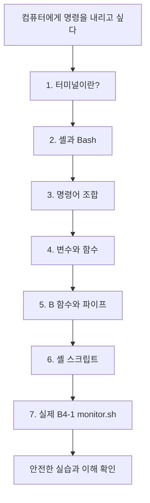
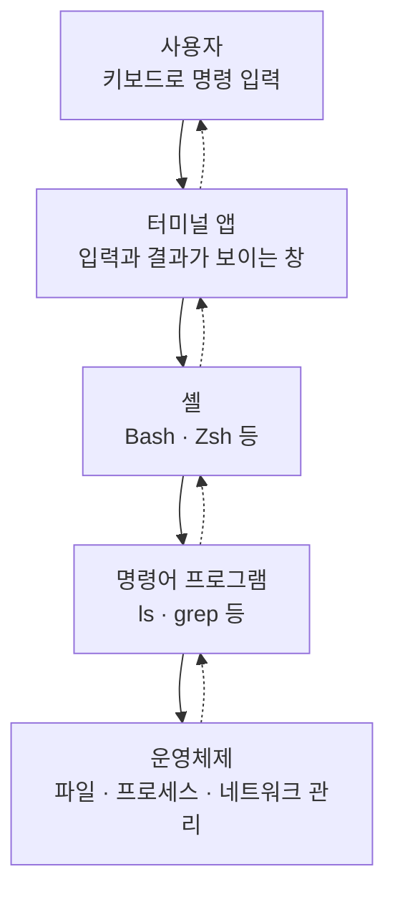
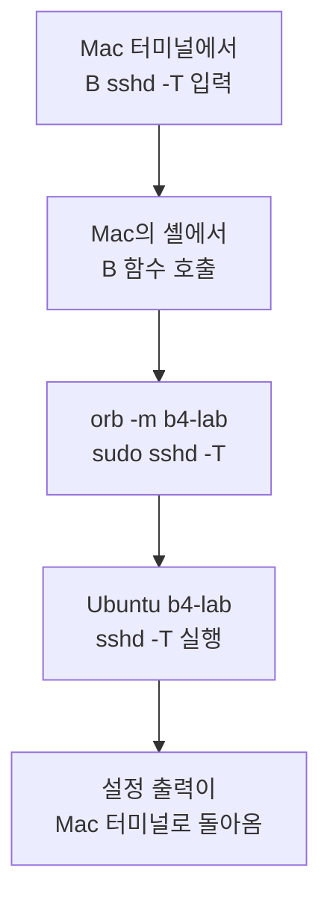
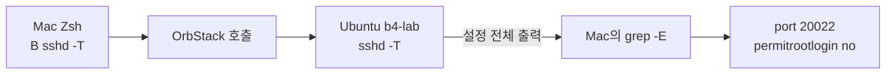
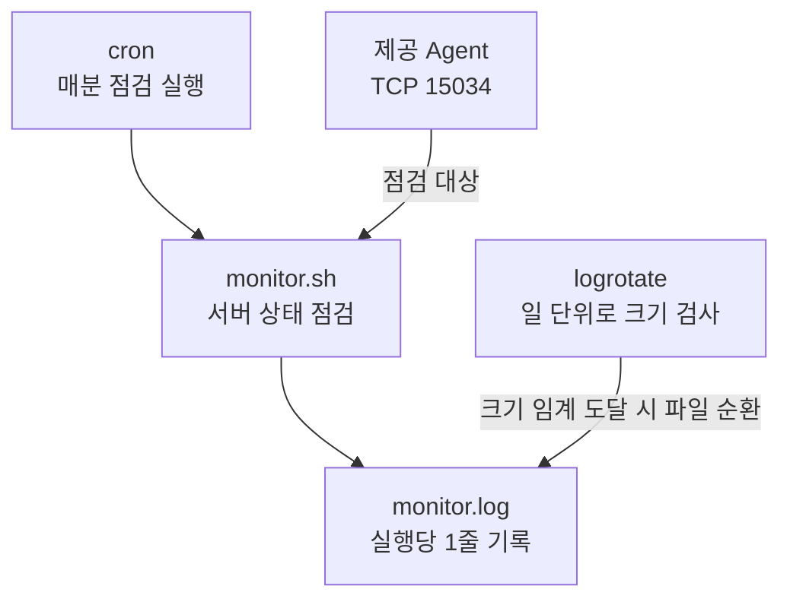

# 0강. 터미널과 셸, Bash — 컴퓨터와 대화하는 방법

> **학습 분야:** Linux 시스템 운영과 셸 자동화  
> **연결 미션:** Codyssey B4-1 — 컴퓨터가 알아서 자기 상태를 점검하게 만들기  
> **원고 상태:** 학습 초안 v0.2 — 질문·실습에 따라 계속 확장  
> **선행 지식:** 파일과 폴더, 프로그램을 실행한다는 개념 정도면 충분  
> **학습 원칙:** 현재 설명의 순서·비유·질문·구조도를 보존하며, 학습 중 발견한 질문을 추가한다. 임의로 요약하지 않는다.

## 0. 이번 강의에서 해결할 질문

이 강의는 B4-1을 진행하면서 실제로 생긴 질문에서 출발한다.

1. 터미널과 셸은 같은 것일까?
2. Bash는 셸의 한 종류라는데, 다른 셸과 무엇이 다를까?
3. 셸에서도 Python처럼 함수를 만들 수 있을까?
4. `B()`라는 함수는 왜 만들었고, 언제까지 사용할 수 있을까?
5. `|` 기호는 무엇이며, 명령을 어떻게 연결할까?
6. 명령어를 실행하는 것과 셸 프로그래밍은 어떻게 다를까?
7. 이번 B4-1에서 셸 프로그래밍은 어떤 역할을 할까?
8. 과제에서 제공한 Agent와 우리가 작성한 `monitor.sh`는 어떻게 다를까?

**오늘의 목표는 명령어를 외우는 것이 아니다.** 명령어가 **어디에서 실행되는지**, **누가 해석하는지**, **전체적으로 무슨 일을 시키는지** 설명하는 것이다.

### 전체 학습 지도



---

## 1. 컴퓨터와 대화하는 두 가지 방법

평소 우리는 마우스로 폴더를 두 번 클릭하거나 휴지통에 파일을 넣는다. 같은 일을 글자로 명령할 수도 있다.

```bash
pwd
```

- **구성 요소:** `pwd`는 *print working directory*의 줄임말로, 현재 작업 폴더를 보여주는 명령어다.
- **전체 해석:** “내가 지금 어느 폴더에서 작업하고 있는지 경로를 출력해라.”
- **실행 결과:** 사용 중인 환경에 따라 `/Users/...` 또는 `/home/...`처럼 표시된다. **특정 경로를 외우는 것이 목적은 아니다.**

```bash
ls
```

- **구성 요소:** `ls`는 현재 폴더에 있는 파일·폴더의 이름을 나열한다.
- **전체 해석:** “지금 폴더에 무엇이 들어 있는지 목록을 보여줘.”

이러한 작업을 할 때 사용하는 것이 **터미널**과 **셸**이다.

### 1-1. 터미널은 무엇일까?

터미널(Terminal)은 명령을 입력하고 결과를 확인하는 화면이다. macOS의 **터미널 앱**이나 Windows의 **Windows Terminal**을 떠올리면 된다. 하지만 터미널 화면 자체가 모든 명령어의 의미를 해석하는 것은 아니다.

### 1-2. 셸은 무엇일까?

셸(Shell)은 사용자가 입력한 명령을 해석하고 알맞은 프로그램을 실행하며 결과를 연결하는 소프트웨어다. 예를 들어 사용자가 `ls`를 입력하면 셸이 해당 프로그램을 찾아 실행한다. 프로그램은 운영체제가 제공하는 기능을 이용해 작업하고, 그 결과는 다시 화면에 보인다.

**셸이 모든 일을 직접 수행한다는 뜻은 아니다.** 셸은 명령 실행을 조정하고 실제 작업은 명령어 프로그램과 운영체제 기능이 담당한다.

### 1-3. 터미널과 셸은 어떻게 연결될까?



일상생활에 비유하자.

- **터미널:** 주문을 전달하고 결과를 확인하는 창구
- **셸:** 주문을 이해하고 적절한 담당 프로그램을 실행하는 직원
- **명령어 프로그램:** 요청된 작업을 수행하는 사람
- **운영체제:** 작업에 필요한 공간·도구·자원을 관리하는 시설

**핵심 문장:** 터미널은 *명령을 입력하고 보는 창*, 셸은 *명령을 해석하고 실행을 조정하는 프로그램*이다.

---

## 2. Bash는 셸의 한 종류다

컴퓨터에서 사용할 수 있는 셸은 여러 종류다.

| 셸 | 특징 | 이번 미션에서의 연결 |
|---|---|---|
| Bash | Linux에서 널리 사용하며 스크립트 작성에 활용 | **`monitor.sh`를 Bash로 작성** |
| Zsh | macOS 기본 로그인 셸. Bash와 공통 문법이 많음 | **Mac 터미널에서 명령 입력** |
| sh | 유닉스 계열의 기본 셸 인터페이스. 구체적 구현은 OS별로 다를 수 있음 | Bash 전용 문법과 차이 이해 |
| Fish | 사용자 편의 기능에 초점. 함수·변수 문법 일부가 다름 | 이번 실습에는 사용하지 않음 |
| PowerShell | Windows에서 널리 사용. 객체 기반 파이프라인이 특징 | Windows 터미널과 비교 가능 |

### 2-1. 셸이 달라도 명령어가 같을까?

Bash와 Zsh에서 다음 명령은 대체로 비슷하게 실행할 수 있다.

```bash
echo "안녕하세요"
```

- **구성 요소:** `echo`는 뒤에 전달된 문자열을 출력한다. `"안녕하세요"`는 출력할 내용이다.
- **전체 해석:** “터미널에 ‘안녕하세요’라고 출력해라.”

하지만 **모든 셸 문법이 똑같은 것은 아니다.** 예를 들어 Fish나 PowerShell에서는 함수 선언 방식이 달라진다. 실제 스크립트가 어느 셸에서 실행되는지 구분해야 한다.

### 2-2. 지금 실행 중인 셸을 확인하기

Mac 터미널에서 다음을 실행한다.

```bash
ps -p $$ -o comm=
```

| 구성 | 뜻 |
|---|---|
| `ps` | 실행 중인 프로세스의 정보를 보여주는 명령 |
| `-p` | 특정 PID(프로세스 식별 번호)를 지정하는 옵션 |
| `$$` | 일반적인 Bash·Zsh 셸에서 현재 셸의 PID |
| `-o comm=` | 실행 명령 이름을 표시하고 열 제목은 생략 |

- **전체 해석:** “지금 명령을 해석하는 셸 프로세스의 이름을 확인해서 출력해라.”
- **기대 결과:** 예를 들어 `zsh` 또는 `bash`. 환경에 따라 표시 형식은 다를 수 있다.

참고로 `echo "$SHELL"`은 계정에 설정된 로그인 셸 경로를 보여줄 수 있어, 현재 실행 중인 셸과 반드시 같지는 않다.

### 2-3. 이번 미션에서는 셸이 어디에서 실행될까?


Mac에서 입력하는 명령과 Ubuntu 안에서 실행하는 명령을 구분하자. **Mac의 셸이 Zsh여도 Ubuntu에서 Bash 스크립트를 실행할 수 있다.**

---

## 3. 명령어 실행과 셸 프로그래밍의 차이

셸을 사용하는 일은 대략 세 단계로 늘어난다.

### 3-1. 명령 하나 실행하기

```bash
pwd
```

**전체 해석:** “현재 작업 폴더를 알려줘.”

### 3-2. 명령 여러 개를 연결하기

```bash
ls | grep -F '.md'
```

| 구성 | 뜻 |
|---|---|
| `ls` | 목록 출력 |
| `|` | 앞 명령의 표준 출력(stdout)을 다음 명령의 표준 입력(stdin)으로 연결 |
| `grep` | 입력에서 특정 문자나 패턴이 있는 줄 검색 |
| `-F` | 정규표현식이 아니라 글자 그대로 찾음 |
| `'.md'` | 찾을 문자열 |

- **전체 해석:** “현재 폴더의 이름 목록을 가져와서, 그중 `.md`라는 문자가 포함된 줄만 보여줘.”
- **주의:** 이 예시는 입문자를 위한 간단한 예다. 파일명에 줄바꿈 등이 있는 특수한 경우에는 `ls`의 결과를 프로그램에서 처리하는 방식이 적절하지 않을 수 있다.

### 3-3. 명령들을 하나의 프로그램으로 저장하기

여러 명령·조건·반복을 `.sh` 파일에 작성하면 사람이 매번 직접 입력하지 않고도 같은 작업을 실행할 수 있다. 이것이 **셸 스크립트**다.

| 구분 | 예 | 역할 |
|---|---|---|
| 단일 명령 | `pwd` | 한 가지 정보 확인 |
| 명령 조합 | `ls \| grep -F '.md'` | 필요한 정보 추출 |
| 셸 스크립트 | `monitor.sh` | 여러 점검을 자동 수행 |

**핵심 문장:** 셸을 *사용하는 것*과, 셸의 변수·함수·조건문으로 *프로그램을 만드는 것*은 연결되지만 같은 개념은 아니다.

---

## 4. 셸에서도 함수를 만들 수 있을까?

Python에서 쓰는 함수와 비교해 보자.

```python
def greet(name):
    print("안녕하세요", name)

greet("학생")
```

셸에서는 이렇게 작성한다.

```bash
greet() {
    echo "안녕하세요 $1"
}

greet "학생"
```

| 구성 | 뜻 |
|---|---|
| `greet` | 함수 이름 |
| `()` | 셸 함수 선언 문법 |
| `{ ... }` | 함수가 실행할 명령 묶음 |
| `echo` | 문자열을 출력하는 명령 |
| `$1` | 함수가 받은 첫 번째 인수(여기서는 `학생`) |
| `greet "학생"` | 함수를 호출하면서 첫 번째 인수를 전달 |

- **전체 해석(함수 정의):** “`greet`이라는 함수를 만들어라. 호출되면 첫 번째 인수 앞에 ‘안녕하세요’를 붙여 출력해라.”
- **전체 해석(함수 호출):** “`greet` 함수에게 ‘학생’을 전달해서 인사말을 출력해라.”
- **결과:** `안녕하세요 학생`

**함수를 쓰는 이유:** 여러 번 쓸 작업에 이름을 붙여 재사용하기 위해서다.

---

## 5. B4-1에서 실제로 사용한 `B()` 함수

우리가 실습에서 사용한 함수는 다음과 같다.

```bash
B() { orb -m b4-lab sudo "$@"; }
```

| 구성 | 뜻 |
|---|---|
| `B` | 원하는 함수 이름. 특별한 예약어가 아님 |
| `()` | 함수 선언 |
| `{ ... }` | 실행할 명령 |
| `orb` | OrbStack 명령어 |
| `-m b4-lab` | `b4-lab`이라는 Linux Machine 지정 |
| `sudo` | **Ubuntu Machine 내부에서** 관리자 권한으로 명령 실행 |
| `"$@"` | `B` 뒤에 준 인수들을 각각의 구분을 유지하며 전달 |

**전체 해석(중요):**

> “앞으로 `B`라는 이름으로 명령을 입력하면, 뒤에 전달한 명령어와 인수들을 OrbStack의 **`b4-lab` Linux 머신 안에서** 관리자 권한으로 실행하도록 함수를 정의해라.”

### 5-1. 실제 사용법

```bash
orb -m b4-lab sudo sshd -T
```

이 긴 명령을 다음처럼 줄인다.

```bash
B sshd -T
```

- **함수를 부르면:** 셸이 `B`를 실행하고 `sshd`, `-T`를 `"$@"` 자리에 전달한다.
- **전체 해석:** “OrbStack에 있는 **`b4-lab` 머신 안에서** 관리자 권한(`sudo`)으로 **SSH 서버(`sshd`)의 현재 유효한 설정값을 점검하고 출력(`-T`)해라**.”
- **세부 정확성:** `sshd -T`는 기본 평가 문맥에서 적용되는 설정을 출력한다. 특정 접속자의 `Match` 조건까지 구체적으로 시험하려면 별도 옵션이 필요할 수 있다. 여기서는 B4-1의 포트와 Root 로그인 설정 확인이 목적이다.



### 5-2. `"$@"`와 인수란?

`B sshd -T`를 호출하면 함수는 두 인수 `sshd`와 `-T`를 받는다. `$1`은 첫 인수, `$2`는 두 번째 인수다. `"$@"`는 받은 **모든 인수를 원래의 구분 그대로** 전달한다. 큰따옴표 덕분에 인수에 공백이 있더라도 그 인수의 경계가 유지된다.

**전체 해석:** “함수에 전달된 인수들을 하나도 빼지 말고, 각각 하나의 인수로 유지한 채 다음 명령에 넘겨라.”

### 5-3. `sudo`가 위험하지는 않을까?

`B` 함수는 `sudo`를 포함한다. 따라서 *조회*가 아닌 설정 변경 명령까지 무심코 넣으면 Ubuntu의 설정이 바뀔 수 있다. **학습 단계에서는 제공된 읽기 전용 명령만 실행한다.** 교육장 Mac 자체에서 `sudo`를 쓰는 것이 아니라 OrbStack 안의 Linux에서 실행하는 것이다.

---

## 6. 함수는 언제까지 사용할 수 있을까?

셸 함수를 한 번 선언하면 일반적으로 **그 셸 세션이 끝날 때까지** 사용할 수 있다.

| 상황 | `B()` 사용 여부 |
|---|---|
| 선언한 같은 터미널 셸 | 사용 가능 |
| 새 터미널 창·탭에서 시작한 다른 셸 | 일반적으로 다시 선언 필요 |
| 기존 셸 종료 후 새로 실행 | 다시 선언 필요 |
| 시작 설정 파일(`~/.zshrc` 등)에 정의 | 새 셸에서도 자동 정의 가능 |

```bash
type B
```

- **구성 요소:** `type`은 셸이 이름을 어떻게 해석하는지 보여준다. `B`는 확인할 이름이다.
- **전체 해석:** “현재 셸에서 `B`가 함수인지, 명령인지, 또는 정의되어 있지 않은지 알려줘.”

새 터미널에서 실행하면 함수가 없다고 나올 수 있다. 그 상태에서 `B()`를 다시 선언한 후 `type B`를 실행해 보자.

**함수는 컴퓨터에 영구 설치된 프로그램과 다르다.** 지금은 이해를 위해 매번 직접 선언하고, 익숙해지면 설정 파일에 등록하는 방식을 배울 수 있다. 함수가 하위 셸에 자동으로 공유되는 것도 일반적으로 보장되지 않는다.

---

## 7. 파이프 `|`와 검색 명령 `grep`

이번에는 실제 B4-1 확인 명령 전체를 해석한다.

```bash
B sshd -T | grep -E '^(port|permitrootlogin) '
```

### 7-1. `B sshd -T`

Ubuntu에서 SSH 서버의 설정을 출력한다. 이 단계만 실행하면 많은 설정이 나온다.

### 7-2. 파이프 `|`

앞 명령의 **표준 출력(stdout)**을 뒤 명령의 **표준 입력(stdin)**으로 전달한다. 프로그램들이 서로 결과를 주고받게 해주는 연결 통로라고 생각하면 된다.

### 7-3. `grep -E '^(port|permitrootlogin) '`

| 구성 | 뜻 |
|---|---|
| `grep` | 입력에서 조건에 맞는 줄을 찾음 |
| `-E` | 확장 정규표현식 사용 |
| `^` | 줄의 시작 |
| `(port\|permitrootlogin)` | `port` 또는 `permitrootlogin` |
| 끝의 공백 | 단어 다음에 공백이 나오는 설정 행만 선택 |

- **부분 해석:** “입력받은 여러 줄 가운데 `port ` 또는 `permitrootlogin `으로 시작하는 줄만 출력해라.”
- **전체 해석:**

> “OrbStack의 **`b4-lab` Ubuntu 서버**에서 SSH 서버의 현재 유효한 설정을 조회한 다음, 그 결과를 **Mac으로 가져와 `grep`으로 검색**해서 **SSH 포트와 Root 원격 로그인 허용 여부에 해당하는 줄만 출력해라**.”

실제 B4-1 검증 결과:

```text
port 20022
permitrootlogin no
```

이는 SSH 관리 포트가 20022로 설정되어 있고, Root 계정의 원격 SSH 로그인이 금지됐다는 뜻이다. *포트를 바꿨다는 사실만으로 보안이 완성되는 것은 아니고*, 뒤에서 UFW 정책과 함께 이해해야 한다.

### 7-4. 명령은 어디서 실행될까?



중요: `sshd -T`는 **Ubuntu에서**, 파이프 오른쪽의 `grep`은 **Mac에서** 실행된다. `grep`은 `B`의 인수가 아니라 Mac의 셸이 구성한 파이프라인의 두 번째 명령이다.

---

## 8. 셸 스크립트는 일반 프로그램과 무엇이 다를까?

사람이 직접 명령을 입력하는 대신, 명령을 파일에 적어 자동 실행할 수 있다. 이 파일을 셸 스크립트라고 한다.

```bash
#!/usr/bin/env bash

echo "점검을 시작합니다."

if [ -f /etc/os-release ]; then
    echo "운영체제 정보 파일이 있습니다."
else
    echo "파일을 찾지 못했습니다."
fi
```

> 위 예시는 **Linux에서** 살펴볼 학습용 스크립트이며 B4-1의 실제 `monitor.sh`와 동일한 파일은 아니다.

### 8-1. 첫 줄 `#!/usr/bin/env bash`

이 줄은 **셔뱅(shebang)**이며 직접 실행할 때 어떤 인터프리터로 파일을 해석할지 지정한다. 실제 B4-1 `monitor.sh`는 `#!/bin/bash`를 사용한다.

- **전체 해석:** “이 파일을 직접 실행할 때 Bash 인터프리터로 읽고 실행해라.”

### 8-2. `if ... then ... else ... fi`

조건문은 결과에 따라 서로 다른 작업을 선택한다.

- `-f /etc/os-release`: 그 경로에 일반 파일이 있으면 참
- **전체 해석:** “운영체제 정보 파일이 있으면 있다는 메시지를 출력하고, 없으면 찾지 못했다는 메시지를 출력해라.”

### 8-3. 스크립트를 어떻게 실행할까?

```bash
bash example.sh
```

- **구성 요소:** `bash`는 Bash 인터프리터, `example.sh`는 실행할 스크립트 파일이다.
- **전체 해석:** “Bash로 `example.sh` 파일을 읽어서 안에 적힌 명령을 순서대로 실행해라.”

```bash
./example.sh
```

- **구성 요소:** `./`는 현재 폴더 안의 파일, `example.sh`는 실행할 파일이다.
- **전체 해석:** “현재 폴더의 `example.sh`를 직접 실행해라.”
- **차이:** 직접 실행은 실행 권한이 필요하며 셔뱅이 있으면 어떤 인터프리터를 쓸지 결정하는 데 이용된다. `bash example.sh`는 명시적으로 Bash를 사용한다.

Linux 파일의 실행 권한은 **3강 사용자·그룹·권한**에서 배운다.

---

## 9. 이번 B4-1 미션에서 Bash는 어떤 역할을 할까?

이번 미션은 Linux 서버가 자기 상태를 자동으로 점검할 수 있도록 운영 환경을 만드는 과제다. 먼저 **두 프로그램을 구분**해야 한다.

### 9-1. Agent — 과제에서 제공한 실행 대상

과제에서 제공한 Agent ZIP 안의 Linux 실행 파일을 Ubuntu에서 사용했다. 실제로 사용한 파일은 `/opt/agent-app/bin/agent-app-linux-x86`이다. 우리가 받은 파일은 소스코드를 직접 수정해 만드는 과제가 아니라 **제공된 프로그램이 요구하는 환경에서 실행되도록 준비하는 대상**이다.

Agent는 시작할 때 다음을 확인한다.

1. 자신이 실행되는 사용자 계정
2. 필수 환경변수
3. 필요한 파일
4. 통신 포트 사용 가능 여부
5. 로그 폴더 쓰기 권한

각 단계가 통과하면 `Agent READY` 메시지가 출력된다. 이번 미션에서는 **Boot Sequence 5/5 OK**, **TCP 15034 LISTEN**이 실제 확인됐다.

여기서 *Agent*는 Claude Code 같은 **코딩 AI 에이전트**가 아니라, 과제에서 제공한 **서버 실습 프로그램**을 뜻한다.

### 9-2. `monitor.sh` — 이번 미션에서 작성한 점검 프로그램

실제 소스: [`bin/monitor.sh`](../../bin/monitor.sh)

스크립트는 다음 일을 한다.

1. 환경변수 파일 `/etc/default/agent-app`을 읽음
2. Agent 프로세스를 찾음
3. Agent가 TCP 15034 포트에서 요청을 받을 준비가 되었는지 확인
4. UFW 방화벽 상태를 확인
5. CPU·메모리·디스크 사용률을 측정
6. 임계값 초과 시 경고를 표시
7. `/var/log/agent-app/monitor.log`에 측정 결과 **1줄** 기록
8. 점검 결과에 맞는 종료 코드를 반환

이는 `B()`처럼 명령 하나를 줄이는 편의용 함수와 다르다. **`monitor.sh`가 실제 이번 미션의 핵심 제출 프로그램**이다.

### 9-3. 종료 코드란 무엇인가?

프로그램이 끝날 때 상태를 숫자로 알릴 수 있다.

| 종료 코드 | B4-1 `monitor.sh`에서의 의미 |
|---|---|
| `0` | Agent 프로세스와 포트가 정상으로 확인됨(경고가 있어도 정상일 수 있음) |
| `1` | Agent 프로세스·포트 건강검진 실패 또는 정상 확인 불가 |
| `2` | 설정이나 모니터링 처리 자체에 오류 발생(다른 실패 상태에 따라 우선순위 처리) |

**주의:** 방화벽 비활성 또는 CPU 사용률 초과는 경고를 표시하지만, *그것만으로* 반드시 `exit 1`이 되는 것은 아니다. 이번 `monitor.sh`가 무엇을 *건강 상태의 핵심 조건*으로 삼았는지 이해해야 한다.

### 9-4. 자동 실행과 기록은 누가 담당할까?



- `cron`: “매분 `monitor.sh`를 실행해라.”
- `monitor.sh`: “Agent와 서버의 상태를 검사하고 측정 결과를 기록해라.”
- `logrotate`: “기록 파일이 지정한 크기에 도달했는지 정기적으로 확인하고, 필요하면 이전 기록을 순환 관리해라.”

B4-1에서는 `logrotate` 설정을 `size 9M`, `rotate 9`로 구성했다. 현재 로그가 임계값 미만이면 실제 파일이 순환되지 않는 것이 정상이다. 이 세부 내용은 7강에서 다룬다.

---

## 10. 지금은 무엇을 알아야 하고, 무엇은 나중에 배울까?

| 지금 반드시 이해할 개념 | 설명 |
|---|---|
| 터미널 | 명령을 입력하고 결과를 보는 창 |
| 셸 | 명령을 해석하고 실행을 연결하는 프로그램 |
| Bash | 셸의 한 종류, 스크립트 작성에도 사용 |
| 명령어 | 프로그램을 실행하거나 작업 지시 |
| 인수 | 명령이나 함수에 전달하는 값 |
| 함수 | 여러 명령에 이름을 붙여 재사용하는 것 |
| 파이프 `\|` | 앞 명령의 출력 → 뒤 명령의 입력 |
| 셸 스크립트 | 여러 명령·조건을 파일에 작성한 프로그램 |
| 종료 코드 | 프로그램 실행 후 상태를 표시하는 숫자 |
| Agent | 과제에서 제공한 실행 대상 |
| `monitor.sh` | 우리가 작성한 Bash 점검 프로그램 |

정규표현식, 숫자로 나타내는 파일 권한, CPU 계산 방식, cron 문법 등은 뒤 강의에서 자세히 배운다. 지금은 **전체 연결 관계**를 이해하면 된다.

---

## 11. 안전한 첫 실습

**환경:** 교육장 Mac 터미널. 이 강의에서는 서버 설정 변경이나 Agent 실행·종료를 하지 않는다.

### 실습 A. 지금 사용하는 셸 확인

```bash
ps -p $$ -o comm=
```

- **전체 해석:** “지금 터미널에서 명령을 해석하고 있는 셸 프로세스 이름을 출력해라.”
- 확인할 것: `zsh`인지 `bash`인지?

### 실습 B. `B()` 함수 선언과 확인

```bash
B() { orb -m b4-lab sudo "$@"; }
type B
```

- **전체 해석(첫 줄):** “앞으로 `B`로 부르는 명령은 Ubuntu `b4-lab` 안에서 관리자 권한으로 실행하도록 함수를 정의해라.”
- **전체 해석(둘째 줄):** “현재 셸이 `B`를 함수로 인식하는지 확인해서 알려줘.”

### 실습 C. SSH 설정 전체와 필요한 줄만 확인

```bash
B sshd -T
```

- **전체 해석:** “Ubuntu `b4-lab`에서 SSH 서버의 유효한 설정값을 모두 출력해라.”

```bash
B sshd -T | grep -E '^(port|permitrootlogin) '
```

- **전체 해석:** “Ubuntu에서 SSH 설정을 가져온 뒤, Mac에서 포트와 Root 로그인 허용 여부만 골라 출력해라.”
- **실제 검증에서 확인한 결과:**

```text
port 20022
permitrootlogin no
```

### 실습 D. 새 터미널에서 함수 사용 가능 여부 확인

1. 새 터미널 창이나 탭을 열고 `type B`를 실행한다.
2. 함수가 없다는 메시지가 나오는지 본다.
3. 다시 `B() { orb -m b4-lab sudo "$@"; }`를 선언한다.
4. `type B`를 실행해 변화를 비교한다.

**실습 안전 원칙**

- SSH·UFW 설정을 바꾸지 않는다.
- Mac 호스트에서 직접 `sudo`를 사용하지 않는다.
- 키·암호·비밀 파일 내용을 출력하지 않는다.
- Agent를 임의로 실행하거나 종료하지 않는다.
- 의미를 모르는 명령은 먼저 질문한다.

**이번 0강에서는 제출 화면을 찍을 필요가 없다.** SSH/UFW 증빙 S1·S2는 원리를 배운 **2강에서** 실제 확인하며 촬영한다.

---

## 12. 이해 확인 질문

1. 터미널과 셸의 역할은 어떻게 다를까?
2. Bash와 Zsh는 모두 셸인데, 왜 다른 이름을 사용할까?
3. `B() { orb -m b4-lab sudo "$@"; }`는 무엇을 하는가? 한 문장으로 설명해 보자.
4. `B sshd -T`에서 `sshd -T`는 Mac과 Ubuntu 중 어디서 실행될까?
5. `B sshd -T | grep -E '^(port|permitrootlogin) '`의 `|`는 어떤 역할을 할까?
6. 위 명령에서 `grep`은 어디서 실행될까?
7. 새 터미널을 열면 기존에 선언했던 `B()` 함수를 그대로 쓸 수 있을까?
8. Agent와 `monitor.sh`는 어떤 관계인가?
9. 사람이 직접 명령어를 실행하는 것과 셸 스크립트를 작성하는 것의 차이는 무엇인가?

**정답을 암기하기보다는 자신의 말로 설명해 보자.** 막히는 질문이 나오면 그 자체가 문서를 확장할 이유다.

---

## 13. 다음 강의와 미션 스토리 연결

0강에서 컴퓨터에 명령을 내리는 방법을 배웠다. 이제 다음 질문이 생긴다.

> “우리가 명령을 내리는 **서버**는 무엇이며, 왜 안전하게 운영하고 관리해야 할까?”

**1강**에서 서버 전체 구조를 살펴보고, **2강**부터 SSH·UFW·사용자 권한·Agent·`monitor.sh`를 실제 B4-1 환경과 연결해 배운다. 특히 **5강**에서는 0강의 함수·조건문·외부 명령·종료 코드 지식을 이용해 실제 `monitor.sh`의 흐름을 읽는다.

나중에 미션 스토리를 만들 때는 다음 세 관계가 시각화의 재료가 된다.

1. **사용자 → 터미널 → 셸 → 명령어 프로그램과 운영체제**
2. **함수 호출 → Ubuntu 명령 실행 → Mac에서 파이프/검색 → 화면 출력**
3. **제공 Agent → `monitor.sh` 점검 → `cron` 자동 실행 + `monitor.log` 기록**

미션 스토리 슬라이드는 지금 만들지 않는다. 먼저 입문자가 실제로 궁금해하는 질문과 충분한 설명을 보존하고, 나중에 시각 중심 슬라이드로 선별·재구성한다. **미션 스토리로 줄여도 이 학습 원고는 줄이지 않는다.**

---

## 14. 질문으로 계속 자라는 문서

이 문서는 *짧게 끝내야 하는 강의*가 아니다. 읽다가 이해되지 않는 부분이 생기면 기존 설명을 삭제하거나 임의로 축약하지 않고 다음처럼 반영한다.

1. **질문을 기록한다.** 어떤 문장·명령어에서 막혔는지 남긴다.
2. **원래 흐름을 유지한 채 설명을 보강한다.** 구성 요소 설명뿐 아니라 반드시 **'전체 해석'**을 넣는다.
3. 필요하면 **비유·표·구조도·흐름도**를 추가한다.
4. 내용이 지나치게 길어지면 **심화편으로 분리하되 원래 절과 링크로 연결**한다.
5. GitHub 기록으로 초안과 수정 내역을 남긴다.

### 명령어 설명 표준 — 이번 강의부터 적용

모든 중요한 명령어·명령 조합은 네 단계로 설명한다.

1. **원문:** 정확히 입력하는 명령어
2. **구성 요소:** 명령, 옵션, 인수, 기호의 의미
3. **전체 해석:** “그래서 컴퓨터에게 무엇을 시키는가?”를 **일상 한국어 한 문장**으로
4. **실제 결과와 미션 연결:** 어느 환경에서 실행됐으며, 어떤 출력이 나오고 왜 필요한가

**최종 원칙:** 문서 분량을 줄이는 것보다 **입문자가 납득할 수 있는 설명 순서와 밀도**를 유지하는 것이 우선이다.

---

### 실제 근거 자료

- [B4-1 제출용 요구사항 수행 내역서](../b4-1-final-evidence.md)
- [B4-1 Bash 점검 프로그램 원본](../../bin/monitor.sh)
- [2026-11-14 최종 회귀 확인 출력](../evidence/task22-closeout-regression.txt)

> 이 문서는 입문 학습용 설명 자료다. 공식 미션의 제출 판정은 [요구사항 수행 내역서](../b4-1-final-evidence.md)를 기준으로 판단한다.
