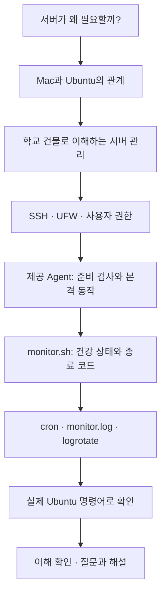
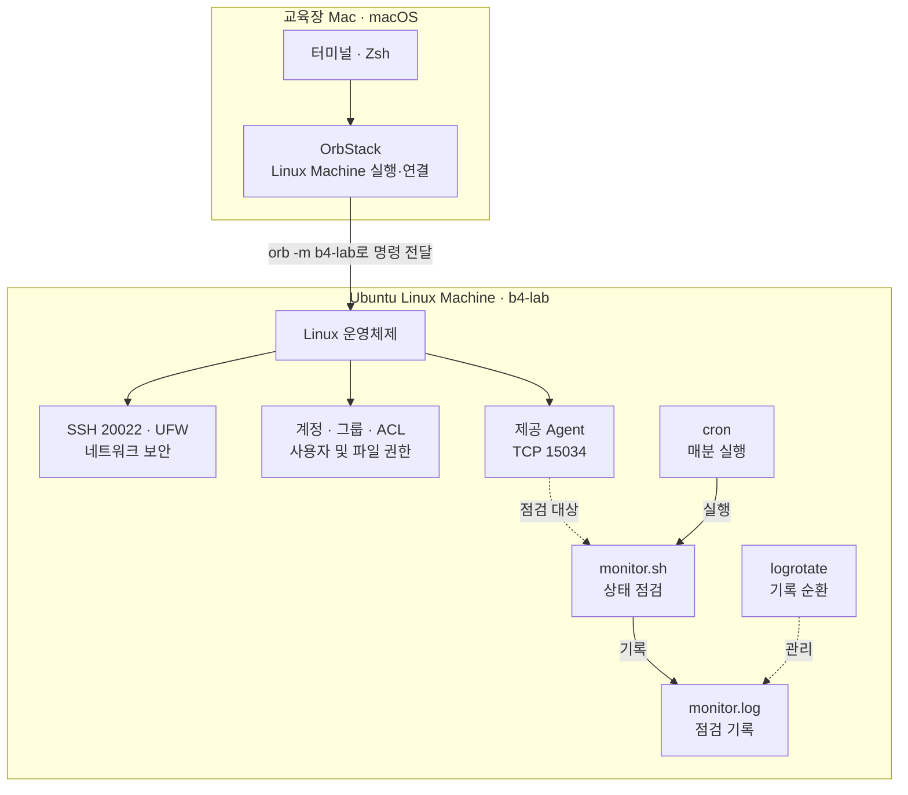
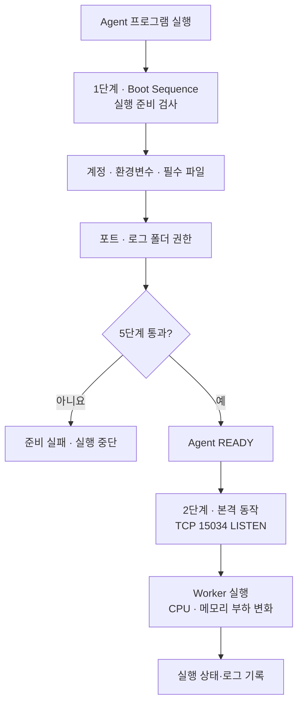
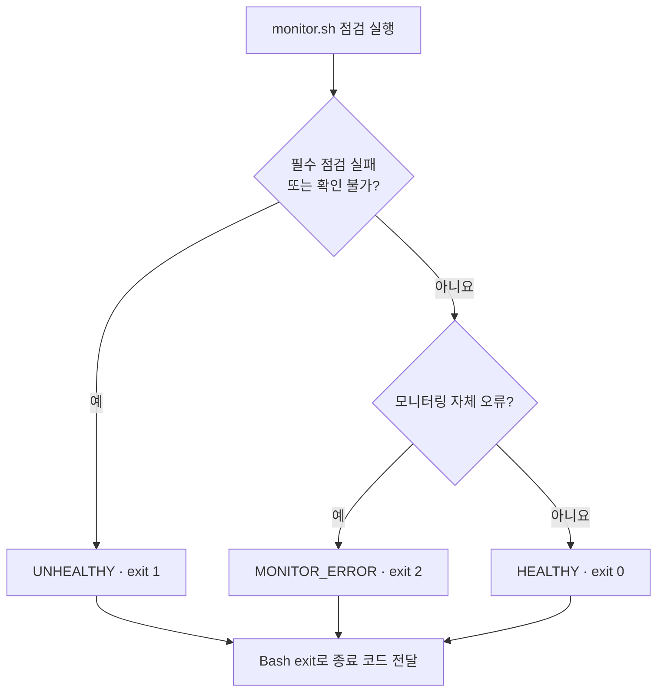
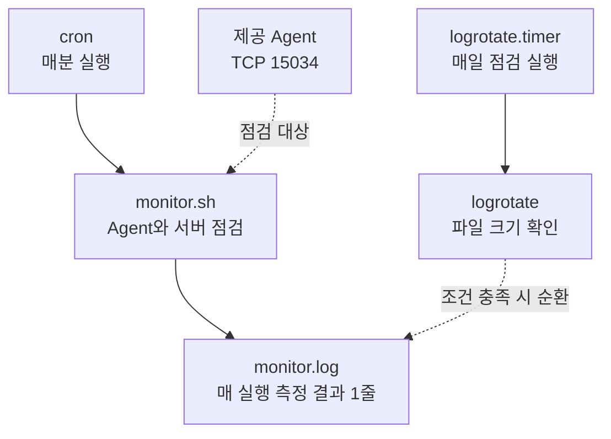

# 1강. 서버에도 경비원과 건강검진이 필요할까?

> **학습 분야:** Linux 시스템 운영과 셸 자동화  
> **연결 미션:** Codyssey B4-1 — 컴퓨터가 알아서 자기 상태를 점검하게 만들기  
> **문서 상태:** 학습 원고 v0.2 — 1강 v0.1과 후속 질문·해설을 통합한 검토본  
> **선행 학습:** [0강. 터미널과 셸, Bash](00-shell-terminal-bash.md)  
> **학습 원칙:** 이전 설명의 구조·순서·비유를 보존하고, 질문이 생긴 부분은 축약하지 않고 확장한다. 중요한 명령은 **원문 → 구성 요소 → 전체 한국어 해석 → 실제 결과**로 설명한다.

---

## 0. 이번 강의에서 해결할 질문

1. 서버는 일반 컴퓨터와 무엇이 다를까?
2. 서버는 왜 보안과 관리가 필요할까?
3. 이번 미션에서 만든 서버는 어디에 있을까?
4. SSH·UFW·사용자 권한은 각각 무엇을 보호할까?
5. Agent는 무엇이며, **실행 조건과 실제 수행하는 일은 어떻게 다를까?**
6. CPU·메모리·디스크는 왜 확인할까?
7. 서버가 스스로 점검한다는 것은 어떤 의미일까?
8. **`exit 0`과 `exit 1`은 Linux가 정한 값일까, 우리가 정한 값일까?**
9. cron·로그·logrotate는 어떻게 연결될까?
10. **OrbStack이 실행하는 일과 Ubuntu 안에서 실행되는 명령은 어떻게 구분할까?**
11. 이번 미션이 성공했다는 것을 어떻게 알 수 있을까?

**이번 강의의 목표는 B4-1 전체 구조를 머릿속에 그릴 수 있게 되는 것이다.** 각 프로그램의 세부 동작은 뒤 강의에서 배우지만, 지금 실제로 궁금해진 부분(Agent의 본격 동작, 종료 코드, 명령 실행 위치)은 충분히 설명한다.

### 전체 학습 지도



---

## 1. 서버는 무엇일까?

### 1-1. 일반 컴퓨터와 서버

우리가 집에서 사용하는 컴퓨터는 게임을 하거나 문서를 작성하는 데 사용한다. 그런데 다른 사람의 요청을 받아 정보를 보내거나 특정 서비스를 제공하는 컴퓨터도 있다.

예를 들어 홈페이지에 접속하면 그 홈페이지에 필요한 정보를 보내주는 컴퓨터가 있다. 이런 역할을 수행하는 컴퓨터 또는 프로그램을 **서버**라고 부른다.

| 일반적인 개인 컴퓨터 | 서버 |
|---|---|
| 주로 사용자가 직접 작업한다 | 다른 프로그램·사용자의 요청을 처리한다 |
| 게임·문서·인터넷 등 다양한 용도로 사용 | 웹·데이터·파일 등 특정 서비스를 제공한다 |
| 사용자가 직접 상태를 확인하기 쉽다 | 원격 관리와 자동 점검이 중요하다 |
| 사용자가 컴퓨터 앞에 있을 수 있다 | 관리자가 항상 앞에 있지는 않다 |

**서버가 반드시 특별한 모양의 컴퓨터여야 하는 것은 아니다.** 일반 컴퓨터도 서버 프로그램을 실행하여 서비스를 제공할 수 있다. 우리가 B4-1에서 사용한 서버도 별도로 구입한 물리적 컴퓨터가 아니다. 교육장 Mac 안에 만든 **Ubuntu Linux Machine**이다.

### 1-2. 왜 Linux를 사용할까?

Linux는 운영체제의 한 종류다. 운영체제는 CPU·메모리·디스크·파일·프로그램 실행 등을 관리한다. Windows나 macOS도 운영체제다.

Linux는 서버 환경에서 널리 사용되며, 명령어와 스크립트를 통해 많은 관리 작업을 자동화할 수 있다. 이번 미션에서는 **Ubuntu**라는 Linux 배포판을 사용했다.

### 1-3. 서버는 항상 실행 중이어야 할까?

서버의 목적에 따라 다르다. 많은 실제 서비스는 계속 요청을 처리해야 하므로 장시간 실행한다. 반면 B4-1의 Agent는 이번 과제에서 **수동으로 실행하고 검증하는 대상**이다.

Agent를 항상 실행하는 상주 서비스로 구성하지는 않았다. 따라서 지금 Agent가 중지되어 있어도, 이번 과제의 구현이 실패한 것은 아니다. 뒤에서 배울 `monitor.sh`는 Agent가 실제로 중지된 상태를 **비정상으로 감지**하는 것까지 수행한다.

---

## 2. 우리가 만든 서버는 어디에 있을까?

### 2-1. 교육장 Mac과 Ubuntu의 관계

이번 실습에는 운영체제가 두 개 등장한다.

- **macOS:** 교육장 컴퓨터에서 실제 실행되는 운영체제
- **Ubuntu Linux:** OrbStack으로 별도로 실행하는 Linux 환경

교육장 Mac은 **호스트(Host)**이고, 그 안에서 실행되는 Ubuntu 환경은 **Linux Machine**이다. 이번 Linux Machine의 이름은 **`b4-lab`**이다.

### 2-2. 왜 이렇게 구성했을까?

교육장 Mac에서는 macOS 자체의 관리자 권한인 `sudo`를 사용할 수 없고, Mac은 주기적으로 초기화된다.

하지만 B4-1은 사용자·그룹·방화벽·SSH·파일 권한처럼 서버 설정을 변경해야 한다. 그래서 Mac 운영체제를 직접 바꾸는 대신 별도의 Ubuntu 환경을 구성했다. **Ubuntu 안의 관리자 권한은 macOS의 관리자 권한과 별개**다.

학교를 비유로 생각해 보자. 건물 주인에게 건물 전체를 고칠 권한은 없더라도, 학교가 실습용으로 따로 제공한 교실에서는 지정된 장비를 관리할 권한을 받을 수 있다. 마찬가지로 Mac의 `sudo`가 막혀 있어도 별도로 구성된 Ubuntu 안에서 `sudo`를 사용할 수 있다.

**주의:** Ubuntu에서 관리자 권한이 있다고 해서 Mac 운영체제 자체의 관리자 권한을 얻은 것은 아니다.

### 2-3. 꼭 구분해야 할 두 컴퓨터 환경

| 교육장 Mac | Ubuntu `b4-lab` |
|---|---|
| 터미널에서 명령을 입력하는 곳 | B4-1 서버 설정이 실제로 적용된 곳 |
| OrbStack 실행·Machine 관리 | SSH·UFW·사용자·그룹·권한의 관리 대상 |
| macOS에서 `sudo` 제한 | Linux Machine 내부에서 `sudo` 가능 |
| 기본 셸은 보통 Zsh | Bash 스크립트 `monitor.sh` 실행 |

### 2-4. OrbStack 명령과 Ubuntu 명령은 무엇이 다를까?

앞서 그린 그림에서 OrbStack 아래를 **‘서버 환경 관리’**와 **‘Linux 명령 실행’**이라는 두 경로로 나눴는데, 이는 *작업 성격을 구분하려는 표현*이었다. 서로 다른 두 Linux 실행 환경이 있다는 뜻은 아니다. 오해하기 쉬워서 그림을 수정했다.

| 입력 명령 | `orb`가 실행되는 위치 | 실제 조회·작업 위치 |
|---|---|---|
| `orb list` | Mac | OrbStack 관리 대상 목록 조회 |
| `orb -m b4-lab cat /etc/os-release` | Mac | Ubuntu 안에서 `cat` 실행 |
| `orb -m b4-lab sudo ufw status` | Mac | Ubuntu 안에서 `sudo ufw status` 실행 |
| `B sshd -T` | Mac에서 `B` 함수 호출 | Ubuntu 안에서 `sudo sshd -T` 실행 |

**핵심:** `orb`는 Mac에서 실행되는 OrbStack 명령어다. `orb -m b4-lab` 뒤에 지정한 Linux 명령은 **같은 `b4-lab` Ubuntu Machine 안**에서 실행된다. OrbStack이 SSH나 UFW 프로그램을 대신 실행하는 별도의 서버는 아니다.

### 시각자료 ① — OrbStack과 Ubuntu의 역할을 정확히 구분한 구조도



이 그림의 화살표는 **관리 관계와 동작 관계를 요약**한 것이야. 예를 들어 Linux 운영체제에서 Agent로 향하는 화살표가 Agent의 네트워크 패킷 흐름을 뜻하는 것은 아니다.

---

## 3. 서버를 학교 건물에 비유해 보자

서버는 프로그램을 켜 두는 것만으로 안전하게 운영되지 않는다. 24시간 운영하는 학교 건물을 떠올려 보자.

학교에는 교직원과 학생이 있고 출입문과 출입 규칙이 있다. 컴퓨터실처럼 특정 사람만 들어갈 수 있는 공간도 있다. 시설 상태를 살피는 관리자도 필요하다.

| 학교에서 필요한 것 | 서버에서 대응하는 기술 |
|---|---|
| 관리자가 들어오는 출입문 | SSH |
| 허가된 출입문만 사용하도록 통제 | UFW 방화벽 |
| 교직원과 학생 구분 | 사용자 계정·그룹 |
| 특정 공간의 출입 허가 | 파일 권한·ACL |
| 업무 담당 직원 | 제공 Agent 프로그램 |
| 시설을 점검하는 관리 담당자 | `monitor.sh` |
| 정해진 시간에 순찰 지시 | cron |
| 순찰 결과를 기록하는 일지 | `monitor.log` |
| 오래된 일지를 정리하는 규칙 | logrotate |

**각 기술의 역할은 서로 다르다.** 출입문이 있다고 모든 사람이 들어와도 되는 것이 아니고, 방화벽을 통과했다고 해서 건물 내부 모든 서류를 읽을 수 있는 것도 아니다. 그래서 네트워크 접근 통제와 파일 접근 권한을 따로 설정한다.

---

## 4. 서버를 안전하게 만드는 세 가지 장치

### 4-1. SSH — 관리자가 들어오는 통로

SSH는 네트워크를 통해 다른 컴퓨터에 안전하게 접속하고 명령을 실행할 때 사용하는 기술이다.

B4-1에서는 SSH 접속에 **TCP 20022번 포트**를 사용하고 최고 관리자 계정인 **Root의 원격 로그인**을 차단했다.

학교의 관리용 출입구를 정하고 최고 권한 계정으로 직접 들어오는 것을 제한한 셈이다. 그러나 **포트 번호만 변경했다고 보안이 완성되는 것은 아니다.**

### 4-2. UFW — 출입 통제 장치

UFW는 Linux에서 방화벽 규칙을 관리하는 도구다. 방화벽은 어떤 네트워크 통신을 허용하거나 차단할지 결정한다.

B4-1은 기본적으로 들어오는 연결을 차단하고 다음 TCP 포트를 허용했다.

| 포트 | 용도 |
|---|---|
| **20022** | SSH 관리 접속 |
| **15034** | Agent 프로그램 통신 |

학교 건물에 여러 출입구가 있어도 허가된 통로만 사용할 수 있게 하는 것과 비슷하다.

### 4-3. 사용자·그룹·권한 — 들어온 사람도 모두 같은 일을 할 수는 없다

서버 내부에는 여러 사용자 계정이 있다. 이번 미션에서 만든 계정은 `agent-admin`, `agent-dev`, `agent-test` 세 개다.

모든 계정이 같은 폴더를 사용할 수 있는 것은 아니다. 예를 들어 `agent-test`는 업로드 폴더를 읽고 쓸 수 있지만 **비밀키와 로그 폴더에는 접근할 수 없도록** 했다.

이것은 학교에 출입할 수 있는 학생도 교무실의 중요한 서류함을 마음대로 열 수 없는 상황과 같다.

**기억할 점:** SSH와 UFW는 *네트워크 접근*을, 계정·그룹·파일 권한은 *서버 내부에서 할 수 있는 일*을 통제한다.

---

## 5. 이번 과제에서 제공한 Agent는 무엇일까?

### 5-1. Agent는 우리가 만든 프로그램일까?

아니다. **Agent는 과제에서 제공한 실행 프로그램**이다. 우리가 한 일은 제공된 프로그램이 요구하는 Linux 환경을 준비하고, 별도로 그 상태를 점검하는 프로그램을 만든 것이다.

실제로 실행한 파일은 다음 경로에 있다.

```text
/opt/agent-app/bin/agent-app-linux-x86
```

`bin`은 실행 프로그램을 두는 데 흔히 쓰는 폴더 이름이고, `agent-app-linux-x86`은 이번 Ubuntu x86-64 환경에서 사용한 실행 파일 이름이다. 여기서의 Agent는 **Claude Code 같은 코딩 AI 에이전트가 아니라 서버 실습용 프로그램**을 뜻한다.

### 5-2. Agent가 실행되기 전에 확인하는 다섯 가지 조건

**여기서 꼭 구분하자. Boot Sequence 5단계는 Agent가 본격적으로 하는 일 다섯 가지가 아니다.** Agent가 *본격적으로 동작하기 전에* 필요한 준비가 끝났는지 확인하는 사전 점검이다.

| 사전 검사 | 실제 확인 내용 | 학교 비유 |
|---|---|---|
| ① 사용자 계정 | `agent-admin`으로 실행되는가? | 담당 직원이 맞는가? |
| ② 환경변수 | 필요한 폴더·포트의 설정이 있는가? | 업무 안내서를 받았는가? |
| ③ 필수 파일 | `secret.key`가 존재하고 올바른가? | 필요한 인증 자료가 있는가? |
| ④ 포트 사용 가능 여부 | TCP 15034를 사용할 수 있는가? | 사용할 출입구가 비어 있는가? |
| ⑤ 로그 폴더 쓰기 권한 | `/var/log/agent-app`에 기록할 수 있는가? | 업무 일지를 쓸 수 있는가? |

이 다섯 단계가 통과하면 실제 B4-1에서는 다음과 같은 메시지가 출력됐다.

```text
All Boot Checks Passed!
Agent READY
```

**전체 해석:** “이 프로그램이 본격적으로 실행되기 위한 조건을 모두 통과했고 준비가 완료되었다.”

`READY`는 준비 완료를 의미하지, 이후 문제가 전혀 없으리라는 보장은 아니다. 그래서 별도의 `monitor.sh`가 필요하다.

> **실제 미션에서 발견한 예외:** 과제의 일부 설명에는 `AGENT_KEY_PATH`를 특정 파일(`t_secret.key`)의 경로로 적었지만, 실제 제공 Agent는 **디렉터리 경로 `/opt/agent-app/api_keys`**와 그 안의 **`secret.key` 파일**을 요구했다. 실패·성공 실험을 통해 제공 프로그램의 실제 요구에 맞춰 설정했다. 자세한 근거는 [공식 수행 내역서 §3](../b4-1-final-evidence.md)를 참고하자. 비밀키 내용을 터미널에 출력하는 실습은 하지 않는다.

### 5-3. 준비가 끝난 Agent는 실제로 무엇을 할까?

이 부분이 초기 1강 설명에서 빠져 있던 핵심이다. 실제 실행 로그를 살펴보면 Agent는 준비 검사를 끝낸 뒤 다음처럼 동작했다.

```text
Agent listening at port 15034
=== Agent Worker Started ===
Cycle: 0 -> 256MB/Lv10 -> 0
[Memory] Increasing... (+25 MB) Total: 25 MB
[CPU] Occupy core for 1s (Level 1)
```

| 출력 | 의미 |
|---|---|
| `Agent listening at port 15034` | TCP 15034번 포트에서 연결을 받을 준비가 됨 |
| `Agent Worker Started` | 내부 작업(Worker)을 시작함 |
| `Cycle: 0 -> 256MB/Lv10 -> 0` | CPU·메모리 부하를 단계적으로 올렸다가 내리는 주기를 표현함 |
| `Memory Increasing` | 프로그램의 메모리 사용량을 증가시키는 동작 |
| `CPU Occupy core` | CPU 자원을 일정 시간 사용하는 동작 |

**이번에 제공된 Agent는 CPU·메모리에 부하를 변화시키는 실습용 프로그램으로 관찰되었다.** 그래서 사용량을 수집하고 임계값을 넘어가는지 점검하는 기능에 의미가 있다.

다만 내부 소스코드를 보지 못했으므로, 이 표는 **실제 실행 로그에서 확인된 동작**을 설명한 것이다. 내부의 모든 기능을 알고 있다는 뜻은 아니다.

### 시각자료 ② — 준비 조건과 실제 동작을 구분한 흐름



### 5-4. Agent와 `monitor.sh`는 다른 프로그램이다

| 제공 Agent | 우리가 작성한 `monitor.sh` |
|---|---|
| 과제에서 전달받은 실행 파일 | Bash로 만든 점검 스크립트 |
| 준비 검사 후 본격 실행 | Agent가 실행 중인지 검사 |
| TCP 15034에서 연결 대기 | 15034 포트의 상태 및 소유 PID 확인 |
| CPU·메모리 부하를 변화시키는 동작이 관찰됨 | 시스템 전체 CPU·메모리·디스크 사용률 측정 |

**Agent는 점검 대상이고, `monitor.sh`는 점검자다.**

---

## 6. 서버도 건강검진이 필요하다

사람이 건강검진을 받을 때 체온과 혈압 등을 확인하듯 컴퓨터도 여러 상태를 확인해야 한다.

### 6-1. Agent 프로세스

실행된 프로그램을 운영체제가 관리하는 단위를 **프로세스(Process)**라고 한다. 프로세스에는 **PID**라는 식별 번호가 붙는다. `monitor.sh`는 Agent로 식별되는 프로세스가 실제 존재하는지 확인한다.

### 6-2. 통신 포트

프로세스가 존재한다고 반드시 통신 준비까지 완료된 것은 아니다. TCP 15034가 **LISTEN**(연결을 받을 준비) 상태인지 확인해야 한다.

또한 15034번 포트가 열려 있어도 **다른 프로그램이 사용 중일 수 있다.** 따라서 이번 `monitor.sh`는 포트를 사용하는 PID가 실제 Agent의 PID인지까지 확인한다.

학교에 비유하면 직원이 건물 안에 있는지 확인하는 것과, 그 직원이 맡은 접수창구가 실제로 열려 있는지 확인하는 것을 구분하는 셈이다.

### 6-3. CPU

CPU는 계산과 명령 처리를 수행하는 장치다. CPU 사용률이 높다면 컴퓨터가 많은 작업을 처리 중일 수 있다.

### 6-4. 메모리

메모리는 실행 중인 프로그램이 데이터를 다루는 작업 공간이다. 사용 가능한 메모리가 지나치게 적으면 프로그램에 문제가 생길 수 있다.

### 6-5. 디스크

디스크는 프로그램·파일·기록 등을 저장하는 공간이다. 저장 공간이 부족하면 파일과 로그를 새로 기록하지 못할 수 있다.

### 6-6. Agent의 부하와 시스템 전체 자원 측정

Agent의 CPU·메모리 부하가 변화하면 Ubuntu 시스템 전체의 사용률도 영향을 받을 수 있다. 하지만 **`monitor.sh`가 수집하는 CPU·메모리·디스크 사용률은 기본적으로 시스템 전체의 값**이다. Agent 프로그램 하나만의 CPU·메모리 사용량과 같지 않다.

이번 미션의 경고 임계값은 다음과 같다.

| 자원 | 사용률이 이 값을 **초과**하면 경고 |
|---|---|
| CPU | 20% |
| 메모리(MEM) | 10% |
| 디스크(DISK_USED) | 80% |

`>`는 ‘초과’를 뜻한다. 정확히 10.0%라면 메모리 경고 기준을 넘은 것이 아니고, 11.0%라면 넘은 것이다. 출력에 보이는 반올림된 소수점 한 자리 값만으로 판단하지 않고 스크립트 내부의 원래 계산값을 기준으로 비교한다.

---

## 7. `monitor.sh`는 어떻게 판단할까?

이곳에서는 **정상 여부(HEALTHY)**와 **경고(WARNING)**, 그리고 **종료 코드(exit code)**를 구분하는 것이 중요하다.

### 7-1. HEALTHY와 UNHEALTHY

- **HEALTHY:** Agent 프로세스가 확인되고, TCP 15034 포트가 올바르게 LISTEN 상태이며, 그 포트의 소유 PID가 Agent 프로세스인 경우
- **UNHEALTHY:** Agent 프로세스·포트 검사에 실패했거나, 필수 정상 상태를 확인할 수 없는 경우
- **WARNING:** 방화벽이 비활성 상태이거나 시스템 자원 사용률이 임계값을 초과한 것처럼 주의가 필요한 경우

**WARNING이 발생했다고 해서 반드시 UNHEALTHY가 되는 것은 아니다.** 이번 프로그램에서 건강 판정의 핵심 조건은 Agent 프로세스와 포트에 있다.

### 7-2. `exit 0`, `exit 1`은 시스템이 정한 값일까?

두 층위를 나눠 이해하자.

1. Unix/Linux 계열 프로그램의 **종료 상태가 `0`이면 성공, 0이 아니면 실패·특별한 상태**를 나타내는 공통 관례가 있다.
2. **`1`, `2`에 어떤 구체적 의미를 줄지는 프로그램이 정한다.** Linux가 `1=Agent 고장`, `2=모니터링 오류`라고 모든 프로그램에 공통으로 정해 놓은 것은 아니다.

이번 `monitor.sh`에서는 다음과 같이 설계했다.

| 종료 코드 | `monitor.sh`가 정한 의미 |
|---|---|
| `0` | Agent 프로세스·포트 정상 확인 (`HEALTHY`) |
| `1` | 필수 건강 점검 실패·정상 확인 불가 (`UNHEALTHY`) |
| `2` | 모니터링 설정·수집·기록 자체의 오류 (`MONITOR_ERROR`) — 이미 필수 점검 실패가 확인됐다면 `1` 우선 |

### 7-3. 간단한 Bash 실습으로 종료 코드 이해하기

이 실습은 **Mac 터미널에서 실행해도 안전**하며 Ubuntu 서버 설정을 변경하지 않는다.

```bash
bash -c 'exit 0'
echo $?
```

- `bash -c 'exit 0'`: Bash에게 ‘종료 상태 0으로 종료하라’는 명령을 실행시키는 것
- `echo $?`: 바로 직전 명령이 반환한 종료 상태를 출력하는 것
- **전체 해석:** “Bash를 실행해 성공을 나타내는 0으로 종료시키고, 방금 명령의 종료 코드를 화면에 보여줘.”
- **결과:** `0`

```bash
bash -c 'exit 1'
echo $?
```

- **전체 해석:** “Bash를 실행해 종료 상태 1로 종료시키고, 방금 명령의 종료 코드를 화면에 보여줘.”
- **결과:** `1`

여기서 중요한 점은 **화면에 `HEALTHY`라는 글자를 출력하는 것과 종료 코드를 `0`으로 돌려주는 것은 별개의 행동**이라는 사실이다.

### 7-4. 실제 `monitor.sh`는 어떻게 종료 코드를 결정할까?

[실제 소스](../../bin/monitor.sh)에는 다음과 같은 함수가 있다.

```bash
verdict() {
  if [ $((FAILS+PENDINGS)) -gt 0 ]; then
    V_CODE=1
    V_RESULT=UNHEALTHY
  elif [ "$ERRORS" -gt 0 ]; then
    V_CODE=2
    V_RESULT=MONITOR_ERROR
  else
    V_CODE=0
    V_RESULT=HEALTHY
  fi
}
```

| 구성 | 의미 |
|---|---|
| `verdict()` | 최종 판정을 계산하는 함수 정의 |
| `FAILS+PENDINGS` | 실패한 점검과 확인 대기 중인 필수 점검의 개수 합 |
| `-gt 0` | 0보다 큰가? |
| `elif` | 첫 조건이 아니라면 다음 조건 검사 |
| `V_CODE` | 돌려줄 종료 코드로 사용할 변수 |
| `V_RESULT` | 화면에 표시할 판정 이름 |

**코드 묶음의 전체 해석:**

> “필수 점검에 실패했거나 정상 여부를 확인하지 못했으면 `UNHEALTHY`, 종료 코드 1로 판정해라. 그런 실패는 없지만 모니터링 자체 오류가 있다면 `MONITOR_ERROR`, 종료 코드 2로 판정해라. 두 경우가 모두 아니면 `HEALTHY`, 종료 코드 0으로 판정해라.”

실제로 결과를 시스템에 전달하는 부분은 다음과 같다.

```bash
exit "$V_CODE"
```

**전체 해석:** “앞에서 정해 놓은 `V_CODE` 숫자를 종료 상태로 반환하고 스크립트를 끝내라.”

프로그램이 종료 상태를 반환하면, 이를 실행시킨 셸이나 다른 프로그램이 그 값을 확인할 수 있다.

### 시각자료 ③ — 종료 코드 판단 흐름



### 7-5. Agent를 의도적으로 중지했는데 `exit 1`이 나오면 실패일까?

반드시 **미션 구현 실패**는 아니다. `monitor.sh`는 *현재 Agent가 정상 실행 중인가*를 보고하기 때문이다.

만약 실습자가 일부러 Agent를 중지했다면 점검 결과가 `UNHEALTHY exit 1`이 되는 것이 **정상적인 장애 감지**다. 즉, *모니터링 대상이 비정상인 것*과 *모니터링 프로그램이 잘못 만들어진 것*을 구분해야 한다.

물론 실제 운영 환경에서 Agent가 계속 작동해야 하는 상황에 종료되었다면 서비스 문제로 대응해야 한다. B4-1에서는 Agent를 상주 서비스로 구성하지 않았고, 실행·중지 두 상태에서 감지가 잘 되는지 검증했다.

---

## 8. 사람이 매번 점검할 수 없다면?

### 8-1. cron — 자동으로 점검을 실행한다

`monitor.sh`를 만들었다고 저절로 매분 실행되지는 않는다. Linux의 **cron**은 정해진 시각에 명령과 프로그램을 실행하도록 예약할 수 있다.

B4-1에서는 **`agent-admin` 계정으로 매분 `monitor.sh`를 실행**하도록 등록했다.

### 8-2. monitor.log — 점검 결과를 기록한다

매번 점검한 측정 결과는 다음 파일에 기록한다.

```text
/var/log/agent-app/monitor.log
```

실제 B4-1 검증 기록에 나온 한 줄이다.

```text
[2026-11-14 09:42:03] PID:100366 CPU:4.2% MEM:5.3% DISK_USED:0.4%
```

- `2026-11-14 09:42:03`: 점검 시각
- `PID:100366`: 점검 당시 확인된 Agent 프로세스의 식별 번호
- `CPU:4.2%`: Ubuntu 시스템 전체 CPU 사용률
- `MEM:5.3%`: Ubuntu 시스템 전체 메모리 사용률
- `DISK_USED:0.4%`: Ubuntu의 해당 파일시스템 디스크 사용률

Agent가 중지되었으면 `PID:N/A`로 기록될 수 있다. 이 파일은 **측정값을 한 줄씩 누적**하는 로그다. 화면에 보이는 `HEALTHY`나 `WARNING` 같은 상세 판정은 `monitor.sh`의 콘솔 출력에서 확인하고, 공식 `monitor.log` 형식에는 따로 포함하지 않는다.

### 8-3. logrotate — 기록 파일을 순환 관리한다

매분 기록하면 파일이 점점 커진다. Linux의 **logrotate**를 사용해 파일 크기를 정기적으로 검사하고, 조건에 맞으면 파일을 순환한다.

이번 설정은 다음과 같다.

| 설정 | 의미 |
|---|---|
| `size 9M` | 약 9MiB를 기준으로 로그 순환 |
| `rotate 9` | 순환본 최대 9개 보존 |
| 활성 로그 + 순환본 | 최대 10개 파일 관리 |

그러나 **매 순간 크기를 감시하는 것은 아니다.** B4-1에서는 매일 실행되는 logrotate 타이머가 파일을 검사한다. 사이에 로그가 커지면 절대 10MB 이하를 보장하지는 않는다.

### 시각자료 ④ — 자동 점검과 기록 관리



**cron은 점검 프로그램 실행 시각**을, **logrotate는 기록 파일 관리**를 담당한다. 둘 다 자동화에 관련 있지만 역할이 다르다.

---

## 9. 실제 문제 상황을 생각해 보자

오전 9시에 Agent가 실행 중이어서 점검 결과가 정상이라고 가정하자. 그런데 9시 3분에 Agent가 종료됐다면 어떻게 될까?

다음 점검에서 `monitor.sh`는 Agent 프로세스를 찾지 못하고 `UNHEALTHY exit 1`을 반환할 수 있다. 로그에는 `PID:N/A` 등의 측정 결과가 남는다.

관리자는 마지막으로 Agent가 확인된 기록과 처음 확인되지 않은 기록을 비교하면서 문제 발생 구간을 좁힐 수 있다.

**기억할 점:** 매분 점검했다고 해서 문제 발생의 *정확한 순간*을 알 수 있는 것은 아니다. 마지막 정상 기록과 첫 비정상 기록 사이에 문제가 생겼을 가능성을 파악하는 것이다.

또 한 가지: 시스템이 점검 결과를 기록한다고 해서 자동으로 문제를 **복구**하는 것은 아니다. B4-1은 **감지와 기록**을 구현한 미션이며, 복구 자동화나 영구 운영 서비스를 모두 구현한 과제로 이해해서는 안 된다.

---

## 10. 우리가 실제로 구성한 B4-1의 의미

이번 미션의 목표는 Linux 명령어를 많이 입력하는 것이 아니다. 서버 운영에 필요한 기능을 하나의 환경으로 연결하는 것이다.

| 학습 영역 | B4-1 공식 요구사항 주요 내용 |
|---|---|
| 출입 관리 | SSH 포트 20022, Root 원격 로그인 차단 |
| 방화벽 | UFW 활성, TCP 20022·15034 인바운드 허용 |
| 사용자 관리 | 계정 3개·그룹 2개 |
| 파일 접근 통제 | 폴더별 권한·ACL |
| 실행 환경 | Agent용 환경변수와 키 파일 |
| Agent 실행 | Boot Sequence 5/5, `Agent READY`, 포트 LISTEN |
| 자동 점검 | Bash `monitor.sh`: 프로세스·포트·UFW·시스템 자원 |
| 기록 | 공식 형식 `monitor.log` |
| 정기 실행 | `agent-admin`의 cron |
| 기록 정리 | logrotate |

저장소의 최종 검증 기록에는 필수 요구사항 **13/13 PASS**가 남아 있다. 하지만 **제출용 화면 캡처와 Owner 최종 제출 승인**은 이 기술적 검증과 별도의 단계다.

이 학습자료가 공식 제출 문서를 대체하는 것도 아니다. 공식 판정과 세부 요구사항은 [최종 수행 내역서](../b4-1-final-evidence.md)를 기준으로 확인한다.

---

## 11. 첫 번째 안전한 실습 — 서버가 실제로 존재하는지 확인하기

**실습 환경:** 교육장 Mac 터미널. 이 강의에서는 설정 변경·Agent 시작·중지·비밀키 내용 출력은 하지 않는다.

### 실습 A. OrbStack Machine 목록 확인

```bash
orb list
```

| 구성 | 의미 |
|---|---|
| `orb` | Mac에서 실행하는 OrbStack 명령 |
| `list` | OrbStack의 Machine 등 관리 대상 목록 조회 |

- **전체 해석:** “현재 OrbStack이 관리하는 실행 환경 목록을 보여줘.”
- **확인할 것:** `b4-lab`이 목록에 있는지 찾아보자. 다른 Machine과 혼동하지 않는다.

### 실습 B. Ubuntu 운영체제 버전 확인

```bash
orb -m b4-lab cat /etc/os-release
```

| 구성 | 의미 |
|---|---|
| `orb` | OrbStack 제어 명령 |
| `-m b4-lab` | 해당 Linux Machine 지정 |
| `cat` | 파일의 내용을 출력하는 명령 |
| `/etc/os-release` | 운영체제 정보가 적힌 파일 |

- **전체 해석:** “OrbStack의 `b4-lab` Linux Machine 안에서 `/etc/os-release` 파일을 읽고 운영체제 정보를 보여줘.”
- **기대 결과:** `Ubuntu`, `24.04` 등의 정보. 실제 버전의 세부 표기는 환경 상태에 따라 확인한다.

### 실습 C. cron 서비스 상태 확인

0강에서 배운 Mac 셸 함수부터 선언한다.

```bash
B() { orb -m b4-lab sudo "$@"; }
```

- **전체 해석:** “앞으로 `B`라는 명령으로 호출하면, 뒤의 명령어를 `b4-lab` Ubuntu에서 관리자 권한으로 실행하도록 함수를 정의해라.”

```bash
B systemctl is-active cron
```

| 구성 | 의미 |
|---|---|
| `B` | Ubuntu 내부에서 관리자 권한으로 명령 실행하는 함수 |
| `systemctl` | systemd가 관리하는 서비스 상태 등을 확인·제어하는 명령 |
| `is-active` | 지정된 서비스가 현재 활성화되어 있는지 조회 |
| `cron` | 정기 실행 스케줄러 서비스 |

- **전체 해석:** “OrbStack의 `b4-lab` 머신 안에서 관리자 권한으로 cron 서비스가 현재 실행 중인지 확인하고 출력해라.”
- **기대 결과:** `active`
- **주의:** `active`만으로 `monitor.sh`가 매분 성공하는지까지 증명된 것은 아니다. 예약 등록과 실제 로그 증가 여부는 7강에서 다룬다.

### 실습 D. 종료 코드라는 개념만 미리 경험하기

Mac 터미널에서 다음을 실행한다.

```bash
bash -c 'exit 0'
echo $?
```

- **전체 해석:** “Bash에게 종료 코드 0으로 끝나게 한 뒤, 직전에 실행한 명령의 상태값을 출력해라.”
- **결과:** `0`

> **안전 원칙:** 의미를 모르는 `sudo`, `ufw disable`, SSH 설정 변경, Root 로그인 시도, Agent 강제 종료, 비밀키 출력은 하지 않는다.

---

## 12. 이번 강의에서 제출용 캡처를 해야 할까?

**아직 공식 제출용 캡처를 찍지 않아도 된다.** 이번 강의의 목적은 서버 전체 구조를 이해하는 것이다. 다만 실습 중 스스로 확인한 화면을 학습 메모로 남겨도 좋다.

| 다음 학습 | 정식 캡처 연결 |
|---|---|
| 2강 · SSH·포트·UFW | S1·S2 |
| 3강 · 계정·그룹·권한 | S3·S4 |
| 4강 · Agent 실행 | S5 |
| 5·6강 · monitor.sh·자원 측정 | S6·S7·S8 |
| 7강 · cron·logrotate | S9·S10 |

원리를 이해한 뒤 실제 출력 화면이 **무엇을 증명하는지 설명하면서** 캡처하는 것이 목표다.

---

## 13. 이해 확인 질문과 해설

질문은 두 유형으로 나눈다.

- **[확인]** 본문에서 배운 내용으로 답할 수 있는 질문
- **[생각해 보기]** 배운 지식을 새로운 상황에 적용하는 질문. 해설도 제공한다.

### 질문 1. [확인] 서버와 일반 컴퓨터는 무엇이 다를까?

**답과 해설:** 특별한 기계의 모양이 아니라 *역할*이 중요하다. 다른 사람·프로그램의 요청을 받아 서비스를 제공하면 서버 역할을 하는 것이다.

### 질문 2. [확인] 이번 미션의 서버는 어디에 있을까?

**답과 해설:** 교육장 Mac의 OrbStack에서 실행하는 Ubuntu Linux Machine **`b4-lab`**에 있다. AWS 등 외부 서버에 만든 것이 아니다.

### 질문 3. [확인] Mac에서 `sudo`가 제한되는데 Ubuntu에서는 가능한 이유는?

**답과 해설:** macOS와 Ubuntu는 별도의 운영체제 환경이다. Ubuntu 내부의 관리자 권한은 macOS 자체의 관리자 권한과 다르다. Ubuntu의 `sudo`를 사용한다고 Mac 전체의 관리자 권한을 얻는 것은 아니다.

### 질문 4. [확인] SSH와 UFW는 어떤 역할을 할까?

**답과 해설:** SSH는 원격에서 안전하게 접속하는 방식이다. UFW는 어떤 네트워크 통신을 허용·차단할지 관리하는 도구다. 출입문과 출입 통제 장치를 구별해 보자.

### 질문 5. [확인] 방화벽이 있는데도 파일 권한이 필요한 이유는?

**답과 해설:** 네트워크로 서버에 접근할 수 있는 것과 서버 안에서 특정 파일을 읽을 수 있는 것은 다른 문제다. B4-1에서 `agent-test`는 업로드 폴더에 접근하지만 비밀키 폴더에는 접근할 수 없다.

### 질문 6. [확인] Agent와 `monitor.sh`는 어떤 관계일까?

**답과 해설:** Agent는 과제에서 제공된 실행 대상이다. Boot Sequence를 통과하면 TCP 포트를 열고 CPU·메모리 부하를 변화시키는 등의 작업을 수행하는 모습이 로그로 확인됐다. `monitor.sh`는 이 Agent와 시스템의 상태를 점검하기 위해 우리가 만든 Bash 프로그램이다.

### 질문 7. [생각해 보기] Agent 프로세스는 있는데 15034 포트가 닫혀 있다면 정상일까?

**답과 해설:** 정상이라고 단정할 수 없다. 프로세스는 있지만 통신 준비가 안 되었을 수 있다. 거꾸로 포트가 열려 있어도 다른 프로그램이 사용 중일 수 있다. 그래서 이번 `monitor.sh`는 프로세스·LISTEN 포트·포트 소유 PID를 함께 확인한다.

### 질문 8. [확인] CPU·메모리·디스크는 무엇을 알려줄까?

**답과 해설:** CPU는 계산 처리 자원, 메모리는 실행 중인 작업 공간, 디스크는 저장 공간의 사용 정도를 나타낸다. 이번 `monitor.sh`는 기본적으로 Ubuntu 시스템 전체의 사용률을 측정한다.

### 질문 9. [확인] cron과 logrotate는 어떻게 다를까?

**답과 해설:** cron은 정해진 시간에 명령을 실행하고, logrotate는 로그 파일의 크기와 보존 개수를 관리한다. B4-1에서 cron은 매분 `monitor.sh`를 실행하며, logrotate는 별도의 systemd 타이머로 정기적으로 실행된다.

### 질문 10. [생각해 보기] Agent를 의도적으로 중지했는데 `UNHEALTHY exit 1`이 나오면 미션 실패일까?

**답과 해설:** 반드시 그렇지는 않다. Agent가 실제 중지된 상태를 `monitor.sh`가 제대로 감지했다면 모니터링 기능은 정상 동작한 것이다. *점검 대상의 비정상 상태*와 *점검 프로그램의 실패*를 구분해야 한다.

### 추가 질문 11. [확인] 종료 코드 `0`, `1`, `2`는 모두 Linux가 의미를 정해 놓은 값일까?

**답과 해설:** `0`이 성공이라는 공통 관례가 있고, `1`·`2`처럼 0이 아닌 값의 구체적인 의미는 프로그램이 정한다. 이 미션에서는 `monitor.sh`가 `1=필수 점검 실패`, `2=모니터링 자체 오류`라고 정했다. Bash의 `exit`로 반환하고, 호출한 셸에서 `$?`로 확인할 수 있다.

---

## 14. 꼭 기억할 문장

**서버를 운영한다는 것은 프로그램을 실행하는 것뿐 아니라, 누가 접근할 수 있는지 통제하고, 잘 작동하는지 확인하며, 문제가 생겼을 때 원인을 찾을 수 있도록 기록하는 일이다.**

이번 B4-1에서는 Linux의 보안·권한·프로그램 실행·상태 점검·자동 기록 기능을 연결하여 이 과정을 구현했다.

특히 다음 구분을 꼭 기억하자.

> **Agent는 실행에 필요한 조건을 먼저 검사하고, 본격적으로 CPU·메모리 부하를 변화시키는 등의 일을 한다. 우리가 작성한 `monitor.sh`는 Agent가 실행 중인지, 통신 가능한 상태인지, 서버 자원을 얼마나 사용 중인지 점검하고 결과를 기록한다.**

---

## 15. 다음 강의와 미션 스토리 연결

1강에서 전체 구조를 배웠다. 다음 **2강**에서는 이렇게 질문한다.

> “서버에 들어오는 네트워크 통신을 어떻게 구분하고 통제할까?”

이를 이해하려면 IP 주소와 포트, SSH와 방화벽의 차이를 알아야 한다. 2강에서는 이런 개념을 구조도로 배우고, 실제 B4-1의 SSH 20022 및 UFW 설정을 확인하여 제출 증빙 **S1·S2**를 확보한다.

나중에 미션 스토리로 발전시킬 시각화의 재료는 다음과 같다.

1. Mac 안에 Ubuntu Linux Machine을 만드는 이유
2. SSH·UFW·계정·권한의 서로 다른 역할
3. 제공 Agent의 **실행 준비 검사**와 **본격 동작**의 차이
4. Agent와 `monitor.sh`의 관계 및 **종료 코드의 의미**
5. 자동 점검 → 기록 → 로그 순환의 흐름

**학습자료는 상세히 유지하고, 미션 스토리만 핵심 개념 중심으로 간결하게 만든다.**

---

## 16. 질문과 보완 기록 — v0.2

이 문서는 학습 중 질문을 반영해 확장한 **1강 v0.2**다. 기존 원고의 제목과 0~16절 구조를 유지하고, 질문을 통해 발견한 부분만 해당 절에 보강했다.

| 질문이 나온 부분 | v0.2에서 보완한 내용 |
|---|---|
| Agent의 다섯 단계가 ‘기능’인가, ‘실행 조건’인가? | **5절**: Boot Sequence와 실제 Worker 동작 분리, 실행 로그·구조도 추가 |
| `exit 0`, `exit 1`은 시스템이 정하는가? | **7절**: Unix/Linux 공통 관례, 프로그램별 종료 코드, Bash `exit`·`$?` 실습과 실제 함수 해석 |
| 이해 확인 질문이 본문보다 어려운가? | **13절**: 확인 질문/생각해 보기 구분, 모든 질문의 정답과 해설 제공 |
| OrbStack의 ‘서버 환경 관리’와 ‘Linux 명령 실행’은 별개 경로인가? | **2절 및 시각자료 ①**: Mac에서 실행하는 OrbStack 명령과 Ubuntu 내부 명령의 역할을 분리 |

### 이후에도 지킬 학습자료 작성 원칙

1. 설명 순서와 학교 건물 비유를 임의로 축약·삭제하지 않는다.
2. 새로운 질문이 나오면 관련 절에서 **기존 설명을 확장**한다.
3. 중요한 명령은 **원문 → 구성 요소별 풀이 → 전체 한국어 해석 → 실제 결과 → 미션과의 연결**로 설명한다.
4. 구조도·흐름도는 실제 역할과 실행 위치를 혼동하지 않도록 그린다.
5. 학습 단계에서 설정을 위험하게 변경하거나 비밀키를 출력하지 않는다.
6. GitHub에 등록할 때는 먼저 완성한 **원고를 그대로** 넣고, 기존 개발·공식 제출 문서는 수정하지 않는다.

### 실제 근거 자료

- [B4-1 공식 요구사항 수행 내역서](../b4-1-final-evidence.md)
- [제공 Agent 실행 기록](../b4-1-agent-runtime.md)
- [B4-1 Bash 점검 프로그램 `monitor.sh`](../../bin/monitor.sh)
- [2026-11-14 최종 회귀 출력](../evidence/task22-closeout-regression.txt)

> 이 문서는 입문 학습용 설명 자료다. 공식 미션의 제출 판정은 [요구사항 수행 내역서](../b4-1-final-evidence.md)를 기준으로 판단한다.
