# 2강. 서버의 출입문과 방화벽 — SSH·포트·UFW

**학습 분야:** Linux 시스템 운영과 네트워크 기초  
**연결 미션:** Codyssey B4-1  
**문서 상태:** 학습 원고 v0.2 — 2강 v0.1 원고(0~18절·Mermaid 2개)를 보존하고 Owner의 S1·S2 실습 결과(2026-11-14)를 통합한 검토본  
**선행 학습:** 0강 터미널·셸·Bash / 1강 서버 운영 전체 구조

> **v0.2 읽는 방법**
>
> - v0.1의 설명·비유·순서·질문은 그대로 두었다. 새로 추가한 내용은 하위 절(예: `9-1`, `13-1`)이나 **「v0.2 보충」** 표시가 붙은 블록에 있다.
> - v0.1에서 본문 뒤에 따로 제시했던 Mermaid 구조도 2개는 관련 본문(7-1절, 8절)으로 옮겼다. 그림 내용은 바꾸지 않았다.
> - 선행 학습: [0강. 터미널과 셸, Bash](00-shell-terminal-bash.md) · [1강. 서버에도 경비원과 건강검진이 필요할까?](01-server-overview.md)
> - 공식 실측 기록: [`docs/b4-1-final-evidence.md`](../b4-1-final-evidence.md) §2.1·§2.2·§4, [S1·S2 화면 증빙 안내](../evidence/screenshots/README.md)

---

## 0. 이번 강의에서 해결할 질문

- 서버는 다른 컴퓨터와 어떻게 연결될까?
- IP 주소와 포트 번호는 무엇이 다를까?
- SSH는 무엇이며 왜 필요한가?
- SSH 포트를 20022로 변경한 이유는 무엇일까?
- Root 계정의 원격 로그인을 차단한다는 것은 어떤 의미일까?
- 방화벽 UFW는 SSH와 무슨 차이가 있을까?
- UFW가 포트를 허용하는 것과 프로그램이 실제 실행되는 것은 같을까?
- 실제 Ubuntu에서 이러한 설정을 어떻게 확인할까?

**이번 강의의 목표:** B4-1 서버에서 SSH 20022와 UFW 20022·15034 설정이 왜 필요한지 설명하고, 안전한 조회 명령으로 직접 확인하는 것이다.

> **v0.2 보충 — 실습 결과를 보고 새로 생긴 질문**
>
> - Mac에서 Ubuntu의 포트로 **실제로 연결이 되는지** 어떻게 시험할까? (`nc`)
> - 연결에 실패했다면, 실패 원인은 무엇일까? **timeout**과 **connection refused**는 어떻게 다를까?
> - SSH 서버가 보낸 **배너**를 받았다면 SSH 로그인에 성공한 것일까?
> - 터미널 출력이 오른쪽으로 밀릴 때 `awk`로 정렬하면 서버 설정도 바뀌는 것일까?

### 이번 강의의 학습 지도 (v0.2 보충)

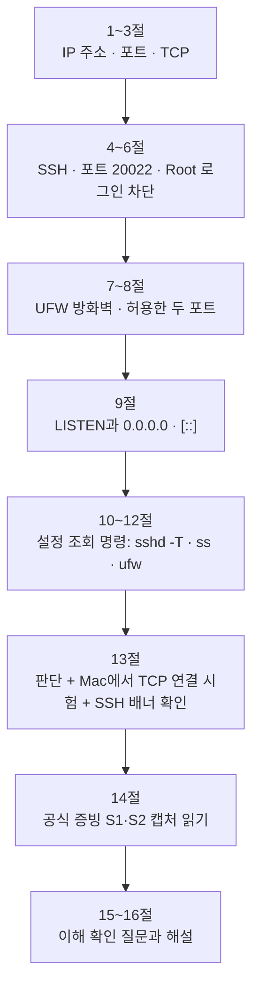

---

## 1. 먼저 상황을 생각해 보자

우리가 만든 Ubuntu 서버 `b4-lab`은 교육장 Mac 안에서 실행된다.

그런데 이 Linux Machine은 별도의 운영체제 환경이므로 Mac에서 직접 클릭만 해서 모든 서버 관리 작업을 처리하는 방식은 아니다.

서버에 명령을 전달하거나 서버 프로그램에 연결하려면 **어떤 컴퓨터에, 어떤 방식으로, 어떤 프로그램에 연결할 것인지** 알아야 한다.

건물에 비유하면 다음과 같다.

- **IP 주소:** 건물을 찾아가기 위한 주소
- **포트 번호:** 건물 안에서 서비스를 구분하는 번호
- **SSH:** 관리자와 서버가 안전하게 통신하는 방법
- **UFW:** 허용할 네트워크 통신을 결정하는 방화벽
- **사용자 권한:** 서버에 접근한 뒤 무엇을 할 수 있는지 결정하는 규칙

이 비유는 처음 이해하기 위한 것이며, 실제로 하나의 포트가 물리적인 문 하나를 뜻하는 것은 아니다.

### 1-1. 실제 실습 환경 (v0.2 보충)

2026-11-14 Owner가 S1·S2 실습을 할 때의 환경은 다음과 같았다.

| 구분 | 실제 값 | 설명 |
|---|---|---|
| 실습 컴퓨터 | 교육장 Mac (macOS) | 학습자가 터미널을 여는 컴퓨터. 이번 강의의 **클라이언트** 쪽 |
| 가상 환경 도구 | OrbStack | Mac 안에서 Linux Machine을 만들고 실행하는 프로그램 |
| Linux Machine 이름 | `b4-lab` | OrbStack이 관리하는 Ubuntu Machine. 이번 강의의 **서버** 쪽 |
| 운영체제 | Ubuntu 24.04.5 LTS | S1 캡처의 `PRETTY_NAME="Ubuntu 24.04.5 LTS"` |
| Ubuntu IP 주소 | `192.168.139.18` | **실습 당시의 값**이다. Machine을 다시 만들거나 네트워크 환경이 달라지면 바뀔 수 있다 |

학교 건물 비유로 다시 말하면, Mac은 **학교 밖에 있는 관리자의 사무실**이고, `b4-lab`은 **같은 부지 안에 지은 별관 건물**이다. 별관에 들어가려면 주소(IP)와 출입문 번호(포트)를 알아야 하고, 그 문이 방화벽(UFW)에서 열려 있어야 하며, 문 안쪽에서 누군가(LISTEN 중인 프로그램)가 기다리고 있어야 한다.

#### Mac에서 실행하는 명령과 Ubuntu 안에서 실행되는 명령

이번 강의의 명령은 **모두 Mac 터미널에 입력한다.** 하지만 실제로 실행되는 장소는 명령마다 다르다. 이 차이를 구분하는 것이 2강 실습의 핵심이다.

| 명령 | 입력하는 곳 | 실제로 실행되는 곳 | 설명 |
|---|---|---|---|
| `orb -m b4-lab ...` | Mac | **Ubuntu `b4-lab` 안** | OrbStack에게 "뒤의 명령을 `b4-lab` 안에서 실행해 달라"고 부탁하는 Mac 명령 |
| `B ...` (`orb -m b4-lab sudo ...`) | Mac | **Ubuntu `b4-lab` 안 (관리자 권한)** | 10절에서 정의하는 줄임 함수 |
| `sshd -T`, `ss`, `ufw` | Mac (`B` 뒤에 붙임) | **Ubuntu 안** | Ubuntu에 설치된 프로그램 |
| 파이프 `\|` 오른쪽의 `grep`, `awk` | Mac | **Mac** | 파이프는 Mac 셸이 처리하므로, Ubuntu의 출력이 Mac으로 넘어온 뒤 Mac에서 걸러진다 |
| `nc ...` | Mac | **Mac** | Mac이 네트워크를 통해 Ubuntu의 포트에 직접 연결을 시도한다 |

즉 `B ufw status verbose`는 "Ubuntu 안을 들여다보는" 명령이고, `nc ... "$IP" 20022`는 "Mac에서 Ubuntu 쪽으로 문을 두드려 보는" 명령이다. 두 종류의 확인은 서로를 대신하지 못한다.

#### 운영체제 확인 명령 (S1 캡처의 [1])

```bash
orb -m b4-lab cat /etc/os-release | head -2
```

| 구성 | 의미 |
|---|---|
| `orb -m b4-lab` | OrbStack의 `b4-lab` Machine 안에서 뒤 명령을 실행 (Mac에서 입력) |
| `cat /etc/os-release` | Ubuntu의 운영체제 정보 파일 내용을 출력 |
| `\| head -2` | 그 출력 중 앞의 두 줄만 남김 (Mac에서 실행) |

**명령어 전체 해석**

“Mac에서 OrbStack의 `b4-lab` Ubuntu 머신에 있는 운영체제 정보 파일을 읽어 오고, 그 가운데 처음 두 줄만 화면에 보여 줘라.”

**실제 출력과 의미**

```text
PRETTY_NAME="Ubuntu 24.04.5 LTS"
NAME="Ubuntu"
```

지금 조회하는 대상이 Mac이 아니라 **Ubuntu 24.04.5 LTS** Machine이라는 것을 보여 준다. S1 캡처에서는 두 번째 줄이 오른쪽으로 밀려 보이는데, 이 현상은 12-1절에서 설명한다.

**B4-1 미션에서 필요한 이유:** S1 증빙의 첫 항목은 "Ubuntu Machine을 사용 중이라는 사실"이다. 뒤에 나오는 SSH·UFW 설정이 Mac의 설정이 아니라 Ubuntu 서버의 설정이라는 것을 먼저 보여 준다.

---

## 2. IP 주소는 무엇일까?

컴퓨터가 네트워크를 통해 서로 통신하려면 상대 컴퓨터를 찾아야 한다.

IP 주소는 네트워크에서 통신할 대상을 식별하고 데이터를 전달할 때 사용하는 주소다.

예를 들어 `192.168.139.18`과 같은 형태는 IPv4 주소다. 이 값은 이전 B4-1 검증에서 관찰된 예시이며, Machine을 다시 만들거나 네트워크 환경이 달라지면 바뀔 수 있다.

> **v0.2 보충 — IPv4와 IPv6**
>
> - **IPv4:** `192.168.139.18`처럼 0~255 사이의 숫자 네 개를 점(`.`)으로 이은 주소다.
> - **IPv6:** IPv4 주소가 부족해지면서 만든 더 긴 주소 체계다. 숫자와 영문자(a~f)를 콜론(`:`)으로 구분하며, 연속된 0을 `::`로 줄여 쓸 수 있다.
>
> B4-1의 서버는 IPv4와 IPv6 양쪽에서 연결을 받을 준비를 하고, 방화벽 규칙도 두 주소 체계에 각각 적용된다. 그래서 9절의 `0.0.0.0`(IPv4)과 `[::]`(IPv6), 8절의 `(v6)` 규칙이 따로 보인다. 이번 실습의 Mac → Ubuntu 연결 시험은 IPv4 주소 `192.168.139.18`로 진행했다.

### 2-1. IP 주소만 알면 충분할까?

하나의 서버에는 여러 프로그램이 동시에 실행될 수 있다.

예를 들어 SSH 서버와 Agent가 같은 Linux Machine 안에서 동작할 수 있다.

서버 주소를 알더라도 두 프로그램 가운데 어느 프로그램과 통신할 것인지 구분해야 한다.

이때 사용하는 것이 포트 번호다.

---

## 3. 포트는 무엇일까?

포트는 컴퓨터 안에서 네트워크 통신을 사용하는 프로그램이나 서비스를 구분할 때 사용하는 번호다.

일반적인 TCP·UDP 포트 번호는 0부터 65535까지 존재한다.

예를 들어 다음과 같다.

| 번호 | 대표적인 용도 |
|---|---|
| TCP 22 | SSH의 기본 포트 |
| TCP 80 | HTTP의 기본 포트 |
| TCP 443 | HTTPS의 기본 포트 |
| TCP 20022 | 이번 B4-1의 SSH 관리 포트 |
| TCP 15034 | 이번 B4-1의 Agent 통신 포트 |

22·80·443은 널리 사용되는 기본 포트 번호이고, 20022·15034는 이번 과제의 설정값이다.

### 3-1. IP 주소와 포트를 함께 생각해 보자

`192.168.139.18:20022`

이 표기를 다음처럼 나눠 보자.

- `192.168.139.18` — 접속할 서버의 IP 주소
- `:` — 주소와 포트 번호를 구분하는 표기
- `20022` — 연결하려는 서비스의 포트 번호

**전체 해석**

“192.168.139.18이라는 주소의 서버에서 TCP 20022 포트를 사용하는 서비스에 연결하려고 한다.”

실제 연결에는 TCP 같은 전송 프로토콜의 선택도 필요하다.

> **v0.2 보충 — 주소와 포트가 연결 경로에서 하는 일**
>
> 아래 그림은 Mac에서 출발한 연결 요청이 Ubuntu의 SSH 서버에 닿기까지 거치는 단계다. **IP 주소는 "어느 건물로 갈지"**, **포트 번호는 "건물의 어느 문으로 들어갈지"**를 정한다.

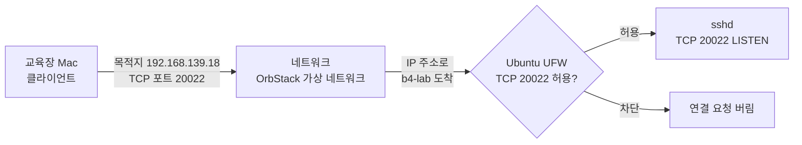

> 이 그림은 이해를 돕기 위해 단순화했다. 실제 네트워크 장치와 OrbStack 내부 동작은 더 복잡하며, 이 그림이 OrbStack의 내부 구조를 그대로 보여 주는 것은 아니다.

### 3-2. TCP는 무엇일까?

TCP는 네트워크를 통해 데이터를 전달할 때 사용하는 전송 프로토콜이다.

TCP는 통신 상대와 연결을 설정하고, 데이터를 순서대로 안정적으로 전달할 수 있도록 돕는다.

SSH는 이러한 TCP 연결 위에서 암호화된 원격 접속 기능을 제공한다.

따라서 SSH와 TCP는 같은 개념이 아니다.

- TCP는 데이터 전달을 위한 통신 기반이다.
- SSH는 그 기반 위에서 사용하는 원격 관리 프로토콜이다.

이전에 B3-1에서 배운 TCP와 패킷의 개념이 여기서 다시 연결된다.

> **v0.2 보충 — TCP 연결이 "성공했다"는 것은 무슨 뜻일까?**
>
> TCP 연결은 본격적인 데이터를 보내기 전에 양쪽이 짧은 신호를 주고받으며 시작된다. 클라이언트가 "연결하고 싶다"는 신호를 보내고, 서버의 해당 포트에서 기다리던 프로그램이 "좋다"고 응답하면 연결이 만들어진다.
>
> 이 과정이 끝나면 **TCP 연결 성공**이다. 하지만 이것은 "통로가 열렸다"는 뜻일 뿐이다. 그 통로 위에서 SSH 대화가 시작되는 것(13-2절의 배너)과, SSH 로그인에 성공하는 것은 각각 다음 단계다.
>
> 연결 요청을 보냈는데 실패하는 경우는 크게 두 가지다. 13-1절에서 자세히 다룬다.
>
> - **timeout (시간 초과):** 정해진 시간 안에 아무 응답도 오지 않았다.
> - **connection refused (연결 거부):** 상대 컴퓨터가 "이 포트에는 기다리는 프로그램이 없다"고 바로 응답했다.

---

## 4. SSH는 무엇일까?

SSH는 *Secure Shell*의 줄임말이다.

네트워크를 통해 다른 컴퓨터에 안전하게 접속하고 명령을 실행하는 데 사용하는 프로토콜이다.

서버 관리자는 서버 앞에 직접 앉아 있지 않더라도 SSH를 이용해 원격 명령을 실행할 수 있다.

### 4-1. SSH 서버와 SSH 클라이언트

SSH 통신에는 두 가지 역할이 있다.

| 역할 | 하는 일 |
|---|---|
| SSH 클라이언트 | 접속을 요청한다 |
| SSH 서버(`sshd`) | 접속 요청을 받아들이고 인증·세션을 처리한다 |

예를 들어 Mac에서 Ubuntu에 SSH 접속을 시도한다면 Mac 쪽 프로그램은 SSH 클라이언트이고, Ubuntu에서 실행되는 `sshd`는 SSH 서버 역할을 한다.

다만 B4-1에서 자주 사용하는 `orb -m b4-lab` 방식은 일반적인 `ssh -p 20022 ...` 접속과 동일하지 않다.

OrbStack은 자체 관리 경로로 Linux Machine 안의 명령을 실행할 수 있기 때문에, **OrbStack 명령 실행과 이번 미션에서 설정한 SSH 포트 20022를 구분해야 한다.**

> **v0.2 보충 — `sshd`라는 이름과 SSH 대화의 순서**
>
> - `sshd`의 끝 글자 `d`는 *daemon*(데몬)의 머리글자다. 데몬은 화면 없이 뒤에서 계속 실행되며 요청을 기다리는 프로그램을 말한다. B4-1의 Ubuntu에서 실행되는 SSH 서버는 OpenSSH의 `sshd`이며, 13-2절의 배너에서 버전 `OpenSSH_9.6p1`을 확인했다.
> - SSH 접속은 대략 다음 순서로 진행된다.
>   1. 클라이언트가 서버의 SSH 포트로 **TCP 연결**을 만든다.
>   2. 서버와 클라이언트가 자기 **SSH 버전 식별 문자열(배너)**을 보낸다. 예: `SSH-2.0-OpenSSH_9.6p1 Ubuntu-3ubuntu13.20`
>   3. 암호화 방식을 정하고 **암호 키를 교환**한다.
>   4. **사용자 인증**(비밀번호 또는 키)을 한다.
>   5. 인증에 성공하면 **로그인 세션**이 열린다.
> - 이번 2강의 실습은 1단계(13-1절)와 2단계(13-2절)까지만 확인했다. 3~5단계는 시험하지 않았다.
> - OrbStack 관리 경로는 Ubuntu 내부 `sshd`를 거치지 않는다. 그래서 `orb -m b4-lab` 명령이 잘 실행된다고 해서 미션 SSH(20022)가 동작한다는 증거가 되지는 않는다. 자세한 실측은 [OrbStack 환경 문서](../orbstack-environment.md)에 기록되어 있다.

---

## 5. 왜 SSH 포트를 20022로 설정했을까?

SSH의 대표적인 기본 포트는 TCP 22다.

이번 과제에서는 SSH 관리용 포트를 **20022**로 설정하도록 요구했다.

이것은 SSH 서버가 20022번 포트에서 접속을 기다리도록 구성한다는 뜻이다.

하지만 중요한 주의사항이 있다.

**포트 번호를 변경하는 것만으로 서버가 안전해지는 것은 아니다.**

서버 보안을 위해서는 사용자의 인증, 관리자 권한 제한, 방화벽, 업데이트 등의 조치가 함께 필요하다.

B4-1에서도 SSH 포트 변경뿐 아니라 Root 원격 로그인 차단과 UFW 규칙을 함께 설정했다.

> **v0.2 보충 — S1 실습에서 확인한 SSH 값**
>
> | 항목 | 실제 확인 값 | 확인한 곳 |
> |---|---|---|
> | SSH 포트 | **TCP 20022** | `sshd -T` 출력 `port 20022` (10-2절) |
> | Root 원격 로그인 | **`PermitRootLogin no`** | `sshd -T` 출력 `permitrootlogin no` (10-2절) |
> | SSH 서버 프로그램 | **`sshd`** | `ss` 출력 `users:(("sshd",...))` (11절) |
> | IPv4 대기 | **`0.0.0.0:20022` LISTEN** | `ss` 출력 (11절) |
> | IPv6 대기 | **`[::]:20022` LISTEN** | `ss` 출력 (11절) |
> | 기본 포트 22 | **LISTEN 목록에 없음** | `ss` 출력에 22가 없음, Mac → 22 연결 실패 (13-1절) |
>
> 이 설정은 Ubuntu의 `/etc/ssh/sshd_config.d/10-b4-mission.conf` 파일에 `Port 20022`, `PermitRootLogin no`로 적용되어 있다([공식 증빙 §2.1](../b4-1-final-evidence.md)). 2강에서는 이 파일을 **수정하지 않고 조회만** 한다.

---

## 6. Root 원격 로그인 차단은 무슨 뜻일까?

Linux에서 `root`는 시스템 전체에 매우 높은 권한을 가진 관리자 계정이다.

이 계정은 시스템 설정 변경이나 파일 관리 등 중요한 작업을 할 수 있다.

따라서 서버에 원격으로 접속할 때 root 계정으로 직접 로그인하는 것을 제한할 수 있다.

이번 B4-1의 설정은 다음과 같다.

```text
PermitRootLogin no
```

**전체 해석**

“SSH를 통한 root 계정의 직접 원격 로그인을 허용하지 마라.”

그렇다고 Ubuntu 안에서 모든 관리자 작업이 불가능해지는 것은 아니다.

필요한 권한을 가진 계정이 `sudo`를 이용해 허용된 관리자 작업을 수행할 수 있기 때문이다.

즉 **Root 원격 로그인 차단**과 **Ubuntu 내부의 sudo 사용**은 서로 다른 문제다.

> **v0.2 보충 — 설정 파일의 `PermitRootLogin`과 출력의 `permitrootlogin`**
>
> 설정 파일에는 `PermitRootLogin no`처럼 대소문자를 섞어 쓰고, 10-2절의 `sshd -T` 출력에는 `permitrootlogin no`처럼 모두 소문자로 나온다. `sshd -T`가 설정 이름을 소문자로 바꿔 출력하기 때문이며, 둘은 같은 설정이다.
>
> 이번 실습에서는 **설정값이 `no`인 것만 확인했다.** 실제로 root 계정으로 SSH 로그인을 시도해 거부되는지는 시험하지 않았다(13절의 "이번 실습에서 하지 않을 일").

---

## 7. UFW는 무엇일까?

UFW는 *Uncomplicated Firewall*의 줄임말이다.

Ubuntu 등에서 방화벽 규칙을 비교적 쉽게 설정하고 확인하도록 도와주는 도구다.

방화벽은 네트워크 통신을 허용하거나 차단하는 역할을 한다.

### 7-1. SSH와 UFW는 어떻게 다를까?

학교에 관리용 출입구가 있다고 생각해 보자.

SSH는 그 출입구를 통해 안전하게 통신하는 방법이다.

UFW는 어떤 출입구로 향하는 네트워크 통신을 허용할지 결정하는 장치다.

SSH 서버가 실행 중이어도 방화벽에서 해당 포트의 접근을 차단하면 외부에서 접속하지 못할 수 있다.

반대로 방화벽이 어떤 포트의 접근을 허용하더라도, 그 포트에서 요청을 받을 프로그램이 실행되지 않았다면 정상 연결이 성립하지 않을 수 있다.

**방화벽 허용과 실제 서비스 실행은 별개의 조건이다.**

#### 시각자료 ① — SSH와 UFW의 관계

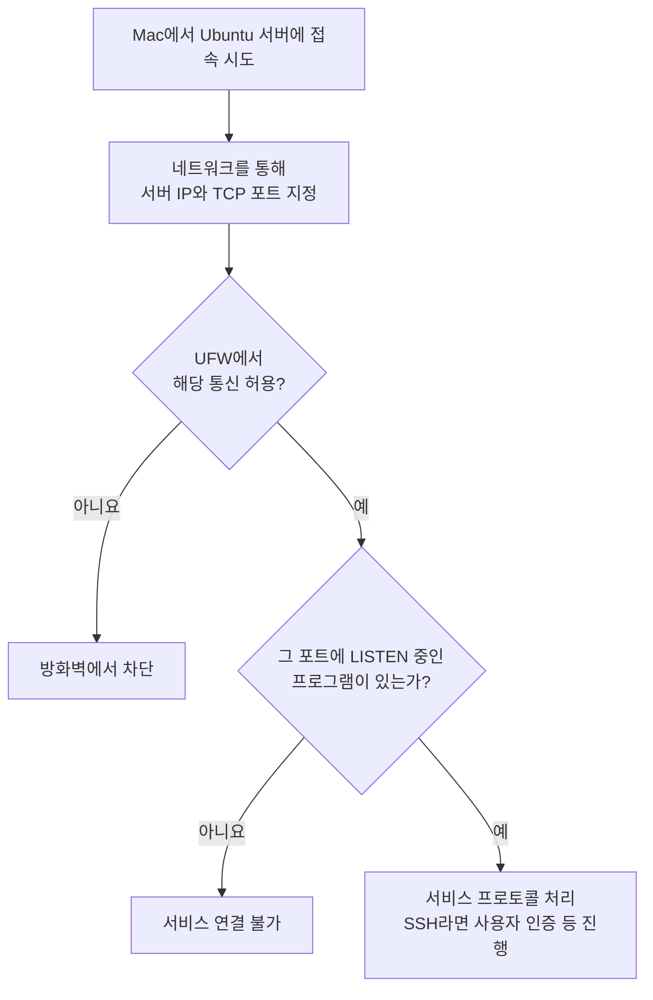

이 그림에서 꼭 기억해야 할 것은 **방화벽이 허용했다고 해서 접속이 무조건 성공하는 것은 아니다**라는 점이야.

> **v0.2 보충 — SSH와 UFW의 역할 비교**
>
> | 질문 | SSH (`sshd`) | UFW |
> |---|---|---|
> | 학교 건물 비유 | 관리용 출입구 안쪽에서 방문자를 맞이하고 신분을 확인하는 **안내 담당자** | 건물 입구에서 "이 출입구로는 들어와도 된다"를 정하는 **출입 통제 장치** |
> | 하는 일 | 연결 요청을 받아 암호화 통신·사용자 인증·로그인 세션 처리 | 들어오고 나가는 네트워크 통신을 포트·방향별로 허용 또는 차단 |
> | 어디에 설정하나 | `sshd` 설정 (`Port 20022`, `PermitRootLogin no`) | UFW 규칙 (`allow 20022/tcp`, `allow 15034/tcp`, 기본 deny incoming) |
> | 어떻게 확인하나 | `B sshd -T`, `B ss -tlnp` (10·11절) | `B ufw status verbose` (12절) |
> | 이것만 있으면? | 방화벽이 막으면 밖에서 접속할 수 없다 | 문 안쪽에 기다리는 프로그램이 없으면 연결이 성립하지 않는다 |
>
> 위 그림의 마지막 칸 "SSH라면 사용자 인증 등 진행"은 TCP 연결과 SSH 배너 교환 **다음**에 일어나는 단계다. 이번 실습은 이 칸에 들어가는 입구(배너)까지만 확인했다(13-2절).

---

## 8. B4-1에서는 어떤 통신을 허용했을까?

실제 B4-1의 UFW는 다음과 같은 정책을 적용했다.

```text
Status: active
Default: deny (incoming), allow (outgoing)

20022/tcp    ALLOW IN
15034/tcp    ALLOW IN
```

여기서 각 부분의 의미를 살펴보자.

| 설정 | 의미 |
|---|---|
| `Status: active` | UFW 방화벽이 활성 상태 |
| `deny (incoming)` | 들어오는 통신은 기본적으로 차단 |
| `allow (outgoing)` | 나가는 통신은 기본적으로 허용 |
| `20022/tcp ALLOW IN` | SSH 관리 포트로 들어오는 TCP 통신 허용 |
| `15034/tcp ALLOW IN` | Agent 포트로 들어오는 TCP 통신 허용 |

실제 출력에는 IPv4와 IPv6를 위한 규칙이 각각 표시되므로 허용 규칙이 네 줄로 보일 수 있다.

이것은 서로 다른 서비스가 네 개라는 뜻은 아니다.

> **v0.2 보충 — S2 캡처에 나온 실제 허용 규칙 네 줄**
>
> ```text
> To                         Action      From
> --                         ------      ----
> 20022/tcp                  ALLOW IN    Anywhere                   # SSH
> 15034/tcp                  ALLOW IN    Anywhere                   # Agent
> 20022/tcp (v6)             ALLOW IN    Anywhere (v6)              # SSH
> 15034/tcp (v6)             ALLOW IN    Anywhere (v6)              # Agent
> ```
>
> | 열 | 의미 |
> |---|---|
> | `To` | 서버 쪽에서 통신을 받을 포트와 프로토콜. `(v6)`가 붙으면 IPv6 규칙 |
> | `Action` | `ALLOW IN` = 들어오는 방향의 통신을 허용 |
> | `From` | 어디에서 오는 통신인가. `Anywhere` = 출발지를 제한하지 않음 |
> | `# SSH`, `# Agent` | 규칙을 만들 때 붙인 메모(주석). 동작에는 영향이 없고 사람이 읽기 위한 것 |
>
> 네 줄은 **서비스 두 개(SSH 20022, Agent 15034) × 주소 체계 두 개(IPv4, IPv6)**이다. 실제 S2 캡처의 `Default:` 줄에는 `deny (routed)`도 함께 보이는데, 이것은 이 서버를 거쳐 다른 곳으로 **지나가는** 통신(라우팅)도 기본 차단한다는 뜻이다. B4-1 미션의 판정 항목은 incoming·outgoing 정책과 두 허용 규칙이다.

#### 시각자료 ② — B4-1에서 열어 둔 두 포트

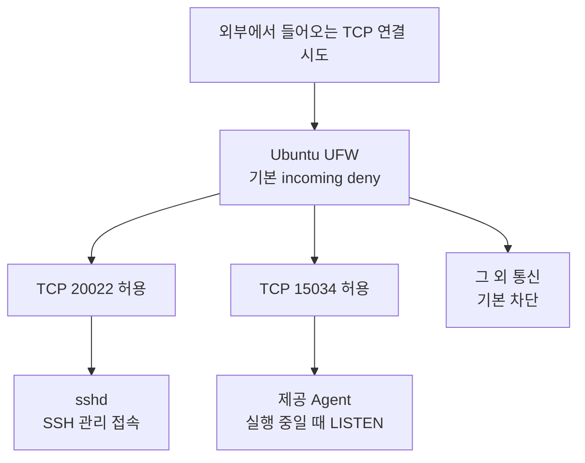

> 일반적인 네트워크 경로를 단순화한 그림이야. OrbStack의 자체 Machine 관리 경로는 별도로 존재하므로, 일반 SSH 접속과 동일하게 취급하지 않아.

> **v0.2 보충:** 그림의 "그 외 통신 기본 차단"에는 기본 SSH 포트 **22**와 이번 시험에 사용한 **15035**가 포함된다. 13-1절에서 Mac → 22, Mac → 15035 연결이 실패한 결과는 이 칸과 함께 해석한다.

### 8-1. 들어오는 통신과 나가는 통신

- **Incoming:** 서버 쪽으로 들어오는 네트워크 통신
- **Outgoing:** 서버에서 외부로 나가는 네트워크 통신

B4-1은 기본적으로 들어오는 통신을 차단하고, 명시적으로 허용한 두 포트의 통신만 받도록 설정했다.

### 8-2. Agent가 중지되어 있는데 15034 포트는 허용되어 있다면?

이 상황은 오류가 아닐 수 있다.

UFW에서 15034 포트를 허용했다는 것은 **그 포트로 들어오는 통신을 방화벽이 차단하지 않도록 설정했다는 뜻**이다.

Agent가 실제로 실행되어 15034 포트에서 연결을 기다리고 있는지는 별도로 확인해야 한다.

이번 미션에서 Agent는 상주 서비스가 아니라 검증할 때 수동 실행하는 프로그램이므로, 중지 상태에서는 15034 포트에 LISTEN 중인 Agent가 없는 것이 정상일 수 있다.

> **v0.2 보충:** 그래서 13-1절의 Mac 연결 시험에서는 15034를 시험 대상에 넣지 않았다. Agent가 중지된 상태에서 15034로 연결하면 실패하는 것이 정상일 수 있고, 그 실패는 방화벽 문제와 구분하기 어렵기 때문이다. 대신 **허용 목록에 없는 포트 15035**를 골라 "허용하지 않은 포트는 막히는가"를 시험했다.

---

## 9. LISTEN은 무슨 뜻일까?

네트워크 프로그램이 TCP 포트에서 연결 요청을 받을 준비가 되어 있으면 그 소켓이 `LISTEN` 상태일 수 있다.

예를 들어 B4-1의 SSH 서버는 다음과 같은 상태로 확인됐다.

```text
0.0.0.0:20022
[::]:20022
```

여기서 `0.0.0.0`은 실제로 접속할 서버의 고정 IP 주소가 아니라, **모든 IPv4 로컬 주소에서 연결을 기다리도록 바인딩했다**는 표현이다.

`[::]`는 IPv6 주소에 관련된 표기다.

이것은 해당 서비스가 요청을 받을 준비가 되어 있음을 보여주지만, 외부에서 반드시 접속할 수 있다는 뜻은 아니다.

외부 접속 여부는 방화벽과 네트워크 경로 등의 조건도 영향을 준다.

따라서 다음 세 가지를 구분해야 한다.

1. SSH 서버 설정에 포트 20022가 지정되었는가?
2. SSH 서버가 실제로 TCP 20022에서 LISTEN 중인가?
3. Mac에서 그 포트로 실제 연결이 가능한가?

B4-1에서는 이 세 가지를 검증 기록으로 남겼다.

### 9-1. `0.0.0.0`과 `[::]`를 조금 더 자세히 (v0.2 보충)

**소켓**은 프로그램이 네트워크 통신을 하기 위해 운영체제에서 받는 "통신 창구"다. 프로그램은 소켓을 만들 때 **어느 주소의 어느 포트에서 기다릴지**를 정하는데, 이것을 **바인딩(bind)**이라고 한다.

한 서버에는 IP 주소가 여러 개 있을 수 있다. 예를 들어 Ubuntu `b4-lab`에는 자기 자신만 부르는 주소(`127.0.0.1`)와 네트워크에서 쓰는 주소(실습 당시 `192.168.139.18`)가 함께 있다.

| 표기 | 주소 체계 | 뜻 | 학교 건물 비유 |
|---|---|---|---|
| `0.0.0.0:20022` | IPv4 | 이 서버가 가진 **모든 IPv4 주소**의 20022번 포트에서 기다린다 | 건물의 정문·후문 어느 쪽 주소로 찾아와도 20022번 창구로 안내한다 |
| `[::]:20022` | IPv6 | 이 서버가 가진 **모든 IPv6 주소**의 20022번 포트에서 기다린다 | 같은 안내를 IPv6 주소로 찾아온 방문자에게도 한다 |
| `0.0.0.0:*`, `[::]:*` | — | 연결해 올 **상대방 주소·포트는 아무거나** 괜찮다 | 어느 동네에서 온 방문자든 받는다 |

- IPv6 주소는 콜론(`:`)을 쓰기 때문에, 포트 번호와 헷갈리지 않도록 주소를 대괄호 `[ ]`로 감싼다. 그래서 `[::]:20022`처럼 쓴다.
- `::`는 IPv6에서 "모두 0인 주소"를 줄여 쓴 것으로, IPv4의 `0.0.0.0`과 같은 역할(모든 주소)을 한다.
- 그러므로 Mac에서는 `0.0.0.0`으로 접속하는 것이 아니라 **실제 서버 주소 `192.168.139.18`**로 접속한다. `0.0.0.0`은 서버 쪽이 "모든 주소에서 받겠다"고 적어 둔 표시일 뿐이다.

아래 그림은 9절의 세 가지 질문을 이번 실습의 확인 순서로 그린 것이다. **앞 단계가 통과해도 다음 단계가 자동으로 통과하는 것은 아니다.**

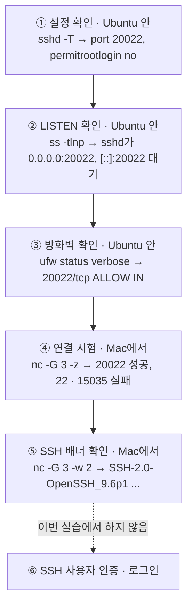

---

## 10. 실제 명령어 ① — SSH 설정 확인

이번 실습은 교육장 Mac 터미널에서 시작한다.

먼저 0강에서 배운 `B()` 함수를 선언한다.

```bash
B() { orb -m b4-lab sudo "$@"; }
```

**명령어 전체 해석**

“앞으로 `B`라는 이름으로 명령을 실행하면, 뒤에 전달한 명령을 OrbStack의 `b4-lab` Ubuntu Machine 안에서 관리자 권한으로 실행하도록 정의해라.”

> **v0.2 보충 — `B()` 함수의 구성 요소**
>
> **실행 위치:** Mac 터미널(zsh)에 입력하고, Mac 셸에 함수로 저장된다. 이 줄 자체는 Ubuntu에 아무것도 실행하지 않는다.
>
> | 구성 | 의미 |
> |---|---|
> | `B()` | `B`라는 이름의 셸 함수를 만든다 |
> | `{ ... ; }` | 함수가 호출될 때 실행할 내용. 마지막 `;`과 띄어쓰기는 셸 문법상 필요하다 |
> | `orb -m b4-lab` | OrbStack의 `b4-lab` Machine 안에서 실행 |
> | `sudo` | Ubuntu 안에서 관리자 권한으로 실행 |
> | `"$@"` | `B` 뒤에 적은 단어들을 **그대로 하나씩** 넘겨준다 |
>
> 예를 들어 `B ufw status verbose`라고 입력하면 Mac 셸은 이것을 `orb -m b4-lab sudo ufw status verbose`로 바꿔 실행한다.
>
> **실제 출력:** 함수 정의는 아무것도 출력하지 않는다. 새 터미널 창을 열면 함수가 사라지므로 다시 선언해야 한다.
>
> **B4-1 미션에서 필요한 이유:** `sshd -T`, `ss -p`, `ufw status`는 관리자 권한이 있어야 전체 정보를 보여 준다. 매번 긴 명령을 입력하면 오타가 생기기 쉬워, 공식 증빙 문서도 같은 `B` 함수를 기준으로 명령을 적었다.

### 10-1. SSH 설정 전체 조회

```bash
B sshd -T
```

| 구성 | 의미 |
|---|---|
| `B` | Ubuntu에서 관리자 권한으로 명령 실행 |
| `sshd` | SSH 서버 프로그램 |
| `-T` | 적용되는 SSH 서버 설정을 출력 |

**명령어 전체 해석**

“OrbStack의 `b4-lab` Ubuntu 머신 안에서 관리자 권한으로 SSH 서버의 현재 유효한 설정을 점검하고 모두 출력해라.”

많은 설정이 출력되기 때문에 다음 명령으로 필요한 항목만 찾는다.

> **v0.2 보충:** `-T`는 *test*의 머리글자로, 설정 파일을 읽고 문법을 검사한 뒤 **최종적으로 적용될 값**을 `이름 값` 형태로 한 줄씩 출력한다. 설정 파일 여러 개(`/etc/ssh/sshd_config`와 `sshd_config.d/` 안의 파일)가 합쳐진 결과를 보여 주므로, 설정 파일을 하나씩 열어 보는 것보다 정확하다. 설정을 바꾸거나 SSH 서버를 다시 시작하지는 않는다.

### 10-2. 필요한 두 항목만 조회

```bash
B sshd -T | grep -E '^(port|permitrootlogin) '
```

**명령어 전체 해석**

“Ubuntu에서 SSH 서버 설정 전체를 가져온 다음, Mac에서 SSH 포트와 Root 로그인 허용 여부에 관한 줄만 골라 출력해라.”

기존 B4-1 검증에서 확인된 결과는 다음과 같다.

```text
port 20022
permitrootlogin no
```

이 결과는 다음을 뜻한다.

- SSH 관리 포트: 20022
- SSH를 통한 Root 직접 로그인: 허용하지 않음

앞에서 배운 것처럼 `sshd -T`는 Ubuntu에서, 파이프 오른쪽의 `grep`은 Mac에서 실행된다.

> **v0.2 보충 — `grep` 부분의 구성 요소**
>
> | 구성 | 의미 |
> |---|---|
> | `\|` | 왼쪽 명령의 출력을 오른쪽 명령의 입력으로 넘긴다 (Mac 셸이 처리) |
> | `grep` | 입력에서 조건에 맞는 줄만 골라낸다 (Mac에서 실행) |
> | `-E` | 확장 정규식을 사용한다. `( \| )` 같은 기호를 바로 쓸 수 있다 |
> | `^` | 줄의 **맨 앞**에서부터 맞춰 본다 |
> | `(port\|permitrootlogin)` | `port` **또는** `permitrootlogin` |
> | 끝의 띄어쓰기 `' '` | 이름 바로 뒤에 공백이 있어야 한다. 그래서 이름이 `port`로 **시작하기만 하는** 더 긴 설정 이름이 있더라도 걸리지 않고, 정확히 `port`와 `permitrootlogin`인 줄만 남는다 |
>
> **실행 위치:** `sshd -T`는 Ubuntu 안, `grep`은 Mac.
>
> **실제 출력과 의미 (2026-11-14 S1 캡처의 [2]):** `port 20022`, `permitrootlogin no` 두 줄이 나왔다. 캡처에서는 두 번째 줄이 오른쪽으로 밀려 보이지만(12-1절), 값은 그대로 읽을 수 있다. 이 결과는 v0.1이 인용한 기존 검증 기록과 같다.
>
> **B4-1 미션에서 필요한 이유:** 공식 요구사항 1번 "SSH 포트 20022, Root 원격 로그인 차단"을 **설정 수준에서** 보여 주는 증거다. 단, 이 출력은 "설정이 그렇게 되어 있다"는 것까지만 보여 준다. 실제로 그 포트에서 기다리는지는 11절에서 따로 확인한다.

---

## 11. 실제 명령어 ② — SSH 서버가 포트를 열어 두었는지 확인하기

```bash
B ss -tlnp | grep sshd
```

`ss`는 Linux에서 네트워크 소켓 상태를 확인하는 명령어다.

| 구성 | 의미 |
|---|---|
| `ss` | 소켓 상태 표시 |
| `-t` | TCP 소켓 |
| `-l` | LISTEN 상태 |
| `-n` | 주소·포트 등을 숫자 형태로 표시 |
| `-p` | 소켓을 사용하는 프로세스 정보 표시 |
| `\| grep sshd` | 출력 중 `sshd`가 포함된 줄 선택 |

**명령어 전체 해석**

“Ubuntu 머신에서 현재 연결 요청을 기다리는 TCP 소켓과 그 소유 프로세스를 확인한 뒤, Mac에서 SSH 서버에 해당하는 정보만 골라 출력해라.”

기존 검증 기록에서는 `0.0.0.0:20022`와 `[::]:20022`가 확인됐다.

이는 SSH 서버가 20022 포트에서 연결 요청을 받을 준비가 되어 있음을 나타낸다.

여기서 SSH 포트가 설정 파일에 존재한다는 사실과 실제 LISTEN 상태를 구분해서 확인하는 것이 중요하다.

> **v0.2 보충 — 실제 출력과 각 칸의 의미 (2026-11-14 S1 캡처의 [3])**
>
> **실행 위치:** `ss`는 Ubuntu 안(관리자 권한), `grep`은 Mac.
>
> ```text
> LISTEN 0      128          0.0.0.0:20022      0.0.0.0:*    users:(("sshd",pid=287,fd=3))
> LISTEN 0      128             [::]:20022         [::]:*    users:(("sshd",pid=287,fd=4))
> ```
>
> | 칸 | 예시 값 | 의미 |
> |---|---|---|
> | 상태 | `LISTEN` | 연결 요청을 기다리는 중 |
> | 대기 중인 요청 수 | `0` | 아직 처리되지 않고 쌓여 있는 연결 요청 수. 0이면 밀린 요청이 없다 |
> | 대기열 최대 크기 | `128` | 처리 전 요청을 최대 몇 개까지 줄 세워 둘 수 있는지 |
> | 내 주소:포트 | `0.0.0.0:20022`, `[::]:20022` | 서버 쪽에서 기다리는 주소와 포트 (9-1절) |
> | 상대 주소:포트 | `0.0.0.0:*`, `[::]:*` | 어떤 상대든 연결해 올 수 있음 |
> | 프로세스 | `users:(("sshd",pid=287,fd=3))` | 이 소켓을 가진 프로그램은 `sshd`, 프로세스 번호(PID)는 287 |
>
> - 두 줄의 `pid`가 같다(287). **하나의 `sshd` 프로그램**이 IPv4 소켓과 IPv6 소켓을 하나씩 열어 둔 것이다. `fd=3`, `fd=4`는 그 프로그램 안에서 두 소켓을 구분하는 번호다.
> - PID 287은 촬영 시점의 값이며, 서버나 `sshd`를 다시 시작하면 바뀔 수 있다.
> - `grep sshd`로 `sshd`가 들어간 줄만 골랐으므로 다른 프로그램의 LISTEN은 화면에 나오지 않는다. 그래도 **`sshd`가 22번에서 기다리는 줄은 없다**는 것은 알 수 있다. 공식 증빙도 "LISTEN `0.0.0.0:20022`, `[::]:20022` (22 없음)"으로 기록했다.
>
> **B4-1 미션에서 필요한 이유:** 10-2절은 "설정에 20022가 적혀 있다"를 보여 주고, 이 명령은 "SSH 서버가 **지금 실제로** 20022에서 기다리고 있다"를 보여 준다. 설정을 바꾸고 SSH 서버를 다시 시작하지 않았거나, 다른 설정이 덮어쓰고 있다면 두 결과가 다를 수 있으므로 둘 다 확인한다.

---

## 12. 실제 명령어 ③ — UFW 방화벽 확인

```bash
B ufw status verbose
```

| 구성 | 의미 |
|---|---|
| `B` | Ubuntu 내부에서 관리자 권한으로 실행 |
| `ufw` | UFW 방화벽 관리 프로그램 |
| `status` | 현재 상태 조회 |
| `verbose` | 기본 정책 등을 포함한 자세한 정보 출력 |

**명령어 전체 해석**

“OrbStack의 `b4-lab` Ubuntu 서버에서 UFW 방화벽이 활성화되어 있는지 확인하고, 기본 정책과 허용된 포트 규칙을 자세하게 출력해라.”

기존 검증에서는 다음 항목이 확인됐다.

- UFW 활성 상태
- 들어오는 통신 기본 차단
- 나가는 통신 기본 허용
- TCP 20022 허용
- TCP 15034 허용

이 명령은 방화벽의 상태를 조회할 뿐 설정을 변경하지 않는다.

> **v0.2 보충 — 실제 출력 (2026-11-14 S2 캡처)**
>
> **실행 위치:** Ubuntu 안(관리자 권한).
>
> ```text
> Status: active
> Logging: on (low)
> Default: deny (incoming), allow (outgoing), deny (routed)
> New profiles: skip
>
> To                         Action      From
> --                         ------      ----
> 20022/tcp                  ALLOW IN    Anywhere                   # SSH
> 15034/tcp                  ALLOW IN    Anywhere                   # Agent
> 20022/tcp (v6)             ALLOW IN    Anywhere (v6)              # SSH
> 15034/tcp (v6)             ALLOW IN    Anywhere (v6)              # Agent
> ```
>
> | 줄 | 의미 |
> |---|---|
> | `Status: active` | UFW가 켜져 있다 |
> | `Logging: on (low)` | 방화벽 동작 기록을 낮은 수준으로 남긴다 |
> | `Default: deny (incoming), allow (outgoing), deny (routed)` | 기본 정책. 들어오는 통신 차단, 나가는 통신 허용, 서버를 거쳐 지나가는 통신 차단 |
> | `New profiles: skip` | 새로 설치된 프로그램용 규칙을 자동으로 추가하지 않는다 |
> | 허용 규칙 네 줄 | SSH(20022)와 Agent(15034)를 IPv4·IPv6에서 각각 허용 (8절 보충 참고) |
>
> **B4-1 미션에서 필요한 이유:** 공식 요구사항 2번 "UFW 활성, TCP 20022/15034만 인바운드 허용"을 보여 주는 증거다. 이 출력에는 **허용 목록에 22번이 없다.** 13-1절에서 Mac → 22 연결이 실패한 결과를 해석할 때 이 사실을 함께 쓴다.

### 12-1. 터미널 출력이 오른쪽으로 밀릴 때 — `awk`로 줄 정렬하기 (v0.2 보충)

S1 캡처를 보면 출력의 두 번째 줄이 맨 왼쪽이 아니라 **앞 줄이 끝난 위치에서** 시작한다.

```text
PRETTY_NAME="Ubuntu 24.04.5 LTS"
                                NAME="Ubuntu"
```

**왜 이런 일이 생길까?** 터미널에서 "다음 줄로 넘어가기"는 사실 두 가지 동작이다.

| 문자 | 이름 | 동작 | 타자기 비유 |
|---|---|---|---|
| `\r` | 캐리지 리턴 (Carriage Return) | 커서를 **줄의 맨 앞**으로 보낸다 | 종이를 끼운 판을 왼쪽 끝으로 되돌리기 |
| `\n` | 라인 피드 (Line Feed) | 커서를 **한 줄 아래**로 내린다 | 종이를 한 줄 위로 올리기 |

Linux 프로그램은 보통 줄 끝에 `\n`만 붙이고, 터미널이 `\n`을 받으면 "맨 앞으로 + 한 줄 아래로"를 함께 처리한다. 그런데 실습 당시에는 `\n`의 "한 줄 아래로"만 적용되고 "맨 앞으로"가 빠진 것처럼 보였다. 그래서 다음 줄이 계단처럼 오른쪽으로 밀렸다. 이번 실습에서 정확한 원인까지 확정하지는 않았다. **확실한 것은 화면 표시의 문제일 뿐, 출력된 값은 바뀌지 않았다는 점이다.** 그래서 S1 캡처의 값은 그대로 판독했다.

S2 캡처를 찍을 때는 다음 명령으로 정렬을 바로잡았다.

```bash
B ufw status verbose | awk '{printf "%s\r\n", $0}'
```

| 구성 | 의미 |
|---|---|
| `B ufw status verbose` | Ubuntu 안에서 UFW 상태 조회 (12절과 같음) |
| `\|` | 그 출력을 Mac의 `awk`로 넘김 |
| `awk` | 입력을 한 줄씩 읽으며, 줄마다 정해진 동작을 하는 텍스트 처리 프로그램 (Mac에서 실행) |
| `'{ ... }'` | 모든 줄에 대해 중괄호 안의 동작을 실행 |
| `printf` | 정해진 형식에 맞춰 출력 |
| `"%s\r\n"` | 형식: 글자들(`%s`)을 쓰고, 이어서 `\r`(맨 앞으로) + `\n`(한 줄 아래로) |
| `$0` | `awk`가 지금 읽은 줄 전체. `%s` 자리에 들어간다 |

**명령어 전체 해석**

“Ubuntu 서버의 UFW 상태를 자세히 조회한 다음, Mac에서 그 출력을 한 줄씩 받아 각 줄 끝에 ‘줄 맨 앞으로 돌아가기’와 ‘다음 줄로 내리기’를 함께 붙여 다시 출력해라.”

**실제 출력과 의미:** S2 캡처에서는 모든 줄이 맨 왼쪽부터 가지런히 출력됐다. 내용은 정렬하지 않은 `B ufw status verbose`의 출력과 같다.

**출력 형식 조정과 서버 설정 변경의 차이**

| 구분 | 예 | 바뀌는 것 |
|---|---|---|
| 출력 형식 조정 | `... \| awk '{printf "%s\r\n", $0}'` | **Mac 화면에 보이는 모양만** 바뀐다. Ubuntu의 UFW 규칙은 그대로다 |
| 서버 설정 변경 | `ufw allow ...`, `ufw disable` 등 | Ubuntu의 실제 방화벽 규칙이 바뀐다. **이번 실습에서는 하지 않는다** |

`awk`는 파이프 오른쪽, 즉 **Mac에서** 실행되며, 이미 Ubuntu에서 넘어온 글자만 다룬다. Ubuntu로 명령을 보내지 않으므로 서버 설정에 영향을 줄 수 없다.

**B4-1 미션에서 필요한 이유:** 제출 캡처는 심사자가 값을 쉽게 읽을 수 있어야 한다. 정렬을 바로잡더라도 **값을 고치거나 지우지 않았다**는 것을 설명할 수 있어야 증빙으로 신뢰받는다.

---

## 13. 실습 결과를 어떻게 판단할까?

**SSH 설정이 정상인가?**

`port 20022`, `permitrootlogin no`인지 확인한다.

**SSH 서버가 실행 중인가?**

`ss` 출력에서 SSH 서버가 TCP 20022를 LISTEN 중인지 확인한다.

**방화벽이 정상인가?**

UFW가 active이고 기본 정책과 허용 규칙이 미션 요구사항에 맞는지 확인한다.

**Agent 포트가 보이지 않으면 실패인가?**

Agent가 수동 실행 방식이라는 점을 기억하자. Agent가 중지된 상태라면 15034 포트에 해당 프로그램의 LISTEN이 없는 것이 정상일 수 있다.

**이번 실습에서 하지 않을 일**

- SSH 포트 변경
- Root 로그인 허용 설정 변경
- UFW 비활성화
- 방화벽 허용 규칙 수정
- 비밀번호·개인키 출력
- 실제 Root SSH 로그인 시도

이번에는 현재 구성된 서버가 어떻게 동작하는지 안전하게 관찰하는 것이 목적이다.

> **v0.2 보충 — 2026-11-14 S1·S2 실습 판단 결과**
>
> | 확인 질문 | 판단 근거 | 결과 |
> |---|---|---|
> | SSH 설정이 정상인가? | `port 20022`, `permitrootlogin no` (10-2절) | 정상 |
> | SSH 서버가 실행 중인가? | `sshd`가 `0.0.0.0:20022`, `[::]:20022` LISTEN (11절) | 정상 |
> | 방화벽이 정상인가? | `Status: active`, deny incoming / allow outgoing, 20022·15034 ALLOW IN (v4·v6) (12절) | 정상 |
> | Mac에서 실제로 연결되는가? | 20022 성공, 22·15035 실패 (13-1절) | 설정과 일치 |
> | 20022에서 정말 SSH 서버가 응답하는가? | 배너 `SSH-2.0-OpenSSH_9.6p1 Ubuntu-3ubuntu13.20` (13-2절) | 확인 |
> | SSH 로그인이 되는가? | 시험하지 않음 | **판단하지 않음** |
>
> 위 표의 앞 세 줄은 **Ubuntu 안에서 본 설정**이고, 뒤의 두 줄은 **Mac에서 실제로 두드려 본 결과**다. 두 방향의 결과가 서로 맞아야 "설정한 대로 동작한다"고 말할 수 있다.

### 13-1. 실제 명령어 ④ — Mac에서 TCP 연결 시험 (v0.2 보충)

9절의 세 번째 질문 "Mac에서 그 포트로 실제 연결이 가능한가?"를 확인하는 명령이다. 이번에는 `B`를 붙이지 않는다. **Mac이 직접** Ubuntu의 포트에 연결을 시도해야 하기 때문이다.

**실행 위치:** Mac 터미널 (전부 Mac에서 실행)

먼저 Ubuntu의 IP 주소를 변수 `IP`에 넣어 둔다. 실습 당시 화면 첫 줄에 `Ubuntu IP: 192.168.139.18`이 표시되어 있다. 예를 들면 다음과 같다.

```bash
IP=192.168.139.18
```

> 이 값은 실습 당시의 IP다. 자기 환경에서 따라 할 때는 현재 Ubuntu의 IP를 확인해서 넣어야 한다.

그다음 세 포트를 차례로 시험했다.

```bash
for PORT in 20022 22 15035; do
  if nc -G 3 -z "$IP" "$PORT" 2>/dev/null; then
    printf 'TCP %-5s : 연결 성공 \n' "$PORT"
  else
    printf 'TCP %-5s : 연결 실패 \n' "$PORT"
  fi
done
```

#### `nc` 한 줄의 구성 요소

| 구성 | 의미 |
|---|---|
| `nc` | *netcat*. 지정한 주소·포트로 TCP 연결을 만들고, 그 연결로 글자를 주고받는 네트워크 도구. macOS에 기본으로 들어 있다 |
| `-G 3` | 연결을 맺을 때까지 **최대 3초**만 기다린다. 3초 안에 연결되지 않으면 포기한다 (macOS `nc`의 옵션) |
| `-z` | 연결이 되는지만 확인하고 **데이터는 보내지 않는다**. 연결되면 곧바로 닫는다 |
| `"$IP"` | 연결할 서버 주소. 변수 `IP`의 값(`192.168.139.18`) |
| `"$PORT"` | 연결할 포트 번호. 반복할 때마다 바뀐다 |
| `2>/dev/null` | 오류 메시지는 화면에 내보내지 않고 버린다. 결과는 아래 `printf`로만 보여 주기 위해서다 |

`nc` 한 줄의 해석: “Mac에서 `192.168.139.18`의 지정한 TCP 포트로 연결을 시도하되, 데이터는 보내지 말고 3초 안에 연결되는지만 확인해라.”

#### 반복문과 조건문의 구성 요소

| 구성 | 의미 |
|---|---|
| `for PORT in 20022 22 15035; do ... done` | `PORT`에 20022, 22, 15035를 **차례로 하나씩** 넣으며 `do`와 `done` 사이를 세 번 실행한다 |
| `if 명령; then A; else B; fi` | 명령이 **성공(종료 코드 0)**하면 A, **실패(0이 아님)**하면 B를 실행한다 |
| `printf 'TCP %-5s : 연결 성공 \n' "$PORT"` | `%-5s` 자리에 포트 번호를 **왼쪽 정렬, 5칸 폭**으로 넣어 출력한다. 그래서 `22`도 `20022`와 같은 위치에 `:`가 온다 |

`nc -z`는 연결에 성공하면 종료 코드 0, 실패하면 0이 아닌 값을 남긴다. 1강에서 배운 `exit 0`·`exit 1`과 같은 원리다. `if`는 출력 글자가 아니라 이 **종료 코드**를 보고 성공·실패를 나눈다.

반복문이 실제로 하는 일은 아래와 같다.

| 회차 | `PORT` 값 | 실제로 실행되는 시험 | 출력 |
|---|---|---|---|
| 1 | `20022` | `nc -G 3 -z 192.168.139.18 20022` | `TCP 20022 : 연결 성공` |
| 2 | `22` | `nc -G 3 -z 192.168.139.18 22` | `TCP 22    : 연결 실패` |
| 3 | `15035` | `nc -G 3 -z 192.168.139.18 15035` | `TCP 15035 : 연결 실패` |

**명령어 전체 해석**

“Mac에서 Ubuntu 서버 `192.168.139.18`의 TCP 20022, 22, 15035 포트에 차례로 하나씩 연결을 시도하되, 데이터는 보내지 말고 각각 3초까지만 기다린 다음, 연결되면 ‘연결 성공’, 아니면 ‘연결 실패’라고 포트 번호와 함께 한 줄씩 출력해라.”

#### 실제 결과 (2026-11-14 Owner 실측)

| 포트 | 결과 | 함께 볼 설정 | 해석 |
|---|---|---|---|
| TCP 20022 | **연결 성공** | `sshd` 20022 LISTEN + UFW 20022 ALLOW IN | 방화벽을 통과했고, 문 안쪽에 `sshd`가 기다리고 있었다 |
| TCP 22 | **연결 실패** | `sshd`가 22에서 LISTEN하지 않음 + UFW 허용 목록에 22 없음 | 기본 SSH 포트는 쓰지 않으며, 방화벽에서도 열어 두지 않았다 |
| TCP 15035 | **연결 실패** | UFW 허용 목록(20022·15034)에 15035 없음 | 허용하지 않은 포트로 들어오는 통신이 기본 정책(deny incoming)에 따라 막혔다고 해석할 수 있다 |

#### 왜 이 세 포트를 골랐을까?

- **20022:** 열려 있어야 하는 포트. 성공해야 정상이다.
- **22:** SSH의 기본 포트. B4-1은 SSH를 20022로 옮겼으므로 실패해야 정상이다.
- **15035:** 허용 목록에 없는 아무 포트. "허용하지 않은 포트는 막힌다"를 확인하기 위한 비교 대상이다. 15034는 Agent 실행 여부에 따라 결과가 달라지므로 넣지 않았다(8-2절 보충).

#### 연결 실패와 방화벽 차단의 관계 — timeout과 connection refused

연결 실패는 크게 두 종류다.

| 구분 | 무슨 일이 일어났나 | 학교 건물 비유 | 흔한 원인 |
|---|---|---|---|
| **timeout (시간 초과)** | 연결 요청을 보냈는데 **정해진 시간 안에 아무 대답도 오지 않았다** | 출입문을 두드렸는데 아무 반응이 없다. 출입 통제 장치가 요청을 조용히 버렸을 수 있다 | 방화벽이 요청을 응답 없이 버림, 주소가 틀림, 네트워크 경로 문제 |
| **connection refused (연결 거부)** | 서버 컴퓨터가 **곧바로** "이 포트에는 기다리는 프로그램이 없다"고 대답했다 | 출입문까지는 갔는데, 안에서 "이 창구는 운영하지 않는다"는 답이 바로 돌아온다 | 방화벽은 통과했지만 그 포트에 LISTEN 중인 프로그램이 없음 |

UFW의 기본 정책 `deny`는 허용하지 않은 통신을 **대답 없이 버린다.** 그래서 방화벽에 막히면 보통 **timeout**이 된다. 반대로 **refused**는 연결 요청이 방화벽을 지나 서버 컴퓨터까지 갔다는 뜻이므로, 방화벽이 원인이 아니라 **LISTEN 중인 프로그램이 없는 것**이 원인일 가능성이 크다.

이번 시험에서 `-G 3`은 timeout을 3초로 정했다. 3초 동안 대답이 없으면 실패로 처리한다.

**주의 — 이 캡처만으로 실패 원인을 확정할 수 없다.**

- 시험 명령에 `2>/dev/null`이 있어서 `nc`의 오류 메시지가 화면에 나오지 않았다. 그래서 22·15035의 실패가 timeout이었는지 refused였는지 **이 캡처에서는 구분되지 않는다.**
- "22·15035가 **방화벽에서 차단되었다**"는 해석은 이 캡처 하나가 아니라, **12절의 UFW 규칙(22·15035는 허용 목록에 없음, deny incoming)과 함께 볼 때** 나오는 결론이다.
- 참고로 공식 증빙 기록([§2.2](../b4-1-final-evidence.md))에는 별도의 검증에서 "22 timeout, 15035 timeout (UFW drop)", "15034는 Agent 중지 시 refused (방화벽 통과·리스너 없음)"로 실패 종류까지 구분해 남겨 두었다. 이것은 이번 `nc` 캡처와는 다른 시험의 기록이다.

**B4-1 미션에서 필요한 이유:** 10~12절은 Ubuntu **안에서** 설정을 들여다본 결과다. 설정이 실제 통신에도 그대로 적용되는지는 **밖(Mac)에서** 연결해 봐야 알 수 있다. 공식 S2 증빙 체크리스트에도 Mac에서 20022·22·15035 접속 시도가 포함되어 있다.

### 13-2. 실제 명령어 ⑤ — SSH 배너 확인 (v0.2 보충)

13-1절에서 20022로 **TCP 연결**이 된다는 것은 확인했다. 그런데 그 포트에서 대답하는 프로그램이 정말 SSH 서버일까? 이것을 확인하는 명령이다.

**실행 위치:** Mac 터미널 (`nc`는 Mac에서 실행)

```bash
nc -G 3 -w 2 "$IP" 20022
```

| 구성 | 의미 |
|---|---|
| `nc` | TCP 연결을 만들고 상대가 보낸 글자를 화면에 출력 |
| `-G 3` | 연결을 맺을 때까지 최대 3초 기다림 |
| `-w 2` | 연결된 뒤 **2초 동안 주고받는 데이터가 없으면** 연결을 닫음. 이 옵션이 없으면 `nc`가 계속 기다려서 직접 끊어야 한다 |
| `"$IP"` | Ubuntu 주소 (`192.168.139.18`) |
| `20022` | SSH 관리 포트 |

이번에는 `-z`가 **없다.** 그래서 `nc`는 연결만 확인하고 끝내지 않고, 연결을 유지한 채 **서버가 보내는 글자를 받아서 화면에 보여 준다.**

**명령어 전체 해석**

“Mac에서 Ubuntu 서버 `192.168.139.18`의 TCP 20022 포트에 연결하고, 서버가 먼저 보내 주는 글자를 화면에 출력하되, 연결은 3초 안에 맺고 2초 동안 아무 데이터도 오가지 않으면 연결을 닫아라.”

**실제 출력 (2026-11-14 Owner 실측)**

```text
SSH-2.0-OpenSSH_9.6p1 Ubuntu-3ubuntu13.20
```

| 부분 | 의미 |
|---|---|
| `SSH-2.0` | SSH 프로토콜 **버전 2.0**으로 대화하겠다는 표시 |
| `OpenSSH_9.6p1` | 서버 프로그램은 **OpenSSH 9.6p1** |
| `Ubuntu-3ubuntu13.20` | Ubuntu가 배포한 OpenSSH 패키지의 버전 정보 |

SSH 서버는 TCP 연결이 맺어지면 **먼저** 이렇게 자기 소개 문자열을 보낸다(4절 보충의 2단계). 이 문자열을 **SSH 배너** 또는 **프로토콜 식별 문자열**이라고 한다. `nc`는 SSH 클라이언트가 아니어서 이 다음 대화를 이어 가지 못하고, 2초 뒤(`-w 2`) 연결을 닫는다.

#### 세 가지 "성공"을 구분하자

| 단계 | 이번 실습에서 확인했나 | 근거 | 이것이 뜻하는 것 |
|---|---|---|---|
| ① TCP 연결 성공 | **확인함** | 13-1절 `TCP 20022 : 연결 성공` | Mac → Ubuntu 20022 통로가 열렸다. 방화벽 통과 + LISTEN 중인 프로그램 있음 |
| ② SSH 프로토콜 식별 문자열 수신 | **확인함** | 13-2절 `SSH-2.0-OpenSSH_9.6p1 ...` | 20022에서 대답하는 프로그램이 **OpenSSH SSH 서버**다 |
| ③ SSH 사용자 인증 및 로그인 성공 | **확인하지 않음** | — | 키 교환·사용자 인증을 하지 않았으므로 알 수 없다 |

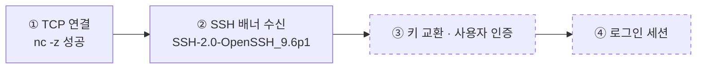

> 그림의 점선 칸(③·④)은 이번 실습에서 **시험하지 않은** 단계다.

**SSH 배너 확인은 실제 SSH 로그인 성공을 의미하지 않는다.** 배너는 SSH 서버가 연결을 받자마자 **누구에게나** 보내는 자기소개다. 로그인할 계정이 있는지, 비밀번호나 키가 맞는지, root 로그인이 실제로 거부되는지는 이 결과로 알 수 없다.

학교 건물 비유로 말하면, 관리용 출입문을 두드렸더니 안에서 "여기는 SSH 관리 창구입니다"라는 안내 방송이 나온 것이다. 그 창구에서 **신분증 검사를 통과해 안으로 들어간 것은 아니다.**

**B4-1 미션에서 필요한 이유:** 13-1절의 "연결 성공"만으로는 20022에서 대답한 프로그램이 무엇인지 알 수 없다. 배너를 받으면 **20022 = OpenSSH SSH 서버**라는 것이 확인되어 S1 증빙이 완성된다. 공식 체크리스트(§4)에는 같은 목적의 `perl` 명령이 예시되어 있지만, Owner는 `nc`로 같은 배너를 받았다.

---

## 14. 공식 제출 증빙 S1·S2

2강에서 배운 내용은 공식 수행 내역서의 S1·S2 화면과 연결된다.

### S1. SSH 설정 증빙

캡처에서 확인할 내용은 다음과 같다.

- Ubuntu Machine을 사용 중이라는 사실
- SSH 관리 포트 20022
- Root SSH 직접 로그인 차단
- SSH 서버의 TCP 20022 LISTEN 상태

현재 서버의 상태 조회는 변경 위험이 낮은 명령만 사용한다.

#### 그림 2-1. S1 — Ubuntu 운영체제와 SSH 설정·LISTEN (v0.2 보충)

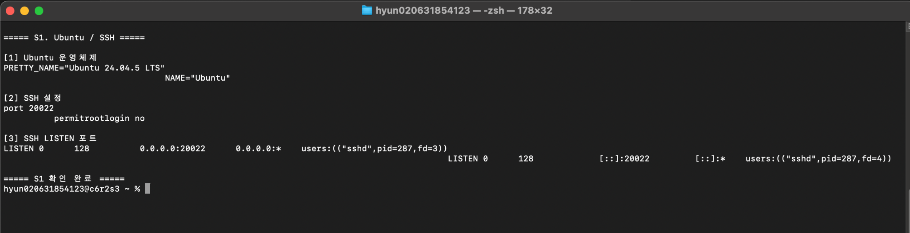

| 질문 | 설명 |
|---|---|
| 무엇을 검사한 화면인가? | Ubuntu `b4-lab`의 운영체제 버전, SSH 서버의 유효 설정(포트·root 로그인), SSH 서버의 LISTEN 상태 |
| 어떤 명령어를 실행했는가? | Mac에서 `[1]` `orb -m b4-lab cat /etc/os-release \| head -2`, `[2]` `B sshd -T \| grep -E '^(port\|permitrootlogin) '`, `[3]` `B ss -tlnp \| grep sshd` |
| 결과를 어떻게 읽어야 하는가? | `[1]` Ubuntu 24.04.5 LTS → `[2]` `port 20022`, `permitrootlogin no` → `[3]` `sshd`(PID 287)가 `0.0.0.0:20022`와 `[::]:20022`에서 LISTEN. 두 번째 줄이 오른쪽으로 밀린 것은 화면 표시 문제이며 값은 그대로다(12-1절) |
| 이 화면이 증명하지 못하는 것은? | Mac에서 실제로 20022에 연결되는지(→ 그림 2-3), 20022에서 대답하는 것이 SSH 서버인지(→ 그림 2-4), SSH 로그인 성공 여부, root 로그인이 실제로 거부되는지 |

### S2. UFW 설정 증빙

캡처에서 확인할 내용은 다음과 같다.

- UFW active
- 기본 incoming deny / outgoing allow
- TCP 20022와 15034 허용
- IPv4·IPv6 규칙 구분

원래 최종 증빙 체크리스트에는 Mac에서 실제 포트 연결을 시험한 기록도 포함되어 있다. 그 부분은 읽기 전용 설정 조회를 먼저 이해한 뒤, 이미 확보한 검증 기록과 연결해 진행한다.

**캡처하기 전에 출력 결과가 무엇을 증명하는지 직접 설명할 수 있는지가 중요하다.**

#### 그림 2-2. S2 — UFW 방화벽 상태와 규칙 (v0.2 보충)

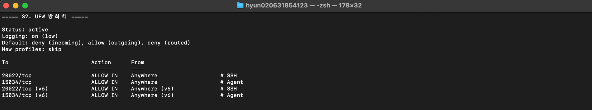

| 질문 | 설명 |
|---|---|
| 무엇을 검사한 화면인가? | Ubuntu `b4-lab`의 UFW 방화벽 활성 여부, 기본 정책, 허용 규칙 |
| 어떤 명령어를 실행했는가? | Mac에서 `B ufw status verbose \| awk '{printf "%s\r\n", $0}'` (`awk`는 줄 정렬만 담당, 12-1절) |
| 결과를 어떻게 읽어야 하는가? | `Status: active` → `Default: deny (incoming), allow (outgoing), deny (routed)` → `20022/tcp`(# SSH)와 `15034/tcp`(# Agent)가 `ALLOW IN`, 같은 두 규칙의 `(v6)` 줄이 IPv6용으로 따로 있음. 서비스는 두 개, 규칙 줄은 네 개 |
| 이 화면이 증명하지 못하는 것은? | 20022·15034에서 실제로 프로그램이 LISTEN 중인지(방화벽 허용 ≠ LISTEN, 7-1절), Mac에서 실제로 연결·차단되는지(→ 그림 2-3), Agent가 실행 중인지 |

#### 그림 2-3. S1·S2 — Mac에서 Ubuntu로 TCP 연결 시험 (v0.2 보충)

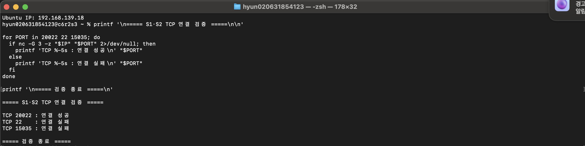

| 질문 | 설명 |
|---|---|
| 무엇을 검사한 화면인가? | 교육장 Mac에서 Ubuntu(`192.168.139.18`)의 TCP 20022·22·15035 포트로 실제 연결이 되는지 |
| 어떤 명령어를 실행했는가? | Mac에서 `for PORT in 20022 22 15035; do ... nc -G 3 -z "$IP" "$PORT" ... done` (13-1절) |
| 결과를 어떻게 읽어야 하는가? | `TCP 20022 : 연결 성공`, `TCP 22 : 연결 실패`, `TCP 15035 : 연결 실패`. 그림 2-1(20022 LISTEN, 22 없음)·그림 2-2(20022 허용, 22·15035 허용 목록에 없음)와 모순 없이 일치한다. 화면 오른쪽 위에 macOS 알림 일부가 함께 찍혀 있지만 시험 내용과는 관계없다 |
| 이 화면이 증명하지 못하는 것은? | 실패 원인이 timeout(방화벽 차단)인지 connection refused(LISTEN 없음)인지(`2>/dev/null`로 오류 메시지를 숨겼기 때문), 20022에서 대답한 프로그램이 SSH 서버인지(→ 그림 2-4), SSH 로그인 성공 여부, 15034(Agent) 동작 |

#### 그림 2-4. S1 — SSH 배너 확인 (v0.2 보충)

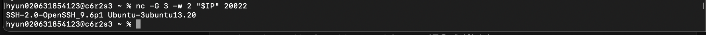

| 질문 | 설명 |
|---|---|
| 무엇을 검사한 화면인가? | Mac에서 Ubuntu TCP 20022에 연결했을 때, 대답하는 프로그램이 SSH 서버인지 |
| 어떤 명령어를 실행했는가? | Mac에서 `nc -G 3 -w 2 "$IP" 20022` (`$IP` = `192.168.139.18`, 13-2절) |
| 결과를 어떻게 읽어야 하는가? | `SSH-2.0-OpenSSH_9.6p1 Ubuntu-3ubuntu13.20` = SSH 프로토콜 2.0을 쓰는 OpenSSH 9.6p1(Ubuntu 패키지) 서버가 20022에서 대답했다. 그림 2-1의 `port 20022`·LISTEN, 그림 2-3의 20022 연결 성공과 일치한다 |
| 이 화면이 증명하지 못하는 것은? | **SSH 사용자 인증과 로그인 성공**(키 교환·인증을 하지 않음), `permitrootlogin no`에 따른 root 로그인 거부의 실제 동작, 사용할 계정·키가 올바른지 |

#### 네 장의 화면을 하나로 연결하면 (v0.2 보충)

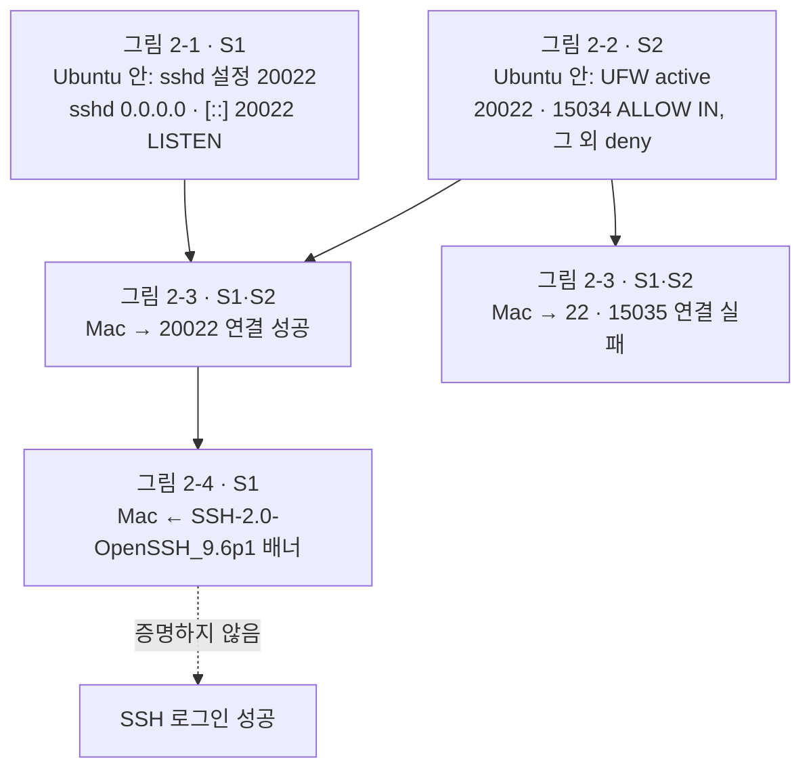

S1·S2 화면, TCP 연결 시험, SSH 배너 확인의 공식 기록과 판정은 [S1·S2 화면 증빙 안내](../evidence/screenshots/README.md)와 [공식 증빙 §4](../b4-1-final-evidence.md)에 있다. 이 학습자료는 그 기록을 **이해하기 위한 교재**이며 공식 판정을 대신하지 않는다.

---

## 15. 이해 확인 질문

### 배운 내용 확인

1. IP 주소와 포트 번호는 어떻게 다를까?
2. SSH는 무엇이며, SSH 서버 `sshd`는 어떤 역할을 할까?
3. SSH의 기본 포트 22와 B4-1의 포트 20022는 어떤 관계일까?
4. Root 원격 로그인을 차단해도 Ubuntu 내부에서 sudo를 사용할 수 있는 이유는 무엇일까?
5. SSH와 UFW는 각각 어떤 역할을 담당할까?
6. `0.0.0.0:20022`는 서버의 실제 IP 주소가 0.0.0.0이라는 뜻일까?
7. `B ss -tlnp | grep sshd` 명령은 전체적으로 무엇을 확인할까?

**v0.2 추가 — 배운 내용 확인**

11. `B ufw status verbose`의 출력에 허용 규칙이 네 줄 보인다. 서비스가 네 개라는 뜻일까?
12. `nc -G 3 -z "$IP" "$PORT"`에서 `-G 3`과 `-z`는 각각 무슨 뜻일까?
13. `for PORT in 20022 22 15035; do ... done`은 무엇을 몇 번 반복할까?
14. timeout과 connection refused는 어떻게 다를까?
15. `B ufw status verbose | awk '{printf "%s\r\n", $0}'`를 실행하면 UFW 설정이 바뀔까?

### 생각해 보기

8. UFW에서 15034를 허용했지만 Agent가 중지되어 있다면 15034가 LISTEN 상태일까?
9. SSH 서버가 20022를 LISTEN 중인데 외부에서 접속할 수 없다면 어떤 항목을 추가로 점검해야 할까?
10. SSH 포트 번호를 20022로 바꾸는 것만으로 서버가 충분히 안전해졌다고 할 수 있을까?

**v0.2 추가 — 생각해 보기**

16. Mac에서 `nc -G 3 -w 2 "$IP" 20022`를 실행해 `SSH-2.0-OpenSSH_9.6p1 ...` 배너를 받았다. 친구가 "이제 SSH 로그인도 된다는 게 증명됐네"라고 말한다면 뭐라고 설명해 줄까?
17. 누군가 실수로 UFW에서 20022 허용 규칙을 지웠다고 하자(`sshd`는 그대로 20022에서 LISTEN 중). 13-1절의 Mac 연결 시험을 다시 하면 20022 결과는 어떻게 될까? 그리고 그 실패는 timeout과 refused 중 어느 쪽일 가능성이 클까?
18. 13-1절 시험에서 15034 대신 15035를 고른 이유는 무엇일까? Agent가 중지된 상태에서 15034를 시험했다면 어떤 결과가 나올 수 있을까?

> 번호 안내: v0.1의 질문 번호 1~10은 그대로 유지했다. v0.2에서 추가한 질문은 11번부터 붙였다.

---

## 16. 이해 확인 질문 해설

**1. IP와 포트의 차이**

IP는 네트워크상의 통신 대상을 찾기 위한 주소이고, 포트는 그 대상 안에서 통신 서비스를 구분하는 번호다.

**2. SSH와 sshd**

SSH는 안전한 원격 접속을 위한 프로토콜이고, `sshd`는 Ubuntu에서 SSH 접속 요청을 받아들이는 서버 프로그램이다.

**3. 22와 20022**

22는 SSH가 흔히 사용하는 기본 포트이며, 이번 미션은 SSH 관리 포트를 20022로 변경했다.

> **v0.2 보충:** 실습에서도 `sshd`는 20022에서만 LISTEN했고(11절), Mac → 22 연결은 실패했다(13-1절).

**4. Root 원격 로그인과 sudo**

SSH를 통한 Root 계정의 직접 로그인 제한은 Ubuntu 내부에서 허가된 계정이 sudo를 사용하는 것과 다른 정책이다.

**5. SSH와 UFW**

SSH는 원격 접속을 위한 통신 방식이고, UFW는 네트워크 접근을 허용하거나 차단하도록 방화벽 규칙을 관리한다.

**6. 0.0.0.0**

`0.0.0.0:20022`는 서버의 모든 IPv4 로컬 주소에서 해당 TCP 포트의 연결 요청을 받도록 설정됐다는 뜻이다.

> **v0.2 보충:** 그래서 Mac에서는 `0.0.0.0`이 아니라 실제 주소 `192.168.139.18`로 접속했다. `[::]:20022`는 같은 의미를 IPv6에 적용한 것이다(9-1절).

**7. ss 명령**

Ubuntu 안에서 현재 LISTEN 중인 TCP 소켓과 프로세스 정보를 확인하고, 그중 SSH 서버 항목만 찾아 보여준다.

**8. UFW 허용과 LISTEN**

서로 다르다. 방화벽이 포트를 허용해도 Agent가 중지되어 있으면 해당 프로그램의 LISTEN이 없을 수 있다.

**9. SSH LISTEN인데 접속 불가**

방화벽 규칙, 실제 네트워크 경로, 클라이언트가 지정한 주소와 포트 등을 점검해야 한다.

> **v0.2 보충:** 실패가 timeout인지 refused인지 확인하면 범위를 좁힐 수 있다. timeout이면 방화벽·주소·경로 쪽을, refused이면 그 포트에서 실제로 LISTEN 중인지를 먼저 의심한다(13-1절).

**10. 포트 번호만 변경하면 충분한가?**

아니다. 인증, 사용자 권한 제한, Root 로그인 정책, 방화벽과 같은 여러 보안 조치가 함께 필요하다.

**11. 허용 규칙 네 줄 (v0.2 추가)**

아니다. 서비스는 SSH(20022)와 Agent(15034) 두 개다. 같은 두 규칙이 IPv4용과 IPv6용(`(v6)`)으로 각각 표시되어 네 줄이 된다(8절 보충).

**12. `-G 3`과 `-z` (v0.2 추가)**

`-G 3`은 연결을 맺을 때까지 최대 3초만 기다린다는 뜻이고, `-z`는 데이터를 보내지 않고 연결이 되는지만 확인한다는 뜻이다. 그래서 이 명령은 "3초 안에 연결되는가?"만 빠르게 시험한다(13-1절).

**13. `for` 반복문 (v0.2 추가)**

변수 `PORT`에 20022, 22, 15035를 차례로 넣으며 `do`와 `done` 사이의 `if nc ...` 부분을 **세 번** 실행한다. 회차마다 그 포트로 연결을 시도하고 결과를 한 줄씩 출력한다(13-1절).

**14. timeout과 connection refused (v0.2 추가)**

timeout은 정해진 시간 안에 **아무 대답도 오지 않은** 것이다. 방화벽이 요청을 대답 없이 버렸을 때 흔히 나타난다. connection refused는 서버 컴퓨터가 **곧바로** "이 포트에는 기다리는 프로그램이 없다"고 대답한 것이다. 요청이 방화벽을 지나 서버까지 갔지만 LISTEN 중인 프로그램이 없을 때 나타난다(13-1절).

**15. `awk` 정렬과 설정 변경 (v0.2 추가)**

바뀌지 않는다. `awk`는 파이프 오른쪽, 즉 Mac에서 실행되며, Ubuntu에서 이미 넘어온 출력 글자의 줄 끝에 `\r\n`을 붙여 화면 정렬만 바로잡는다. UFW 규칙을 바꾸는 것은 `ufw allow`, `ufw disable` 같은 명령이고, 이번 실습에서는 사용하지 않았다(12-1절).

**16. 배너 수신과 로그인 (v0.2 추가)**

배너는 SSH 서버가 연결을 받자마자 누구에게나 보내는 자기소개 문자열이다. 배너를 받았다는 것은 ① TCP 연결 성공과 ② 20022에서 대답하는 프로그램이 OpenSSH SSH 서버라는 것까지만 보여 준다. 그다음 단계인 키 교환, 사용자 인증, 로그인 세션은 하지 않았으므로 **로그인 성공은 증명되지 않았다**고 설명하면 된다(13-2절).

**17. 20022 허용 규칙이 사라진다면 (v0.2 추가)**

UFW 기본 정책이 deny incoming이므로, 허용 규칙이 없어진 20022로 들어오는 통신은 차단된다. 따라서 Mac → 20022 결과는 **연결 실패**가 될 것이다. `sshd`가 LISTEN 중이어도 방화벽이 먼저 막기 때문이다(7-1절). UFW는 막은 통신에 대답하지 않으므로 **timeout**일 가능성이 크다. 이것은 "LISTEN 중이어도 방화벽이 막으면 접속할 수 없다"는 7-1절 내용을 실제 상황에 적용한 것이다. 단, 이번 강의에서는 규칙을 지우는 실험을 **하지 않는다**(13절).

**18. 15034 대신 15035를 고른 이유 (v0.2 추가)**

15034는 UFW에서 허용했지만, Agent가 중지되어 있으면 그 포트에서 LISTEN 중인 프로그램이 없다(8-2절). 이때 15034로 연결하면 방화벽은 통과하지만 기다리는 프로그램이 없어서 실패하며, 보통 **connection refused**가 된다. 그러면 "방화벽이 막아서 실패했는가?"를 시험하려는 목적과 섞여 버린다. 15035는 허용 목록에 아예 없는 포트이므로 "허용하지 않은 포트는 방화벽이 막는다"는 것을 시험하기에 알맞다.

---

## 17. 다음 강의와 미션 스토리 연결

이번 2강에서는 서버에 들어오는 **네트워크 통신**을 어떻게 구분하고 통제하는지 배웠다.

다음 3강에서는 질문을 바꿔 보자.

**“서버에 들어온 사용자들은 모두 같은 파일을 열고 수정할 수 있을까?”**

이 질문을 이해하려면 Linux 사용자 계정, 그룹, 파일 권한, ACL을 배워야 한다.

### 미션 스토리로 발전시킬 핵심 개념

- IP 주소와 포트 번호의 관계
- SSH와 UFW의 역할 차이
- Root 로그인 차단과 관리자 권한의 차이
- UFW 허용과 실제 LISTEN 상태의 차이
- Mac → OrbStack → Ubuntu 명령 실행 경로

이 관계를 그림으로 표현하면 B3-1에서 학습한 네트워크 개념과 B4-1의 Linux 운영 기술도 자연스럽게 연결할 수 있다.

> **v0.2 보충 — 실습에서 얻은 미션 스토리 소재**
>
> - **"안에서 본 설정"과 "밖에서 두드려 본 결과"**: Ubuntu 안의 `sshd -T`·`ss`·`ufw` 결과와 Mac에서의 `nc` 결과가 서로 맞아떨어지는 장면
> - **세 가지 성공의 구분**: TCP 연결 → SSH 배너 → (아직 하지 않은) 로그인
> - **timeout과 refused**: "대답 없는 문"과 "운영하지 않는 창구"의 차이
> - **보이는 모양과 실제 설정**: `awk`로 화면 정렬을 바꿔도 서버 설정은 그대로라는 점

---

## 18. 질문과 보완 기록

이 문서는 2강 v0.1 초안을 바탕으로 Owner의 S1·S2 실습 결과를 통합한 v0.2 원고다.

읽다가 설명이 부족한 부분이 발견되면 원래 순서와 비유를 유지한 채 해당 부분에 추가한다.

중요한 명령어는 계속 다음 순서로 설명한다.

**명령어 원문 → 구성 요소별 풀이 → 전체 한국어 해석 → 실제 출력 → B4-1 미션과의 연결**

실제 서버 조회나 화면 캡처는 학습자가 명령의 의미를 이해한 뒤 진행한다.

학습·보완이 끝난 원고는 `docs/learning/02-ssh-ufw.md`로 GitHub에 등록한다.

### 버전 기록

| 버전 | 내용 |
|---|---|
| v0.1 | 0~18절 본문과 Mermaid 구조도 2개(SSH와 UFW의 관계, B4-1에서 열어 둔 두 포트) 작성. GitHub 미등록 |
| v0.2 | v0.1 원문을 보존하고 다음을 보충: 실제 실습 환경과 Mac/Ubuntu 명령 실행 위치(1-1절), IPv4·IPv6(2절), TCP 연결 성공·실패의 의미(3-2절), SSH 접속 단계(4절), S1 실측값(5·10·11절), `0.0.0.0`·`[::]`와 소켓 바인딩(9-1절), S2 실제 출력과 `(v6)`·`deny (routed)`(8·12절), `awk` 출력 정렬(12-1절), Mac TCP 연결 시험과 timeout/refused(13-1절), SSH 배너와 세 가지 성공의 구분(13-2절), S1·S2 실습 화면 4장과 그림 설명(14절), 이해 확인 질문 11~18번과 해설, Mermaid 구조도 5개 추가. v0.1 Mermaid 2개는 7-1절·8절로 이동 |

### v0.2에서 남은 확인 사항

- 터미널 줄 밀림(12-1절)의 정확한 원인은 확정하지 않았다. 출력 값에는 영향이 없다.
- SSH 사용자 인증·로그인과 root 로그인 거부 동작은 이번 2강 실습 범위에서 시험하지 않았다.
- Ubuntu IP `192.168.139.18`과 `sshd` PID 287은 2026-11-14 실습 당시의 값이다.
