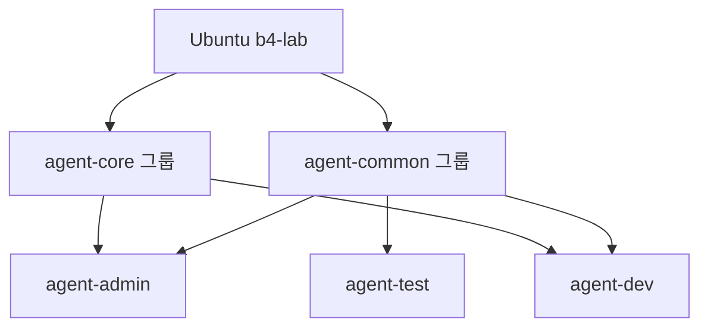
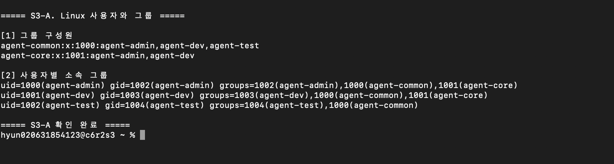
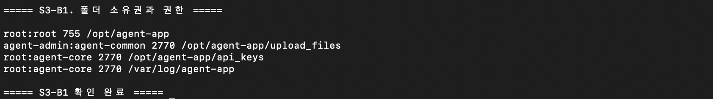
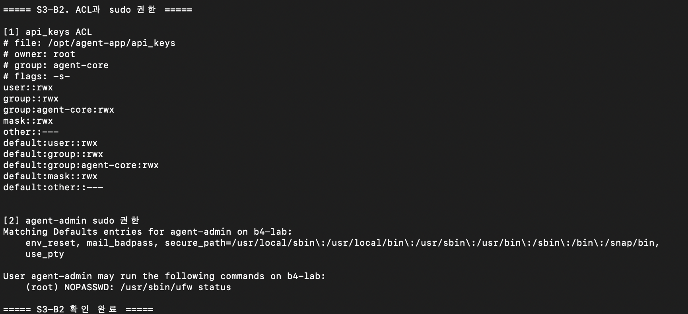

# 3강. 같은 서버에 들어왔는데, 왜 열 수 있는 폴더가 다를까?

**학습 분야:** Linux 시스템 운영과 보안 기초  
**연결 미션:** Codyssey B4-1 — 컴퓨터가 알아서 자기 상태를 점검하게 만들기  
**문서 상태:** v0.2 원고 / 학습 검토 — v0.1(0~18절)을 보존하고 검토 의견 4건(실습 E 명령, §12 문체, §11-2 ACL 설명, §6-1 sticky bit)을 반영한 뒤, Owner가 2026-11-16에 촬영한 S3 실습 화면 3장을 연결한 검토본  
**선행 학습:** 0강 터미널·Bash, 1강 서버 관리, 2강 SSH·포트·UFW

> **v0.2 읽는 방법**
>
> - v0.1의 설명·비유·질문은 그대로 두었다. 추가한 내용은 하위 절(예: `6-2`, `11-3`)이나 **「v0.2 보충」** 표시가 붙은 블록에 있다.
> - 기술적으로 바로잡은 곳은 15절 실습 E의 명령과 12절의 문체다.
> - **S3 실습 연결:** 2026-11-16에 Owner가 직접 촬영한 화면 3장(S3-A·S3-B1·S3-B2)을 관련 절(4·10·11·14절)에 연결하고, 16절에서 각 화면이 증명하는 것과 증명하지 못하는 것을 정리했다. 추가 설명은 `4-1`, `10-4`, `10-5`, `11-4`, `11-5`, `14-2`, `14-3`, `16-1`~`16-4`절과 **「S3 실습 연결」** 표시 블록에 있다.
> - 이미지는 저장소의 공식 증빙 폴더(`docs/evidence/screenshots/`)에 이미 등록된 원본을 상대경로로 참조할 뿐, 복사·수정하지 않았다.

---

## 0. 이번 강의에서 해결할 질문

1. 서버에 여러 사용자 계정이 필요한 이유는 무엇일까?
2. 사용자와 그룹은 어떻게 다를까?
3. Linux에서 `root`는 누구일까?
4. 같은 그룹에 속하면 무엇이 달라질까?
5. 파일의 소유자와 사용 권한은 어떤 관계일까?
6. `rwx`, `755`, `2770`, `640`은 무슨 뜻일까?
7. ACL은 일반 파일 권한과 어떻게 다를까?
8. `sudo`는 사용자 계정과 어떤 관계가 있을까?
9. B4-1에서 `agent-admin`, `agent-dev`, `agent-test`는 각각 어디에 접근할 수 있을까?
10. 실제 Linux에서 설정을 안전하게 확인하는 방법은 무엇일까?

**학습 목표:** B4-1의 세 사용자와 두 그룹이 왜 필요했는지 설명하고, 폴더별 접근 권한을 직접 읽을 수 있게 되는 것이다.

---

## 1. 서버에 들어왔다고 모든 공간을 사용할 수 있을까?

2강에서는 SSH와 방화벽을 배웠다.

SSH는 원격으로 서버에 접근하는 통신 방식이고, UFW는 어떤 네트워크 통신을 허용할지 통제한다.

그런데 서버에 들어오는 통신을 허용했다고 해서 모든 사용자가 서버의 모든 파일에 접근해도 될까?

학교 건물을 다시 떠올려 보자.

학교 안에는 교실, 교무실, 컴퓨터실, 자료 보관실이 있다. 학교에 들어올 수 있는 사람이라고 해서 모든 방의 열쇠를 주지는 않는다.

학생은 일반 교실을 사용할 수 있지만 교무실의 중요 문서를 마음대로 변경해서는 안 된다.

서버도 똑같다.

**네트워크를 통해 서버에 접근할 수 있는 것과, 서버 내부 파일에 접근할 수 있는 것은 다른 문제다.**

| 학교 건물 | Linux 서버 |
|---|---|
| 출입 가능한 사람을 확인 | 사용자 계정 |
| 교직원·학생·관리팀 구분 | 사용자 그룹 |
| 방이나 자료의 관리자 | 파일 소유자 |
| 열람·작성·출입 허가 | 파일 권한 |
| 특별한 접근 허가 | ACL |
| 일부 행정 작업 승인 | sudo |

이것이 3강의 출발점이다.

---

## 2. Linux 사용자 계정은 무엇일까?

Linux는 여러 사용자가 함께 사용할 수 있는 운영체제다.

각 사용자를 구분하기 위해 사용자 계정이 존재한다.

사용자 계정은 단순한 이름표가 아니다. 어떤 사용자가 프로그램을 실행하고 파일을 읽거나 수정하려고 할 때 Linux가 권한을 판단하는 중요한 기준이 된다.

### 2-1. B4-1에서 만든 세 사용자

이번 미션에서는 다음 계정을 만들었다.

| 계정 | 미션에서의 역할 |
|---|---|
| `agent-admin` | 제공 Agent를 실행하고 자동 점검을 수행하는 운영 계정 |
| `agent-dev` | 프로그램과 점검 스크립트의 개발·관리 역할 |
| `agent-test` | 일반 사용자에 가까운 제한된 접근 권한을 검증하는 계정 |

이 이름들은 B4-1 실습을 위해 정한 이름이다.

`agent-admin`이라고 부른다고 해서 자동으로 Linux의 최고 관리자 권한을 갖는 것은 아니다.

**이름과 권한은 다르다.**

예를 들어 `agent-admin`도 Linux의 `root`와 같은 사용자는 아니다.

### 2-2. Root는 누구일까?

`root`는 Linux에서 시스템 전체를 관리할 수 있는 특별한 관리자 계정이다.

대부분의 일반적인 파일 접근 제한을 넘어서는 높은 권한을 가진다.

일상적인 서비스를 항상 root로 실행하면 사고나 침해가 발생했을 때 피해 범위가 커질 수 있다.

그래서 이번 B4-1에서는 Agent를 `root`가 아니라 `agent-admin`으로 실행하도록 했다.

이전에 SSH에서 설정한 `PermitRootLogin no`는 root의 SSH 직접 로그인을 제한한다는 의미다.

---

## 3. 그룹은 무엇일까?

사용자 세 명이 있다고 생각해 보자.

각 사용자에게 모든 폴더의 권한을 하나하나 설정할 수도 있다.

하지만 사용자 수가 많아지면 관리가 복잡해진다.

예를 들어 어떤 자료를 개발팀 전체가 읽을 수 있도록 하려면 어떻게 해야 할까?

사람마다 권한을 따로 부여하는 것보다 **개발팀이라는 그룹을 만들고 그 그룹에 권한을 부여**하는 것이 편리하다.

그룹은 여러 사용자에게 공통된 접근 권한을 관리하기 위한 단위다.

### 3-1. B4-1의 두 그룹

이번 미션에서는 다음 그룹을 만들었다.

**`agent-common`**

세 사용자 모두 소속된 공통 그룹이다.

- `agent-admin`
- `agent-dev`
- `agent-test`

**`agent-core`**

중요한 작업과 파일에 접근하도록 허용한 그룹이다.

- `agent-admin`
- `agent-dev`

`agent-test`는 `agent-core`에 포함하지 않았다.

### 3-2. 그림으로 이해하기



여기서 중요한 것은 **한 사용자가 여러 그룹에 동시에 속할 수 있다**는 점이다.

`agent-admin`은 공통 그룹과 핵심 그룹에 모두 속한다.

그리고 소속 그룹마다 허용된 폴더에 접근할 수 있다.

---

## 4. UID와 GID는 무엇일까?

Linux는 사용자와 그룹을 이름뿐 아니라 숫자로도 구분한다.

- **UID(User ID):** 사용자 식별 번호
- **GID(Group ID):** 그룹 식별 번호

예를 들어 B4-1 검증 기록에서 `agent-admin`은 UID 1000으로 표시되었다.

다음 명령을 실행하면 이를 확인할 수 있다.

```bash
B id agent-admin
```

**구성 요소별 해석**

| 구성 | 의미 |
|---|---|
| `B` | OrbStack의 Ubuntu에서 관리자 권한으로 명령 실행 |
| `id` | 사용자의 UID, 기본 그룹, 소속 그룹 확인 |
| `agent-admin` | 정보를 조회할 사용자 이름 |

**명령어 전체 해석**

“Ubuntu `b4-lab`에 등록된 `agent-admin` 사용자의 식별 번호와 소속 그룹을 출력해라.”

실제 검증 기록의 일부는 다음과 같다.

```text
uid=1000(agent-admin)
gid=1002(agent-admin)
groups=1002(agent-admin),1000(agent-common),1001(agent-core)
```

여기서 `gid=1002(agent-admin)`은 기본 그룹이고, 뒤의 `groups=`에는 현재 소속된 그룹들이 나와 있다.

그룹 이름과 숫자는 다른 Linux 환경에서는 달라질 수 있다.

### 4-1. S3-A 실습 결과: 사용자와 그룹 (2026-11-16)

> **S3 실습 연결.** 위의 출력은 기존 검증 기록에서 가져온 것이었다. 2026-11-16에 Owner가 교육장 Mac 터미널에서 직접 같은 항목을 다시 조회해 촬영했다.



**이 화면에 대응하는 명령** (화면에는 명령 문장이 찍혀 있지 않으며, 공식 증빙 체크리스트의 조회 명령에 대응한다)

```bash
B getent group agent-common agent-core
B id agent-admin
B id agent-dev
B id agent-test
```

**화면의 실제 출력**

```text
agent-common:x:1000:agent-admin,agent-dev,agent-test
agent-core:x:1001:agent-admin,agent-dev
uid=1000(agent-admin) gid=1002(agent-admin) groups=1002(agent-admin),1000(agent-common),1001(agent-core)
uid=1001(agent-dev) gid=1003(agent-dev) groups=1003(agent-dev),1000(agent-common),1001(agent-core)
uid=1002(agent-test) gid=1004(agent-test) groups=1004(agent-test),1000(agent-common)
```

**출력 읽는 법**

| 계정 | UID | 기본 그룹(`gid`) | 추가로 속한 그룹 |
|---|---|---|---|
| `agent-admin` | 1000 | `agent-admin`(1002) | `agent-common`(1000), `agent-core`(1001) |
| `agent-dev` | 1001 | `agent-dev`(1003) | `agent-common`(1000), `agent-core`(1001) |
| `agent-test` | 1002 | `agent-test`(1004) | `agent-common`(1000) |

- `agent-common`(1000)의 구성원은 세 계정 모두이고, `agent-core`(1001)의 구성원은 `agent-admin`과 `agent-dev`뿐이다.
- 각 계정은 자기 이름과 같은 **개인 기본 그룹**(1002~1004)도 하나씩 가진다. 3-1절의 두 그룹은 여기에 더해 공유용으로 만든 그룹이다.
- **`agent-test`의 `groups=`에는 `agent-core`가 없다.** 이것이 10-2·10-4절에서 설명할 “키 폴더 접근 거부”의 출발점이다.

**이 화면이 증명하는 것:** 2026-11-16 시점에 서버에 등록된 그룹 구성원과 사용자별 소속 그룹.
**이 화면만으로 증명할 수 없는 것:** 그 소속이 폴더 접근에 실제로 어떤 결과를 내는지(→ 12절, 16-3절).

---

## 5. 파일의 소유자는 누구일까?

Linux 파일과 폴더에는 소유자와 소유 그룹이 있다.

예를 들어 다음 표기를 살펴보자.

```text
agent-admin:agent-common
```

콜론(`:`) 왼쪽은 소유 사용자, 오른쪽은 소유 그룹이다.

**전체 해석**

“이 파일이나 폴더의 소유 사용자는 `agent-admin`이고, 소유 그룹은 `agent-common`이다.”

단, 소유자라는 사실만으로 어떤 작업이든 가능하다는 뜻은 아니다.

파일이나 폴더에 실제로 설정된 권한도 함께 확인해야 한다.

---

## 6. Linux의 기본 권한 `r`, `w`, `x`

Linux에서는 파일이나 폴더에 접근할 때 크게 세 가지 권한을 사용한다.

| 문자 | 영어 | 파일에서의 의미 |
|---|---|---|
| `r` | read | 파일 내용을 읽을 수 있음 |
| `w` | write | 파일 내용을 수정할 수 있음 |
| `x` | execute | 프로그램·스크립트를 실행할 수 있음 |

그런데 같은 문자가 **폴더(디렉터리)**에 적용되면 의미가 조금 달라진다.

| 문자 | 폴더에서의 의미 |
|---|---|
| `r` | 폴더에 들어 있는 이름 목록을 조회 |
| `w` | 폴더 안의 항목을 생성·삭제·이름 변경할 수 있는 권한의 일부 |
| `x` | 경로를 따라 폴더 안으로 진입·탐색할 수 있음 |

폴더의 `w` 권한만으로 모든 작업이 가능한 것은 아니다. 일반적으로 파일을 생성하거나 삭제하려면 폴더의 `w`와 `x`가 함께 필요하다.

### 6-1. 파일을 읽는 것과 삭제하는 것은 왜 다를까?

중요한 차이가 있다.

파일 내용의 읽기·수정 권한은 주로 파일 자체의 권한으로 판단한다.

하지만 파일을 삭제하는 작업은 해당 파일이 들어 있는 **부모 디렉터리의 권한**에 크게 영향을 받는다.

따라서 파일에 `w` 권한이 없더라도 부모 폴더의 권한과 다른 제한 조건에 따라 삭제가 가능할 수 있다.

이 차이는 단순한 숫자 암기보다 중요하다.

> **v0.2 보충 — 6-2. 삭제를 더 제한하는 sticky bit**
>
> 위에서 말한 “다른 제한 조건” 중 대표적인 것이 **sticky bit**라는 특수 권한이다.
>
> 여러 사용자가 모두 쓸 수 있는 폴더에서는 폴더의 `w` 권한만 보면 남의 파일도 지울 수 있게 된다. sticky bit가 설정된 디렉터리에서는 **파일 소유자, 디렉터리 소유자, root만** 그 안의 파일을 삭제하거나 이름을 바꿀 수 있다.
>
> 대표적인 예가 `/tmp`다. `/tmp`는 모든 사용자가 파일을 만들 수 있어야 하므로 권한이 `1777`이다. 맨 앞의 `1`이 sticky bit를 뜻하고, `ls -ld /tmp`에서는 마지막 문자가 `t`로 보인다(`drwxrwxrwt`).
>
> **9절의 setgid `2770`과는 목적이 다르다.**
>
> | 특수 권한 | 숫자 | 디렉터리에서의 목적 | 예 |
> |---|---|---|---|
> | sticky bit | `1` | 폴더 안 항목을 **남이 삭제·이름 변경하지 못하게** 제한 | `/tmp` `1777` |
> | setgid | `2` | 폴더 안에서 새로 만든 항목이 **폴더의 소유 그룹을 물려받게** 함 | B4-1 `2770` |
>
> 이번 B4-1 폴더의 `2770`에는 sticky bit(`1`)가 없다. 즉 B4-1의 공용 폴더는 삭제 제한이 아니라 **그룹 상속**을 위해 특수 권한을 사용한다. 두 권한은 서로 다른 일을 하며, 필요하면 함께 쓸 수도 있다(예: `3770`).

---

## 7. 권한은 누구에게 적용될까?

Linux의 기본 권한은 일반적으로 다음 세 대상에 대해 설정한다.

1. **Owner:** 파일이나 폴더의 소유 사용자
2. **Group:** 파일이나 폴더의 소유 그룹에 속한 사용자
3. **Others:** 그 외의 사용자

예를 들어 다음을 보자.

```text
rwxrwx---
```

세 문자씩 나눠서 읽는다.

| 대상 | 권한 | 의미 |
|---|---|---|
| 소유 사용자 | `rwx` | 읽기·쓰기·실행 |
| 소유 그룹 | `rwx` | 읽기·쓰기·실행 |
| 그 외 사용자 | `---` | 권한 없음 |

여기서는 소유자와 소유 그룹이 모든 권한을 가지고, 그 외 사용자는 접근할 수 없다.

---

## 8. `755`, `770`, `640`은 어떻게 읽을까?

Linux에서는 권한을 숫자로 표시하기도 한다.

각 권한에 다음 숫자를 부여한다.

- 읽기 `r = 4`
- 쓰기 `w = 2`
- 실행 `x = 1`

허용할 권한의 숫자를 더한다.

예를 들어 `rwx`는 `4 + 2 + 1 = 7`이다.

| 숫자 | 문자 | 의미 |
|---|---|---|
| 7 | `rwx` | 읽기·쓰기·실행 |
| 6 | `rw-` | 읽기·쓰기 |
| 5 | `r-x` | 읽기·실행 |
| 4 | `r--` | 읽기 |
| 0 | `---` | 아무 권한 없음 |

### 8-1. `755` 해석

`755`는 다음과 같다.

- 소유자: `7` → `rwx`
- 소유 그룹: `5` → `r-x`
- 그 외 사용자: `5` → `r-x`

**전체 해석**

“소유자는 읽기·쓰기·실행을 할 수 있고, 다른 사람들은 읽기와 실행을 할 수 있지만 수정은 할 수 없다.”

### 8-2. `640` 해석

`640`은 다음과 같다.

- 소유자: `6` → `rw-`
- 소유 그룹: `4` → `r--`
- 그 외 사용자: `0` → `---`

**전체 해석**

“파일 소유자는 읽고 수정할 수 있으며, 소유 그룹은 읽기만 가능하고, 다른 사람은 접근할 수 없다.”

B4-1의 `secret.key` 파일이 이 권한을 사용한다.

---

## 9. `2770`은 왜 네 자리일까?

앞에서 배운 권한은 세 자리였다.

그런데 B4-1의 폴더 권한은 `2770`이다.

앞의 `2`에는 특별한 의미가 있다.

여기서 `2`는 **setgid라는 특수 권한**을 나타낸다.

디렉터리에 setgid가 적용되면 그 안에서 새로 만든 파일·폴더가 일반적인 경우 해당 디렉터리의 소유 그룹을 물려받도록 할 수 있다.

### 9-1. 학교 자료실을 생각해 보자

개발팀 공용 폴더가 있다고 가정하자.

`agent-admin`이 파일을 만들 때마다 개인 그룹으로 만들어지면 다른 개발팀 사용자가 파일을 함께 관리하기 어려울 수 있다.

공용 폴더에 setgid를 적용하면 새로운 파일도 그 폴더의 그룹을 이어받도록 만들 수 있다.

**권한 2770의 전체 해석**

“이 폴더는 소유자와 소유 그룹에 읽기·쓰기·탐색 권한을 주고, 다른 사람의 접근은 막으며, 새로 생성되는 항목이 폴더 그룹을 이어받을 수 있도록 설정한다.”

단, 그룹 상속이 된다고 해서 새 파일에 항상 동일한 쓰기 권한까지 자동 부여되는 것은 아니다. 실제 새 파일의 권한은 생성 방식, umask, 기본 ACL 등의 영향을 받는다.

> **v0.2 보충.** setgid(`2`)는 “새 항목의 그룹 상속”, 6-2절의 sticky bit(`1`)는 “남의 항목 삭제 제한”이 목적이다. `2770`은 앞의 것만 사용한다.

---

## 10. 이번 B4-1의 폴더 권한은 어떻게 구성했을까?

실제 미션에서 사용한 경로는 다음과 같다.

| 경로 | 소유자:그룹 | 권한 |
|---|---|---|
| `/opt/agent-app` | `root:root` | `755` |
| `/opt/agent-app/upload_files` | `agent-admin:agent-common` | `2770` |
| `/opt/agent-app/api_keys` | `root:agent-core` | `2770` |
| `/var/log/agent-app` | `root:agent-core` | `2770` |

### 10-1. upload_files

세 사용자 모두 속한 `agent-common` 그룹이 접근할 수 있도록 했다.

업로드된 자료처럼 여러 사용자가 함께 다루어야 하는 공간이다.

### 10-2. api_keys

보안상 중요한 자료를 관리하는 폴더다.

`agent-core`에 속한 `agent-admin`과 `agent-dev`만 접근하도록 했다.

`agent-test`는 이 그룹에 포함되지 않으므로 접근할 수 없다.

### 10-3. /var/log/agent-app

Agent와 모니터링 관련 로그가 저장되는 폴더다.

이 역시 `agent-core` 그룹 중심으로 접근하도록 했다.

실제 접근은 기본 권한뿐 아니라 ACL도 함께 적용된 상태다.

### 10-4. S3-B1 실습 결과: 폴더 소유권과 권한 (2026-11-16)

> **S3 실습 연결.** 위 10절의 표는 Owner가 2026-11-16에 직접 촬영한 화면과 같은 값이다.



**이 화면에 대응하는 명령** (화면에는 명령 문장이 찍혀 있지 않으며, 공식 증빙 체크리스트의 조회 명령에 대응한다)

```bash
B stat -c '%U:%G %a %n' \
  /opt/agent-app \
  /opt/agent-app/upload_files \
  /opt/agent-app/api_keys \
  /var/log/agent-app
```

구성 요소(`stat`, `-c`, `%U`, `%G`, `%a`, `%n`)의 뜻은 15절 실습 C의 표와 같다. 전체 해석도 같다: “네 폴더의 소유 사용자, 소유 그룹, 숫자 권한, 경로를 한 줄씩 출력해라.”

**화면의 실제 출력과 해석**

| 폴더 | 소유자:그룹 | 권한 | 읽는 법 |
|---|---|---|---|
| `/opt/agent-app` | `root:root` | `755` | 소유자 `rwx`, 나머지는 `r-x`. 누구나 안으로 들어와 목록을 볼 수 있지만 수정은 root만 가능 |
| `/opt/agent-app/upload_files` | `agent-admin:agent-common` | `2770` | `agent-common` 그룹(세 계정 모두)이 읽기·쓰기·탐색 가능, 그 외 차단, 새 항목은 그룹 상속(setgid) |
| `/opt/agent-app/api_keys` | `root:agent-core` | `2770` | `agent-core` 그룹(admin·dev)만 읽기·쓰기·탐색 가능, 그 외 차단, 그룹 상속 |
| `/var/log/agent-app` | `root:agent-core` | `2770` | `api_keys`와 같은 구조. 로그도 `agent-core` 중심 |

**B4-1 미션에서의 의미:** 같은 `2770`이어도 **폴더의 소유 그룹이 `agent-common`이냐 `agent-core`이냐**에 따라 들어갈 수 있는 사용자가 달라진다. 숫자 권한은 같고 그룹이 다르다는 점이 3강의 핵심이다.

**이 화면이 증명하는 것:** 네 폴더의 소유자·소유 그룹·숫자 권한(`2770`의 setgid 포함).
**이 화면만으로 증명할 수 없는 것:** ACL 규칙(→ 11-4절), 사용자가 실제로 읽고 쓸 수 있는지(→ 16-3절).

### 10-5. 왜 `agent-test`는 `upload_files`에는 들어가고 `api_keys`에는 들어가지 못할까?

> **S3 실습 연결.** 4-1절(그룹 소속)과 10-4절(폴더 소유 그룹)을 이어 보면 이유가 보인다.

Linux는 접근하는 사용자를 **세 범주 중 하나로 분류**해 해당 범주의 권한만 적용한다(7절). 분류 순서는 소유자 → 소유 그룹 구성원 → 그 외 사용자다. `agent-test`를 두 폴더에 대입해 보자.

| 폴더 | 소유 그룹 | `agent-test`는 구성원인가? | 적용되는 범주 | 결과 |
|---|---|---|---|---|
| `upload_files` | `agent-common` | **예** (`groups=`에 `agent-common` 있음) | 소유 그룹 `rwx` | 읽기·쓰기 가능 |
| `api_keys` | `agent-core` | **아니오** (`groups=`에 `agent-core` 없음) | 그 외 사용자 `---` | 접근 거부 |

- `/opt/agent-app`은 `755`이므로 `agent-test`도 그 안까지는 **들어갈 수 있다**. 하지만 `api_keys`의 `other`는 `---`이어서 그 폴더 안으로는 들어갈 수 없다.
- ACL에도 `agent-test`에게 줄 항목이 없다. 11-2절 출력의 이름 있는 그룹 항목은 `agent-core`뿐이므로 `agent-test`는 ACL에서도 어떤 항목에도 해당하지 않고 `other::---`로 판정된다.
- 그래서 **“같은 서버에 들어왔는데 열 수 있는 폴더가 다르다”**: 계정은 같은 서버를 쓰지만, 계정이 속한 그룹이 다르기 때문이다.

---

## 11. ACL은 무엇일까?

ACL은 **Access Control List**의 줄임말이다.

한국어로는 접근 제어 목록이라고 한다.

기본적인 Linux 권한은 소유자·소유 그룹·그 외 사용자라는 세 범주를 사용한다.

그런데 특별히 한 사용자에게만 추가 권한을 주거나, 특정 그룹에 별도 권한을 부여해야 할 수도 있다.

이때 ACL을 사용할 수 있다.

### 11-1. 기본 권한과 ACL의 차이

**기본 권한**

“소유자에게는 읽기·쓰기, 그룹에게는 읽기, 나머지에게는 접근 금지.”

**ACL**

“기본 권한은 유지하되, 특정 사용자나 특정 그룹에 추가로 정한 권한을 부여.”

ACL은 더 세밀한 접근 통제가 필요할 때 사용하는 방법이다.

### 11-2. B4-1에서 확인한 ACL 예시

`/opt/agent-app/api_keys`의 실제 검증 출력 일부는 다음과 같다.

```text
user::rwx
group::rwx
group:agent-core:rwx
mask::rwx
other::---
default:user::rwx
default:group::rwx
default:group:agent-core:rwx
default:mask::rwx
default:other::---
```

처음에는 복잡해 보이지만 크게 세 가지를 구분하면 된다.

**첫째. 일반 접근 규칙**

`user::rwx`, `group::rwx`, `other::---`는 소유자·그룹·그 외 사용자에게 적용되는 권한을 보여준다.

**둘째. 특정 그룹에 대한 별도 규칙**

`group:agent-core:rwx`는 `agent-core` 그룹에 해당하는 ACL 규칙이다.

**셋째. 기본 ACL**

`default:`로 시작하는 항목은 이 디렉터리에서 새로 생성되는 파일·폴더의 ACL에 영향을 주는 기본 규칙이다.

`mask::rwx`는 ACL에서 특정 그룹·사용자 항목이 실제로 행사할 수 있는 권한의 상한을 정하는 요소다.

ACL 전체 동작을 정확히 판단할 때는 소유자, 소속 그룹, mask, 경로의 상위 폴더 권한 등을 함께 고려해야 한다.

### 11-3. `group::rwx`와 `group:agent-core:rwx`는 무엇이 다를까?

> **v0.2 보충.** 출력에 “그룹” 줄이 두 개 있어서 헷갈리기 쉽다. 두 줄은 형식이 다르다.

| 표기 | 이름 | 누구에게 적용되는가 |
|---|---|---|
| `group::rwx` | 소유 그룹 항목 | 이름이 비어 있다(`::`). 파일·폴더의 **소유 그룹**에 해당하는 규칙 |
| `group:agent-core:rwx` | 이름 있는 그룹 항목 | `agent-core`라고 **이름을 지정한** 그룹에 대한 추가 규칙 |

이 폴더의 소유 그룹은 10절 표와 같이 `agent-core`다(`root:agent-core`). 따라서 이번 출력에서는 두 줄이 **같은 `agent-core` 그룹을 가리키고 권한도 모두 `rwx`**여서 내용이 겹친다.

- 두 줄이 겹치더라도 결과가 모순되지는 않는다. `agent-core` 그룹은 어느 줄로 보나 `rwx`다.
- 이름 있는 그룹 항목은 소유 그룹이 아닌 **다른 그룹**에 권한을 줄 때 의미가 뚜렷해지는 형식이다. 소유 그룹이 바뀌어도 `agent-core`에 대한 규칙이 남는다는 차이는 있다.
- **왜 두 줄을 모두 두었는지는 이 출력만으로 알 수 없다.** 설정 의도는 이 문서에서 추정하지 않으며, 확인하려면 설정을 만든 절차 기록을 봐야 한다.

### 11-4. S3-B2 실습 결과(1): `api_keys`의 ACL (2026-11-16)

> **S3 실습 연결.** 11-2절의 출력은 Owner가 2026-11-16에 직접 촬영한 화면에서도 같은 값으로 확인되었다. 이 화면의 아래쪽에는 sudo 권한 결과도 함께 있다(→ 14-2절).



**이 화면에 대응하는 명령** (화면에는 명령 문장이 찍혀 있지 않으며, 공식 증빙 체크리스트의 조회 명령에 대응한다)

```bash
B getfacl -p /opt/agent-app/api_keys
```

구성 요소(`getfacl`, `-p`)와 전체 해석은 15절 실습 D와 같다: “`api_keys` 폴더에 설정된 접근 제어 목록을 자세히 조회해라.”

**화면의 실제 출력과 해석**

| 출력 | 뜻 |
|---|---|
| `# owner: root` / `# group: agent-core` | 소유자 root, 소유 그룹 `agent-core` (10-4절 `stat`과 일치) |
| `# flags: -s-` | **setgid 설정됨** (`stat`의 `2770`의 앞자리 `2`와 일치) |
| `user::rwx` | 소유자 root: 읽기·쓰기·탐색 |
| `group::rwx` | 소유 그룹(`agent-core`): 읽기·쓰기·탐색 |
| `group:agent-core:rwx` | 이름을 지정한 `agent-core` 그룹: 읽기·쓰기·탐색 |
| `mask::rwx` | 이름 있는 항목과 소유 그룹이 행사할 수 있는 최대 권한 = `rwx`(제한 없음) |
| `other::---` | 그 외 모든 사용자: 권한 없음 (→ 10-5절의 `agent-test`) |
| `default:user::rwx` 등 `default:` 다섯 줄 | 이 폴더 **안에서 새로 만들어지는 항목**에 물려줄 기본 ACL |

**B4-1 미션에서의 의미:** `other::---`가 키 폴더의 문을 닫고, `group::rwx`·`group:agent-core:rwx`가 `agent-core` 구성원에게만 문을 연다. `default:` 항목은 새 키·로그 파일도 같은 규칙을 이어받게 하려는 장치다.

**이 화면이 증명하는 것:** `api_keys`의 ACL 규칙, setgid 플래그, 기본(default) ACL 항목의 존재.
**이 화면만으로 증명할 수 없는 것:** `group::rwx`와 `group:agent-core:rwx`를 둘 다 둔 설정 의도(11-3절), 새로 만든 파일에 실제로 어떤 권한이 붙는지.

### 11-5. setgid가 주는 것과 기본 ACL이 주는 것은 어떻게 다를까?

> **S3 실습 연결.** S3-B2 화면에는 `flags: -s-`(setgid)와 `default:` ACL이 **함께** 나타난다. 둘은 비슷해 보이지만 상속하는 대상이 다르다.

| 구분 | setgid (`flags: -s-`, `2770`의 `2`) | 기본 ACL (`default:` 항목) |
|---|---|---|
| 물려주는 것 | 새 항목의 **소유 그룹** | 새 항목의 **권한 규칙(ACL)** |
| 새 파일의 결과 | 그룹이 폴더 그룹(`agent-core`)이 된다 | ACL 규칙(`group:agent-core:rwx` 등)이 새 항목에 복사된다 |
| 답하는 질문 | “이 파일은 **어느 그룹 것**인가?” | “그 그룹과 다른 사람은 이 파일로 **무엇을 할 수 있나?**” |
| 확인 도구 | `stat`의 `2770`, `getfacl`의 `flags` | `getfacl`의 `default:` 줄 |

- setgid만 있으면 새 파일의 **그룹 이름**은 맞아도 **그룹 권한**은 만든 사람의 `umask` 등에 따라 `r--`처럼 낮아질 수 있다(9-1절 단서).
- 기본 ACL은 이 부분을 보완해 새 항목에도 `agent-core`의 권한 규칙이 붙도록 한다. 다만 실제 결과는 `mask`와 프로그램이 파일을 만들 때 지정하는 모드의 영향도 받는다.
- 따라서 B4-1처럼 **여러 사용자가 같은 폴더에 파일을 만들고 서로 이어 쓰는 구조**에서는 둘을 함께 쓰는 것이 안전하다. 이 문서는 화면에서 두 설정이 **함께 존재함**까지만 확인했으며, 새 파일을 실제로 만들어 본 결과는 S3 화면에 없다.

---

## 12. 세 사용자에게 실제로 어떤 차이가 생겼을까?

이번 미션의 접근 권한 검증 결과는 다음과 같았다.

| 사용자 | 업로드 폴더 | 키 보관 폴더 | 로그 폴더 |
|---|---|---|---|
| `agent-admin` | 읽기·쓰기 | 읽기·쓰기 | 읽기·쓰기 |
| `agent-dev` | 읽기·쓰기 | 읽기·쓰기 | 읽기·쓰기 |
| `agent-test` | 읽기·쓰기 | 접근 거부 | 접근 거부 |

이 표가 3강에서 가장 중요한 결과다.

**사용자 계정이 서로 다르더라도 같은 그룹에 속하면 같은 공용 자료에 접근할 수 있다. 하지만 핵심 그룹에 속하지 않은 사용자는 중요 자료에 접근할 수 없도록 제한할 수 있다.**

여기서 읽기·쓰기는 실제 검증 과정에서 해당 사용자로 임시 파일을 생성·확인·삭제하는 방식으로 검사된 결과다. 단순히 파일 권한 숫자만 보고 추측한 값이 아니다.

> **S3 실습 연결 — 출처 구분.** 이 표의 읽기·쓰기 결과는 **S3 화면 3장에 나오지 않는다.** 근거는 2026-11-14 최종 회귀 기록 [`task22-closeout-regression.txt`](../evidence/task22-closeout-regression.txt)의 `## RW matrix`(임시 파일 생성·삭제 시험)다. S3 화면은 그 결과를 낳는 **설정**(그룹 소속·소유권·ACL)이 2026-11-16에도 같음을 보여 준다. 두 증거의 차이는 16-3절에서 설명한다.

---

## 13. `monitor.sh`와 키 파일에도 권한이 있을까?

물론이다.

폴더뿐 아니라 개별 파일에도 소유자와 권한이 존재한다.

### 13-1. monitor.sh

실제 설정은 다음과 같다.

```text
agent-dev:agent-core 750
```

- 소유 사용자: `agent-dev`
- 소유 그룹: `agent-core`
- 소유자 권한: `rwx`
- 그룹 권한: `r-x`
- 그 외 사용자: 권한 없음

따라서 `agent-dev`는 소유자로서 파일을 읽고 수정하고 실행할 수 있다.

`agent-admin`은 `agent-core` 그룹에 속하기 때문에 파일을 읽고 실행할 수 있다.

`agent-test`는 실행할 권한이 없다.

이것이 **개발자가 만든 점검 스크립트를 운영 계정도 실행할 수 있도록 한 구조**다.

### 13-2. secret.key

실제 설정은 다음과 같다.

```text
root:agent-core 640
```

- `root`는 파일을 읽고 수정할 수 있다.
- `agent-core` 소속 사용자는 읽을 수 있다.
- 그 외 사용자는 읽을 수 없다.

이번 수업에서는 키 파일의 **내용이 아니라 권한과 접근 가능 여부만 확인**한다.

---

## 14. sudo는 무엇일까?

`sudo`는 허가된 사용자가 다른 사용자, 일반적으로 root의 권한으로 명령을 실행할 수 있도록 돕는 기능이다.

그러나 모든 사용자가 모든 sudo 명령을 사용할 수 있는 것은 아니다.

B4-1에서는 `agent-admin`에 다음 명령만 특별히 허용했다.

```text
/usr/sbin/ufw status
```

이 명령은 UFW의 상태를 조회한다.

### 14-1. 왜 이런 예외를 만들었을까?

우리가 만든 `monitor.sh`는 방화벽이 활성 상태인지 확인해야 한다.

하지만 `agent-admin`에 방화벽을 마음대로 변경할 권한까지 줄 필요는 없다.

그래서 정확히 필요한 조회 명령만 허용했다.

| 계정 | sudo 권한 |
|---|---|
| `agent-admin` | `ufw status` 한 명령만 허용 |
| `agent-dev` | 허용되지 않음 |
| `agent-test` | 허용되지 않음 |

이러한 운영 방법을 **최소 권한 원칙**이라고 한다.

필요한 작업에 필요한 만큼만 권한을 부여하는 것이다.

### 14-2. S3-B2 실습 결과(2): `agent-admin`의 sudo 권한 (2026-11-16)

> **S3 실습 연결.** 11-4절에 넣은 S3-B2 화면의 아래쪽 `[2] agent-admin sudo 권한` 부분이다.

**이 화면에 대응하는 명령** (화면에는 명령 문장이 찍혀 있지 않으며, 공식 증빙 체크리스트의 조회 명령에 대응한다)

```bash
B -l -U agent-admin
```

`B` 함수에 `sudo`가 이미 들어 있으므로 `B` 뒤에 `sudo`를 다시 쓰지 않는다(15절 실습 E). 구성 요소(`-l`, `-U agent-admin`)와 전체 해석도 실습 E와 같다.

**화면의 실제 출력(핵심)**

```text
User agent-admin may run the following commands on b4-lab:
    (root) NOPASSWD: /usr/sbin/ufw status
```

**읽는 법:** `(root)`는 root 권한으로, `NOPASSWD`는 비밀번호 입력 없이, `/usr/sbin/ufw status`는 이 한 명령만 허용한다는 뜻이다. 화면 위쪽의 `Matching Defaults entries …`는 sudo의 기본 동작 설정이며 허용 명령 목록이 아니다.

**이 화면이 증명하는 것:** `agent-admin`에게 허용된 sudo 명령이 `/usr/sbin/ufw status` 하나라는 것.
**이 화면만으로 증명할 수 없는 것:** `agent-dev`·`agent-test`의 sudo 거부. 이 화면에는 `agent-admin`만 나온다. 두 계정의 거부(`User agent-dev is not allowed to run sudo on b4-lab.` 등)는 [`task22-closeout-regression.txt`](../evidence/task22-closeout-regression.txt)의 `## sudo` 항목에 근거한다.

### 14-3. 왜 모든 sudo가 아니라 `ufw status` 하나만 허용했을까?

14-1절의 이유를 한 번 더 정리하면 다음 비교가 된다.

| 구분 | `ufw status` | `ufw disable`, `ufw allow …` 등 |
|---|---|---|
| 하는 일 | 방화벽 상태를 **조회** | 방화벽 규칙을 **변경** |
| `monitor.sh`에 필요한가 | 필요(방화벽 활성 여부 점검) | 필요 없음 |
| 오용 시 피해 | 거의 없음 | 출입문(2강의 포트 규칙)이 열릴 수 있음 |

- `monitor.sh`의 임무는 상태를 **점검**하는 것이므로 조회 권한이면 충분하다.
- `agent-admin`이 침해되거나 잘못된 명령을 실행해도, 허용된 sudo가 조회 한 개뿐이라 **피해 범위가 그 명령으로 한정**된다. 이것이 최소 권한 원칙이다.
- 한 가지 주의: 허용 명령에 `status`까지 정확히 적었기 때문에 `ufw`의 다른 하위 명령은 허용 목록에 없다. 이것은 이 화면의 출력(허용 목록 한 줄)으로 확인되며, 실제 거부 동작을 시험한 결과는 S3에 없다.

---

## 15. 실제 Linux에서 사용자와 권한 확인하기

이제 교육장 Mac의 터미널에서 읽기 전용 명령을 사용해 실제 값을 확인해 보자.

먼저 다음 함수를 선언한다.

```bash
B() { orb -m b4-lab sudo "$@"; }
```

**전체 해석:** “`B` 뒤에 입력한 명령을 Ubuntu `b4-lab`에서 관리자 권한으로 실행하도록 정의해라.”

> **v0.2 보충.** 함수 안에 이미 `sudo`가 들어 있다. 즉 `B id agent-admin`은 `orb -m b4-lab sudo id agent-admin`으로 실행된다. 따라서 `B` 뒤에 `sudo`를 또 쓰지 않는다. 아래 실습 E에서 이 점이 중요하다.

### 실습 A. 두 그룹의 소속 사용자 확인

```bash
B getent group agent-common agent-core
```

| 구성 | 의미 |
|---|---|
| `B` | Ubuntu 내부에서 관리자 권한으로 명령 실행 |
| `getent` | 시스템의 사용자·그룹 등 계정 데이터 조회 |
| `group` | 그룹 정보를 조회하도록 지정 |
| `agent-common agent-core` | 조회할 그룹 두 개 |

**명령어 전체 해석**

“Ubuntu에 등록된 `agent-common`과 `agent-core` 그룹의 정보를 조회하고, 각 그룹에 어떤 사용자가 들어 있는지 출력해라.”

기존 검증 결과:

```text
agent-common:x:1000:agent-admin,agent-dev,agent-test
agent-core:x:1001:agent-admin,agent-dev
```

여기서 그룹 이름, 그룹 번호, 소속 사용자 목록을 확인할 수 있다.

### 실습 B. 사용자별 UID와 그룹 확인

```bash
B id agent-admin
B id agent-dev
B id agent-test
```

**명령어 전체 해석**

“Ubuntu의 세 계정에 대해 사용자 식별 번호와 기본 그룹, 추가 소속 그룹을 각각 조회해라.”

특히 `agent-test`가 `agent-core`에 포함되어 있지 않은지 확인한다.

### 실습 C. 폴더 소유권과 권한 확인

```bash
B stat -c '%U:%G %a %n' \
  /opt/agent-app \
  /opt/agent-app/upload_files \
  /opt/agent-app/api_keys \
  /var/log/agent-app
```

| 구성 | 의미 |
|---|---|
| `stat` | 파일과 폴더의 상세 정보 조회 |
| `-c` | 출력 형식을 직접 지정 |
| `%U` | 소유 사용자 이름 |
| `%G` | 소유 그룹 이름 |
| `%a` | 숫자로 표시한 권한 |
| `%n` | 파일이나 폴더 경로 |

**명령어 전체 해석**

“Ubuntu의 네 폴더에 대해 소유 사용자, 소유 그룹, 숫자 권한, 경로를 한 줄씩 출력해라.”

기존 검증 결과:

```text
root:root 755 /opt/agent-app
agent-admin:agent-common 2770 /opt/agent-app/upload_files
root:agent-core 2770 /opt/agent-app/api_keys
root:agent-core 2770 /var/log/agent-app
```

### 실습 D. ACL 확인

```bash
B getfacl -p /opt/agent-app/api_keys
```

| 구성 | 의미 |
|---|---|
| `getfacl` | 파일·폴더의 ACL 규칙 조회 |
| `-p` | 파일 경로를 전체 경로로 표시 |
| `/opt/agent-app/api_keys` | 조회 대상 폴더 |

**명령어 전체 해석**

“Ubuntu의 `api_keys` 폴더에 설정된 접근 제어 목록을 자세히 조회해라.”

여기서는 `group:agent-core:rwx`와 `default:`로 시작하는 규칙을 찾아보자. 11-3절에서 설명한 것처럼 `group::rwx`와 `group:agent-core:rwx`가 같은 `agent-core`를 가리키는지도 함께 확인한다.

### 실습 E. 제한된 sudo 권한 확인

```bash
B -l -U agent-admin
```

| 구성 | 의미 |
|---|---|
| `B` | Ubuntu `b4-lab`에서 관리자 권한으로 명령 실행. 함수 안에 `sudo`가 이미 포함되어 있다. |
| `-l` | 허용된 sudo 명령 목록 확인 |
| `-U agent-admin` | `agent-admin` 사용자의 권한을 조회 |

`B -l -U agent-admin`은 함수가 펼쳐져 `orb -m b4-lab sudo -l -U agent-admin`이 된다. `sudo`는 `B` 안에 한 번만 들어가므로 `B` 뒤에 `sudo`를 다시 쓰지 않는다. (`B sudo -l -U agent-admin`처럼 쓰면 `sudo sudo -l ...`이 되어 불필요하게 중복된다.)

**명령어 전체 해석**

“Ubuntu `b4-lab`에서 관리자 권한(`sudo`)으로 `sudo -l -U agent-admin`을 실행해, `agent-admin` 사용자에게 어떤 sudo 명령이 허용되어 있는지 조회해라.”

기존 검증 결과의 핵심:

```text
(root) NOPASSWD: /usr/sbin/ufw status
```

이는 `agent-admin`이 비밀번호 입력 없이 `ufw status`라는 특정 명령을 root 권한으로 실행할 수 있음을 뜻한다.

이 명령은 sudo 권한을 추가하지 않고 현재 설정을 조회한다.

---

## 16. 공식 제출 증빙 S3은 무엇을 촬영할까?

이번 3강의 공식 증빙은 **S3 — 사용자·그룹·ACL**이다.

모든 학습 실습을 따로 촬영할 필요는 없다.

한 화면에 충분한 정보가 들어가지 않으면 다음 두 화면으로 나누어도 된다.

**S3-A — 사용자와 그룹**

- `agent-common`, `agent-core`의 구성원
- `agent-admin`, `agent-dev`, `agent-test`의 그룹 소속

**S3-B — 폴더 권한과 ACL**

- 각 폴더의 소유자·그룹·숫자 권한
- `api_keys`의 ACL
- `agent-admin`의 제한된 sudo 권한

기존 회귀 검증에는 사용자별 실제 읽기·쓰기 시험 결과도 남아 있다.

따라서 지금은 설정을 변경하거나 새 파일을 만들지 않고, 조회 결과를 촬영하는 것으로 시작한다.

**주의:** 비밀번호나 비밀키 파일의 내용을 출력하지 않는다. `chmod`, `chown`, `setfacl`, `usermod`처럼 설정을 변경하는 명령도 이번 조회 실습에서는 사용하지 않는다.

### 16-1. S3 촬영 결과 (2026-11-16)

> **S3 실습 연결.** Owner가 2026-11-16에 교육장 Mac 터미널에서 직접 실행·촬영한 원본 3장이 저장소에 등록되어 있다(편집·합성 없음). 모두 조회 전용이며 설정 변경 명령은 사용하지 않았다.

| 화면 | 학습자료 위치 | 확인한 설정 | 대응 명령 |
|---|---|---|---|
| [S3-A](../evidence/screenshots/S3-A-users-groups-2026-11-16.png) | 4-1절 | 그룹 구성원, 사용자별 UID·소속 그룹 | `getent group`, `id` |
| [S3-B1](../evidence/screenshots/S3-B1-folder-permissions-2026-11-16.png) | 10-4절 | 폴더 소유자·그룹·숫자 권한 | `stat -c` |
| [S3-B2](../evidence/screenshots/S3-B2-acl-sudo-2026-11-16.png) | 11-4절, 14-2절 | `api_keys`의 ACL, `agent-admin`의 sudo 권한 | `getfacl -p`, `sudo -l -U` |

화면에는 `===== S3-… =====` 제목과 출력이 찍혀 있을 뿐 **실행한 명령 문장은 보이지 않는다.** 표의 “대응 명령”은 공식 증빙 체크리스트에 대응하는 명령이며, 촬영에 쓴 스크립트 문장 자체를 이 학습자료에서 확인한 것은 아니다. 값은 2026-11-14 회귀 기록의 같은 항목과 일치한다.

### 16-2. 15절 실습과 S3 화면의 대응

| 15절 실습 | S3 화면 | 비고 |
|---|---|---|
| 실습 A (`getent group`) | S3-A [1] | 일치 |
| 실습 B (`id`) | S3-A [2] | 일치 |
| 실습 C (`stat`) | S3-B1 | 일치 |
| 실습 D (`getfacl`) | S3-B2 [1] | 일치 |
| 실습 E (`B -l -U agent-admin`) | S3-B2 [2] | 일치 |

### 16-3. 설정을 확인하는 것과 실제 동작을 시험하는 것은 어떻게 다를까?

> **S3 실습 연결.** S3 화면 3장은 **설정 조회**이고, 12절의 읽기·쓰기 표는 **동작 시험**이다. 둘을 섞어 말하면 안 된다.

| 구분 | 설정 확인 | 동작 확인 |
|---|---|---|
| 방법 | `id`, `stat`, `getfacl`, `sudo -l`로 값을 **읽는다** | 해당 사용자로 임시 파일을 **실제로 만들고 읽고 지운다** |
| 알 수 있는 것 | 규칙이 어떻게 적혀 있는가 | 그 규칙이 합쳐져 **결과적으로 허용·거부되는가** |
| 이번 B4-1 근거 | S3-A, S3-B1, S3-B2 (2026-11-16) | `task22-closeout-regression.txt`의 `## RW matrix`, `## sudo` (2026-11-14) |
| 놓칠 수 있는 것 | 소유자·그룹·ACL·mask·상위 폴더 권한이 합쳐진 최종 결과 | 규칙이 왜 그런 결과를 냈는지 |

- 설정은 맞는데 동작이 다를 수 있다. 예를 들어 상위 폴더의 `x`가 막혀 있거나 `mask`가 권한을 줄이면 ACL 줄만 읽어서는 알 수 없다.
- 동작이 맞아 보여도 설정을 모르면 **왜 그런지** 설명할 수 없다.
- 그래서 증빙은 둘을 함께 둔다: 설정은 S3 화면, 동작은 회귀 기록. **이 학습자료는 두 출처를 구분해 인용한다.**

### 16-4. S3 화면이 증명하지 않는 것

- **사용자별 실제 읽기·쓰기 결과.** `agent-test`가 `upload_files`는 읽기·쓰기 가능하고 `api_keys`·로그는 접근 거부라는 결과는 S3 화면에 없다. 근거: `task22-closeout-regression.txt`의 `## RW matrix`.
- **`agent-dev`·`agent-test`의 sudo 거부.** S3-B2에는 `agent-admin`만 나온다. 근거: 같은 기록의 `## sudo`.
- **`monitor.sh`·`secret.key`의 파일 단위 권한**(13절)은 S3 화면에 없다. 근거: 같은 기록의 `## perms`.
- **ACL 두 줄(`group::rwx`, `group:agent-core:rwx`)을 둔 의도.**
- **새로 만든 파일에 실제로 붙는 권한.**

---

## 17. 이해 확인 질문과 해설

### 1. 사용자와 그룹은 무엇이 다를까?

사용자는 개별 계정이고, 그룹은 여러 사용자에게 공통 권한을 부여하기 위한 단위다.

### 2. `agent-admin`은 root인가?

아니다. 이름에 admin이 들어가지만 일반 사용자 계정이며, 일부 허용된 작업에 대해서만 sudo 권한이 있다.

### 3. `agent-common`과 `agent-core`는 왜 나누었을까?

공용 파일 공간에는 세 사용자가 모두 접근하게 하고, 중요 자료에는 admin과 dev만 접근하게 하기 위해서다.

### 4. 파일에서 `rwx`는 무엇을 뜻할까?

읽기, 쓰기, 실행 권한이다.

### 5. 폴더에서 `x`는 무슨 의미일까?

그 폴더를 경로로 사용해 진입·탐색할 수 있는 권한이다.

### 6. `755`와 `770`은 어떤 차이가 있을까?

`755`는 소유자 외의 사용자도 읽기·실행(폴더에서는 탐색)이 가능하다. `770`은 소유자와 소유 그룹에만 모든 권한을 주고 그 외 사용자에게는 권한을 주지 않는다.

### 7. `2770`의 첫 숫자 2는 무엇일까?

디렉터리의 setgid 특수 권한이다. 디렉터리 안에서 만들어지는 항목의 그룹 소유권 상속에 영향을 준다.

### 8. ACL은 왜 필요한가?

소유자·소유 그룹·그 외 사용자에 대한 기본 권한만으로 표현하기 어려운 특정 사용자나 그룹의 접근 규칙을 설정할 수 있기 때문이다.

### 9. `agent-test`가 업로드 폴더에는 접근하지만 키 폴더에는 접근할 수 없는 이유는?

`agent-test`는 `agent-common`에만 속하고 `agent-core`에는 속하지 않기 때문이다. 각 폴더의 소유 그룹과 권한·ACL에 따라 접근 가능한 범위가 달라진다.

### 10. `monitor.sh`를 `agent-admin`이 실행할 수 있는 이유는 무엇일까?

스크립트의 소유 그룹이 `agent-core`이고, 그룹 실행 권한이 있기 때문이다. `agent-admin`도 이 그룹에 속한다.

### 11. (v0.2 추가) setgid `2770`과 sticky bit `1777`은 무엇이 다를까?

setgid는 디렉터리 안에서 새로 만든 항목이 디렉터리의 소유 그룹을 물려받게 한다. sticky bit는 디렉터리 안의 항목을 소유자(와 디렉터리 소유자, root)만 삭제·이름 변경할 수 있게 한다. B4-1의 `2770`은 setgid만 사용하고, `/tmp`의 `1777`은 sticky bit를 사용한다.

### 12. (v0.2 추가) `group::rwx`와 `group:agent-core:rwx`는 어떻게 다를까?

앞의 것은 소유 그룹에 대한 항목이고, 뒤의 것은 `agent-core`라고 이름을 지정한 그룹에 대한 항목이다. `api_keys`는 소유 그룹이 `agent-core`라서 두 줄이 같은 그룹을 가리킨다. 두 줄을 둔 이유는 출력만으로는 알 수 없다.

### 13. (S3 추가) setgid와 기본 ACL은 무엇이 다를까?

setgid는 새 항목이 폴더의 **소유 그룹**을 물려받게 하고, 기본(default) ACL은 새 항목이 **권한 규칙**을 물려받게 한다. 앞의 것은 “어느 그룹 것인가”, 뒤의 것은 “그 그룹이 무엇을 할 수 있는가”에 관한 설정이다(11-5절).

### 14. (S3 추가) `stat`·`getfacl`로 확인하는 것과 실제 읽기·쓰기 시험은 무엇이 다를까?

앞의 것은 **설정이 어떻게 적혀 있는지** 읽는 것이고, 뒤의 것은 그 설정이 합쳐져 **실제로 허용·거부되는지** 시험하는 것이다. B4-1에서 설정은 S3 화면(2026-11-16), 실제 동작은 회귀 기록의 `## RW matrix`(2026-11-14)가 근거다(16-3절).

### 15. (S3 추가) `agent-admin`에게 왜 `ufw status`만 sudo로 허용했을까?

`monitor.sh`가 방화벽이 켜져 있는지 **조회**만 하면 되기 때문이다. 방화벽을 바꾸는 권한까지 주면 계정 침해나 실수 때, 출입문 규칙이 바뀔 수 있다. 필요한 만큼만 허용하는 것이 최소 권한 원칙이다(14-3절).

### 생각해 보기. 서버 운영자가 모든 계정에 sudo 권한을 주면 편리하지 않을까?

처음에는 편리할 수 있다. 하지만 잘못된 명령이나 계정 침해가 발생했을 때 피해가 커질 수 있다.

그래서 실제 서버에서는 계정별로 필요한 작업과 권한을 구분하는 것이 중요하다.

---

## 18. 다음 강의와 학습자료 확장 원칙

지금까지는 누가 서버에 들어올 수 있는지, 그리고 어떤 폴더와 파일에 접근할 수 있는지를 배웠다.

다음 4강에서는 **“프로그램은 자신이 사용할 폴더와 통신 포트를 어떻게 알 수 있을까?”**라는 질문을 다룬다.

이것이 환경변수와 실행 설정의 역할이다.

또한 제공 Agent가 어떤 사용자 계정으로 실행되고, 어떤 파일에 접근하며, 왜 Boot Sequence 5단계가 필요한지도 자세히 배운다.

다음 강의는 공식 증빙 S4·S5와 연결된다.

### 원고 확장 원칙

- 3강 v0.1은 학습 초안으로 유지한다.
- 질문이 생기면 기존 설명을 삭제하지 않고 해당 절에 보충한다.
- 중요한 명령어는 **원문 → 구성 요소 → 전체 한국어 해석 → 실제 출력과 의미** 순서로 설명한다.
- 구조도는 사용자·그룹·폴더의 관계를 이해하는 데 활용한다.
- 검토·승인 후 `docs/learning/03-users-groups-permissions-acl.md`로 GitHub에 등록한다.
- 이 원고를 미션 스토리 슬라이드로 단축하더라도 상세 학습 원고는 보존한다.

### 근거 문서

- [B4-1 공식 수행 내역서](https://github.com/hyun02063185-AX-beginner/Codyssey_B4-1/blob/main/docs/b4-1-final-evidence.md)
- [최종 회귀 검증 출력](https://github.com/hyun02063185-AX-beginner/Codyssey_B4-1/blob/main/docs/evidence/task22-closeout-regression.txt)
- [B4-1 학습자료 목차](https://github.com/hyun02063185-AX-beginner/Codyssey_B4-1/blob/main/docs/learning/README.md)

**현재 상태:** 3강 v0.2 원고 / 학습 검토(검토 의견 4건 반영, S3 Owner 캡처 3장 연결). Draft PR로 등록되어 Owner 학습 검토 대기 중이며 main에는 병합하지 않았다.
