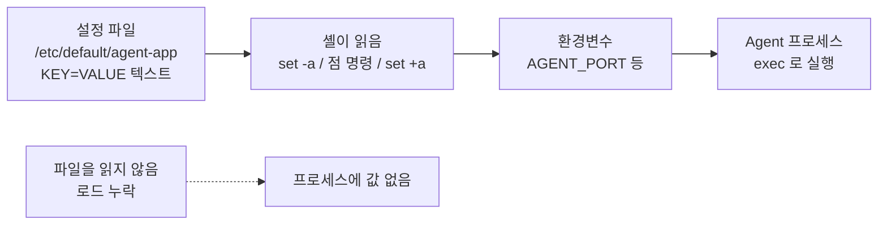
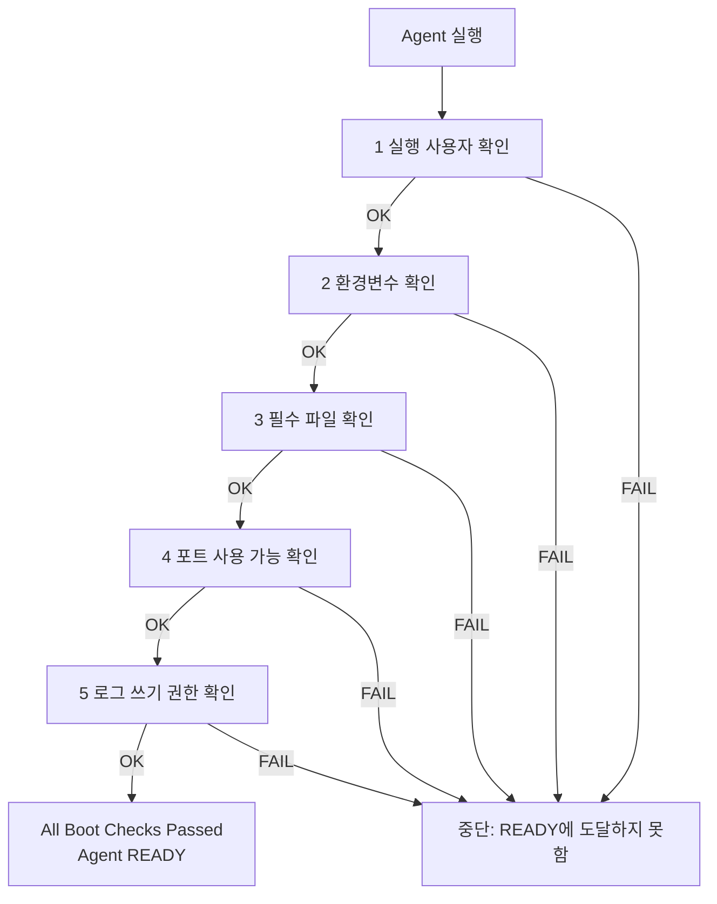
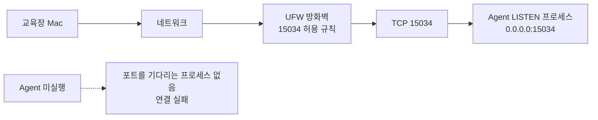
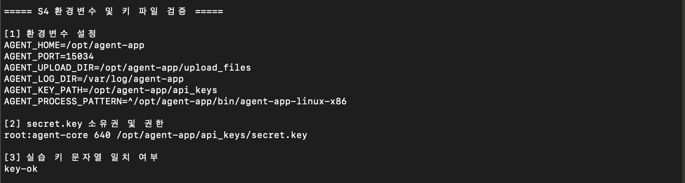

# 4강. 프로그램은 자신의 설정을 어떻게 알고 실행될까?

**학습 분야:** Linux 시스템 운영과 보안 기초  
**연결 미션:** Codyssey B4-1 — 컴퓨터가 알아서 자기 상태를 점검하게 만들기  
**문서 상태:** v0.1 원고 / 학습 검토 — 4강 첫 원고. 과거 실행 검증 기록과 일반 Linux 개념을 구분해 작성했다. S4 Owner 화면(2026-11-17)은 11-5절에 연결했고, S5 Owner 화면은 아직 없다.  
**선행 학습:** [0강 터미널·Bash](00-shell-terminal-bash.md), [1강 서버 개요](01-server-overview.md), [2강 SSH·UFW](02-ssh-ufw.md), [3강 사용자·그룹·권한·ACL](03-users-groups-permissions-acl.md)

> **읽는 방법**
>
> - 이 문서의 설명은 두 종류다. **[기록]** 표시가 붙은 내용은 B4-1 저장소의 실제 검증 기록에서 가져온 것이고, **[개념]** 표시가 붙은 내용은 일반적인 Linux 지식이다. 기록에 없는 오류 문구나 결과는 만들어 넣지 않았다.
> - 제공 Agent(`agent-app-linux-x86`)는 저장소에 들어 있지 않은 실행 파일이라 소스 코드를 볼 수 없다. Agent 내부에서 각 변수를 어떻게 쓰는지는 **실행 출력으로 관찰된 범위까지만** 설명한다.
> - 이 강의에서는 Ubuntu 설정을 바꾸거나 Agent를 실행하지 않는다. 실습은 조회 명령만 소개한다.
> - 공식 실측 기록: [`docs/b4-1-final-evidence.md`](../b4-1-final-evidence.md), [`docs/b4-1-agent-runtime.md`](../b4-1-agent-runtime.md), [최종 회귀 출력](../evidence/task22-closeout-regression.txt)

---

## 0. 이번 강의에서 해결할 질문

1. 똑같은 프로그램인데 컴퓨터마다 다른 폴더와 포트를 사용하는 것은 어떻게 가능할까?
2. 프로그램과 프로세스는 무엇이 다를까?
3. 환경변수란 무엇이고, 왜 코드에 값을 직접 쓰지 않고 따로 전달할까?
4. 셸 변수와 환경변수는 어떻게 다를까?
5. `set -a`, `.`, `set +a`는 설정 파일을 읽을 때 각각 무슨 일을 할까?
6. `AGENT_KEY_PATH`는 왜 파일이 아니라 디렉터리일까?
7. 제공 Agent는 왜 root가 아니라 `agent-admin`으로 실행할까?
8. Boot Sequence 5단계는 각각 어떤 문제를 미리 막아 줄까?
9. 방화벽이 15034를 허용했는데도 접속이 안 될 수 있는 이유는?

**학습 목표:** 설정 파일의 값이 어떻게 환경변수가 되어 Agent 프로세스에 전달되는지, 그리고 Agent가 어떤 조건을 확인한 뒤에야 서버로 동작하는지를 처음부터 끝까지 설명할 수 있게 되는 것이다.

---

## 1. 똑같은 프로그램인데 왜 컴퓨터마다 다른 곳을 쓸까?

3강에서는 “같은 서버에 들어와도 계정에 따라 열 수 있는 폴더가 다르다”는 것을 배웠다. 이번에는 질문을 프로그램 쪽으로 돌려 보자.

> **똑같은 프로그램인데, 컴퓨터마다 다른 폴더와 포트를 사용하는 것은 어떻게 가능할까?**

급식 조리법을 떠올려 보자.

- 조리법은 모든 학교가 같다. “국을 끓이고, 간을 하고, 배식한다.”
- 하지만 **어느 주방에서, 몇 인분을, 어느 배식대에서** 하는지는 학교마다 다르다.

그래서 조리법에 “우리 학교 3층 주방”이라고 적어 버리면 다른 학교에서는 쓸 수 없다. 조리법은 그대로 두고, 학교마다 **“오늘의 작업 안내서”**를 따로 붙이는 편이 낫다.

| 급식 비유 | 프로그램 세계 |
|---|---|
| 조리법 | 프로그램(코드, 실행 파일) |
| 작업 안내서 | 설정(환경변수, 설정 파일) |
| 안내서에 적힌 주방 위치, 배식대 번호 | 폴더 경로, 포트 번호 |
| 조리법을 보고 실제로 요리하는 중인 조리사 | 프로세스 |

이 비유는 이해를 돕기 위한 것일 뿐, 기술적 의미와는 구분해야 한다. 아래에서 하나씩 정확한 개념으로 바꿔 보겠다.

---

## 2. 프로그램과 프로세스는 어떻게 다를까?

### 2-1. 용어 풀이

- **프로그램:** 디스크에 저장된 실행 가능한 파일이다. 아직 실행되지 않은 상태다. B4-1에서는 `/opt/agent-app/bin/agent-app-linux-x86`이 프로그램이다.
- **프로세스:** 프로그램을 **실행하기 시작해서 메모리에 올라가 동작 중인 것**이다. 실행할 때마다 새 프로세스가 만들어진다.
- **PID(Process ID):** 실행 중인 프로세스에 붙는 번호다. 프로세스가 끝나면 사라지고, 다시 실행하면 다른 번호가 붙는다.

| 구분 | 프로그램 | 프로세스 |
|---|---|---|
| 어디에 있나 | 디스크의 파일 | 메모리에서 실행 중 |
| 몇 개? | 파일은 하나 | 같은 파일로 여러 개 실행 가능 |
| 누구의 권한? | 파일 소유자·권한(3강) | **실행한 사용자의 UID와 소속 그룹** |
| 설정(환경변수) | 파일 안에는 없음 | **프로세스마다 따로 가진다** |

**[기록]** B4-1의 제공 Agent는 실행하면 PID 두 개가 나타난다. 예를 들어 2026-11-14 회귀 기록에서는 `pid=[100365 100366]`이었다. 앞의 것이 부모, 뒤의 것이 자식 프로세스이며, 포트를 실제로 잡고 있는 것은 **자식**이었다. 이는 10절에서 다시 다룬다.

### 2-2. 프로세스는 “누구로” 실행되는가

프로세스는 **실행한 계정의 권한**으로 동작한다. 3강에서 본 것처럼 파일에 접근할 수 있는지는 “누가 시도하는가”로 결정되는데, 프로그램이 실행되면 그 “누구”는 프로세스를 실행한 사용자다.

따라서 같은 Agent 파일이라도 `agent-admin`이 실행하면 `agent-core` 그룹의 폴더를 읽을 수 있고, `agent-test`가 실행하면 읽을 수 없다. 프로그램 파일과 실행 프로세스, 그 계정의 권한은 서로 연결되어 있다(8-5절).

---

## 3. 프로그램이 실행할 때 필요한 정보는 무엇일까?

Agent 같은 서버 프로그램은 시작하기 전에 최소한 다음을 알아야 한다.

| 필요한 정보 | 질문 | B4-1 예 |
|---|---|---|
| 기준 폴더 | 내 프로그램 폴더는 어디? | `/opt/agent-app` |
| 포트 | 어느 번호에서 기다릴까? | `15034` |
| 업로드 폴더 | 받은 파일을 어디에 두나? | `/opt/agent-app/upload_files` |
| 로그 폴더 | 기록을 어디에 쓰나? | `/var/log/agent-app` |
| 키 위치 | 인증용 키는 어디서 읽나? | `/opt/agent-app/api_keys` |

### 3-1. 값을 전달하는 방법 두 가지

**방법 1. 코드에 값을 직접 넣는다 (하드코딩).**

```text
포트 = 15034      ← 프로그램 코드 안에 고정
```

- 장점: 간단하다.
- 단점: 값을 바꾸려면 **프로그램을 다시 만들어야** 한다. 컴퓨터마다 다른 값을 쓰기 어렵다. 비밀번호를 코드에 넣으면 코드와 함께 유출될 수 있다.

**방법 2. 외부 설정으로 전달한다.**

```text
프로그램: “포트는 설정에서 읽자”
설정:     AGENT_PORT=15034
```

- 장점: 프로그램은 그대로 두고 **설정만 바꾸면** 된다. 컴퓨터마다 다른 값을 줄 수 있고, 설정 파일의 권한으로 누가 바꿀 수 있는지도 통제된다.
- 단점: 설정이 빠지거나 틀리면 프로그램이 실행되지 않는다. (실제로 B4-1에서도 설정이 틀려 Agent가 시작을 거부한 사례가 있다. 7-3절.)

프로그램에 외부 설정을 전달하는 대표적인 방법이 **환경변수**다.

---

## 4. 환경변수는 무엇일까?

### 4-1. 정의

**환경변수(environment variable)**는 프로세스가 실행될 때 함께 전달받는 **“이름=값” 형태의 설정**이다.

```text
AGENT_PORT=15034
```

| 부분 | 이름 | 의미 |
|---|---|---|
| `AGENT_PORT` | 변수 이름 | 어떤 설정인지 |
| `=` | 구분 기호 | 이름과 값을 나눈다 (양옆에 공백을 넣지 않는다) |
| `15034` | 값 | 설정한 내용 |

프로세스는 자신이 가진 환경변수 목록을 읽을 수 있다. 프로그램은 “`AGENT_PORT`라는 이름의 값을 알려 줘”라고 묻고, 받은 값으로 동작한다.

### 4-2. 이름은 어떻게 짓나 — B4-1 이름 규칙

B4-1의 변수는 모두 `AGENT_`로 시작한다. 이렇게 하면 `PATH`, `HOME` 같은 다른 변수와 구분되고, 이 프로그램을 위한 설정임을 한눈에 알 수 있다. 관례상 대문자와 밑줄(`_`)을 쓴다.

`AGENT_` + 대상(`HOME`, `PORT`, `LOG_DIR` …) 구조로 읽으면 된다. `DIR`은 폴더(directory), `PATH`는 경로를 뜻하는 이름이다.

### 4-3. 셸 변수와 환경변수는 무엇이 다를까?

0강에서 셸(Bash)이 사용자의 명령을 받아 프로그램을 실행해 준다고 했다. 셸 안에서도 변수를 만들 수 있다.

| 구분 | 셸 변수 | 환경변수 |
|---|---|---|
| 만드는 법 | `NAME=value` | `export NAME=value` 또는 `set -a` 이후의 대입 |
| 누가 볼 수 있나 | **그 셸만** | 그 셸 **+ 그 셸이 실행하는 자식 프로세스** |
| 용도 | 셸 스크립트 내부의 임시 값 | 실행할 프로그램에 설정을 넘겨주는 값 |

**[개념] 직접 확인해 보는 작은 예제** (B4-1 설정과 무관한 일반 예제이며 아무 설정도 바꾸지 않는다)

```bash
FOO=hello
bash -c 'echo "자식이 보는 FOO=[$FOO]"'
export FOO
bash -c 'echo "자식이 보는 FOO=[$FOO]"'
```

| 구성 | 의미 |
|---|---|
| `FOO=hello` | 셸 변수 `FOO`를 만든다 (아직 `export`하지 않음) |
| `bash -c '…'` | 새 bash 프로세스(자식)를 만들어 따옴표 안의 명령을 실행한다 |
| `$FOO` | 변수 `FOO`의 값을 꺼낸다 |
| `export FOO` | `FOO`를 환경변수로 승격해 자식에게 물려주도록 표시한다 |

**전체 해석:** “셸 변수 FOO를 만들고 자식에게 보여 준다. 그다음 FOO를 export하고 한 번 더 보여 준다.”

**예상 출력**

```text
자식이 보는 FOO=[]
자식이 보는 FOO=[hello]
```

첫 번째는 비어 있고, 두 번째는 `hello`가 나온다. 이것이 셸 변수와 환경변수의 차이다. **B4-1 미션에서의 의미:** Agent는 셸이 실행하는 “자식 프로세스”다. 설정이 셸 변수로만 남아 있으면 Agent는 볼 수 없다. 그래서 6절에서 `set -a`로 환경변수로 만들어 준다.

### 4-4. 부모 프로세스에서 자식 프로세스로

프로세스는 다른 프로세스를 만들어 낼 수 있다. 만든 쪽이 **부모**, 만들어진 쪽이 **자식**이다. 새 자식 프로세스는 부모의 환경변수를 **복사본으로 물려받는다**.

- 자식이 받은 환경변수를 바꿔도 **부모에게는 영향이 없다**.
- 부모가 나중에 값을 바꿔도 **이미 실행된 자식에게는 반영되지 않는다.** 환경변수는 자식이 만들어지는 시점의 복사본이다.

이 두 번째 성질이 “설정 파일을 고쳐도 이미 실행 중인 프로세스는 그대로”인 이유다(6-6절).

---

## 5. B4-1의 환경변수

### 5-1. 설정 파일

B4-1의 환경변수는 `/etc/default/agent-app` 파일에 모아 둔다. 저장소에는 같은 내용의 예제 [`config/etc-default-agent-app.example`](../../config/etc-default-agent-app.example)가 있다.

- **[기록]** 소유권과 권한은 `root:root 0644`(3강의 `644`: 소유자 `rw-`, 그 외 `r--`). 누구나 읽을 수 있지만 root만 수정할 수 있다.
- **[기록]** 이 파일에는 비밀값이 들어 있지 않다. 비밀 파일의 **경로**만 있다(7-5절).
- **[기록]** 형식은 `KEY=VALUE`이며 `export`나 따옴표를 쓰지 않는다. 이렇게 쓰면 Bash의 `source`와 systemd의 `EnvironmentFile=` 양쪽에서 같은 결과를 낸다.

```text
AGENT_HOME=/opt/agent-app
AGENT_PORT=15034
AGENT_UPLOAD_DIR=/opt/agent-app/upload_files
AGENT_LOG_DIR=/var/log/agent-app
AGENT_KEY_PATH=/opt/agent-app/api_keys
AGENT_PROCESS_PATTERN=^/opt/agent-app/bin/agent-app-linux-x86
```

(실제 파일에는 `#`으로 시작하는 설명 줄이 더 있다.)

### 5-2. 한눈에 보기

| 변수 | 설정값 | 한마디로 |
|---|---|---|
| `AGENT_HOME` | `/opt/agent-app` | 프로그램이 설치된 기준 폴더 |
| `AGENT_PORT` | `15034` | Agent가 기다릴 통신 포트 |
| `AGENT_UPLOAD_DIR` | `/opt/agent-app/upload_files` | 업로드 파일 폴더 |
| `AGENT_LOG_DIR` | `/var/log/agent-app` | 로그 폴더 |
| `AGENT_KEY_PATH` | `/opt/agent-app/api_keys` | **키가 들어 있는 폴더** |
| `AGENT_PROCESS_PATTERN` | `^/opt/agent-app/bin/agent-app-linux-x86` | `monitor.sh`가 Agent를 찾는 규칙 |

앞의 다섯 개가 Agent 실행 환경이고, 마지막 하나는 모니터링용 별도 설정이다(5-8절).

다섯 변수의 이름과 값은 [Notion 요약]과 [승인된 실습 설계]에서 정해졌고, 제공 Agent가 직접 요구하는 것으로 **실행 결과에서 확인된 것은 `AGENT_KEY_PATH`의 값과 15034 포트, 로그 폴더 쓰기 가능 여부**다(9절). 아래에서는 각 변수마다 “어디서 쓰이는지”를 **확인된 범위만** 적는다.

### 5-3. `AGENT_HOME=/opt/agent-app`

- **이름의 구성:** `AGENT` + `HOME`. 이 Agent의 “집” 폴더.
- **목적:** 프로그램 파일(`bin/`), 업로드 폴더, 키 폴더가 모두 이 아래에 있어서 설치 위치의 기준이 된다.
- **사용 위치 [기록]:** `monitor.sh`는 시작할 때 이 변수가 비어 있지 않은지 확인하고 설정 요약 줄에 값을 찍는다. 배포 경로도 `$AGENT_HOME/bin/monitor.sh`로 적혀 있다. 제공 Agent 내부에서의 사용 방식은 실행 출력으로 확인되지 않았다.
- **3강 연계:** `/opt/agent-app`은 `root:root 755`다. 누구나 안으로 들어올 수 있지만 root만 수정한다.
- **잘못 설정하면 [개념]:** 존재하지 않는 폴더를 가리키면 그 아래 경로를 찾지 못해 시작 단계에서 막히거나 엉뚱한 곳을 사용할 수 있다. **[기록]** `monitor.sh`는 이 변수가 비어 있으면 `ERROR CONFIG required variable missing or empty` 로그를 남긴다.

### 5-4. `AGENT_PORT=15034`

- **이름의 구성:** `AGENT` + `PORT`.
- **목적:** Agent가 접속을 기다릴 TCP 포트 번호.
- **사용 위치 [기록]:** Boot Sequence 4단계가 `Port 15034 is available.`을 출력하고, 시작 후 `Agent listening at port 15034`가 로그에 나온다. `monitor.sh`는 이 값으로 LISTEN 상태를 검사하며, 값이 정수 1~65535가 아니면 `AGENT_PORT invalid` 오류를 낸다.
- **2강 연계:** UFW가 `15034/tcp`를 허용하는 것은 이 포트로 들어오는 통신을 “통과시켜 주는” 것일 뿐이다(10-3절).
- **잘못 설정하면 [개념]:** UFW가 허용하지 않은 포트를 쓰면 방화벽에 막혀 접속할 수 없다. 이미 다른 프로그램이 쓰는 포트이면 4단계(포트 사용 가능 여부)에서 문제가 생긴다.

### 5-5. `AGENT_UPLOAD_DIR=/opt/agent-app/upload_files`

- **이름의 구성:** `AGENT` + `UPLOAD` + `DIR`(폴더).
- **목적:** 업로드된 파일을 두는 공용 폴더.
- **사용 위치 [기록]:** `monitor.sh`가 비어 있지 않은지 확인하고 요약에 출력한다. 제공 Agent가 이 폴더를 어떻게 쓰는지는 실행 기록에 나타나지 않는다.
- **3강 연계:** `agent-admin:agent-common 2770`. 세 계정이 모두 읽고 쓸 수 있는 공간이다.
- **잘못 설정하면 [개념]:** 없는 폴더이거나 실행 계정에 쓰기 권한이 없는 폴더를 가리키면 업로드 저장이 실패할 수 있다.

### 5-6. `AGENT_LOG_DIR=/var/log/agent-app`

- **이름의 구성:** `AGENT` + `LOG` + `DIR`.
- **목적:** Agent와 모니터링의 로그 폴더.
- **사용 위치 [기록]:** Boot Sequence 5단계가 `Log directory is writable: /var/log/agent-app`을 확인한다. `monitor.sh`는 `$AGENT_LOG_DIR/monitor.log`에 기록을 남기고, Agent는 `/var/log/agent-app/agent_app.log`에도 기록한다(`agent-admin:agent-core 660`).
- **3강 연계:** `root:agent-core 2770`. `agent-core` 구성원(`agent-admin`, `agent-dev`)만 쓸 수 있다. Agent를 `agent-admin`으로 실행하는 이유 중 하나다.
- **잘못 설정하면 [개념]:** 쓸 수 없는 폴더를 가리키면 기록을 남기지 못한다. 로그 폴더의 쓰기 가능 여부는 Boot Sequence 5단계가 바로 검사하는 항목이다(9절).

### 5-7. `AGENT_KEY_PATH=/opt/agent-app/api_keys`

- **이름의 구성:** `AGENT` + `KEY` + `PATH`. 이름에 `PATH`가 있지만 **키 자체가 아니라 키가 있는 위치**를 가리킨다.
- **목적:** Agent가 인증 키를 찾을 위치를 알려 준다.
- **사용 위치 [기록]:** 제공 Agent가 값을 직접 검사한다. 값이 다르면 2단계에서 `Key Path Mismatch. Expected: /opt/agent-app/api_keys`로 거부하고, 값이 맞으면 그 폴더 안의 `secret.key`를 3단계에서 확인한다. `monitor.sh`는 이 값이 설정되어 있는지만 로그에 남기고 **값 자체는 출력하지 않는다.**
- **가리키는 대상은 폴더다.** 7절에서 자세히 설명한다.
- **잘못 설정하면 [기록]:** 7-3절의 두 가지 실패 사례가 정확히 이 경우다.

### 5-8. 별도 변수 `AGENT_PROCESS_PATTERN`

앞의 다섯 개는 Agent에게 주는 설정이었다. 이 변수는 다르다. **`monitor.sh`가 “지금 Agent가 실행 중인가”를 찾을 때 쓰는 규칙**이다.

```text
AGENT_PROCESS_PATTERN=^/opt/agent-app/bin/agent-app-linux-x86
```

| 부분 | 의미 |
|---|---|
| `^` | 명령줄의 **맨 앞**에서 시작해야 일치 |
| `/opt/agent-app/bin/agent-app-linux-x86` | Agent 실행 파일의 전체 경로 |

- `monitor.sh`는 `pgrep -f` 명령으로 이 패턴과 일치하는 프로세스를 찾는다(5강에서 자세히 다룬다). `-f`는 프로그램 이름만이 아니라 **전체 명령줄**을 검사한다는 뜻이다.
- `^`로 시작하게 한 이유 **[기록]**: Agent를 실행할 때 쓰는 `sudo`, `runuser`, `env`, `bash -c …` 같은 **감싸는 명령(래퍼)**의 인자에도 Agent 경로 문자열이 들어간다. 맨 앞을 고정하지 않으면 이런 래퍼도 Agent로 오인한다.
- **[기록]** 이 패턴이 없으면(미설정) `monitor.sh`는 어떤 프로세스도 Agent로 추측하지 않고 `PENDING PROCESS`로 남긴다. 패턴을 설정한 뒤에는 Agent 실행 중 `HEALTHY exit 0`, 중지 시 `UNHEALTHY exit 1`로 판정된다.

### 5-9. 포트 15034와 SSH 포트 20022는 무엇이 다를까?

두 숫자가 모두 “포트”라서 혼동하기 쉽다. 역할이 완전히 다르다.

| 구분 | `15034` | `20022` |
|---|---|---|
| 용도 | **Agent**(제공 프로그램)와의 통신 | **SSH**(원격 관리 접속) |
| 기다리는 프로그램 | Agent 프로세스 | `sshd` |
| 어디서 정해지나 | `AGENT_PORT` 환경변수 | SSH 서버 설정 파일의 `Port 20022` (환경변수 아님) |
| UFW | `15034/tcp` 허용 | `20022/tcp` 허용 |
| 접속하는 사람 | Agent 사용자·점검 | 서버 관리자 |
| Agent가 꺼져 있으면 | 아무도 기다리지 않아 연결 실패 | 영향 없음(SSH는 별개 서비스) |

`AGENT_PORT`를 바꾸어도 SSH 포트는 변하지 않고, 그 반대도 마찬가지다. 방화벽(UFW)은 **두 포트를 각각 허용**해야 한다(2강).

---

## 6. 설정 파일은 어떻게 환경변수가 될까?

### 6-1. 파일의 내용은 아직 환경변수가 아니다

`/etc/default/agent-app`은 **그냥 텍스트 파일**이다. 파일에 적혀 있다는 사실만으로 프로그램이 자동으로 값을 알게 되지는 않는다. 누군가가 읽어서 **환경변수로 만들고, 그 환경변수를 가진 채 프로그램을 실행**해야 한다. 그 일을 하는 명령이 다음 세 줄이다.

```bash
set -a
. /etc/default/agent-app
set +a
```

### 6-2. 명령 풀이

**원문**

```bash
set -a
. /etc/default/agent-app
set +a
```

**구성 요소별 의미**

| 구성 | 의미 |
|---|---|
| `set -a` | **allexport**를 켠다. 이 시점 이후에 값이 대입되는 모든 변수를 자동으로 환경변수(export)로 만든다. |
| `.` (점) | 뒤에 오는 파일을 **현재 셸 안에서** 한 줄씩 읽어 실행한다. Bash의 `source`와 같은 기능이다. |
| `/etc/default/agent-app` | 읽을 설정 파일 |
| `set +a` | allexport를 끈다. 이후에 만드는 변수는 자동으로 export되지 않는다. |

**명령어 전체 해석**

“지금부터 만드는 변수는 모두 환경변수로 만들어라. 설정 파일을 현재 셸에서 읽어라. 다 읽었으면 자동 export를 꺼라.”

### 6-3. 각 부분이 하는 일

**`.`과 `source`의 관계.** 둘은 같은 기능이다. `.`은 모든 POSIX 셸(sh, bash)에서 동작하는 표준 이름이고, `source`는 Bash가 제공하는 같은 뜻의 별칭이다. B4-1 설정 파일과 예제는 `.`을 사용한다. 중요한 점은 **새 셸을 만들지 않고 현재 셸 안에서 실행한다**는 것이다. 그래서 파일 안의 대입 결과가 지금 셸에 남는다. (파일을 `bash 파일`로 실행하면 자식 셸이 값을 만들고 끝나서, 지금 셸에는 아무것도 남지 않는다.)

**`KEY=VALUE`가 처리되는 방식.** 설정 파일의 한 줄 `AGENT_PORT=15034`는 Bash가 보기에 **그냥 변수 대입문**이다. 그래서 `.`으로 읽으면 Bash가 한 줄씩 실행하면서 변수 `AGENT_PORT`에 `15034`를 대입한다.

- 이 때문에 `=` 양옆에 공백이 있으면 안 된다. `AGENT_PORT = 15034`로 쓰면 Bash는 `AGENT_PORT`라는 **명령**을 찾으려 한다.
- 따옴표와 `export`를 쓰지 않는 단순한 형식으로 맞춘 이유도 같은 파일을 Bash와 systemd가 모두 읽을 수 있게 하기 위해서다(5-1절).
- 파일 안의 `#` 줄은 주석이라 무시된다.

**`set -a`가 필요한 이유.** `set -a` 없이 읽으면 어떻게 될까? 4-3절의 예제처럼 **셸 변수만** 생긴다.

| 순서 | 셸 변수만 생김 (`set -a` 없이) | 환경변수로 생김 (`set -a` 사용) |
|---|---|---|
| `. 설정파일` | 셸 안에만 값이 존재 | 값이 존재하고 export 표시가 붙음 |
| Agent를 실행하면 | Agent가 **값을 받지 못함** | Agent가 **환경변수로 받음** |

그래서 `set -a`로 “이 파일에서 만드는 값은 전부 자식에게 넘겨라”라고 먼저 지시하는 것이다. 변수마다 `export`를 붙이지 않아도 되므로 설정 파일을 단순한 `KEY=VALUE` 형식으로 유지할 수 있다.

**`set +a`가 필요한 이유.** `set -a`는 켜 둔 동안 만들어지는 **모든** 변수를 export한다. 설정 파일 읽기가 끝난 뒤에도 켜 두면, 뒤에 이어지는 스크립트에서 만드는 임시 변수까지 전부 환경변수가 되어 자식 프로세스에 새어 나간다. 필요한 구간에서만 켜고 끄는 것이 안전하다. 이 세 줄은 “설정 파일을 읽는 구간”만 감싼다.

**export의 의미.** 변수를 export한다는 것은 “이 변수를 **자식 프로세스에게도 물려주겠다**”고 표시하는 것이다(4-3절).

### 6-4. 예상 결과와 B4-1 미션에서의 의미

**[기록]** B4-1은 이 세 줄을 두 곳에서 쓴다.

1. `monitor.sh`는 시작할 때 `set -a; . "$ENV_FILE"; set +a`로 설정을 읽는다(`ENV_FILE`의 기본값은 `/etc/default/agent-app`).
2. Agent 실행 명령도 같은 방식으로 설정을 읽은 뒤 Agent를 시작한다(8절).

**[기록]** 2026-11-14 회귀에서 `monitor.sh`는 `CONFIG AGENT_HOME=/opt/agent-app AGENT_PORT=15034 AGENT_UPLOAD_DIR=/opt/agent-app/upload_files AGENT_LOG_DIR=/var/log/agent-app`와 `CONFIG AGENT_KEY_PATH is set (value intentionally not printed or logged)`를 출력했다. 값을 읽었다는 증거다. 같은 줄에서 키 경로 값은 일부러 출력하지 않는다.

### 6-5. 로그인 셸과 cron은 왜 같은 환경변수를 자동으로 공유하지 않을까?

**[개념]** 환경변수는 부모에서 자식으로만 물려진다. 그런데 서로 다른 방식으로 시작된 프로세스는 **부모가 다르다**.

| 시작 방식 | 환경 구성 |
|---|---|
| 로그인 셸(SSH로 로그인) | 로그인 시 `~/.profile`, `/etc/profile` 같은 설정 파일들을 읽는다 |
| cron이 실행하는 작업 | 로그인 과정을 거치지 않는다. **아주 단순한 기본 환경**으로 시작한다 |
| `env -i`로 시작 | 환경을 **완전히 비운 채** 시작 |

그래서 “내 로그인 셸에서는 되는데 cron에서는 안 되는” 일이 생긴다. 로그인 셸에 `AGENT_*` 변수가 있어도 cron이 시작한 프로세스는 그 변수를 받지 못한다.

**[기록]** 이 점은 B4-1에서 직접 시험했다. `agent-admin`의 로그인 셸(`sudo -iu agent-admin`), `env -i`, cron 유사 `sh -c`에서 설정 파일을 읽기 전에는 `AGENT_*`가 **모두 0개**였다. 그래서 B4-1은 로그인 셸 설정(`~/.bashrc` 등)에 의존하지 않고, 필요한 곳(`monitor.sh`, Agent 실행 명령)에서 **명시적으로 로드**한다.

### 6-6. `env -i`는 왜 쓸까?

`env -i`는 **기존 환경변수를 모두 비운 상태**로 명령을 실행한다. 뒤에 `NAME=값`을 적으면 그것만 환경에 넣어 준다.

- 이유 1. **재현성.** 내 로그인 셸에 우연히 들어 있던 변수가 결과에 영향을 주지 않는다.
- 이유 2. **검증.** “설정 파일만으로 충분한가”를 시험하려면 다른 환경변수가 없어야 한다. 환경을 비운 상태에서 설정 파일을 읽어 Agent가 시작되면 명시 로드가 실제로 동작함을 보여 준다.
- 이유 3. **cron과 같은 조건 만들기.** cron의 단순한 환경과 비슷한 상태에서 미리 시험할 수 있다.

**[기록]** 2026-11-13 환경변수 검증 시험(`docs/b4-1-agent-runtime.md` 작업 9)은 `sudo -u agent-admin env -i PATH=/usr/bin:/bin bash -c '…'` 방식으로 로그인 환경이 전혀 없는 새 프로세스에서 수행되었다.

### 6-7. 설정 파일의 내용과 실제 실행 프로세스의 환경은 다를 수 있다

두 가지를 구분해야 한다.

| 구분 | 설정 파일 | 실행 중인 프로세스의 환경 |
|---|---|---|
| 정체 | 디스크의 텍스트 | 프로세스가 **시작할 때 받은 복사본** |
| 바꾸면 | 다음에 읽을 때부터 반영 | 이미 실행 중이면 **그대로** |
| 확인 방법 | `grep`, `cat` | 그 프로세스가 가진 값을 직접 봐야 함 |

예를 들어 Agent를 실행한 뒤 파일에서 `AGENT_PORT`를 바꿔도, 이미 실행 중인 Agent는 처음 받은 값으로 계속 동작한다. 새 값을 적용하려면 Agent를 다시 시작해야 한다.

또 파일이 맞아도 **실행할 때 명시 로드를 빠뜨리면** 프로세스에는 값이 없다. 따라서 “설정 파일이 올바르다”는 증거와 “실행 프로세스가 그 값을 받았다”는 증거는 별개다. **[기록]** 작업 9의 검증 표도 “환경변수 파일이 올바르게 정의·로드된다”까지만 PASS이고, Agent가 값을 실제로 쓰는지는 Agent를 실행한 뒤(작업 17)에야 확인되었다고 구분해 적고 있다.

### 6-8. 구조도 1 — 설정이 프로그램에 전달되는 과정



화살표가 이어지는 것은 **읽기(로드)와 export, 그리고 그 환경을 가진 채 실행**이 모두 일어났을 때뿐이다. 점선은 로드를 빠뜨렸을 때의 결과를 뜻한다.

---

## 7. 키 파일과 접근 권한

### 7-1. 폴더 경로와 파일 경로는 다르다

Agent의 키와 관련된 경로는 두 개이고, 이 둘을 혼동하면 안 된다.

| 경로 | 종류 | 설명 |
|---|---|---|
| `AGENT_KEY_PATH` = `/opt/agent-app/api_keys` | **디렉터리(폴더)** | 키가 들어 있는 폴더. 환경변수로 전달한다. |
| `/opt/agent-app/api_keys/secret.key` | **파일** | 실제 키가 담긴 파일. Agent가 위 폴더 안에서 이 이름으로 찾는다. |

택배로 비유하면, `AGENT_KEY_PATH`는 “보관함 위치”이고 `secret.key`는 “보관함 안의 물건”이다. 변수는 보관함까지만 알려 주고, 물건의 이름(`secret.key`)은 Agent가 정해진 규칙으로 안다.

### 7-2. 실제 구성과 권한 — 3강 연결

**[기록]**

| 대상 | 소유자:그룹 | 권한 |
|---|---|---|
| `/opt/agent-app/api_keys` (폴더) | `root:agent-core` | `2770` |
| `/opt/agent-app/api_keys/secret.key` (파일) | `root:agent-core` | `0640` |

`stat`의 `%a`는 앞의 0을 빼고 `640`으로 표시한다. 3강 8-2절에서 배운 대로 `640`은 다음과 같다.

| 대상 | 숫자 | 문자 | 의미 |
|---|---|---|---|
| 소유자(root) | `6` | `rw-` | 읽기·쓰기 |
| 소유 그룹(`agent-core`) | `4` | `r--` | 읽기만 |
| 그 외 | `0` | `---` | 접근 불가 |

**왜 `agent-admin`은 읽을 수 있고 `agent-test`는 접근할 수 없을까?**

- `agent-admin`은 `agent-core` 구성원이다(3강 4-1절). 폴더 `2770`의 그룹 권한 `rwx`로 폴더에 들어갈 수 있고, 파일 `640`의 그룹 권한 `r--`로 읽을 수 있다.
- `agent-test`는 `agent-core`가 아니다. 폴더 `api_keys`의 “그 외” 권한이 `---`이므로 **폴더 단계에서 이미 막힌다.** 파일의 권한을 따져 보기도 전에 거부된다.

**[기록]** 이 결과는 2026-11-14 회귀의 `## RW matrix`에서 확인되었다. `agent-admin`·`agent-dev`는 `api_keys`에서 읽기·쓰기 `R/W`, `agent-test`는 `read=no write=no`였다. 그리고 공식 정합성 기록에는 키 파일 읽기가 `agent-admin`·`agent-dev`는 성공, `agent-test`는 거부로 적혀 있다.

### 7-3. 프로그램이 요구하는 경로와 설정값이 일치해야 하는 이유, 그리고 실제 사례

프로그램은 외부 설정을 **믿고** 동작하지만, 프로그램이 정해 둔 규칙과 설정이 어긋나면 실행을 거부한다. 제공 Agent는 값을 검사하는 쪽이다.

**[기록]** 작업 17에서 `b4-recovery-test`에서 실행한 시도다. (`b4-lab`에는 정정된 설정으로만 실행했다.)

| 시도 | 설정 | Agent의 반응 |
|---|---|---|
| 1 | `AGENT_KEY_PATH=/opt/agent-app/api_keys/t_secret.key` (**파일** 경로) | 2단계에서 거부: `Key Path Mismatch. Expected: /opt/agent-app/api_keys` (3~5단계는 Skipped) |
| 2 | `AGENT_KEY_PATH=/opt/agent-app/api_keys` (**폴더** 경로)인데 `secret.key` 파일이 없음 | 2단계 `[OK]`, 3단계 거부: `Missing File: secret.key (Expected location: /opt/agent-app/api_keys/secret.key)` |
| 3 | 폴더 경로 + `secret.key` 존재 (`root:agent-core 0640`) | 5/5 `[OK]`, `Agent READY` |

배울 점:

1. **과제 설명과 실제 프로그램이 다를 수 있다.** 과제 설명은 `AGENT_KEY_PATH`가 `t_secret.key` 파일이라고 했지만, 실제 제공 Agent는 폴더를 요구했다. B4-1은 **실제 실행 파일의 검증 결과**를 기준으로 설정했다.
2. 시도 1·2는 Agent 결함이 아니라 **설정 불일치**였다.
3. 실패 지점이 단계마다 달랐다. 값이 틀리면 2단계, 파일이 없으면 3단계에서 멈춘다. 이것이 5단계를 나눠 검사하는 이유를 보여 준다(9절).

### 7-4. 이 파일에 들어 있는 것은 진짜 비밀키가 아니다

**[기록]** `secret.key`에는 공식 실습 문자열 `agent_api_key_test` 한 줄만 들어 있다. **실제 서비스의 비밀키가 아니다.** 그래도 비밀 파일을 다루는 습관은 실제처럼 연습한다.

- 키 파일의 **내용을 터미널이나 로그에 그대로 출력하지 않는다.** (`cat secret.key`로 화면에 찍지 않는다.)
- 필요하면 **일치 여부만** 판정한다(11절).
- `monitor.sh`도 `AGENT_KEY_PATH` 값이 설정되었다는 사실만 기록하고 값 자체는 출력하지 않는다.

> 화면 캡처, 터미널 기록, 로그 파일은 한 번 남으면 공유되기 쉽다. 실제 서비스에서는 키 내용이 한 번이라도 화면에 찍히면 유출된 것으로 보고 다시 발급해야 한다.

### 7-5. 비밀값을 환경변수에 넣는 것과 비밀 파일의 경로를 전달하는 것

| 방식 | 예 | 위험 |
|---|---|---|
| 비밀값을 환경변수에 직접 넣음 | `AGENT_API_KEY=abc123…` | 설정 파일을 읽을 수 있는 모든 계정에게 노출. `env` 같은 명령 출력, 프로세스 정보, 로그에 실수로 찍힐 수 있다. (**[개념]**) |
| **비밀 파일의 경로**를 전달 | `AGENT_KEY_PATH=/opt/agent-app/api_keys` | 환경변수에는 **위치만** 있다. 내용은 파일 권한(`640`, `agent-core`)이 보호한다. |

B4-1은 두 번째 방식이다. 설정 파일 `/etc/default/agent-app`은 `0644`라서 `agent-dev`·`agent-test`도 읽을 수 있다. 그래서 비밀이 **들어 있지 않아야** 한다. **[기록]** 환경변수 검증에서도 “파일 내 비밀 형태 값 없음”이 확인되었다. 비밀은 3강에서 배운 파일 권한이 지킨다.

---

## 8. Agent 프로그램은 어떻게 실행될까?

### 8-1. 실행 구조

제공 Agent는 **저장소에 포함되지 않은** 실행 파일 `agent-app-linux-x86`이다. 파일은 수동으로 배포한다.

**[기록]** 배포된 파일은 `/opt/agent-app/bin/agent-app-linux-x86`, `root:agent-core 0750`이다. 3강의 해석을 그대로 적용하면 다음과 같다.

| 대상 | `750` | 의미 |
|---|---|---|
| root | `rwx` | 읽기·쓰기·실행 |
| `agent-core` 구성원 | `r-x` | 읽기·실행 (쓰기 불가) |
| 그 외 | `---` | 접근 불가 |

`agent-admin`과 `agent-dev`는 실행할 수 있고, 수정할 수 있는 것은 root뿐이다.

Agent가 서버로 동작하기까지의 구조는 다음 다섯 단계다.

1. 실행 파일이 존재한다.
2. `agent-admin` 계정으로 실행한다.
3. 설정 파일의 환경변수를 **명시적으로 로드**한다.
4. Agent가 **실행 전 조건을 검사**한다(Boot Sequence).
5. 검사를 통과하면 **포트 15034에서 통신을 기다린다.**

### 8-2. 실제 실행 명령

B4-1 기록에는 **서로 다른 두 가지 실행 형태**가 있다. 둘은 환경변수를 전달하는 원리는 같지만 **같은 명령이 아니다.**

| 구분 | 마지막 부분 | 출처 [기록] |
|---|---|---|
| 형태 ① | `exec /opt/agent-app/bin/agent-app-linux-x86` | `b4-1-agent-runtime.md` 작업 17 "실행 방법" |
| 형태 ② | `exec setsid /opt/agent-app/bin/agent-app-linux-x86` | `b4-1-final-evidence.md` §2.5 "실행" |

> **실행 위치 안내.** 아래 명령의 `sudo`는 **Ubuntu `b4-lab` 내부에서 실행하는 명령**의 일부다. **교육장 Mac 터미널에서 직접 `sudo`로 실행하지 않는다.** Mac에서 Ubuntu로 보낼 때는 3강의 `B` 함수처럼 `orb -m b4-lab …`를 거친다(8-6절). 이 강의에서는 어느 형태도 실행하지 않는다.

**원문 — 형태 ① (작업 17 기록)**

```bash
sudo runuser -u agent-admin -- env -i PATH=/usr/bin:/bin HOME=/home/agent-admin bash -c \
  'cd ~; set -a; . /etc/default/agent-app; set +a; exec /opt/agent-app/bin/agent-app-linux-x86'
```

**원문 — 형태 ② (최종 수행 내역서 §2.5 기록)**

```bash
sudo runuser -u agent-admin -- env -i PATH=/usr/bin:/bin HOME=/home/agent-admin bash -c \
  'cd ~; set -a; . /etc/default/agent-app; set +a; exec setsid /opt/agent-app/bin/agent-app-linux-x86'
```

아래의 구성 요소 표와 전체 해석은 두 형태에 공통이며, `setsid`만 8-3절에서 따로 설명한다.

**구성 요소별 의미**

| 구성 | 의미 |
|---|---|
| `sudo` | 관리자 권한으로 실행. **Ubuntu 안에서의 sudo**다(8-6절). `runuser`는 root만 쓸 수 있어서 필요하다. |
| `runuser -u agent-admin --` | 지정한 사용자(`agent-admin`)로 명령을 실행한다. `-u`는 사용자 지정, `--`는 “여기부터는 `runuser`의 옵션이 아니라 실행할 명령”이라는 구분 표시다. |
| `env -i` | 기존 환경변수를 모두 비우고 시작한다(6-6절). |
| `PATH=/usr/bin:/bin` | 셸이 명령어를 찾는 폴더 목록을 최소한으로 지정한다. 아래에서 설명한다. |
| `HOME=/home/agent-admin` | 사용자의 홈 폴더를 지정한다. 아래에서 설명한다. |
| `bash -c '…'` | 새 Bash를 만들어 따옴표 안의 문자열을 명령으로 실행한다. |
| `cd ~` | 홈 폴더로 이동한다. 여기서 `~`는 `HOME` 값이다. |
| `set -a; . /etc/default/agent-app; set +a` | 설정 파일을 환경변수로 로드한다(6절). |
| `exec /opt/agent-app/bin/agent-app-linux-x86` | 현재 셸을 Agent 프로세스로 **교체**해 실행한다. |

**명령어 전체 해석**

“Ubuntu에서 관리자 권한으로, `agent-admin` 계정으로 명령을 실행하라. 이때 환경변수를 전부 비우고 `PATH`와 `HOME`만 지정하라. 새 Bash가 홈 폴더로 이동해 설정 파일을 환경변수로 읽은 다음, 자기 자신을 Agent 프로그램으로 바꿔 실행하라.”

### 8-3. 요소별 자세한 풀이

**`runuser`와 프로세스 실행 계정.** `runuser`는 root가 다른 사용자로 명령을 실행하게 해 준다. 실행된 프로세스의 UID는 `agent-admin`(1000)이고, 소속 그룹(`agent-admin`, `agent-common`, `agent-core`)도 그 계정의 것을 받는다. **[기록]** Boot 1단계가 `Running as service user 'agent-admin' (uid=1000)`을 출력한다.

**`PATH`.** 셸이 `ls` 같은 명령어를 입력받았을 때 **어느 폴더들에서 그 이름의 프로그램을 찾을지** 적어 둔 목록이다. `env -i`로 환경을 비우면 `PATH`도 사라져서 명령을 찾지 못할 수 있다. 그래서 `/usr/bin:/bin`만 다시 지정한다. 필요한 최소한의 시스템 폴더만 두어 **의도하지 않은 곳의 프로그램이 실행되는 일을 줄인다.** (Agent는 전체 경로로 실행하므로 `PATH`를 거치지 않는다.)

**`HOME`.** 사용자의 홈 폴더를 알려 주는 변수다. `env -i`가 이것도 지웠으므로 직접 넣는다. 이 값이 있어야 뒤의 `cd ~`가 올바른 곳(`/home/agent-admin`)으로 간다. 이 명령에서 홈으로 이동하는 이유는 Agent를 **일정한 시작 위치**에서 실행하기 위해서다.

**`bash -c`.** `bash -c '문자열'`은 새 Bash 프로세스에게 문자열을 명령으로 실행하게 한다. 이 Bash는 **로그인 셸이 아니고 대화형도 아니라서** `~/.bashrc` 같은 개인 설정 파일을 읽지 않는다. 이전 환경에 의존하지 않고, 필요한 로드는 문자열 안에서 직접 한다.

**`cd`.** 현재 위치를 바꾸는 명령이다. 여기서는 `~`(홈)로 이동한다.

**`set -a` … `set +a`.** 6절에서 설명한 구간이다. 이 구간에서 설정 파일의 값이 환경변수가 된다.

**`exec`.** `exec 명령`은 **현재 셸 프로세스를 그 명령으로 바꾼다.** 새 프로세스를 하나 더 만드는 것이 아니라 같은 프로세스(같은 PID)가 Agent로 변한다. 장점은 다음과 같다.

- 환경변수가 그대로 이어진다. 앞에서 로드한 설정이 Agent의 환경이 된다.
- 감싸고 있던 `bash`가 남아 있지 않아서 프로세스 목록이 단순해진다.
- 종료 신호가 Agent에게 직접 전달된다.

**`setsid`(§2.5 형태).** `setsid`는 새 세션을 만들어 명령을 실행해서, 터미널이 닫혀도 영향을 덜 받게 한다. `exec setsid …`는 “현재 셸을 `setsid`로 바꾸고, 그것이 Agent를 실행하라”는 뜻이다. 환경변수 전달 원리(`env -i` → 명시 로드 → `exec`)는 두 형태가 같다. 다만 **세션이 다르므로** 터미널 연결이나 종료 신호(Ctrl+C로 보내는 SIGINT 등)가 Agent에 전달되는 방식에는 차이가 있을 수 있다. 이 차이가 실제로 어떤 결과를 냈는지는 기록에 따로 적혀 있지 않으며, 이 문서는 결과를 만들어 넣지 않는다. 참고로 [기록] 형태 ①(작업 17)은 SIGINT로 종료했다고 되어 있고, 증빙 체크리스트(§4 S5)는 배경 실행한 Agent가 SIGINT를 무시할 수 있어 `pkill -TERM`으로 종료하라고 적고 있다(10-4절). 따라서 S5를 촬영할 때 어느 형태를 쓸지는 후속 실습에서 정한다.

### 8-4. 예상 출력과 B4-1 미션에서의 의미

**[기록]** 실행하면 Boot Sequence 출력이 나온다(9절). 성공하면 `Agent READY`와 로그가 이어진다.

```text
2026-11-14 09:41:44,885 [INFO] Agent listening at port 15034
```

**B4-1 미션에서의 의미:** 이 한 줄의 명령에 이 강의의 핵심이 모두 들어 있다. 누가 실행하는가(`runuser`), 어떤 환경으로 실행하는가(`env -i`와 명시 로드), 어떤 프로그램인가(`exec`). 환경변수가 설정 파일에서 Agent 프로세스까지 연결되는 길이다.

### 8-5. 프로세스 실행 계정과 파일 권한의 관계 — 3강 연계

Agent는 `agent-admin`으로 실행되기 때문에 다음이 가능하다.

| 필요한 것 | 근거(3강) | 결과 |
|---|---|---|
| 실행 파일 실행 | `root:agent-core 750`, `agent-admin`은 `agent-core` 구성원 | 실행 가능 |
| 키 파일 읽기 | `root:agent-core 640`, 그룹 `r--` | 읽기 가능 |
| 로그 쓰기 | `/var/log/agent-app` `root:agent-core 2770` | 쓰기 가능 |

**Agent를 root가 아닌 일반 사용자로 실행하는 이유 [개념]:** root로 서비스를 계속 실행하면 Agent에 문제가 생겼을 때 시스템 전체가 위험해진다. 일반 계정으로 실행하면 피해를 그 계정의 권한 범위로 제한할 수 있다(최소 권한 원칙, 3강 14절). **[기록]** Agent가 부팅할 때 실행 사용자를 확인한다는 점도 출력으로 알 수 있다(9절 1단계).

### 8-6. Mac의 sudo와 Ubuntu 안의 sudo는 다르다

| 구분 | Mac의 sudo | Ubuntu(`b4-lab`) 안의 sudo |
|---|---|---|
| 어느 컴퓨터? | 교육장 Mac(macOS) | Ubuntu 가상 머신 |
| 누구의 권한? | Mac의 관리자 계정 | Ubuntu 안의 관리자(root) 권한 |
| 권한 정책 | Mac의 설정 | Ubuntu의 `/etc/sudoers.d/` 설정 |
| B4-1 사용 | **사용하지 않는다** | 사용한다 |

3강에서 쓴 `B() { orb -m b4-lab sudo "$@"; }` 함수는 Mac에서 `orb`로 Ubuntu에 명령을 보내고, **그 안에서** `sudo`로 실행한다. 이 `sudo`는 Ubuntu 안의 것이다. **교육장 Mac의 관리자 권한은 쓰지 않는다.** 두 시스템의 권한 체계는 서로 독립이다. Ubuntu 안에서도 `agent-admin`은 `ufw status` 한 명령만 sudo가 허용된다(3강 14절). 위 실행 명령의 `sudo`는 Ubuntu 기본 사용자의 권한으로 `runuser`를 쓰기 위한 것이고, 이후 Agent 자체는 `agent-admin`으로 동작한다.

---

## 9. Boot Sequence 5단계

### 9-1. Boot Sequence란?

Agent는 시작하자마자 포트를 열지 않는다. 먼저 **실행에 필요한 조건 다섯 가지를 순서대로 점검**하고, 모두 통과해야 `Agent READY`가 된다. 이 점검을 **Boot Sequence(부팅 순서)**라고 한다. 확인 없이 시작하면 나중에 이유를 알 수 없는 오류로 멈출 수 있으니, 시작 단계에서 원인을 분명히 알려 주기 위한 구조다.

**[기록]** 2026-11-14 회귀 기록의 실제 출력이다.

```text
>>> Starting Agent Boot Sequence...
[1/5] Checking User Account               [OK]
   ... Running as service user 'agent-admin' (uid=1000)
[2/5] Verifying Environment Variables     [OK]
   ... All required Envs correct
[3/5] Checking Required Files             [OK]
   ... Verified 'secret.key' with correct key string.
[4/5] Checking Port Availability          [OK]
   ... Port 15034 is available.
[5/5] Verifying Log Permission            [OK]
   ... Log directory is writable: /var/log/agent-app
------------------------------------------------------------
All Boot Checks Passed!
Agent READY
```

### 9-2. 단계별 설명

아래 각 단계에서 “B4-1에서 통과한 근거”와 “실패 시”는 **[기록]**과 **[개념]**을 구분해 적었다. 실패 문구가 기록에 없는 단계는 문구를 적지 않았다.

#### 1단계. Checking User Account — 실행 사용자 확인

- **무엇을 검사하나:** 어떤 계정으로 실행되고 있는지.
- **왜 필요한가 [개념]:** 서비스 프로그램이 의도하지 않은 계정으로 실행되면 권한이 너무 넓거나 좁아서 문제가 된다.
- **실패하면:** 이 단계의 실패 출력은 저장소 기록에 없다. 이 문서는 문구를 만들지 않는다. **[개념]** 이후 단계의 파일·폴더 접근 권한이 실행 계정에 달려 있으므로(8-5절), 계정이 달라지면 뒤 단계의 결과도 달라진다.
- **B4-1에서 통과한 근거 [기록]:** `Running as service user 'agent-admin' (uid=1000)`. 실행 명령의 `runuser -u agent-admin`이 이 결과를 만든다.

#### 2단계. Verifying Environment Variables — 환경변수 확인

- **무엇을 검사하나:** Agent가 필요로 하는 환경변수가 올바른 값으로 전달되었는지.
- **왜 필요한가:** 설정이 빠지거나 틀리면 이후 단계가 엉뚱한 위치를 대상으로 동작한다. 6절의 로드가 제대로 되었는지 확인하는 단계다.
- **실패하면 [기록]:** 시도 1에서 `Key Path Mismatch. Expected: /opt/agent-app/api_keys`로 실패했고, **3~5단계는 실행되지 않고 건너뛰었다(Skipped).** 앞 단계가 실패하면 READY에 도달하지 못한다.
- **B4-1에서 통과한 근거 [기록]:** `All required Envs correct`. `AGENT_KEY_PATH`가 폴더 경로로 맞춰졌다. 어떤 변수들을 어떻게 점검하는지는 Agent 소스를 볼 수 없어 **기록에서 확인되는 것은 `AGENT_KEY_PATH`의 값 검사뿐이다.**

#### 3단계. Checking Required Files — 필수 파일 확인

- **무엇을 검사하나:** 필요한 파일이 있는지. 출력으로 확인되는 대상은 `secret.key`이며, “올바른 키 문자열”로 검증되었다고 나온다.
- **왜 필요한가:** 키가 없거나 다르면 인증이 불가능하다. 시작 때 미리 막는 것이 낫다.
- **실패하면 [기록]:** 시도 2에서 `Missing File: secret.key (Expected location: /opt/agent-app/api_keys/secret.key)`로 실패했다. **키 파일이 있어도 Agent 실행 계정이 읽을 수 없으면 안 된다**는 것은 일반 원리다(7-2절).
- **B4-1에서 통과한 근거 [기록]:** `Verified 'secret.key' with correct key string.` 파일은 `root:agent-core 0640`이고 `agent-admin`이 `agent-core` 구성원이라서 읽을 수 있다. 키 문자열은 출력에 나타나지 않는다.

#### 4단계. Checking Port Availability — 포트 사용 가능 여부 확인

- **무엇을 검사하나:** 15034 포트가 **쓸 수 있는 상태**인지(다른 프로세스가 이미 잡고 있지 않은지).
- **왜 필요한가 [개념]:** 한 포트는 한 번에 하나의 프로세스만 기다릴 수 있다. 이미 사용 중이면 Agent는 서버로 동작할 수 없다. 또 Agent를 이중으로 실행하는 사고를 막는다.
- **실패하면:** 이 단계의 실패 출력은 기록에 없다. 이 문서는 문구를 만들지 않는다.
- **B4-1에서 통과한 근거 [기록]:** `Port 15034 is available.` 실행 전에 15034에 LISTEN 중인 프로세스가 없는 상태였고(과거 기록에서 종료 후 15034가 해제됨을 확인), 같은 이유로 **Agent를 두 번 실행하면 두 번째는 이 단계에서 문제가 될 수 있다.**

#### 5단계. Verifying Log Permission — 로그 쓰기 권한 확인

- **무엇을 검사하나:** 로그 폴더에 **쓸 수 있는지**.
- **왜 필요한가:** 서버 프로그램은 상태를 로그로 남긴다. 로그를 쓸 수 없으면 문제가 생겨도 기록이 없고, 모니터링(`monitor.sh`)도 의미가 없다.
- **실패하면:** 이 단계의 실패 출력은 기록에 없다. 문구를 만들지 않는다.
- **B4-1에서 통과한 근거 [기록]:** `Log directory is writable: /var/log/agent-app`. 폴더가 `root:agent-core 2770`이고 `agent-admin`이 `agent-core` 구성원이어서 쓸 수 있다. 3강의 권한 설계가 여기서 실제 효과를 낸 것이다.

### 9-3. `All Boot Checks Passed!`와 `Agent READY`의 의미

| 출력 | 의미 |
|---|---|
| `All Boot Checks Passed!` | 위 다섯 단계가 **모두** `[OK]`였다는 요약 |
| `Agent READY` | Agent가 준비를 마치고 **서버로 동작을 시작**한다는 신호 |

이 뒤에 `Agent listening at port 15034`, `Agent Worker Started` 같은 로그가 이어진다. 즉 **READY는 시작 조건을 통과했다는 뜻**이고, 이후 실제로 포트를 열고 기다리는 것이 LISTEN 상태다(10절).

### 9-4. 구조도 2 — Boot Sequence



어느 단계에서든 실패하면 READY에 도달하지 못한다. **[기록]** 시도 1에서는 2단계 실패 뒤 3~5단계가 Skipped되었고, 시도 2에서는 3단계에서 멈췄다.

---

## 10. Agent가 서버로 동작하는 과정과 네트워크

### 10-1. LISTEN 상태와 `0.0.0.0:15034`

- **서버(Server):** 요청을 기다리는 프로그램.
- **LISTEN(리슨):** 프로그램이 특정 포트를 열어 놓고 **접속을 기다리는 상태**. 아직 연결된 것이 아니라 **기다리는 중**이다.
- **소켓(socket):** 네트워크 통신의 끝점. 프로그램이 포트를 잡으면 소켓이 하나 만들어진다.

**[기록]** 실제 출력이다.

```text
LISTEN 0      1            0.0.0.0:15034      0.0.0.0:*    users:(("agent-app-linux",pid=100366,fd=4))
```

| 부분 | 의미 |
|---|---|
| `LISTEN` | 접속을 기다리는 상태 |
| `0.0.0.0:15034` | `0.0.0.0`은 “이 서버가 가진 **모든 IPv4 주소**”라는 뜻이고, 뒤는 포트. 즉 서버의 어느 IPv4 주소로 오든 15034로 들어오는 접속을 받는다. |
| `0.0.0.0:*` | 어떤 상대(주소·포트)의 접속이든 받는다는 표시 |
| `users:(("agent-app-linux",pid=100366…` | 이 소켓을 잡고 있는 프로세스. 프로세스 이름이 `agent-app-linux`로 짧게 보이는 것은 `ss`가 이름을 일부만 보여주기 때문이다. |

`127.0.0.1:15034`처럼 특정 주소에만 묶여 있으면 그 주소로 온 접속만 받는다. 외부에서 접근해야 하는 서버는 `0.0.0.0`에 바인딩(묶이는)된다. **[기록]** `monitor.sh`는 `0.0.0.0:15034`의 LISTEN을 확인하고, 이 형태가 없으면 FAIL 또는 PENDING으로 처리한다.

**부모와 자식 프로세스 [기록].** 같은 실행에서 PID가 둘(`100365`, `100366`)이고, 소켓을 잡은 것은 자식(`100366`)이다. 부모는 실행을 시작해 주는 부트로더 같은 역할이어서 소켓을 직접 잡지 않는다. 그래서 `monitor.sh`는 두 PID를 모두 Agent로 인정하되, 포트를 잡은 프로세스가 둘 중 하나일 때만 OK로 본다.

### 10-2. 구조도 3 — Agent가 서버로 동작하는 과정



세 가지가 **모두** 갖춰져야 연결된다.

1. 네트워크로 서버에 닿을 수 있어야 한다.
2. 방화벽(UFW)이 15034를 **허용**해야 한다.
3. 그 포트에서 **기다리는 프로세스(Agent)**가 있어야 한다.

### 10-3. 방화벽이 허용하는 것과 프로그램이 LISTEN하는 것은 다르다

2강에서 UFW가 포트 통과 여부를 정하는 문지기라고 배웠다. 문지기가 문을 열어 두었다고 해서 **문 안쪽에 사람이 있는 것은 아니다.**

| 구분 | UFW 허용 | Agent LISTEN |
|---|---|---|
| 하는 일 | 15034로 들어오는 통신을 **통과**시키는 규칙 | 15034에서 접속을 **받는** 프로그램 |
| 어디에 있나 | 방화벽 규칙 | 실행 중인 프로세스 |
| 없으면 | 연결이 막힌다(차단) | 연결할 상대가 없다(대기 중인 프로그램 없음) |
| 확인 명령 | `ufw status` | `ss -ltnp` |

그러므로 UFW가 15034를 허용해도 **Agent가 실행되지 않으면 접속할 수 없다.** 반대로 Agent가 LISTEN 중이어도 UFW가 허용하지 않으면 바깥에서는 막힌다.

**[기록]** 2026-11-14 회귀에서 이 둘을 따로 확인했다. UFW는 `20022/tcp`·`15034/tcp`가 허용(`ALLOW IN`)된 상태였고, Agent를 실행한 뒤에는 `ss`로 `0.0.0.0:15034` LISTEN과 소켓 소유 PID를 확인했으며, Mac에서 Machine IP의 15034로 TCP 연결이 성공했다(작업 17). **UFW 허용 규칙만 보고 판단하지 않았다.** 또 `monitor.sh`도 “LISTEN 소켓의 소유자가 Agent 프로세스인가”까지 확인한다.

### 10-4. 종료하면 프로세스와 LISTEN 소켓이 왜 사라질까

LISTEN 소켓은 **프로세스가 소유한 자원**이다. 프로세스가 끝나면 운영체제가 그 프로세스의 자원을 모두 회수하므로 소켓도 닫히고 15034가 다시 사용 가능해진다. **[기록]** Agent를 종료하자 `Stop signal received`, `Agent Shutdown. Releasing resources.`가 출력되었고, 잔여 프로세스가 없었으며 15034가 해제되었다. 종료 후 `monitor.sh`는 `FAIL PROCESS`, `FAIL PORT tcp/15034 not LISTEN`, `UNHEALTHY exit=1`로 판정했다.

또한 **[기록]** 이 Agent는 상주 서비스로 구성하지 않았다. 검증할 때만 수동으로 실행하고 종료한다. 종료 신호에 관한 주의: 배경으로 실행한 Agent는 SIGINT를 무시할 수 있어서 증빙 체크리스트는 종료에 `pkill -TERM -f '^/opt/agent-app/bin/agent-app-linux-x86'`를 쓰도록 적고 있다.

---

## 11. S4 실습 준비: 환경변수와 키 파일 조회

이 실습은 **조회만** 한다. 설정을 바꾸지 않고, Agent를 실행하지 않으며, 비밀값을 출력하지 않는다. 교육장 Mac에서 sudo는 사용하지 않는다(8-6절).

> **현재 상태:** Owner가 2026-11-17에 촬영한 S4 화면을 11-5절에 연결했다. 11-1~11-4절은 촬영 전 준비용 설명이며 그대로 보존했다. S5(Agent 실행) 화면은 아직 없다.

### 11-1. 함수 선언

```bash
B() { orb -m b4-lab sudo "$@"; }
```

**전체 해석:** “`B` 뒤에 입력한 명령을 Ubuntu `b4-lab`에서 관리자 권한(`sudo`)으로 실행하도록 정의한다.” (3강 15절과 같다. 함수 안에 `sudo`가 이미 있으므로 `B` 뒤에 `sudo`를 또 쓰지 않는다.)

### 11-2. 실습 1 — 환경변수 설정 확인

**원문**

```bash
B grep -v '^#' /etc/default/agent-app
```

**구성 요소별 의미**

| 구성 | 의미 |
|---|---|
| `B` | Ubuntu `b4-lab`에서 관리자 권한으로 실행 |
| `grep` | 파일에서 조건에 맞는 줄만 골라 출력 |
| `-v` | 조건에 **맞지 않는** 줄만 출력(반전) |
| `'^#'` | 줄 맨 앞(`^`)이 `#`인 줄. 작은따옴표로 감싸 셸이 해석하지 않게 한다. |
| `/etc/default/agent-app` | 읽을 파일 |

**명령어 전체 해석:** “`/etc/default/agent-app` 파일에서 `#`으로 시작하는 주석 줄을 빼고 나머지 줄만 출력해라.”

**예상 출력 [기록: 회귀 `## env`와 예제 파일 기준]**

```text
AGENT_HOME=/opt/agent-app
AGENT_PORT=15034
AGENT_UPLOAD_DIR=/opt/agent-app/upload_files
AGENT_LOG_DIR=/var/log/agent-app
AGENT_KEY_PATH=/opt/agent-app/api_keys
AGENT_PROCESS_PATTERN=^/opt/agent-app/bin/agent-app-linux-x86
```

**B4-1 미션에서의 의미:** 환경변수 다섯 개와 모니터링용 패턴 하나가 설정 파일에 올바르게 적혀 있는지 보여 준다.

**이 결과가 증명하는 것:** 주석(`#`) 줄을 제외한 **활성 설정 줄의 내용**. 출력된 활성 설정 항목(위 6줄)에는 비밀값이 아니라 경로·포트·패턴만 들어 있다는 것. (이 명령은 주석 줄을 출력하지 않으므로 **주석 줄의 내용이나 파일 전체**에 비밀값이 없다는 증명은 아니다.)
**이 결과가 증명하지 못하는 것:** 실행 중인 Agent 프로세스가 **그 값을 실제로 받았는지**. 파일 내용과 프로세스 환경은 별개다(6-7절).

### 11-3. 실습 2 — 키 파일 소유권과 권한 확인

**원문**

```bash
B stat -c '%U:%G %a %n' \
  /opt/agent-app/api_keys/secret.key
```

**구성 요소별 의미**

| 구성 | 의미 |
|---|---|
| `stat` | 파일 정보 조회 |
| `-c '…'` | 출력 형식을 지정 |
| `%U:%G` | 소유 사용자:소유 그룹 |
| `%a` | 숫자 권한 |
| `%n` | 파일 경로 |
| `\` | 줄 이어쓰기. 다음 줄이 같은 명령의 연속이다. |

**명령어 전체 해석:** “`secret.key` 파일의 소유 사용자·소유 그룹, 숫자 권한, 경로를 한 줄로 출력해라.” (파일 **내용**은 출력하지 않는다.)

**예상 출력 [기록: 회귀 `## perms`]**

```text
root:agent-core 640 /opt/agent-app/api_keys/secret.key
```

**B4-1 미션에서의 의미:** 3강의 `640` 해석을 실제 파일에 대입한 것이다. `agent-core`에 속한 `agent-admin`·`agent-dev`만 읽을 수 있다.

**이 결과가 증명하는 것:** 키 파일의 소유자·그룹·권한 설정.
**이 결과가 증명하지 못하는 것:** 파일에 올바른 키 문자열이 들어 있는지, 실제로 `agent-admin`이 읽을 수 있는지(권한 설정이 읽기 가능함을 의미하지만 동작 시험은 아니다. 3강 16-3절).

### 11-4. 실습 3 — 키 값 일치 여부만 확인 (내용 출력 금지)

공식 증빙 체크리스트(`b4-1-final-evidence.md` §4 S4)는 다음 방식으로 **일치 여부만** 판정한다.

```bash
B bash -c '[ "$(cat /opt/agent-app/api_keys/secret.key)" = agent_api_key_test ] && echo key-ok'
```

| 구성 | 의미 |
|---|---|
| `B bash -c '…'` | Ubuntu에서 관리자 권한으로 새 Bash에게 문자열을 실행시킨다 |
| `$(cat …/secret.key)` | 파일 내용을 읽어 그 자리에 값으로 끼워 넣는다 (**화면에 출력되지 않고** 비교에만 쓰인다) |
| `[ A = B ]` | A와 B가 같은지 비교 |
| `agent_api_key_test` | 비교 대상인 공식 **실습 문자열** |
| `&&` | 앞이 참일 때만 뒤를 실행 |
| `echo key-ok` | 일치하면 `key-ok`만 출력 |

**명령어 전체 해석:** “키 파일의 내용이 공식 실습 문자열과 같으면 `key-ok`라고만 출력해라. 다르면 아무것도 출력하지 않는다.”

**예상 출력:**

```text
key-ok
```

**주의:**

- 화면에는 `key-ok`만 나온다. 키 내용을 화면에 출력하지 않는 방식이다. 이 습관이 중요하다.
- 비교 대상이 명령줄에 적힌다. 여기서는 **실제 비밀키가 아닌 공식 실습 문자열**이라 문제가 없지만, 실제 서비스의 비밀키라면 명령줄이나 셸 기록에 남기지 않는 별도의 방법을 써야 한다.
- 일치하지 않으면 아무것도 출력되지 않으므로 “무출력 = 불일치 또는 읽기 실패”로 해석한다.

**이 결과가 증명하는 것:** 키 파일 내용이 공식 실습 문자열과 같다는 것.
**이 결과가 증명하지 못하는 것:** 실제 서비스 비밀키의 안전성(이 값은 실습용이다). 일반 계정(`agent-admin`)이 읽을 수 있는지(이 명령은 sudo로 실행되므로 root 권한으로 읽는다).

### 11-5. S4 실습 결과 (2026-11-17)

> **S4 실습 연결.** 11-2~11-4절의 세 조회에 대응하는 결과를 Owner가 2026-11-17 오후 5:36에 교육장 Mac 터미널에서 직접 실행·촬영했다(원본, 편집·합성 없음).



**이 화면에 대응하는 명령.** 화면에는 `===== S4 환경변수 및 키 파일 검증 =====` 제목과 세 구역의 출력만 있고 **실행 명령 문장은 보이지 않는다.** 아래는 공식 증빙 체크리스트(§4 S4)에 적힌 대응 명령이며, 촬영에 쓴 스크립트의 문장 자체를 확인한 것은 아니다. 구성 요소와 전체 해석은 11-1~11-4절을 본다.

```bash
B grep -v '^#' /etc/default/agent-app
B stat -c '%U:%G %a %n' /opt/agent-app/api_keys/secret.key
B bash -c '[ "$(cat /opt/agent-app/api_keys/secret.key)" = agent_api_key_test ] && echo key-ok'
```

**화면의 실제 출력**

```text
[1] 환경변수 설정
AGENT_HOME=/opt/agent-app
AGENT_PORT=15034
AGENT_UPLOAD_DIR=/opt/agent-app/upload_files
AGENT_LOG_DIR=/var/log/agent-app
AGENT_KEY_PATH=/opt/agent-app/api_keys
AGENT_PROCESS_PATTERN=^/opt/agent-app/bin/agent-app-linux-x86

[2] secret.key 소유권 및 권한
root:agent-core 640 /opt/agent-app/api_keys/secret.key

[3] 실습 키 문자열 일치 여부
key-ok
```

**출력 읽는 법**

| 구역 | 출력 | 이 강의에서의 해석 |
|---|---|---|
| [1] | `AGENT_HOME` · `AGENT_UPLOAD_DIR` · `AGENT_LOG_DIR` | 5-3·5-5·5-6절의 기준·업로드·로그 폴더. 3강의 `755`·`2770` 폴더와 같은 경로다. |
| [1] | `AGENT_PORT=15034` | Agent가 기다릴 포트(5-4절). SSH 20022와 다른 값이다(5-9절). |
| [1] | `AGENT_KEY_PATH=/opt/agent-app/api_keys` | 끝이 `secret.key`가 아니라 **폴더**다(7-1절). 파일 경로가 아니라는 점이 화면에서 확인된다. |
| [1] | `AGENT_PROCESS_PATTERN=^/opt/…` | Agent용 설정이 아니라 `monitor.sh`용 규칙(5-8절). 앞의 5개와 구분해 읽는다. |
| [2] | `root:agent-core 640 …/secret.key` | 소유자 root `rw-`, `agent-core` 그룹 `r--`, 그 외 접근 없음(7-2절). `agent-test`가 이 그룹에 없다는 것은 3강 4-1절의 S3-A 화면과 이어진다. |
| [3] | `key-ok` | 키 파일 내용이 공식 실습 문자열과 같다는 판정만 출력되었다. 내용은 화면에 없다(7-4절). |

**B4-1 미션에서의 의미:** 설정 파일의 값(6절), 키 폴더와 키 파일의 구분(7절), 3강의 `640` 권한이 한 화면에 모여 있다. Agent가 Boot Sequence 2단계(환경변수)와 3단계(필수 파일)를 통과하기 위한 **입력 조건**이 이 화면의 값과 같다.

**이 화면이 증명하는 것**

- 2026-11-17 시점에 설정 파일에 활성 설정 6줄이 위 값으로 적혀 있고, 그 출력에는 경로·포트·패턴만 있다.
- `secret.key`의 소유권·권한이 `root:agent-core 640`이다.
- 키 파일 내용이 공식 실습 문자열과 일치한다.

**이 화면만으로 증명할 수 없는 것**

- **Agent 프로세스의 실제 환경변수 수신 여부.** 화면은 설정 **파일**이다. 실행 중인 프로세스가 받은 값은 별개다(6-7절).
- **`agent-admin`의 키 파일 실제 읽기 성공 여부.** [2]는 권한 설정이고, [3]은 `B`(Ubuntu 안의 `sudo`)로 읽은 결과여서 root 권한의 읽기다. `agent-admin` 읽기 성공과 `agent-test` 거부는 2026-11-14 회귀의 `## RW matrix`에 근거한다(3강 16-3절의 설정 확인과 동작 확인 구분).
- **Agent Boot Sequence 실행 성공 여부.** Agent 실행이 없다. 과거 실행 검증은 2026-11-14 회귀의 `## agent run`에 근거하고, 현재 머신의 Agent 배포와 S5 화면은 12절에 정리한 대로 확인·촬영 대기다.

**기록 구분.** 이 화면은 이번 Owner 캡처이고, 위의 읽기·Boot 근거는 과거 회귀 기록이다. 두 증거는 시점이 다르며 서로를 대신하지 않는다. 화면의 값은 회귀 기록의 `## env`·`## perms`(환경변수 값, `root:agent-core 640`, `secret.key content ok: yes`)와 일치한다.

---

## 12. S5 실습의 현재 제약과 증빙 상태

### 12-1. 기록과 현재 상태는 다르다

| 항목 | 상태 | 근거 |
|---|---|---|
| 과거 Agent 실행 검증(Boot 5/5, `Agent READY`, `0.0.0.0:15034`) | **PASS** (과거 실행 검증) | 2026-11-14 회귀 `## agent run`, 작업 17·18 |
| 교육장 Mac 초기화 후 현재 머신의 제공 Agent 배포 | **확인·복구 필요** | Owner 보고: 설정 13개 항목만 복구, Agent 바이너리는 재배포되지 않음. 저장소의 복구 문서도 Agent 바이너리를 자동으로 설치하지 않는다고 적고 있다 |
| 현재 S5 화면 증빙 | **촬영 대기** | Owner 촬영 필요 |
| S4 화면 증빙 | **화면 확보**(2026-11-17) | Owner 촬영본 [S4-env-key-2026-11-17.png](../evidence/screenshots/S4-env-key-2026-11-17.png), 11-5절 |

과거 실행 기록은 현재 머신의 상태를 증명하지 않는다. 이 문서는 현재 머신에서 Agent가 실행된다고 쓰지 않는다.

**저장소에 Agent가 없는 이유 [기록]:** 제공 Agent 원본(ZIP과 실행 파일)은 저장소에 포함하지 않고 수동으로 배포한다. 복구 자동화(`bootstrap`)의 점검 결과에도 Agent 항목은 `[PEND]`(미완료)로 남는다. 이는 **오류가 아니라 의도된 설계**다.

### 12-2. 하지 않는 일

- Agent를 임의로 구현하거나 모의 서버로 대체하지 않는다. 모의 프로그램의 결과는 제공 Agent의 Boot Sequence 증빙이 될 수 없다.
- 바이너리 재배포와 S5 실행은 **후속 실습에서 별도 승인 후** 수행한다.
- 이 강의에서는 Ubuntu 설정을 바꾸지 않고 Agent를 실행하지 않는다.

### 12-3. S5 촬영 때 확인할 것 (예고)

공식 체크리스트(`b4-1-final-evidence.md` §4 S5)의 기대 출력은 `[1/5]~[5/5] [OK]`, `All Boot Checks Passed!`, `Agent READY`, `LISTEN 0.0.0.0:15034`다. 실제 촬영 결과가 나오면 이 문서에 연결한다.

---

## 13. 기록과 개념의 구분 정리

| 내용 | 구분 | 근거 |
|---|---|---|
| 환경변수 5개 값, `AGENT_PROCESS_PATTERN` | 기록 | `config/etc-default-agent-app.example`, 회귀 `## env` |
| 설정 파일 `root:root 0644` | 기록 | 작업 9 |
| 키 파일 `root:agent-core 640`, 내용은 실습 문자열 | 기록 | 회귀 `## perms`, 공식 정합성 문서 |
| 경로 불일치 사례(시도 1·2·3) | 기록 | `b4-1-agent-runtime.md` 작업 17 |
| Boot Sequence 5단계 출력, READY | 기록 | 회귀 `## agent run` |
| `0.0.0.0:15034` LISTEN, 부모·자식 PID | 기록 | 회귀, 작업 17 |
| 로그인 셸·`env -i`·cron 유사 환경에서 `AGENT_*` 0개 | 기록 | 작업 9 검증 3번 |
| 셸 변수와 환경변수의 차이, `set -a` 동작 원리 | 개념 | 일반 Linux·Bash |
| 단계별 “왜 필요한가”, 실패 영향 중 기록에 없는 문구 | 개념 | 일반 설명이며 문구를 만들지 않음 |
| 현재 머신의 Agent 배포 상태 | 미확인 | Owner 보고, 복구 필요 |
| S4 화면(2026-11-17) | 기록(Owner 캡처) | 11-5절. 명령문은 화면에 없고 체크리스트의 대응 명령 |
| S5 화면 | 없음 | 촬영 대기 |

---

## 14. 이해 확인 질문과 해설

### 1. 환경변수는 왜 필요한가?

프로그램을 다시 만들지 않고도 컴퓨터마다 다른 폴더, 포트, 키 위치 같은 설정을 전달하기 위해서다. 값을 코드에 넣으면 바꿀 때마다 프로그램을 수정해야 하고, 비밀값이 코드와 함께 유출될 수도 있다.

### 2. 셸 변수와 환경변수는 어떻게 다른가?

셸 변수는 그 셸 안에서만 보인다. 환경변수는 export되어 그 셸이 실행하는 **자식 프로세스에도 전달된다.** 설정을 Agent 같은 프로그램에 넘기려면 환경변수여야 한다(4-3절 예제).

### 3. `set -a`와 `set +a`는 무슨 역할을 하는가?

`set -a`는 그 이후 대입되는 변수를 자동으로 export한다. 설정 파일을 읽는 동안 켜 두면 파일 안의 모든 `KEY=VALUE`가 환경변수가 된다. `set +a`는 그 기능을 끈다. 읽는 구간 밖에서 만드는 변수까지 자식 프로세스로 새는 것을 막는다(6-3절).

### 4. `AGENT_KEY_PATH`가 파일이 아니라 디렉터리인 이유는 무엇인가?

제공 Agent가 **디렉터리 경로를 요구**하고, 그 안에서 `secret.key`라는 이름의 파일을 찾기 때문이다. 파일 경로(`…/t_secret.key`)로 설정하면 Agent가 `Key Path Mismatch. Expected: /opt/agent-app/api_keys`로 거부했다(7-3절). 과제 설명과 달라도 **실제 프로그램의 요구가 기준**이다.

### 5. Agent를 root가 아닌 일반 사용자로 실행하는 이유는 무엇인가?

서비스에 문제가 생겨도 피해를 그 계정의 권한 범위로 제한하기 위해서다(최소 권한 원칙). `agent-admin`은 `agent-core` 그룹이라서 Agent 실행, 키 읽기, 로그 쓰기에 필요한 권한만 있다(8-5절).

### 6. UFW가 15034를 허용해도 Agent가 실행되지 않으면 왜 접속할 수 없는가?

UFW는 통신을 **통과시키는 규칙**이고, 연결을 받아 주는 것은 15034에서 LISTEN하는 프로세스다. Agent가 없으면 포트에서 기다리는 프로그램이 없어 연결이 실패한다. 그래서 B4-1은 UFW 규칙과 LISTEN 소켓을 따로 확인했다(10-3절).

### 7. Boot Sequence의 각 단계는 어떤 문제를 예방하는가?

1. 사용자 확인: 의도하지 않은 계정으로 실행되는 문제
2. 환경변수 확인: 설정이 빠지거나 틀린 채 시작되는 문제
3. 필수 파일 확인: 키 파일 같은 필수 자원이 없는 문제
4. 포트 확인: 포트가 이미 사용 중이라 서버로 동작할 수 없는 문제
5. 로그 권한 확인: 로그를 기록하지 못하는 문제

이 중 B4-1 기록에서 **실제로 실패했던 것은 2단계와 3단계**이고, 나머지 단계의 실패 출력은 기록에 없다(9절).

### 8. 프로그램 파일, 실행 프로세스, 환경변수는 어떻게 연결되는가?

프로그램 파일(`agent-app-linux-x86`)은 디스크에 있는 실행 파일이다. 이것을 `agent-admin`이 실행하면 프로세스가 만들어지고, 프로세스는 **그 계정의 권한**을 갖는다. 설정 파일의 값은 셸이 읽어 환경변수로 export하고, `exec`로 시작된 Agent 프로세스가 **시작 시점의 복사본**으로 받는다. 파일 권한은 3강, 환경변수는 이 강의, 포트는 2강의 지식이 한 프로세스에서 만난다(8절, 10절).

### 9. (추가) `env -i`를 쓰는 이유는 무엇인가?

로그인 셸의 우연한 환경이 결과에 섞이지 않도록 환경을 비우고, 필요한 변수만 명시적으로 로드해서 재현 가능하게 하기 위해서다. 또 cron처럼 단순한 환경에서도 동작하는지 미리 확인할 수 있다(6-6절).

### 10. (추가) 설정 파일을 고치면 이미 실행 중인 Agent에도 바로 반영될까?

아니다. 환경변수는 프로세스가 시작될 때 받은 복사본이다. 파일을 고친 뒤 Agent를 다시 시작해야 새 값이 적용된다(6-7절).

### 11. (추가) 비밀 키를 환경변수에 직접 넣지 않고 경로만 전달하는 이유는?

설정 파일 `0644`는 여러 계정이 읽을 수 있고, 환경변수는 명령 출력이나 로그에 노출되기 쉽다. 경로만 전달하면 비밀 내용은 `640`·`agent-core` 파일 권한이 지킨다(7-5절).

### 생각해 보기. Agent가 `READY`를 출력했다면 모든 것이 완벽하게 동작한다고 말할 수 있을까?

아니다. `READY`는 시작 조건 다섯 가지를 통과했다는 뜻이다. **실제 접속 가능 여부**는 UFW 허용, LISTEN 상태, 네트워크 경로를 따로 확인해야 하고, **모니터링 완료**는 `monitor.sh`가 Agent를 올바르게 인식하는지(`AGENT_PROCESS_PATTERN`)까지 확인해야 한다. 작업 17에서도 “Agent 실행 성공과 모니터링 완료는 다르다”고 기록되어 있다.

---

## 15. 다음 강의와 학습자료 확장 원칙

지금까지는 프로그램이 설정을 받아 서버로 동작하기까지의 흐름을 배웠다. 다음 5강에서는 **“컴퓨터가 알아서 상태를 점검하게 하는 Bash 스크립트 `monitor.sh`는 어떻게 만들어졌을까?”**를 다룬다. 이 강의의 `AGENT_PROCESS_PATTERN`, `pgrep -f`, LISTEN 점검이 그대로 이어진다.

### 원고 확장 원칙

- 4강 v0.1은 학습 초안이며, 질문이 생기면 기존 설명을 삭제하지 않고 해당 절에 보충한다.
- 중요한 명령어는 **원문 → 구성 요소 → 전체 한국어 해석 → 예상 출력 → 미션 연결** 순서로 설명한다.
- 기록에 없는 오류 문구와 결과는 만들어 넣지 않는다.
- Owner의 화면이 확보되면 해당 절에 연결하고 이 문서의 상태를 갱신한다(S4는 11-5절에 연결했고 S5는 대기 중이다).

### 근거 문서

- [B4-1 공식 수행 내역서](../b4-1-final-evidence.md)
- [Agent 실행 기록](../b4-1-agent-runtime.md)
- [공식 정합성 수정](../b4-1-official-alignment.md)
- [환경 복구 자동화](../b4-1-recovery.md)
- [환경변수 예제 파일](../../config/etc-default-agent-app.example)
- [최종 회귀 검증 출력](../evidence/task22-closeout-regression.txt)
- [B4-1 학습자료 목차](README.md)

**현재 상태:** 4강 v0.1 원고 / 학습 검토. S4 환경변수·키 파일 화면은 **확보**(2026-11-17, 11-5절), S5 Agent 실행 화면은 **촬영 대기**이며, 현재 머신의 제공 Agent 배포는 확인·복구가 필요하다.
