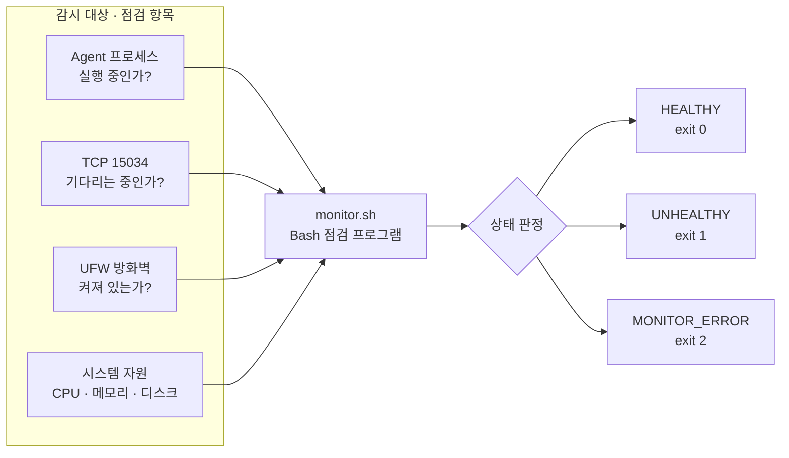
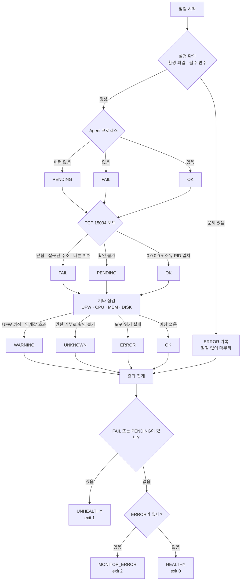
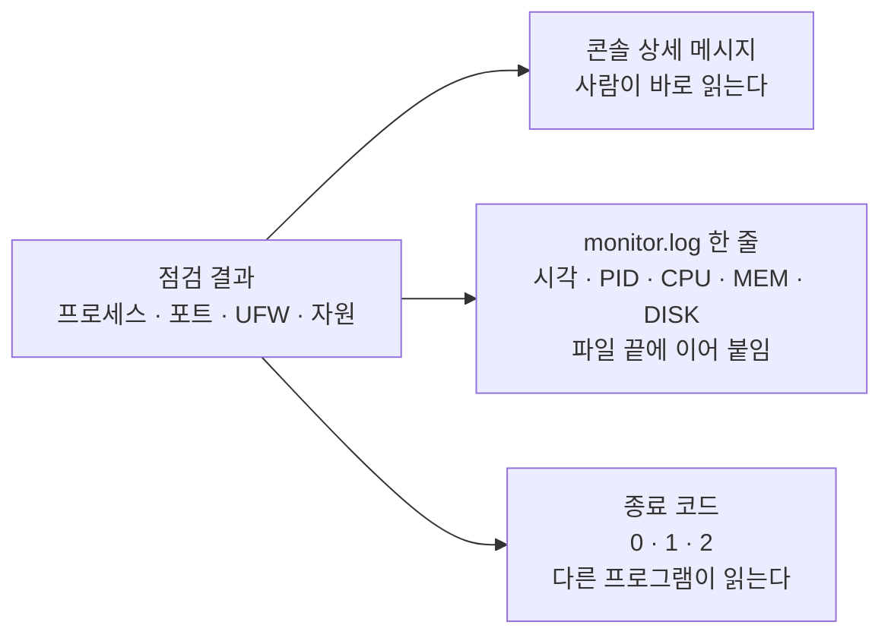
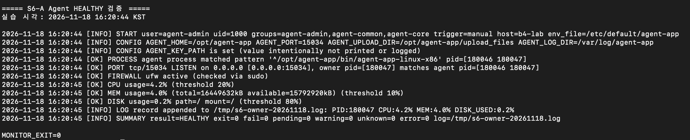
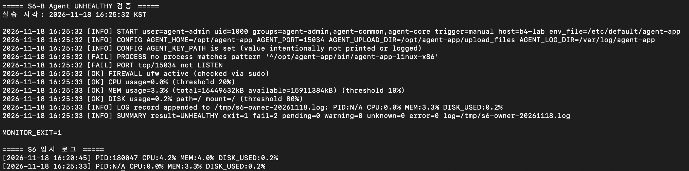

# 5강. 컴퓨터는 어떻게 스스로 이상을 발견할까?

**부제:** Bash 스크립트 `monitor.sh`의 동작 원리  
**학습 분야:** Linux 시스템 운영과 셸 자동화  
**연결 미션:** Codyssey B4-1 — 컴퓨터가 알아서 자기 상태를 점검하게 만들기  
**문서 상태:** v0.1 원고 / 학습 검토 — 5강 첫 원고. 실제 구현(`bin/monitor.sh`)과 2026-11-14 최종 회귀 기록을 기준으로 썼다. 2026-11-18 Owner가 촬영한 **S6 화면(S6-A·S6-B)을 11-5절에 연결했다.** 11-1~11-4절의 2026-11-14 회귀 기록은 그대로 보존했다.  
**선행 학습:** [0강 터미널·Bash](00-shell-terminal-bash.md), [2강 SSH·UFW](02-ssh-ufw.md), [3강 사용자·그룹·권한·ACL](03-users-groups-permissions-acl.md), [4강 환경변수와 Agent 실행](04-env-agent-runtime.md)

> **읽는 방법**
>
> - **[기록]** 은 저장소의 실제 소스·검증 기록에서 가져온 내용이고, **[개념]** 은 일반적인 Linux·Bash 지식이다. 기록에 없는 출력은 만들어 넣지 않았다.
> - 이 강의는 `monitor.sh` 337줄을 한 줄씩 해설하지 않는다. **전체 흐름을 먼저 보고, 판단이 일어나는 부분만** 자세히 읽는다. (코드 줄 번호는 이 원고를 쓴 시점의 `bin/monitor.sh` 기준이며, 파일이 바뀌면 달라질 수 있다.)
> - 이 강의에서는 **Agent를 실행하지 않고, UFW를 끄지 않으며, 어떤 설정도 바꾸지 않는다.** 13절의 S6 실습은 Owner가 진행할 수 있도록 준비한 것이며, 2026-11-18에 Owner가 실제로 수행했다(11-5절). 이 원고는 직접 실행하지 않았다.
> - 근거 문서: [`bin/monitor.sh`](../../bin/monitor.sh), [`docs/b4-1-monitor.md`](../b4-1-monitor.md), [`docs/b4-1-agent-runtime.md`](../b4-1-agent-runtime.md), [`docs/b4-1-final-evidence.md`](../b4-1-final-evidence.md), [최종 회귀 출력](../evidence/task22-closeout-regression.txt), [설정 예제](../../config/etc-default-agent-app.example)
> - `b4-1-monitor.md` 등 과거 설계 문서에는 당시의 `PENDING`·`UNKNOWN` 상태가 적혀 있다. 그 문서들 맨 위의 "현황(최신)" 안내와 **현재 코드**가 우선이며, 이 강의도 현재 코드를 따른다.

---

## 0. 도입 질문 — Agent가 살아 있다는 것만 확인하면 서버는 정상일까?

4강에서 우리는 제공 Agent를 실행했고, 이런 것들을 확인했다.

- Boot Sequence 5단계가 `[OK]`이고 `Agent READY`가 나왔다.
- `ss`로 보면 `0.0.0.0:15034`에서 LISTEN 중이다.
- PID `88567`·`88568`이 Agent 프로세스이고, 소켓 소유 PID는 `88568`이었다(S5-B).

그런데 이것으로 "서버가 정상"이라고 말할 수 있을까? 아래 네 문장을 비교해 보자.

| # | 문장 | 확인하는 방법 | 이것만으로 알 수 있는 것 |
|---|---|---|---|
| ① | 프로그램 **파일이 존재한다** | `ls -l /opt/agent-app/bin/agent-app-linux-x86` | 설치는 되어 있다. 실행 중인지는 모른다 |
| ② | 프로세스가 **실행 중이다** | `pgrep -f …` | 메모리에서 돌고 있다. 손님을 받을 준비가 됐는지는 모른다 |
| ③ | 서버가 **포트에서 기다린다** | `ss -ltnp` | 15034에서 누군가 기다린다. 그게 Agent인지, 외부에서 닿는 주소인지는 모른다 |
| ④ | **정상 동작 조건이 모두 만족된다** | ①②③ + 방화벽·자원 확인 | 우리가 정한 기준을 통과했다 |

**이 넷은 같지 않다.** 병원에 비유하면 이렇다.

- ① 의사 **면허가 있다** (자격은 있다)
- ② 의사가 **출근해 있다** (병원 안에 있다)
- ③ 의사가 **진료실에서 환자를 기다린다** (진료 가능한 자세)
- ④ 병원이 **정상 운영 중이다** (의사 + 진료실 문이 열림 + 간호사·전기·소독 상태까지 OK)

> **비유와 실제의 구분.** 병원 비유는 "조건이 여러 겹"이라는 감각을 잡기 위한 것이다. 실제 `monitor.sh`가 보는 것은 의사가 아니라 **프로세스·TCP 소켓·UFW 상태·CPU/MEM/DISK**다.

이번 강의의 목표는 이 네 번째 층, 즉 **"조건들을 모아 정상/비정상을 판정하는 프로그램"** 이 어떻게 만들어졌는지를 이해하는 것이다. 이 강의가 끝나면 다음 질문에 스스로 답할 수 있어야 한다.

1. Agent가 실행 중인 것을 어떻게 알 수 있을까?
2. 프로그램이 살아 있어도 정상적으로 동작하지 않을 수 있을까?
3. 문제를 발견하면 어떻게 결과를 판단할까?
4. 경고와 장애는 무엇이 다를까?
5. Bash 프로그램은 다른 프로그램에 결과를 어떻게 전달할까?

---

## 1. 모니터링이란 무엇인가?

**모니터링(monitoring)** 은 시스템의 **상태를 관찰하고, 기준과 비교해 이상을 알아내는 일**이다. 다섯 단계로 나눠 생각하면 쉽다.

| 단계 | 의미 | `monitor.sh`에서는 |
|---|---|---|
| ① 상태 관찰 | 지금 상태를 **측정**한다 | 프로세스·포트·UFW·CPU/MEM/DISK 수집 |
| ② 주기적 검사 | 한 번이 아니라 **반복해서** 본다 | 스크립트 자체는 1회 실행. 반복은 cron이 맡는다(7강) |
| ③ 정상·비정상 판정 | 기준과 **비교**한다 | `OK`/`FAIL`/`WARNING` 등 판정, 최종 `HEALTHY`/`UNHEALTHY` |
| ④ 장애 발견 | 비정상을 **알아차린다** | 종료 코드 `1`, 콘솔의 `[FAIL]` |
| ⑤ 기록·후속 대응 | **남기고** 누군가 대응한다 | `monitor.log` 한 줄 기록, 사람의 확인·조치 |

CPU 수집이나 cron 같은 세부는 6~7강에서 배운다. 이번 강의는 **② 이후 판정과 전달의 구조**에 집중한다.

### 1-1. Agent와 monitor.sh의 역할

| | Agent (`agent-app-linux-x86`) | `monitor.sh` |
|---|---|---|
| 정체 | 제공된 **실행 파일**(소스를 볼 수 없음) | 우리가 읽을 수 있는 **Bash 스크립트**(`bin/monitor.sh`) |
| 역할 | 서버로 동작한다(15034에서 대기) | 그 서버와 시스템의 **상태를 검사**한다 |
| 관계 | **감시 대상** | **감시자** |
| 실행 방식 | 검증 때 수동 실행, 상주 서비스 아님 [기록] | 1회 실행하고 **끝난다**. 결과를 남기고 종료 |

감시자와 감시 대상은 **서로 다른 프로그램**이다. 감시자가 감시 대상 안에 들어 있지 않기 때문에, Agent가 죽어도 `monitor.sh`는 "Agent가 죽었다"고 보고할 수 있다.

### 1-2. 구조도 1 — Agent와 Monitor의 관계



네 갈래의 입력이 `monitor.sh` 한 곳으로 모이고, 마지막에 **셋 중 하나의 판정**이 나온다. 판정 규칙은 8~9절에서 자세히 본다.

---

## 2. Bash 스크립트도 프로그램이다

### 2-1. 용어 풀이

| 용어 | 뜻 |
|---|---|
| **셸(shell)** | 사용자의 명령을 받아 운영체제에 전달하는 프로그램. Bash는 셸의 한 종류(0강) |
| **셸 스크립트** | 셸 명령을 **파일에 적어 두고 순서대로 실행**하게 만든 것 |
| **`.sh` 파일** | 셸 스크립트에 흔히 붙이는 확장자. **관례일 뿐** 실행 규칙을 정하지는 않는다 |
| **shebang(셔뱅)** | 파일 첫 줄의 `#!` 로 시작하는 줄. "이 파일을 **어떤 프로그램으로 해석할지**" 알려 준다 |

`monitor.sh`의 첫 줄 **[기록]**:

```bash
#!/bin/bash
```

- `#!` : shebang 표시. 보통 `#`은 주석이지만 **첫 줄의 `#!`는 특별 취급**된다.
- `/bin/bash` : 이 파일을 해석할 프로그램의 경로.

**전체 해석:** "이 파일은 `/bin/bash`로 읽어서 실행해라."

### 2-2. 직접 실행 vs `bash script.sh`

**[개념]**

| 방식 | 명령 | 실행 권한(x)이 필요한가 | 어떤 해석기를 쓰나 |
|---|---|---|---|
| 직접 실행 | `/opt/agent-app/bin/monitor.sh` | **필요** | 파일 첫 줄 shebang이 정한다 |
| Bash에 넘김 | `bash /opt/agent-app/bin/monitor.sh` | **불필요**(읽기 권한 r만 있으면 됨) | 명령에서 쓴 `bash` |

3강의 권한 개념이 여기서 이어진다. **[기록]** 배포된 파일은 `agent-dev:agent-core 750`(`rwxr-x---`)이다.

- 소유자 `agent-dev` : 읽기·쓰기·실행(rwx) → 수정은 소유자만 한다.
- 그룹 `agent-core` : 읽기·실행(r-x) → `agent-admin`이 이 그룹이어서 실행할 수 있다.
- 그 밖의 계정(`agent-test` 등) : 권한 없음 → `Permission denied`.

즉 "직접 실행"을 하려면 **실행 권한(x)이 있는 계정**이어야 한다. 이것이 `agent-admin`으로 실행하는 이유 중 하나다.

### 2-3. 순차 실행과 외부 명령 호출

스크립트는 **위에서 아래로 한 줄씩** 실행된다. 그리고 스크립트가 하는 일의 대부분은 **다른 프로그램(외부 명령)을 호출하고 그 결과를 받는 것**이다.

`monitor.sh`가 호출하는 외부 명령 **[기록: 코드 108행과 본문]**:

| 외부 명령 | 하는 일 |
|---|---|
| `pgrep` | 조건에 맞는 프로세스 찾기 |
| `ss` | 소켓(LISTEN 포트) 조회 |
| `ufw`(+`sudo`) | 방화벽 상태 조회 |
| `df` | 디스크 사용량 |
| `awk` | 텍스트·숫자 계산 |
| `date`, `sleep` | 시각, 잠시 대기 |

코드 앞쪽에서는 **필요한 명령이 설치되어 있는지부터 확인**한다.

```bash
for t in ss pgrep df awk date sleep; do
  command -v "$t" >/dev/null 2>&1 || { say ERROR TOOLS "required command not found: $t"; finish; }
done
```

**전체 해석:** "`ss pgrep df awk date sleep`을 하나씩 꺼내서, 그 명령이 없으면 `ERROR` 메시지를 내고 곧바로 끝내라." (문법은 4절에서 풀이한다.) 점검 도구가 없다는 것은 **점검 대상의 문제가 아니라 감시자 쪽의 문제**이므로 `ERROR`다.

---

## 3. monitor.sh 전체 구조

`bin/monitor.sh`를 위에서 아래로 훑으면 아홉 단계로 나뉜다. 이 구조를 먼저 머릿속에 넣고, 이후 절에서 각 단계를 자세히 본다.

| # | 단계 | 코드 위치(대략) | 입력 | 출력(결과) | 실패할 수 있는 이유 |
|---|---|---|---|---|---|
| 1 | **실행 준비** | 25~47행 | (없음) | `set -u`, 고정 `PATH`, 카운터 0으로 초기화 | — |
| 2 | **환경변수 로드** | 115~122행 | `/etc/default/agent-app` | 변수 `AGENT_*` 사용 가능 | 파일을 읽을 수 없음 → `ERROR CONFIG` |
| 3 | **설정값 검증** | 124~147행 | 로드한 변수, 임계값 | 유효하면 진행 | 필수 변수 누락, 포트가 숫자가 아님 → `ERROR CONFIG` |
| 4 | **Agent 프로세스 검사** | 149~168행 | `AGENT_PROCESS_PATTERN` | `OK`/`FAIL`/`PENDING`/`ERROR PROCESS` | 패턴 미설정, 프로세스 없음, `pgrep` 자체 오류 |
| 5 | **TCP 15034 LISTEN 검사** | 170~253행 | `ss -H -ltnp` 출력 | `OK`/`FAIL`/`PENDING`/`ERROR PORT` | 포트가 안 열림, 루프백 전용 바인딩, 소유 PID 불일치·미확인 |
| 6 | **UFW 상태 검사** | 255~291행 | `sudo -n /usr/sbin/ufw status` | `OK`/`WARNING`/`UNKNOWN`/`ERROR FIREWALL` | UFW 비활성, sudo 거부, 예상 밖 출력 |
| 7 | **CPU·MEM·DISK 수집** | 293~334행 | `/proc/stat`, `/proc/meminfo`, `df` | 사용률 + `OK`/`WARNING` | 파일·명령 읽기 실패 → `ERROR` |
| 8 | **결과 기록** | 336행 `write_record` | 4~7단계에서 모은 값 | `monitor.log`에 한 줄 | 로그 파일 열기·쓰기 실패 → `ERROR LOG` |
| 9 | **최종 상태·종료 코드** | 337행 `finish` | 모든 판정 카운터 | `SUMMARY` 줄, `exit 0/1/2` | — |

> 7단계의 계산식(CPU 두 번 샘플링 등)은 **6강**에서 자세히 배운다. 이번 강의에서는 "수집한 값을 기록하고 임계값과 비교한다"까지만 이해하면 된다.

### 3-1. 구조도 2 — Health Check 의사결정



읽는 요령:

- **FAIL·PENDING**은 필수 조건(프로세스·포트) 쪽에서 나오고 → 곧바로 `UNHEALTHY(1)` 쪽으로 이어진다.
- **WARNING·UNKNOWN**은 집계는 되지만 **종료 코드를 바꾸지 않는다.**
- **ERROR**는 `exit 2`이지만, **FAIL/PENDING이 하나라도 있으면 그쪽이 먼저**(`exit 1`)다(9절).
- 설정 오류(`CE`)와 도구 부족은 점검 단계로 가지 않고 곧바로 마무리된다. 그 경로에서는 `monitor.log`에 기록이 남지 않는다(10절).

---

## 4. Bash의 판단 문법 — 실제 코드로 배우기

문법을 따로 외우지 않고, **`monitor.sh`가 판단하는 장면** 안에서 하나씩 만난다.

### 4-1. 변수 대입

```bash
FAILS=0; WARNS=0; UNKNOWNS=0; PENDINGS=0; ERRORS=0     # 30행
```

- `이름=값` 형태이며 **`=` 양옆에 공백이 없어야 한다.** (`FAILS = 0`은 "FAILS라는 명령을 실행"으로 해석되어 오류가 난다.)
- `;` 는 명령을 구분한다(줄바꿈과 같은 역할).
- 이 다섯 변수는 **판정을 세는 계수기**다. 점검 결과가 `FAIL`이면 `FAILS`가 1 올라간다.

### 4-2. `$변수`와 `${변수}`

```bash
say OK CPU "usage=${cpu}% (threshold ${CPU_WARN}%)"     # 311행 부분
ENV_FILE="${MONITOR_ENV_FILE:-/etc/default/agent-app}"   # 28행
```

| 표기 | 뜻 |
|---|---|
| `$cpu` | 변수 `cpu`의 값 |
| `${cpu}` | 같은 값. **이름의 끝을 중괄호로 분명히** 한다(뒤에 `%` 등이 붙을 때 헷갈리지 않게) |
| `${변수:-기본값}` | 변수가 **없거나 비어 있으면 기본값**을 쓴다 |

28행의 의미: "`MONITOR_ENV_FILE`이 지정돼 있으면 그 파일을, 아니면 `/etc/default/agent-app`을 설정 파일로 써라." 평소에는 기본값이 쓰이고, **테스트할 때만 다른 파일로 바꿔 끼울 수 있다.**

### 4-3. `if` / `elif` / `else` / `fi` — 최종 판정

가장 중요한 판단 코드다(93~97행). **[기록]**

```bash
verdict() {
  if [ $((FAILS+PENDINGS)) -gt 0 ]; then V_CODE=1; V_RESULT=UNHEALTHY
  elif [ "$ERRORS" -gt 0 ]; then V_CODE=2; V_RESULT=MONITOR_ERROR
  else V_CODE=0; V_RESULT=HEALTHY; fi
}
```

| 구성 | 의미 |
|---|---|
| `$((FAILS+PENDINGS))` | `FAILS`와 `PENDINGS`를 **더한 숫자** (산술 확장) |
| `-gt 0` | "0보다 **크다**"(greater than) |
| `if … then … elif … then … else … fi` | 조건 1 → 조건 2 → 나머지. `fi`는 `if`를 거꾸로 쓴 닫는 표시 |

**전체 해석:** "FAIL과 PENDING의 합이 0보다 크면 UNHEALTHY(코드 1). 그렇지 않고 ERROR가 있으면 MONITOR_ERROR(코드 2). 둘 다 아니면 HEALTHY(코드 0)."

**순서가 곧 우선순위**다. `if`가 `elif`보다 먼저 검사되므로 FAIL/PENDING이 ERROR보다 우선한다.

### 4-4. `for`와 `while` — 반복

```bash
for v in AGENT_HOME AGENT_PORT AGENT_UPLOAD_DIR AGENT_LOG_DIR; do      # 125행
  if [ -z "${!v:-}" ]; then say ERROR CONFIG "required variable missing or empty: $v"; cfg_bad=1; fi
done
```

- `for 이름 in 목록; do … done` : 목록의 항목을 하나씩 `v`에 담아 반복한다.
- `${!v}` : **간접 참조**. `v`에 든 *이름*(예: `AGENT_PORT`)의 변수 *값*을 읽는다.
- `-z` : 문자열이 **비어 있다(zero length)**.

**전체 해석:** "필수 변수 네 개를 차례로 보며, 비어 있으면 오류를 출력하고 설정 불량 표시(`cfg_bad=1`)를 켜라."

`while`은 **조건이 참인 동안 반복**한다. 5·6절의 `while IFS= read -r line; do … done`은 "출력 결과를 한 줄씩 읽는 반복"이다(`read -r`: 한 줄 읽기, `IFS=`: 줄 앞뒤 공백 보존).

### 4-5. `case` — 값에 따른 분기

`say` 함수가 호출될 때마다 **어떤 등급인지에 따라 해당 계수기를 올린다**(49~55행).

```bash
bump() {
  case "$1" in
    FAIL) FAILS=$((FAILS+1));; WARNING) WARNS=$((WARNS+1));;
    UNKNOWN) UNKNOWNS=$((UNKNOWNS+1));; PENDING) PENDINGS=$((PENDINGS+1));;
    ERROR) ERRORS=$((ERRORS+1));;
  esac
}
```

- `case 값 in 패턴) 실행;; … esac` : 값이 어느 패턴과 맞는지 보고 **그 줄만** 실행한다. `;;`는 그 분기의 끝, `esac`는 `case`를 거꾸로 쓴 닫는 표시.
- `$1` : 함수에 **첫 번째로 전달된 값**. `bump FAIL`이라고 부르면 `$1`은 `FAIL`이다.
- `OK`와 `INFO`는 패턴에 없으므로 **아무것도 세지 않는다.**

같은 `case`가 포트의 바인딩 주소를 분류하는 데도 쓰인다(198~203행, 6절).

### 4-6. 함수 정의와 호출

```bash
say() { # level category message  -> stdout only
  local msg="${3//$'\n'/ }"
  printf '%s [%s] %s %s\n' "$(ts)" "$1" "$2" "$msg"
  bump "$1"
}
```

- `이름() { … }` : 함수 정의. 정의만으로는 실행되지 않고 **이름을 부를 때** 실행된다.
- `$1 $2 $3` : 호출할 때 준 값. `say OK PROCESS "agent process matched …"`라고 부르면 `$1=OK`, `$2=PROCESS`, `$3=메시지`.
- `local` : 이 함수 안에서만 쓰는 변수.
- `$(ts)` : **명령 치환**. `ts` 함수(현재 시각을 돌려줌)를 실행하고 그 **출력**을 그 자리에 끼워 넣는다.
- `${3//$'\n'/ }` : 메시지 속 줄바꿈을 공백으로 바꿔서 **로그가 한 줄로** 나오게 한다.

`say`는 두 가지를 한꺼번에 한다. **① 한 줄을 화면에 출력**, **② `bump`로 등급 집계**. 모든 점검이 이 함수를 통해 결과를 말하기 때문에 집계가 빠지지 않는다. 이것이 이 프로그램의 핵심 설계다.

### 4-7. `[ ]`와 `[[ ]]` — 조건 검사

| 형태 | 설명 | 코드 속 예 |
|---|---|---|
| `[ 조건 ]` | 전통적인 검사 명령(사실 `test` 명령의 다른 이름). **안의 공백이 필수**이고 변수는 `"따옴표"`로 감싸는 것이 안전 | `[ "$ERRORS" -gt 0 ]` |
| `[[ 조건 ]]` | Bash 전용 확장. 패턴·**정규표현식**(`=~`)을 쓸 수 있다 | `[[ "${1:-}" =~ ^[0-9]+$ ]]` (102행) |

자주 쓰는 검사 연산자 **[개념 + 코드 속 용례]**:

| 연산자 | 뜻 | 예 |
|---|---|---|
| `-z 문자열` / `-n 문자열` | 비어 있다 / 비어 있지 않다 | `[ -z "$LOG_FILE" ]` |
| `-e` / `-f` / `-d` / `-L` | 존재 / 일반 파일 / 디렉터리 / 심볼릭 링크 | `[ -L "$LOG_FILE" ]` |
| `-r` / `-x` | 읽을 수 있다 / 실행할 수 있다 | `[ ! -r "$ENV_FILE" ]` |
| `-eq -ne -lt -gt` | 숫자 같다/다르다/작다/크다 | `[ "$AGENT_PORT" -lt 1 ]` |
| `=` | 문자열이 같다 | `[ "$p" = "$$" ]` |
| `!` | 부정(아니다) | `[ ! -r "$ENV_FILE" ]` |

102행의 `is_uint`는 "**이 값이 숫자로만 이루어졌는가**"를 정규표현식 `^[0-9]+$`로 묻는다. `^`는 처음, `$`는 끝, `[0-9]+`는 숫자 한 개 이상이라는 뜻이다. 포트 번호 검증(129행)에 쓰인다.

### 4-8. `&&`와 `||` — 앞의 결과에 따라 뒤를 실행

| 연산자 | 뜻 |
|---|---|
| `A && B` | A가 **성공했을 때만** B 실행 |
| `A \|\| B` | A가 **실패했을 때만** B 실행 |

```bash
command -v "$t" >/dev/null 2>&1 || { say ERROR TOOLS "required command not found: $t"; finish; }   # 109행
[ "$cfg_bad" -eq 0 ] || finish                                                                     # 141행
```

**전체 해석:** 109행 — "명령 `$t`가 있는지 확인(`command -v`)하고, 없어서 **실패하면** 중괄호 안(오류 출력 + 마무리)을 실행해라." 141행 — "`cfg_bad`가 0이 **아니면**(설정에 문제가 있으면) 곧바로 `finish`해라."

덧붙임: `>/dev/null 2>&1`은 "출력과 오류 메시지를 모두 버려라"(조용히 검사만 하라)는 뜻이다. `/dev/null`은 무엇이든 삼키는 특수 파일이다.

### 4-9. `return`과 `exit`, 그리고 `$?`

| | 역할 | 코드 속 예 |
|---|---|---|
| `return 값` | **함수만** 끝내고 호출한 곳으로 돌아간다 | `init_log`에서 `LOG_STATE=disabled; return` (65행) |
| `exit 값` | **스크립트 전체**를 끝내고 값을 **종료 코드**로 돌려준다 | `finish`의 `exit "$V_CODE"` (100행) |
| `$?` | **바로 앞 명령의 종료 코드** | `pids=$(pgrep …); prc=$?` (156행) |

**종료 코드** 규칙(**[개념]**): 모든 명령은 끝날 때 숫자 하나를 남긴다. **0은 성공, 0이 아니면 실패(또는 특별한 상황)** 다. `pgrep`은 이 숫자로 말한다.

| `pgrep` 종료 코드 | 의미 |
|---|---|
| 0 | 하나 이상 찾았다 |
| 1 | 하나도 못 찾았다 (오류 아님) |
| 2 이상 | 명령 자체가 오류 |

그래서 157행은 `[ "$prc" -gt 1 ]`(2 이상)일 때만 `ERROR`로 처리한다. **"못 찾음(1)"은 점검 결과 `FAIL`이고, "명령 고장(2+)"은 `ERROR`** 이기 때문이다. 이 둘을 가르는 것이 8절의 핵심이다.

---

## 5. Agent 프로세스 검사

### 5-1. 설정: 어떤 것을 Agent로 볼 것인가

4강 5-8절에서 본 설정이다. **[기록: 설정 예제, 회귀 `## env`]**

```text
AGENT_PROCESS_PATTERN=^/opt/agent-app/bin/agent-app-linux-x86
```

`monitor.sh`는 이 값을 읽어 `pgrep -f`에 넘긴다(156행).

```bash
pids=$(pgrep -f -- "$AGENT_PROCESS_PATTERN" 2>/dev/null); prc=$?
```

### 5-2. 용어 풀이

- **PID(Process ID):** 실행 중인 프로세스에 운영체제가 붙이는 **번호표**. 같은 프로그램을 두 번 실행하면 PID가 다르다. 프로세스가 끝나면 번호는 사라진다.
- **프로세스 이름:** 커널이 기록하는 짧은 이름. 리눅스는 이 이름을 **15글자까지만** 보관한다. [개념]
- **전체 명령줄(command line):** 실행할 때 입력한 **경로와 인수 전체**.

S5-B의 소켓 줄에서 이 차이가 눈에 보인다 **[기록: 4강 12-4절]**.

```text
88567 /opt/agent-app/bin/agent-app-linux-x86            ← 전체 명령줄
LISTEN 0 1  0.0.0.0:15034 …  users:(("agent-app-linux",pid=88568,fd=4))   ← 짧은 프로세스 이름
```

이름은 `agent-app-linux`(15글자)로 잘려 있고, 전체 명령줄에는 `-x86`까지 나온다. 같은 프로세스를 두 가지 얼굴로 보는 셈이다.

### 5-3. `pgrep -f` 풀이

**원문**

```bash
pgrep -f -- '^/opt/agent-app/bin/agent-app-linux-x86'
```

| 구성 | 의미 |
|---|---|
| `pgrep` | 조건에 맞는 프로세스를 찾아 **PID를 출력** |
| `-f` | 프로세스 이름이 아니라 **전체 명령줄**을 검사 |
| `--` | "여기부터는 옵션이 아니라 패턴"이라는 구분 표시(패턴이 `-`로 시작해도 안전) |
| `'^/opt/…-x86'` | **확장 정규표현식** 패턴. 작은따옴표로 감싸 셸이 해석하지 못하게 함 |

**전체 해석:** "명령줄이 `/opt/agent-app/bin/agent-app-linux-x86`으로 **시작**하는 프로세스를 모두 찾아서 PID를 출력해라."

**왜 `-f`가 필요한가?** `-f`가 없으면 `pgrep`은 이름(최대 15글자 `agent-app-linux`)만 본다. 경로를 포함한 긴 패턴은 이름과 맞지 않아 **아무것도 못 찾는다.** 경로까지 지정해 정확히 이 Agent만 겨냥하려면 `-f`가 필요하다. [개념]

**실제 결과 [기록: 회귀 `-- monitor (Agent running)`]**

```text
[OK] PROCESS agent process matched pattern '^/opt/agent-app/bin/agent-app-linux-x86' pid=[100365 100366]
```

PID가 **두 개**다. 다음 항에서 이유를 본다.

### 5-4. 정규표현식 `^`는 왜 쓰는가

**정규표현식(regular expression)** 은 문자열의 **모양**을 적는 규칙이다. `^`는 "문자열의 **맨 앞**에서 시작"이라는 뜻이다.

4강 5-8절에서 보았듯, Agent를 실행하는 명령은 `sudo runuser … bash -c '… exec /opt/agent-app/bin/agent-app-linux-x86'`처럼 **Agent 경로 문자열을 포함한 긴 명령줄**을 가진다. 이 감싸는 프로그램(래퍼)이나, 편집기로 그 경로를 열어 둔 프로세스도 `-f`로 검사하면 경로 문자열이 **중간에 들어 있다.**

| 후보 프로세스의 명령줄 | `^` 없이 경로만 검색 | `^/opt/…` 로 검색 |
|---|---|---|
| `/opt/agent-app/bin/agent-app-linux-x86` | 일치 | 일치 |
| `runuser … bash -c '… exec /opt/agent-app/bin/agent-app-linux-x86'` (래퍼, 예시) | 일치(오인) | **불일치** |
| `vim /opt/agent-app/bin/agent-app-linux-x86` (예시) | 일치(오인) | **불일치** |

> 위 표의 두 번째·세 번째 줄은 `^`의 효과를 설명하려고 만든 **[개념] 예시**이며 실제 `ps` 출력 기록이 아니다. 기록에 있는 근거는 설정 예제 주석("ANCHORED at the start of the command line so wrappers … do not match")이다.

### 5-5. 부모·자식 Agent 프로세스가 모두 검색되는 이유

**[기록]** Agent를 한 번 실행하면 **프로세스가 둘** 생긴다. 회귀의 `100365`·`100366`, S5-B의 `88567`·`88568`이 그 예다. 둘 다 명령줄이 같은 경로로 시작하므로 `pgrep -f`가 **둘 다** 찾는다. 소켓을 직접 잡는 쪽은 자식이다(4강 10-1절). 

그래서 `monitor.sh`는 찾은 PID를 **목록으로** 저장한다(`AGENT_PIDS`). 160행은 목록에서 **자기 자신과 부모를 제외**한다.

```bash
for p in $pids; do [ "$p" = "$$" ] || [ "$p" = "$PPID" ] || AGENT_PIDS="$AGENT_PIDS $p"; done
```

- `$$` : 지금 실행 중인 **이 스크립트의 PID**, `$PPID` : 이 스크립트를 **실행시킨 부모의 PID**.
- **전체 해석:** "찾은 PID마다, 나 자신도 아니고 내 부모도 아니면 Agent 목록에 추가해라." 감시자가 자기 자신을 Agent로 착각하는 일을 막는 안전장치다.

### 5-6. 왜 "아무 프로세스나 있으면 정상"으로 보면 안 될까?

- 서버 컴퓨터에는 프로세스가 수백 개 있다. `python`이든 `bash`든 **"뭔가 돌고 있다"는 사실은 Agent의 정상 여부와 아무 관련이 없다.**
- 엉뚱한 프로세스를 Agent로 오인하면, **진짜 Agent가 죽었는데도 HEALTHY**가 나오는 **거짓 안심**이 생긴다. 모니터링에서 가장 위험한 오류다.

그래서 코드 주석(150~151행)은 **"식별은 추측하지 않는다"** 고 못 박는다.

### 5-7. 패턴을 설정하지 않으면 왜 `PENDING`인가

```bash
if [ -z "${AGENT_PROCESS_PATTERN:-}" ]; then
  say PENDING PROCESS "agent identification criteria not configured (AGENT_PROCESS_PATTERN unset); not assuming any python process is the Agent"
```

패턴이 비어 있으면 **무엇을 Agent로 볼지 모른다.** 이때 `FAIL`("Agent가 없다")이라고 단정하면 틀릴 수 있고, `OK`라고 하면 거짓 안심이다. 그래서 **"판정할 근거가 아직 없다"는 뜻의 `PENDING`** 으로 남긴다. 그리고 `PENDING`은 **정상으로 치지 않는다**(`exit 1`). **[기록]** 과거 설계 문서의 "Agent 없음 / `PENDING`"은 Agent를 확보하기 전의 상태였고, 현재는 패턴이 설정되어 Agent 실행 중 `OK`가 나온다.

### 5-8. 판정 요약

| 상황 | 출력 등급 | 집계 |
|---|---|---|
| 패턴 미설정 | `PENDING PROCESS` | `PENDING` +1 |
| `pgrep` 오류(2 이상) | `ERROR PROCESS` | `ERROR` +1 |
| 패턴과 일치하는 프로세스 없음 | `FAIL PROCESS` | `FAIL` +1 |
| 일치하는 프로세스 있음 | `OK PROCESS` | `PROC_OK=1`, 그 PID 저장 |

> **S5-B 연결.** S5-B 화면의 `88567`·`88568`은 정확히 이 검사가 찾아낼 PID 쌍이다. 다만 S5-B와 S6는 **서로 다른 날의 별개 실행**이다. S6-A(2026-11-18)에서는 다른 PID 쌍(`180046`·`180047`)이 같은 방식으로 인식된다(11-5절).

---

## 6. TCP 포트와 프로세스를 함께 확인하는 이유

### 6-1. 프로세스만 보면 놓치는 것

Agent 프로세스가 **떠 있어도** 다음 문제가 있을 수 있다.

- 포트를 열지 못했다(부팅 후 내부 오류 등) → 손님이 못 들어온다.
- **자기 컴퓨터 안에서만**(`127.0.0.1`) 열려 있다 → 외부에서 접속 불가.
- 15034를 잡고 있는 것이 **다른 프로그램**이다(포트 충돌).

반대로 **포트가 열려 있어도** 그것이 Agent라는 보장은 없다. 그래서 `monitor.sh`는 **프로세스(누가)와 포트(어디서)를 따로 보고, 마지막에 둘을 연결**한다. 구분해 보자.

| 확인 항목 | 질문 |
|---|---|
| Agent 프로세스 존재 | Agent로 보이는 프로세스가 있나? |
| TCP 15034 LISTEN | 15034에서 기다리는 소켓이 있나? |
| `0.0.0.0` 바인딩 | 외부(모든 IPv4 주소)에서 들어올 수 있는 모양인가? |
| LISTEN 소켓 소유 PID | 그 소켓을 **누가** 잡고 있나? |
| Agent PID와 소켓 소유 PID 일치 | 잡고 있는 것이 **우리가 찾은 Agent**인가? |

### 6-2. `ss -ltnp` 풀이

**원문 (코드는 `-H`를 추가해 `ss -H -ltnp`를 사용, 185행)**

| 옵션 | 의미 |
|---|---|
| `ss` | 소켓 상태를 보여 주는 명령 |
| `-l` | **LISTEN** 중인 소켓만 (listening) |
| `-t` | **TCP**만 |
| `-n` | 이름 대신 **숫자**로 표시(포트를 `15034`로, 서비스 이름 변환 안 함) |
| `-p` | 소켓을 잡은 **프로세스(PID)** 도 표시 |
| `-H` | 맨 윗줄 제목(header)을 **출력하지 않음**(스크립트가 처리하기 쉽게) |

**전체 해석:** "TCP로 LISTEN 중인 모든 소켓을 숫자로, 그 소켓을 잡은 프로세스와 함께, 제목 줄 없이 출력해라."

**실제 결과 [기록: 4강 S5-B, 회귀]**

```text
LISTEN 0      1            0.0.0.0:15034      0.0.0.0:*    users:(("agent-app-linux",pid=88568,fd=4))
```

`monitor.sh`는 이 출력에서 awk로 **로컬 주소(4번째 칸)가 `:15034`로 끝나는 줄**만 골라낸다(189행).

```bash
lst=$(printf '%s\n' "$ssout" | awk -v p="$AGENT_PORT" '$4 ~ (":" p "$") {print}')
```

> `-p`의 한계 **[기록: 코드 주석 180~183행]**: `ss -p`는 **다른 사용자의 소켓**의 PID를 보여 주지 않을 수 있다(자신 또는 root가 볼 수 있는 범위). 이 경우 소유 PID가 비어 있고, 아래 "미확인" 분기가 쓰인다.

### 6-3. 현재 코드가 구분하는 경우

**① 바인딩 주소 분류 (198~203행)**

```bash
case "$h" in
  0.0.0.0)          v4all=1;;
  "[::]"|"*")       v6any=1;;
  127.*|"[::1]")    loop=1;;
  *)                spec=1;;
esac
```

| 로컬 주소 | 의미 | 결과 |
|---|---|---|
| `0.0.0.0:15034` | **IPv4 와일드카드**: 서버의 모든 IPv4 주소 | 요건 충족 |
| `127.x.x.x:15034`, `[::1]:15034` | **루프백 전용**: 자기 컴퓨터 안에서만 | `FAIL` |
| 특정 IP 하나(예: `10.0.0.5:15034`) | 그 주소로 온 접속만 | `FAIL` |
| `[::]:15034`, `*:15034`만 있음 | IPv6 와일드카드. **IPv4 접속 가능 여부를 `ss` 출력만으로는 알 수 없다** | `PENDING` |

마지막 행이 흥미롭다. `[::]`가 IPv4도 받아 주는지는 소켓의 `IPV6_V6ONLY` 설정에 달려 있는데 `ss`는 이를 보여 주지 않는다. 그래서 **"확인할 수 없는 것은 OK로 치지 않는다"** 는 원칙으로 `PENDING`을 쓴다.

**② 소유 PID 비교 (230~242행)** — 바인딩이 `0.0.0.0`으로 통과된 뒤에만 비교한다.

| 상황 | 결과 |
|---|---|
| 소켓을 잡은 PID 중 **Agent PID 목록에 없는 것**이 있다 | `FAIL` — "다른 프로그램이 포트를 잡고 있다" |
| 소유 PID가 `ss`에 **보이지 않는다**(권한 때문) | `PENDING` — "Agent의 것인지 확인할 수 없다" |
| 소유 PID가 모두 Agent PID 중 하나 | `OK` |
| Agent 프로세스가 아예 확인되지 않았다(`PROC_OK`≠1) | 포트는 `OK`로 쓰되 **"owner not evaluated"**(소유자 미평가)를 표시. 프로세스 검사가 이미 `FAIL`/`PENDING`이므로 최종 판정은 `UNHEALTHY` |

### 6-4. 실제 사례 — 부모 PID와 자식 PID

**[기록: 4강 S5-B]** Agent 프로세스는 `88567`·`88568` 둘이고, 15034 LISTEN 소켓의 소유 PID는 `88568`이다. `monitor.sh`가 이 상황을 보면:

1. 5절 검사 → `AGENT_PIDS="88567 88568"`
2. 6절 검사 → 소유 PID `88568`은 Agent PID 목록에 **있다** → 일치 → `OK`

소켓을 잡은 쪽은 자식 하나지만 부모도 Agent로 인정하므로 **둘 중 하나만 일치하면 된다.** (회귀 기록의 실제 출력은 `owner pid=[100366] matches agent pid=[100365 100366]`.)

> **정직한 주의 — S5-A와 S5-B는 같은 실행이라고 입증되지 않았다.** 4강 12-4절에서 확인했듯 S5-B(약 오후 6:08)가 S5-A(시작 로그 `18:10:30`)보다 약 2분 **먼저** 촬영되었다. 이 두 이미지만으로는 같은 Agent 실행의 것인지 알 수 없다. 이 강의는 PID `88567·88568`을 **"S5-B에서 관찰된 한 번의 실행 사례"** 로만 쓰며, S5-A와 같은 실행이라고 단정하지 않는다.

### 6-5. "UFW에서 15034를 허용"과는 무관하다

코드 주석 171~172행: **"Firewall allow rules (UFW 15034) are NOT considered."** 포트 검사는 **실제 LISTEN 소켓**만 본다. UFW 규칙이 허용되어 있어도 Agent가 대기하지 않으면 `FAIL`이고(4강 10-3절), 반대로 UFW 상태는 다음 절에서 **따로** 검사한다.

---

## 7. UFW 방화벽 상태 검사

### 7-1. "규칙이 있다"와 "켜져 있다"는 다르다

2강에서 배운 UFW를 떠올리자.

- **규칙(rule):** "15034/tcp는 들어와도 좋다"는 **허용 목록**.
- **활성(active):** 방화벽이 **지금 실제로 동작하며 패킷을 거르고 있는 상태**.

규칙이 줄줄이 적혀 있어도 UFW가 **inactive**(꺼짐)이면 그 규칙들은 **적용되지 않는다.** 건물에 출입 명단이 있어도 경비실 문이 닫혀 있는 것과 같다(비유). 그래서 `monitor.sh`는 규칙 목록이 아니라 **`Status:` 줄**을 본다.

코드 주석(261행)은 `ufw.conf`의 `ENABLED=`는 **힌트일 뿐** 실제 필터링을 증명하지 않는다고 적고 있다. 판정에는 쓰지 않고 `UNKNOWN` 메시지 끝에 참고(`hint only`)로만 붙인다.

### 7-2. `sudo -n /usr/sbin/ufw status`

**원문 (코드는 `sudo -n /usr/sbin/ufw status`를 `timeout 15`와 함께 실행, 271·280행)**

| 구성 | 의미 |
|---|---|
| `sudo` | 다른 사용자(여기서는 root)의 권한으로 실행 |
| `-n` | **non-interactive**. 비밀번호를 **묻지 않는다.** 비밀번호가 필요하면 물어보는 대신 **즉시 실패**한다 |
| `/usr/sbin/ufw` | **전체 경로**로 지정한 ufw 프로그램 |
| `status` | 방화벽 상태를 보여 달라는 하위 명령 |

**전체 해석:** "root 권한으로 `/usr/sbin/ufw status`를 실행하되, 비밀번호를 묻지 말고 안 되면 바로 실패하라."

**`-n`이 필요한 이유 [기록: 코드 주석 258행]:** `monitor.sh`는 cron이 사람 없이 실행한다. 비밀번호 입력을 기다리면 **영원히 멈춰 버린다.** `-n`이 있으면 막혀도 곧바로 실패하므로 `UNKNOWN`으로 처리하고 계속 진행할 수 있다. (코드는 추가로 `timeout 15`로 최대 15초만 기다린다.)

> **Mac의 sudo와 Ubuntu의 sudo.** 위 `sudo`는 **Ubuntu `b4-lab` 안의 `agent-admin`이 쓰는 sudo**다. 교육장 Mac의 관리자 권한과는 무관하며, Mac에서는 sudo를 쓰지 않는다(4강 8-6절).

### 7-3. 최소 권한 sudo 정책

`ufw status`는 root만 실행할 수 있다. 그렇다고 `agent-admin`에게 모든 sudo를 주면 위험하다. 그래서 **정확히 이 한 명령만** 허용했다. **[기록]**

```text
agent-admin ALL=(root) NOPASSWD: /usr/sbin/ufw status
```

- 파일: `/etc/sudoers.d/90-b4-agent-admin-ufw-status` (`root:root 0440`)
- `NOPASSWD:` : 비밀번호 없이 실행
- **인수까지 정확히** 일치해야 한다. `ufw status verbose`, `ufw disable`, `/bin/bash` 등은 거부된다(테스트 Machine 검증 기록).
- `agent-dev`, `agent-test`는 sudo가 없다. 회귀 출력의 `## sudo` 절이 이 상태를 보여 준다.

이것이 **최소 권한 원칙(principle of least privilege)** 이다. 필요한 일에 필요한 만큼의 권한만 준다. 3강의 "계정별로 필요한 폴더만 열어 준다"와 같은 발상이다.

### 7-4. OK, WARNING, UNKNOWN, ERROR의 차이 — UFW 사례

280~290행의 흐름을 정리하면:

| 상황 | 판정 | 종료 코드에 영향 |
|---|---|---|
| 첫 줄이 `Status: active` | **OK** | 없음 |
| 첫 줄이 `Status: inactive` | **WARNING** | **없음** |
| 출력에 `need to be root`, `permission denied`, `a password is required`, `sudo:` 등 **권한 거부 문구** | **UNKNOWN** | 없음 |
| 그 밖의 실패(예상 못한 출력 등) | **ERROR** | `ERROR` 규칙(9절) |
| `sudo`가 설치되지 않은 비root 실행 | **UNKNOWN** | 없음 |
| `/usr/sbin/ufw`가 없다(실행 불가) | **WARNING** ("no UFW firewall") | 없음 |

> **코드와 주석의 작은 차이.** 코드 상단 주석(260행)은 "command missing … → ERROR"라고도 적고 있으나, **실제 분기**(276~277행)는 `/usr/sbin/ufw`가 없을 때 `WARNING`이다. 이 강의는 **실제 분기**를 따른다. (같은 내용이 `b4-1-monitor.md`의 점검 표에도 `ufw 없음 → WARNING`으로 적혀 있다.) 또한 **root로 실행하면 sudo 없이 직접** 실행한다(`checked via root`). S6에서 `agent-admin`으로 실행해야 `checked via sudo`가 나오는 이유다.

**왜 `inactive`가 `FAIL`이 아니라 `WARNING`일까?** Agent의 **필수 정상 조건은 프로세스와 포트**다(공식 요구: 프로세스·TCP 15034 점검, 실패 시 `exit 1`). 방화벽이 꺼져 있으면 **보안상 주의할 상황**이지만, Agent가 서버로 동작하는 것 자체가 막힌 것은 아니다. 그래서 **경고를 남기되 감시와 판정은 계속**한다(`exit` 영향 없음). 경고 하나 때문에 감시를 중단하거나 장애로 단정하지 않는다는 설계 의도다.

### 7-5. 검증 기록 — UFW를 끄지 않고 확인한 방법

**이 강의에서는 UFW를 비활성화하는 실습을 하지 않는다.** 이미 있는 기록으로 대신한다.

| 기록 | 방법 | 결과 |
|---|---|---|
| 본 환경(2026-11-14 회귀 `UFW inactive WARNING via read-only stub`) | UFW를 끄지 않고, `MONITOR_UFW_CMD`로 **"inactive라고 출력하는 읽기 전용 가짜 명령(스텁)"** 을 끼워 넣음 | `[WARNING] FIREWALL ufw inactive (checked via hook)` + `SUMMARY result=HEALTHY exit=0 … warning=1` |
| 격리된 테스트 Machine(`b4-1-final-evidence.md` §2.7) | **실제로** `ufw disable` 후 시험 | `WARNING`, `HEALTHY exit 0`, cron 실행에서도 동일. 시험 뒤 `ufw --force enable`로 복구, 규칙·정책 동일, SSH 20022 유지 |

두 기록 모두 "방화벽 경고 + 정상 종료 코드"라는 같은 결론을 보여 준다. (스텁이 사용된 줄에서 `checked via hook`으로 표시되는 점에 주목하자. 실제 UFW를 조회한 것이 아니라는 표시다.)

---

## 8. 정상·경고·장애의 차이

### 8-1. 여섯 가지 판정

| 종류 | 핵심 의미 | 일상 비유(보조) | 코드에서 나오는 예 |
|---|---|---|---|
| **OK** | 확인한 조건을 **통과** | 체온 정상 | `OK PROCESS`, `OK PORT`, `OK FIREWALL` |
| **WARNING** | 주의할 상황이지만 **즉시 장애로 단정하지 않음** | 체온이 약간 높음 | `WARNING FIREWALL`(ufw inactive), `WARNING CPU`(임계값 초과) |
| **FAIL** | **필수 정상 조건**을 만족하지 못함 | 열이 높아 등교 불가 | `FAIL PROCESS`, `FAIL PORT` |
| **UNKNOWN** | 상태를 **확인할 수 없음**(권한 등으로 못 봄) | 체온계를 못 꺼냄 | `UNKNOWN FIREWALL`(sudo 거부) |
| **PENDING** | **필수 판정 근거가 아직 확보되지 않음** | 검사 기준표가 아직 없음 | `PENDING PROCESS`(패턴 미설정), `PENDING PORT`(`[::]`만 있음, 소유자 미확인) |
| **ERROR** | **모니터링 자체의 오류** | 체온계가 고장 | `ERROR CONFIG`, `ERROR TOOLS`, `ERROR PORT`(ss 실패) |

> 위 비유는 구분을 돕는 **보조 설명**이다. 실제 판정은 `monitor.sh`가 `say 등급 항목 메시지`로 출력하는 문자열과 그 계수기다.

특히 헷갈리기 쉬운 두 쌍을 짚자.

**UNKNOWN vs PENDING — "볼 수 없음" vs "아직 근거가 없음"**

- `UNKNOWN`: 보려고 **시도했지만 권한이 없어 못 봤다**(sudo 거부). 해당 항목은 **필수 정상 조건이 아니므로** 판정에 영향이 없다.
- `PENDING`: **필수 조건**(프로세스·포트)을 판단할 **근거 자체가 없다**(식별 기준 미설정, 소유자 미확인). 근거가 없으면 **정상으로 치지 않는다.**

**FAIL vs ERROR — "대상이 나쁘다" vs "감시자가 고장"**

- `FAIL`: 점검은 **정상 수행**됐고 결과가 "없다/닫혔다/불일치"였다(`pgrep` 종료 코드 1).
- `ERROR`: 점검 **도구나 설정이 잘못**됐다(`pgrep` 종료 코드 2 이상, 필수 변수 누락). Agent가 정상인지 아닌지 **알 수 없다.**

### 8-2. 현재 코드에서의 집계

`say 등급 …`이 호출될 때마다 4-5절의 `bump`가 계수기를 올린다.

| 등급 | 올라가는 변수 | 최종 판정에 쓰이는가 |
|---|---|---|
| `INFO`, `OK` | (없음) | 아니오 |
| `WARNING` | `WARNS` | **아니오** |
| `UNKNOWN` | `UNKNOWNS` | **아니오** |
| `FAIL` | `FAILS` | **예** → `UNHEALTHY` |
| `PENDING` | `PENDINGS` | **예** → `UNHEALTHY` |
| `ERROR` | `ERRORS` | **예**(FAIL/PENDING이 없을 때) → `MONITOR_ERROR` |

`verdict()`는 4-3절 그대로 **`FAILS+PENDINGS` → `ERRORS` → 나머지** 순서로 본다. 요점은 다음이다.

> **WARNING이 있다고 해서 반드시 UNHEALTHY가 되는 것은 아니다.**  
> 회귀 기록: `SUMMARY result=HEALTHY exit=0 fail=0 pending=0 warning=1 …` — 경고가 1개 있어도 `HEALTHY`다.

CPU·MEM·DISK의 임계값 초과도 `WARNING`이다(코드 주석: 20% / 10% / 80%, **초과(`>`)일 때만**, 정확히 같으면 `OK`). 자세한 비교는 6강에서 다룬다. 즉 **자원 경고만으로는 서버를 장애로 판정하지 않는다.**

### 8-3. 판정 사례 정리

| 장면 | 프로세스 | 포트 | 방화벽 | 자원 | 결과 |
|---|---|---|---|---|---|
| 모두 정상 | OK | OK | OK | OK | HEALTHY / 0 |
| 방화벽만 꺼짐 | OK | OK | WARNING | OK | **HEALTHY / 0** |
| sudo 거부로 방화벽 불명 | OK | OK | UNKNOWN | OK | **HEALTHY / 0** |
| Agent 중지 | FAIL | FAIL | OK | OK | UNHEALTHY / 1 |
| 패턴 미설정 | PENDING | (상황에 따라*) | OK | OK | UNHEALTHY / 1 |
| `df` 실행 실패 | OK | OK | OK | ERROR(DISK) | MONITOR_ERROR / 2 |
| Agent 중지 + `df` 실패 | FAIL | FAIL | OK | ERROR | **UNHEALTHY / 1** (FAIL 우선) |

\* 6-3절 마지막 행: 프로세스가 확인되지 않으면 포트는 소유자 미평가로 `OK`가 출력될 수 있고(포트가 닫혀 있으면 `FAIL`), 어느 쪽이든 프로세스가 이미 `PENDING`이라 결과는 `UNHEALTHY`다.

위 표는 코드의 `verdict()` 규칙을 **조합한 해석**이다. 이 중 실제 기록으로 확인된 것은 "모두 정상(11-1절)", "방화벽 WARNING(스텁, 7-5절)", "Agent 중지(11-2절)"이며, 나머지 행은 코드 규칙에서 도출한 예상 결과다.

---

## 9. 종료 코드의 의미

### 9-1. 세 가지 종료 코드 **[기록: 코드 11~18행, 93~101행]**

| 종료 코드 | 결과 이름 | 의미 |
|---|---|---|
| **0** | `HEALTHY` | FAIL·PENDING·ERROR 없음. 경고·UNKNOWN은 있어도 된다 |
| **1** | `UNHEALTHY` | FAIL 또는 PENDING이 하나 이상 있음 |
| **2** | `MONITOR_ERROR` | ERROR가 있음 — **확인된 장애(FAIL/PENDING)가 없을 때만** |

**우선순위:** `1`이 `2`보다 먼저다. 이유: Agent가 **확실히 죽어 있다**는 사실(FAIL)은 `df` 같은 도구가 고장 났다는 사실보다 **긴급한 정보**다. 감시자 쪽에 오류가 있더라도 확인된 장애를 숨기면 안 된다.

세부 규칙: 코드 상단 주석(12~17행)대로 `HEALTHY`는 "프로세스 확인 **AND** `0.0.0.0:PORT` LISTEN **AND** 소켓 소유 PID가 Agent 프로세스임을 확인"이 모두 필요하다. 이 셋 중 하나라도 `FAIL`/`PENDING`이면 `exit 1`이다.

### 9-2. 화면 출력과 종료 코드는 다른 전달 방식이다

| | 화면(콘솔) 출력 | 종료 코드 |
|---|---|---|
| 읽는 대상 | **사람** | **다른 프로그램**(cron, 셸, 스크립트) |
| 모양 | 글자(`HEALTHY`, `[FAIL] PROCESS …`) | 숫자 하나(`0`~`255`) |
| 확인 방법 | 눈으로 읽기 | `$?`, `if monitor.sh; then …` |
| 정보량 | 많다(이유·PID·값) | 적다(성공/실패 구분) |

`monitor.sh`는 마지막 줄에서 **둘 다** 낸다.

```bash
finish() {
  verdict; printf '%s\n' "$(summary_line "$V_RESULT" "$V_CODE")"     # 사람이 읽는 SUMMARY 한 줄
  exit "$V_CODE"                                                      # 프로그램이 읽는 숫자
}
```

**[기록: 실제 출력]**

```text
2026-11-14 09:41:51 [INFO] SUMMARY result=HEALTHY exit=0 fail=0 pending=0 warning=0 unknown=0 error=0 log=…
```

`result=HEALTHY`는 **사람을 위한 글자**이고, 그 뒤에 `exit 0`으로 **종료**하는 것이 **프로그램을 위한 신호**다. 같은 사실을 두 경로로 전달한다. SUMMARY 줄에 `exit=0`이 적혀 있는 것도 사람이 읽을 때 종료 코드를 알게 하려는 것이며, 종료 코드 자체는 `exit`이 만든다.

### 9-3. 종료 코드는 어떻게 확인할까

**[개념]** 셸에서 방금 끝난 명령의 종료 코드는 `$?`에 있다.

```bash
/opt/agent-app/bin/monitor.sh; echo "exit=$?"
```

**전체 해석:** "monitor.sh를 실행하고, 끝나면 그 종료 코드를 `exit=숫자`로 출력해라." 주의: `echo`가 `$?`를 읽기 전에 다른 명령이 끼면 값이 덮어쓰이므로 **바로 다음에** 읽어야 한다.

cron은 이 종료 코드로 실패를 알 수 있고(7강), 기록 자동화 같은 다른 프로그램도 이 숫자로 후속 동작을 정한다. **사람 눈에는 글자가, 프로그램에는 숫자가 필요하기 때문에 두 가지가 모두 있다.**

---

## 10. 상태 확인에서 기록까지

### 10-1. 콘솔 출력과 로그 파일은 다르다

`monitor.sh`는 **출력 대상이 둘**이고 담는 내용이 **서로 다르다.** **[기록: 코드 주석 34~44행]**

| | 콘솔(stdout) | `monitor.log` |
|---|---|---|
| 내용 | 각 점검의 **상세 메시지**(`[OK] PROCESS …`) 여러 줄 | **공식 형식 한 줄** (실행 1회당 1줄) |
| 대상 | 사람(실시간) | 사람·후속 분석(시간 순서 기록) |
| 남는가 | 터미널을 닫으면 사라짐 | 파일로 남음 |

공식 한 줄 형식은 다음과 같다.

```text
[YYYY-MM-DD HH:MM:SS] PID:<n|N/A> CPU:<n>% MEM:<n>% DISK_USED:<n>%
```

**[기록: 회귀]**

```text
[2026-11-14 09:41:51] PID:100366 CPU:3.2% MEM:5.0% DISK_USED:0.4%
```

- **타임스탬프** `[2026-11-14 09:41:51]` : 이 기록이 **언제** 남았는지. 기록을 시간순으로 쌓아야 "언제부터 이상했는지"를 추적할 수 있다. 코드는 `ts()` 함수(`date '+%Y-%m-%d %H:%M:%S'`)로 만든다.
- 경로: `$AGENT_LOG_DIR/monitor.log`, 즉 `/var/log/agent-app/monitor.log` (`MONITOR_LOG_FILE`로 바꿀 수 있다 — 시험용).

### 10-2. append — 이어 붙이기

```bash
printf '%s\n' "$line" >>"$LOG_FILE"      # 83행
```

- `>` 는 파일을 **덮어쓴다**(기존 내용 삭제). `>>` 는 파일 **끝에 이어 붙인다**(append). 코드는 `>>`만 쓴다.
- **전체 해석:** "`$line`을 한 줄로 출력하되, 그것을 `$LOG_FILE`의 **맨 끝에 덧붙여라**."
- 코드 주석(41행): **"The file is never truncated."** 파일을 비우거나 자르는 코드가 없다.

**기존 로그를 덮어쓰지 않는 이유.** 로그는 **과거의 증거**다. 덮어쓰면 "어제 새벽에 Agent가 잠깐 멈췄다" 같은 이력이 사라진다. 또 매분 cron이 쌓아 가는 기록이므로 한 번 덮어쓰면 복구할 수 없다.

### 10-3. 실행당 한 줄, 그리고 안전장치

- **한 줄을 한 번에 쓴다.** 파일을 **열고 → 한 번 쓰고 → 닫는다.** 오래 열어 두지 않으므로 logrotate(7강)가 파일 이름을 바꿔도 엉뚱한 파일에 쓰지 않고, 동시에 두 번 실행되어도 한 줄씩 온전히 붙는다.
- **심볼릭 링크 거부.** 로그 경로가 바로가기(`-L`)면 다른 곳에 쓰게 속일 수 있으므로 `ERROR LOG`로 거부한다.
- **로그 문제도 `ERROR`다.** 열기·쓰기가 안 되면 `ERROR LOG`로 알린다. 단 점검 자체는 끝까지 수행한다.
- **비밀값은 기록하지 않는다.** `AGENT_KEY_PATH`의 값은 출력도 기록도 하지 않고 "설정됨"이라는 사실만 낸다(4강 7절 연결).
- 설정 오류 등으로 **자원 수집 단계에 이르기 전에 끝난 실행은 기록 줄을 남기지 않는다**(코드 주석 43행).

### 10-4. PID를 확인하지 못하면 `N/A`

```text
[2026-11-14 09:43:23] PID:N/A CPU:0.2% MEM:4.4% DISK_USED:0.4%      ← Agent 중지 후 [기록]
```

Agent가 없으면 기록할 PID가 **없다.** 코드는 `REC_PID="N/A"`로 시작해 **Agent가 확인된 경우에만** 실제 PID로 바꾼다(250~253행). 소켓 소유 PID가 Agent PID에 속하면 그것을, 아니면 가장 앞의 Agent PID를 쓴다. 측정 못한 CPU·MEM·DISK 값도 `N/A`다.

**왜 `0`이나 임의 번호를 쓰지 않을까?** PID는 **"만들어 내지 않는다(never invented)"** 는 원칙이 코드 주석에 있다. `PID:0`이라고 적으면 마치 PID 0이 있는 것처럼 읽히고, 자동 분석이 잘못된 결론을 낼 수 있다. **모르면 모른다고 적는 것**이 거짓 정보보다 안전하다. 앞서 5-6절의 "거짓 안심" 방지와 같은 원칙이다.

### 10-5. 구조도 3 — 상태와 기록



같은 점검 결과가 **세 갈래로 전달**된다. 콘솔은 **지금 사람**에게, `monitor.log`는 **나중의 사람**에게, 종료 코드는 **기계**에게 간다. 6강에서는 이 한 줄의 CPU·MEM·DISK 값을 어떻게 계산하는지, 7강에서는 이 기록이 쌓이고 순환하는 방식을 배운다.

---

## 11. 실제 S6 실습 결과를 읽는 방법

> **상태 안내.** 11-1~11-4절은 **2026-11-14 최종 회귀 기록**([task22 출력](../evidence/task22-closeout-regression.txt))에 근거하며 그대로 보존했다. **2026-11-18에 Owner가 촬영한 S6 화면은 11-5절**에 연결했다. 두 기록은 날짜·PID·시각이 다른 별개의 실행이다.

### 11-1. Agent 실행 중 [기록]

```text
-- monitor (Agent running)
[INFO] START user=agent-admin uid=1000 groups=agent-admin,agent-common,agent-core trigger=manual host=b4-lab env_file=/etc/default/agent-app
[INFO] CONFIG AGENT_HOME=/opt/agent-app AGENT_PORT=15034 AGENT_UPLOAD_DIR=/opt/agent-app/upload_files AGENT_LOG_DIR=/var/log/agent-app
[INFO] CONFIG AGENT_KEY_PATH is set (value intentionally not printed or logged)
[OK] PROCESS agent process matched pattern '^/opt/agent-app/bin/agent-app-linux-x86' pid=[100365 100366]
[OK] PORT tcp/15034 LISTEN on 0.0.0.0 [0.0.0.0:15034], owner pid=[100366] matches agent pid=[100365 100366]
[OK] FIREWALL ufw active (checked via sudo)
[OK] CPU usage=3.2% (threshold 20%)
[OK] MEM usage=5.0% (total=16434648kB available=15619148kB) (threshold 10%)
[OK] DISK usage=0.4% path=/ mount=/ (threshold 80%)
[INFO] LOG record appended to /tmp/tmp.87ZBofEluc/m.log: PID:100366 CPU:3.2% MEM:5.0% DISK_USED:0.4%
[INFO] SUMMARY result=HEALTHY exit=0 fail=0 pending=0 warning=0 unknown=0 error=0 log=/tmp/tmp.87ZBofEluc/m.log
rc=0
```

(각 줄 앞의 시각은 생략했다.)

| 줄 | 읽는 법 |
|---|---|
| `START … trigger=manual` | 누가(`agent-admin`) 어떤 그룹으로, **수동**(`manual`)으로 실행했나. cron이면 `trigger=cron`(7강) |
| `OK PROCESS … pid=[100365 100366]` | 5절 — 패턴에 맞는 프로세스 2개(부모·자식) |
| `OK PORT … owner pid=[100366] matches …` | 6절 — `0.0.0.0` 바인딩 + 소유 PID가 Agent PID 중 하나 |
| `OK FIREWALL ufw active (checked via sudo)` | 7절 — `agent-admin`이 `sudo -n`으로 확인 |
| `OK CPU/MEM/DISK` | 자원이 임계값(20/10/80) 이하 — 6강 |
| `LOG record appended to /tmp/…/m.log` | 10절 — 한 줄 기록. **임시 로그**(`/tmp/…`)를 썼고 운영 `monitor.log`가 아니다 |
| `SUMMARY result=HEALTHY exit=0 … ` | 9절 — 종료 코드 `0` |
| `rc=0` | 회귀 스크립트가 `$?`를 찍은 것. 종료 코드가 **0** |

### 11-2. Agent 중지 후 [기록]

```text
-- monitor (Agent stopped, rerun)
agent stopped, residual none
15034 released
[FAIL] PROCESS no process matches pattern '^/opt/agent-app/bin/agent-app-linux-x86'
[FAIL] PORT tcp/15034 not LISTEN
[INFO] SUMMARY result=UNHEALTHY exit=1 fail=2 pending=0 warning=0 unknown=0 error=0 log=/tmp/tmp.mfkZHwjcrY/m.log
rc=1
[2026-11-14 09:43:23] PID:N/A CPU:0.2% MEM:4.4% DISK_USED:0.4%
```

| 줄 | 읽는 법 |
|---|---|
| `agent stopped, residual none` / `15034 released` | Agent 종료 후 **잔여 프로세스 없음**, 15034 **해제** 확인(점검 전 확인) |
| `FAIL PROCESS` | 5절 — 일치하는 프로세스 없음(`pgrep` 종료 코드 1) |
| `FAIL PORT tcp/15034 not LISTEN` | 6절 — 15034 LISTEN 소켓이 없음 |
| `fail=2`, `UNHEALTHY`, `exit=1` | 8·9절 — FAIL 2개 → `UNHEALTHY`, 종료 코드 1 |
| `PID:N/A` | 10-4절 — 확인할 Agent PID가 없다 |

이 재실행 기록에는 방화벽·CPU·MEM·DISK 줄이 실려 있지 않다(회귀 파일에 왜 생략되었는지는 기록이 없다). 위에 적힌 줄만 근거로 삼고, 실리지 않은 줄의 내용은 단정하지 않는다.

### 11-3. 회귀 기록의 정정 — 무효가 된 첫 시도

회귀 파일 머리의 **정정 기록**을 반드시 함께 읽는다.

> 첫 실행에서 배경 실행 Agent가 SIGINT를 무시해 종료되지 않았고, 그 사이 "(Agent stopped)" 구간은 **Agent가 살아 있어 HEALTHY**로 나왔습니다(무효). SIGTERM으로 종료 후 다시 실행한 결과가 맨 아래 "monitor (Agent stopped, rerun)"입니다.

그래서 회귀 파일에는 `-- monitor (Agent stopped)`에 `HEALTHY exit=0`이 있고, 맨 아래에 `UNHEALTHY exit=1`이 있다. **앞의 `HEALTHY`는 "중지한 줄 알았지만 실제로는 살아 있던" 무효 구간**이다. 유효한 중지 결과는 **맨 아래 재실행(rerun)** 이다. 이 사건은 반대로 **monitor.sh가 정확히 동작했다**는 증거다. Agent가 살아 있으면 `HEALTHY`로, 죽으면 `UNHEALTHY`로 정직하게 판정했다. 실습 때 "종료했다고 믿는 것"이 아니라 **"종료를 확인한 뒤" 다시 점검**하는 습관의 근거다(13절 6단계).

### 11-4. 2026-11-14 기록이 증명하는 것과 하지 않는 것

| 증명한다 | 증명하지 않는다 |
|---|---|
| 2026-11-14 `b4-lab`에서 Agent 실행 시 `HEALTHY/0`, 중지 시 `UNHEALTHY/1`로 판정됨 | **현재 머신**(2026-11-17 초기화 이후)에서 같은 결과가 나온다는 것 → 2026-11-18 S6 화면이 확인(11-5절) |
| 임시 로그 파일에 한 줄이 기록됨 | 운영 `monitor.log`의 내용 |
| 저장소 `monitor.sh`와 배포본의 sha256이 같았다 (`86d6b9ce…f056`) | 현재 배포본이 같다는 것 → 13절 2단계의 확인 결과는 S6 화면에 없다 |

> 참고: 이 원고를 쓰는 시점의 저장소 `bin/monitor.sh`의 sha256도 `86d6b9ce51c46bc4f68e3738eb23eae023a19d4c9a83eccfeaf5fa30cd96f056`으로, 회귀 기록의 배포본 해시와 같다. 즉 **회귀 이후 소스가 바뀌지 않았다.**

### 11-5. Owner 실습 결과 (2026-11-18) — S6-A·S6-B

> **S6 실습 연결.** 2026-11-18 Owner가 `b4-lab`에서 직접 실행하고 촬영한 화면 2장이다(원본, 편집·합성 없음). 이 문서는 Agent를 재실행하지 않았고 결과를 인용만 한다. **11-1~11-4절의 2026-11-14 회귀 기록과는 날짜·PID·시각이 다른 별개의 실행이며, 두 기록의 PID와 시각을 섞어 읽지 않는다.** 화면에 **명령 문장은 보이지 않는다**(대응 명령은 13절).

**S6-A — Agent 실행 중 (실습 시각 16:20:44 KST)**



```text
[OK] PROCESS agent process matched pattern '^/opt/agent-app/bin/agent-app-linux-x86' pid=[180046 180047]
[OK] PORT tcp/15034 LISTEN on 0.0.0.0 [0.0.0.0:15034], owner pid=[180047] matches agent pid=[180046 180047]
[OK] FIREWALL ufw active (checked via sudo)
[OK] CPU usage=4.2% (threshold 20%)
[OK] MEM usage=4.0% (total=16449632kB available=15792920kB) (threshold 10%)
[OK] DISK usage=0.2% path=/ mount=/ (threshold 80%)
[INFO] LOG record appended to /tmp/s6-owner-20261118.log: PID:180047 CPU:4.2% MEM:4.0% DISK_USED:0.2%
[INFO] SUMMARY result=HEALTHY exit=0 fail=0 pending=0 warning=0 unknown=0 error=0 log=/tmp/s6-owner-20261118.log
MONITOR_EXIT=0
```

**S6-B — Agent 종료 후 (실습 시각 16:25:32 KST)**



```text
[FAIL] PROCESS no process matches pattern '^/opt/agent-app/bin/agent-app-linux-x86'
[FAIL] PORT tcp/15034 not LISTEN
[OK] FIREWALL ufw active (checked via sudo)
[OK] CPU usage=0.0% (threshold 20%)
[OK] MEM usage=3.3% (total=16449632kB available=15911384kB) (threshold 10%)
[OK] DISK usage=0.2% path=/ mount=/ (threshold 80%)
[INFO] LOG record appended to /tmp/s6-owner-20261118.log: PID:N/A CPU:0.0% MEM:3.3% DISK_USED:0.2%
[INFO] SUMMARY result=UNHEALTHY exit=1 fail=2 pending=0 warning=0 unknown=0 error=0 log=/tmp/s6-owner-20261118.log
MONITOR_EXIT=1

===== S6 임시 로그 =====
[2026-11-18 16:20:45] PID:180047 CPU:4.2% MEM:4.0% DISK_USED:0.2%
[2026-11-18 16:25:33] PID:N/A CPU:0.0% MEM:3.3% DISK_USED:0.2%
```

(START·CONFIG 줄은 생략했다. 전체 출력은 [증빙 안내](../evidence/screenshots/README.md)의 S6 절에 있다.)

**읽는 법 — 이 강의에서 배운 것과 연결**

| 화면 | 연결되는 절 |
|---|---|
| `pid=[180046 180047]` 두 개 | 5-5절 — 부모·자식 PID가 모두 검색됨 |
| `owner pid=[180047] matches` | 6-3·6-4절 — 소켓 소유 PID가 Agent PID 중 하나 |
| `checked via sudo` | 7-2절 — `agent-admin`이 `sudo -n`으로 조회 (root로 실행하면 `checked via root`) |
| 종료 후 `FAIL PROCESS`·`FAIL PORT`, `fail=2` | 8절 — `FAIL`이 `UNHEALTHY`를 만듦 |
| `SUMMARY … exit=1`과 `MONITOR_EXIT=1` | 9-2절 — 사람이 읽는 글자와 프로그램이 읽는 숫자 |
| 임시 로그 두 줄, `PID:N/A` | 10-2·10-4절 — append로 쌓이고 Agent가 없으면 `N/A` |
| `warning=0` | 방화벽이 `active`이므로 경고 없음. 방화벽 `WARNING`은 이번에 재현하지 않았고 7-5절의 과거 기록에 근거한다 |

**증명하지 않는 것:** 소유권·`IDENTICAL` 확인과 Agent 종료 절차는 화면에 없다. PID `180046`·`180047`은 S6-A에만 있어 S6-B가 "같은 Agent를 종료한 직후"라는 것은 화면만으로 입증되지 않는다. 운영 `monitor.log`는 이 화면에 없다.

---

## 12. 한눈에 보는 용어 정리

| 용어 | 한 줄 설명 |
|---|---|
| 모니터링 | 상태를 관찰하고 기준과 비교해 이상을 알아내는 일 |
| shebang | 파일 첫 줄 `#!/bin/bash`. 해석할 프로그램 지정 |
| PID | 프로세스 번호표 |
| `pgrep -f` | 전체 명령줄로 프로세스를 찾는다 |
| `^` | 정규표현식에서 "맨 앞에서 시작" |
| LISTEN | 포트를 열고 접속을 기다리는 상태 |
| `0.0.0.0` | 서버의 모든 IPv4 주소 |
| `sudo -n` | 비밀번호를 묻지 않고, 안 되면 즉시 실패 |
| OK/WARNING/FAIL/UNKNOWN/PENDING/ERROR | 8절의 여섯 판정 |
| 종료 코드 | 프로그램이 끝날 때 남기는 숫자. 0 성공 |
| HEALTHY/UNHEALTHY/MONITOR_ERROR | 최종 판정 (종료 코드 0/1/2) |
| append (`>>`) | 파일 끝에 이어 붙이기 |

---

## 13. S6 실습 준비 — 실행하지 않는다

> **이 절의 명령은 Owner가 직접 진행할 수 있도록 준비한 것이다. 이 원고를 쓰는 과정에서 실행하지 않았다.** **상태: Owner가 2026-11-18에 S6 실습을 수행하고 화면 2장을 촬영했다(11-5절).** 화면에는 명령 문장이 없으므로, 아래 명령이 촬영 스크립트와 글자 그대로 같다고 단정하지 않는다. 이후 재실습도 Owner의 별도 작업이다.

### 13-0. 시작 전 안내

- **교육장 Mac에서는 sudo를 사용하지 않는다.** Ubuntu(`b4-lab`) 안의 sudo만 쓴다(4강 8-6절).
- 3강·4강의 함수를 쓴다. **함수 안에 이미 Ubuntu `sudo`가 들어 있으므로 `B sudo …`처럼 중복해서 쓰지 않는다.**

  ```bash
  B() { orb -m b4-lab sudo "$@"; }
  ```

- **원본 `/var/log/agent-app/monitor.log`를 삭제·초기화하지 않는다.** 실습에서는 **임시 로그**를 쓴다. 임시 로그 경로는 `MONITOR_LOG_FILE=/tmp/s6-monitor.log`처럼 **운영 경로(`/var/log/agent-app/monitor.log`)와 겹치지 않게** 정한다. 운영 로그에는 cron이 이미 1분마다 기록을 쌓고 있다. (cron은 `/opt/agent-app/bin/monitor.sh`를 `agent-admin`으로 실행하며, 이 설정에는 손대지 않는다.)
- **Agent 부하:** 제공 Agent는 시험 중 CPU·메모리를 **점진적으로 올리는 동작**이 있다 [기록: `final-evidence.md` 제약]. 실행한 채 오래 두지 말고, **monitor 실행은 한두 번만** 한다. 반복 실행은 CPU를 1초씩 샘플링하는 monitor와 Agent 부하가 겹쳐 `WARNING CPU`를 만들 수 있다(경고라서 `HEALTHY`는 유지되지만 결과가 길어진다).
- Agent 실행은 **별도 터미널 창 하나**에서, monitor 실행은 **다른 창**에서 한다.

### 13-1. 단계 1 — monitor.sh 파일 소유권·권한 확인

```bash
B stat -c '%U:%G %a %n' /opt/agent-app/bin/monitor.sh
```

| 구성 | 의미 |
|---|---|
| `stat` | 파일 정보 출력 |
| `-c '…'` | 출력 형식 지정 |
| `%U:%G` | 소유자:그룹 |
| `%a` | 숫자 권한(예: 750) |
| `%n` | 파일 이름 |

**예상 결과 [기록: 회귀 `## perms`, 형식은 이 명령에 맞춘 것]:** `agent-dev:agent-core 750 /opt/agent-app/bin/monitor.sh`  
**의미:** 소유자 `agent-dev`만 수정, 그룹 `agent-core`(`agent-admin` 포함)는 실행 가능, 그 외는 불가.

### 13-2. 단계 2 — GitHub 소스와 Ubuntu 배포본 동일 여부

```bash
B cmp /opt/agent-app/bin/monitor.sh - < bin/monitor.sh && echo IDENTICAL
```

| 구성 | 의미 |
|---|---|
| `cmp A -` | 파일 A와 **표준 입력(`-`)** 을 바이트 단위로 비교. 같으면 아무것도 출력하지 않고 종료 코드 0 |
| `< bin/monitor.sh` | **Mac의** 저장소 파일을 표준 입력으로 보냄. 이 `<`는 Mac 셸이 처리한다(저장소 폴더에서 실행) |
| `&& echo IDENTICAL` | `cmp`가 성공(같음)했을 때만 출력 |

**전체 해석:** "Ubuntu의 배포본과 Mac 저장소의 `bin/monitor.sh`가 바이트까지 같으면 `IDENTICAL`이라고 출력해라." 다르면 `cmp`가 다른 위치를 알리고 `IDENTICAL`은 나오지 않는다. (공식 체크리스트 §4 S6의 명령과 같다.) 저장소 `Codyssey_B4-1` 폴더에서 실행해야 `bin/monitor.sh`를 찾는다. **같지 않으면 6~8단계를 진행하지 말고** 먼저 원인을 확인한다(배포본 갱신은 이번 작업 범위 밖).

### 13-3. 단계 3 — Agent 실행 (터미널 창 A)

4강 8-2절의 실행 명령을 **Ubuntu 안에서** 그대로 쓴다. 아래는 최종 수행 내역서 §2.5의 형태 ②이다.

```bash
B runuser -u agent-admin -- env -i PATH=/usr/bin:/bin HOME=/home/agent-admin bash -c \
  'cd ~; set -a; . /etc/default/agent-app; set +a; exec setsid /opt/agent-app/bin/agent-app-linux-x86'
```

- `B`가 이미 Ubuntu `sudo`를 포함하므로 **`runuser`부터** 쓴다(`B sudo runuser …` 금지).
- 이 창은 Agent가 **계속 실행 중인 상태**로 둔다. 4강의 Boot Sequence가 `Agent READY`로 끝나는지 확인한다.

### 13-4. 단계 4 — `agent-admin`으로 monitor.sh 실행 (터미널 창 B)

먼저 임시 로그 경로가 **비어 있는지** 확인한다.

```bash
B test ! -e /tmp/s6-monitor.log && echo "임시 로그 경로 비어 있음"
```

그다음 `agent-admin`으로 실행한다.

```bash
B runuser -u agent-admin -- env -i PATH=/usr/bin:/bin MONITOR_LOG_FILE=/tmp/s6-monitor.log /opt/agent-app/bin/monitor.sh; echo "exit=$?"
```

| 구성 | 의미 |
|---|---|
| `B` | Ubuntu 안에서 관리자 권한으로 실행 |
| `runuser -u agent-admin --` | **`agent-admin` 계정으로** 실행(cron과 같은 계정). root로 실행하면 UFW를 sudo 없이 직접 조회해 `checked via root`가 나오므로 의미가 달라진다 |
| `env -i PATH=/usr/bin:/bin` | 환경변수를 비우고 최소 `PATH`만 지정. `monitor.sh`는 설정 파일을 **스스로 읽으므로**(121행) 로그인 환경 없이도 동작한다 |
| `MONITOR_LOG_FILE=/tmp/s6-monitor.log` | 기록할 로그를 **임시 파일**로 지정(운영 `monitor.log`를 건드리지 않음) |
| `/opt/agent-app/bin/monitor.sh` | 배포된 스크립트 |
| `; echo "exit=$?"` | 종료 코드를 바로 출력(9-3절) |

**전체 해석:** "환경을 비운 채 `agent-admin`으로 monitor.sh를 실행하되 로그는 `/tmp/s6-monitor.log`에 남기고, 끝나면 종료 코드를 보여 줘라."

> **`exit=` 값 주의.** `orb`가 안쪽 명령의 종료 코드를 그대로 돌려주는지는 이 강의가 별도로 검증하지 않았다. 의심되면 **SUMMARY 줄의 `exit=`** 를 기준으로 읽고(회귀의 `rc=`는 Machine 안에서 찍은 값이다), 두 값이 다르면 그 사실을 기록한다.

### 13-5. 단계 5 — HEALTHY, exit 0 확인

다음을 눈으로 확인한다(값·PID·시각은 달라도 된다).

- `[OK] PROCESS … pid=[…]` (PID 2개)
- `[OK] PORT … owner pid=[…] matches agent pid=[…]`
- `[OK] FIREWALL ufw active (checked via sudo)`
- `SUMMARY result=HEALTHY exit=0 …`
- `exit=0`

`CPU`·`MEM` 줄에 `WARNING`이 보이는 것은 **Agent가 일부러 부하를 올리기 때문일 수 있다**(경고이므로 `HEALTHY`는 유지된다).

### 13-6. 단계 6 — Agent 정상 종료 + 종료 확인

Agent가 **foreground에서 실행 중인 창 A**에서 `Ctrl+C`(SIGINT)를 누르는 방법은 과거 작업 17 기록에 있다. 다만 **배경·`setsid`로 실행한 Agent는 SIGINT를 무시한 적이 있어**(11-3절) 공식 체크리스트는 SIGTERM을 쓴다. 터미널 창 B에서:

```bash
B pkill -TERM -f '^/opt/agent-app/bin/agent-app-linux-x86'
```

(구성 요소는 4강 12-4절. 5절의 `pgrep -f`와 **같은 앵커 패턴**이다.)

종료되었는지 **반드시 확인한다.** (이 확인 없이 7단계로 가면 11-3절의 무효 사례가 반복될 수 있다.)

```bash
B pgrep -f '^/opt/agent-app/bin/agent-app-linux-x86'; echo "pgrep rc=$?"
B ss -H -ltn 'sport = :15034'; echo "ss rc=$?"
```

- `pgrep rc=1`(찾은 것 없음)이어야 한다.
- 두 번째 명령은 15034 LISTEN 소켓만 보며 **아무 줄도 출력되지 않아야** 한다. (`ss` 필터 구문 `'sport = :15034'`는 일반 개념 설명이며 이 저장소 기록에 없는 명령이다. 이전 강의에서 쓴 `B ss -ltnp | grep 15034`로 대신해도 된다.)

### 13-7. 단계 7 — monitor.sh 재실행 (임시 로그 재사용)

```bash
B runuser -u agent-admin -- env -i PATH=/usr/bin:/bin MONITOR_LOG_FILE=/tmp/s6-monitor.log /opt/agent-app/bin/monitor.sh; echo "exit=$?"
```

같은 임시 로그에 **이어 붙으므로**(append, 10-2절) 파일에는 두 줄이 쌓인다.

### 13-8. 단계 8 — UNHEALTHY, exit 1 확인

- `[FAIL] PROCESS no process matches pattern …`
- `[FAIL] PORT tcp/15034 not LISTEN`
- `SUMMARY result=UNHEALTHY exit=1 fail=2 …`
- `exit=1`

임시 로그를 확인한다.

```bash
B cat /tmp/s6-monitor.log
```

예상: 두 줄 — 첫 줄은 `PID:<숫자>`(Agent 실행 중), 둘째 줄은 `PID:N/A`(중지 후). 10-4절의 설명과 일치하는지 본다.

### 13-9. 정리와 주의

- 임시 파일 `/tmp/s6-monitor.log`는 **운영 로그가 아니다.** 지워야 한다면 **이 임시 파일만** 지운다(`B rm /tmp/s6-monitor.log`). **`/var/log/agent-app/monitor.log`는 절대 지우거나 비우지 않는다.**
- 실습 후 Agent는 **종료된 상태**로 두는 것이 기준이다(상주 서비스가 아님).
- 이 실습은 **UFW를 끄지 않는다.** 방화벽 `WARNING`은 7-5절의 기록으로 학습한다.
- 촬영은 위 5단계 화면과 8단계 화면을 **같은 터미널에서 연속으로** 찍을 때 가장 읽기 쉽다. 촬영 결과는 11-5절과 [증빙 안내](../evidence/screenshots/README.md)에 연결했다.

---

## 14. 이해 확인 질문과 해설

### 1. Agent와 monitor.sh는 어떤 관계인가?

Agent는 서버로 동작하는 **감시 대상**이고, `monitor.sh`는 그 상태를 **검사하는 별도 프로그램**이다. 서로 독립이어서 Agent가 죽어도 `monitor.sh`가 "죽었다"고 보고할 수 있다(1-1절).

### 2. 스크립트도 프로그램이라고 할 수 있는가?

그렇다. 셸 스크립트는 **셸 명령을 파일에 적어 순서대로 실행**하게 한 프로그램이다. 컴파일된 실행 파일과 달리 **사람이 읽을 수 있는 텍스트**이고, 첫 줄 shebang이 해석기를 정한다. 실행 권한과 소유자·그룹 권한이 적용되고 외부 명령을 호출한다는 점에서 일반 프로그램과 같다(2절).

### 3. PID는 무엇인가?

실행 중인 프로세스에 운영체제가 붙이는 **번호표**다. 같은 프로그램을 두 번 실행하면 PID가 다르고, 종료되면 번호가 사라진다. Agent는 부모·자식 PID 두 개(예: `88567`·`88568`)로 나타난다(5-2·5-5절).

### 4. `pgrep -f`는 무엇을 찾는가?

**전체 명령줄**이 패턴과 일치하는 프로세스의 PID를 찾는다. `-f`가 없으면 짧은 프로세스 이름(최대 15글자)만 본다. 하나도 못 찾으면 종료 코드 `1`, 명령 자체가 실패하면 `2` 이상이다(5-3절, 4-9절).

### 5. 정규표현식의 `^`는 왜 사용하는가?

"명령줄의 **맨 앞**에서 시작"을 뜻한다. Agent를 실행시키는 `sudo`·`runuser`·`bash -c` 같은 감싸는 프로세스나 편집기도 명령줄 **중간**에 Agent 경로가 들어 있다. `^`로 맨 앞을 고정하면 이들이 Agent로 오인되지 않는다(5-4절).

### 6. Agent가 실행 중이어도 포트 검사가 필요한 이유는?

프로세스가 떠 있어도 **포트를 열지 못했거나, 루프백(`127.0.0.1`)에만 열었거나, 다른 프로그램이 15034를 잡고 있을 수** 있기 때문이다. 서버는 **손님이 들어올 수 있어야** 의미가 있으므로 LISTEN과 `0.0.0.0` 바인딩을 별도로 확인한다(6절).

### 7. LISTEN 소켓의 소유 PID를 확인하는 이유는?

**"15034를 기다리는 것이 정말 우리가 찾은 Agent인가"** 를 확인하기 위해서다. 포트가 열려 있다는 사실만으로는 다른 프로그램이 점유한 경우를 구별할 수 없다. 소유 PID가 Agent PID 중 하나여야 `OK`이고, 목록에 없으면 `FAIL`, `ss`에 보이지 않으면 `PENDING`이다(6-3절).

### 8. WARNING과 FAIL은 무엇이 다른가?

`FAIL`은 **필수 정상 조건**(프로세스·포트) 불충족이며 `UNHEALTHY(exit 1)`를 만든다. `WARNING`은 주의할 상황(UFW 비활성, 자원 임계값 초과)이지만 **즉시 장애로 단정하지 않으며** 종료 코드를 바꾸지 않는다(8절).

### 9. UNKNOWN과 PENDING은 무엇이 다른가?

`UNKNOWN`은 **보려고 했으나 권한 등으로 못 본** 상태(예: sudo 거부로 UFW를 못 읽음)이고, 필수 조건이 아니므로 판정에 영향이 없다. `PENDING`은 **필수 판정의 근거가 아직 없는** 상태(예: `AGENT_PROCESS_PATTERN` 미설정, 소켓 소유자 미확인)이며 **정상으로 치지 않아 `exit 1`** 이 된다(8-1절).

### 10. exit 0과 exit 1은 어떤 의미인가?

`exit 0`은 `HEALTHY`(FAIL·PENDING·ERROR 없음), `exit 1`은 `UNHEALTHY`(FAIL 또는 PENDING 있음)다. 참고로 `exit 2`는 `MONITOR_ERROR`(감시 자체의 오류, 확인된 장애가 없을 때)이고 **1이 2보다 우선**한다. 종료 코드는 화면 글자와 달리 **다른 프로그램이 읽는 신호**다(9절).

### 11. 방화벽 WARNING이 발생해도 HEALTHY가 가능한 이유는?

UFW 비활성은 **주의할 상황이지만 Agent의 필수 정상 조건이 아니다.** `verdict()`는 `FAILS+PENDINGS`와 `ERRORS`만 보므로 `WARNING`은 결과를 바꾸지 않는다. 경고 때문에 감시를 멈추거나 장애로 단정하지 않기 위한 설계이며, 회귀 기록의 `warning=1 … result=HEALTHY exit=0`이 그 증거다(7-4·8-2절).

### 12. 기록을 남기는 이유는 무엇인가?

콘솔 출력은 닫으면 사라지지만 `monitor.log`는 **시간순 증거**로 남아, "언제부터 이상했는가"와 CPU·MEM·DISK의 변화를 나중에 분석할 수 있다. 그래서 **덮어쓰지 않고 이어 붙이며**(append), PID를 모르면 **`N/A`** 라고 정직하게 적는다(10절).

### 13. (심화) `$?`는 언제 읽어야 하는가?

**바로 앞 명령**의 종료 코드만 담으므로 그 직후에 읽어야 한다. 156행의 `pids=$(pgrep …); prc=$?`가 이 원칙을 지킨 예다. 사이에 다른 명령이 끼면 값이 덮어쓰인다(4-9·9-3절).

### 생각해 보기. `monitor.sh`가 `HEALTHY`를 출력했다면 서버에 문제가 없다고 확신해도 될까?

아니다. `HEALTHY`는 **`monitor.sh`가 확인하는 조건**(Agent 프로세스, 15034 `0.0.0.0` LISTEN과 소유 PID, 종료 코드 규칙)이 통과했다는 뜻이다. UFW 경고나 `UNKNOWN`이 남아 있을 수 있고(`warning`·`unknown` 개수는 SUMMARY에 따로 표시된다), Agent의 **업무 기능**(실제 요청 처리)은 이 점검이 보지 않는다. 모니터링은 "정해 둔 조건의 확인"이지 "모든 것의 보증"이 아니다.

---

## 15. 기록과 개념의 구분 정리

| 내용 | 구분 | 근거 |
|---|---|---|
| `monitor.sh`의 구조·판정·종료 코드 규칙 | **[기록]** | `bin/monitor.sh` 현재 소스 |
| `AGENT_PROCESS_PATTERN` 값, UFW sudo 정책, PID 쌍 | **[기록]** | 설정 예제, 회귀 `## env`·`## sudo`, 4강 S5-B |
| 2026-11-14 HEALTHY/UNHEALTHY 결과 | **[기록]** | task22 회귀 출력 (11절) |
| 실제 `ufw disable` 시험, 읽기 전용 스텁 시험 | **[기록]** | `b4-1-final-evidence.md` §2.7, 회귀 |
| 셸 스크립트·shebang·`pgrep`·`ss` 옵션 일반 설명 | **[개념]** | 일반 Linux·Bash 지식 |
| 5-4절 표의 래퍼·`vim` 행 | **[개념 예시]** | `^`의 효과 설명용 |
| 8-3절 조합표의 미검증 행 | **해석** | `verdict()` 규칙에서 도출(기록 없음 표시) |
| S6 실습 명령(13절) | **준비** | 이 원고는 실행하지 않음 |
| 2026-11-18 S6 실습 결과(11-5절) | **[기록]** | Owner 촬영 S6-A·S6-B, `docs/evidence/screenshots/README.md` |
| 2026-11-14 회귀 결과(11-1~11-4절) | **[기록]** | task22 회귀 출력. 11-5절과 별개의 실행 |

**현재 S6 증빙 상태:** `S6 모니터링 Health Check 화면 확보(2026-11-18)`. 화면은 Owner가 촬영한 원본이며 이 강의가 만들거나 편집하지 않았다.

---

## 16. 다음 강의

이번 강의는 **판정과 전달의 구조**를 배웠다. 다음 두 강의가 남은 조각을 채운다.

- **6강 (예정):** CPU·메모리·디스크 점검과 로그 — `/proc/stat`·`/proc/meminfo`·`df`로 값을 어떻게 계산하고, 임계값 경계(정확히 같으면 `OK`, 초과하면 `WARNING`)를 어떻게 시험하는가.
- **7강 (예정):** cron과 logrotate — 매분 자동 실행(`MONITOR_TRIGGER=cron`), 로그가 커지면 순환하는 방식과 보존 정책.

### 원고 확장 원칙

- 5강 v0.1은 학습 초안이며, 질문이 생기면 기존 설명을 삭제하지 않고 해당 절에 보충한다.
- 중요한 명령어는 **원문 → 구성 요소 → 전체 한국어 해석 → 결과 → 미션 연결** 순서로 설명한다.
- 기록에 없는 출력은 만들어 넣지 않는다.
- S7~S10 화면이 확보되면 해당 강의에 연결하고 상태를 갱신한다. (S6는 11-5절에 연결했다.)

### 근거 문서

- [B4-1 공식 수행 내역서](../b4-1-final-evidence.md)
- [monitor.sh 구현 기록](../b4-1-monitor.md)
- [Agent 실행 기록](../b4-1-agent-runtime.md)
- [monitor.sh 소스](../../bin/monitor.sh)
- [환경변수 예제 파일](../../config/etc-default-agent-app.example)
- [최종 회귀 검증 출력](../evidence/task22-closeout-regression.txt)
- [B4-1 학습자료 목차](README.md)

**현재 상태:** 5강 v0.1 원고 / 학습 검토. S6 모니터링 Health Check 화면은 **확보**(2026-11-18, 11-5절)다.
