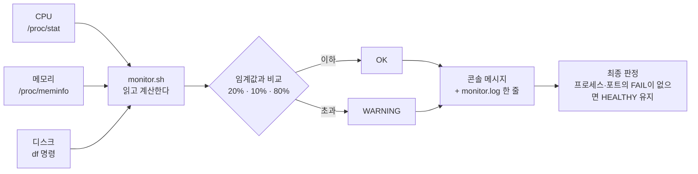
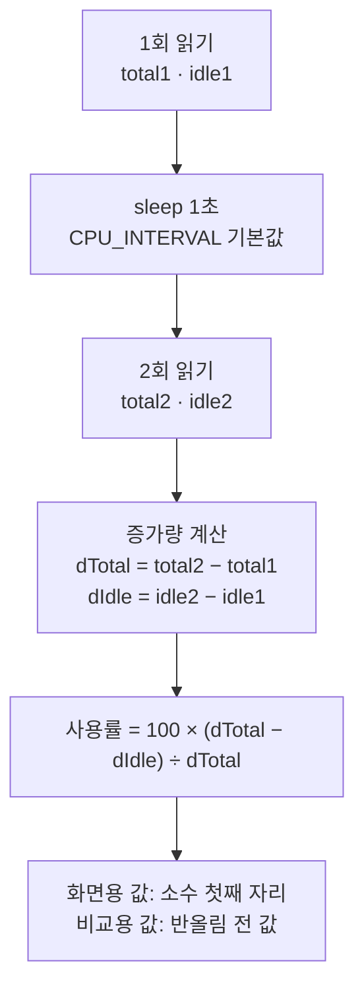
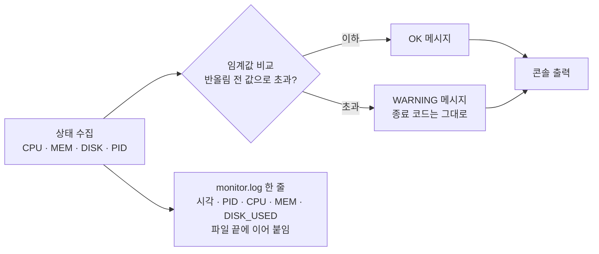
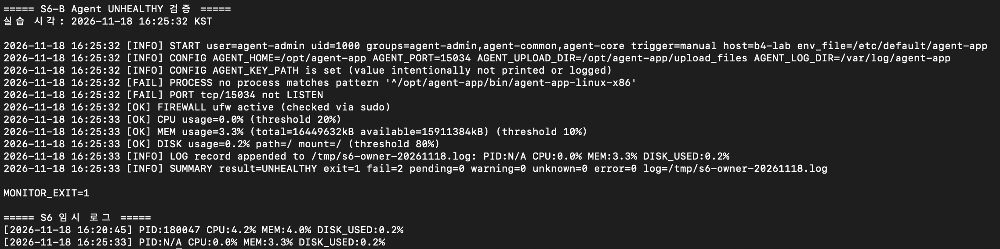

# 6강. 컴퓨터는 자신의 사용량을 어떻게 알까?

**부제:** Linux CPU·메모리·디스크 사용률과 모니터링 로그  
**학습 분야:** Linux 시스템 운영과 셸 자동화  
**연결 미션:** Codyssey B4-1 — 컴퓨터가 알아서 자기 상태를 점검하게 만들기  
**문서 상태:** v0.1 원고 / 학습 검토 — 6강 첫 원고. 실제 구현(`bin/monitor.sh`), 2026-11-14 최종 회귀 기록, 2026-11-18 Owner S6 화면을 기준으로 썼다. **S7·S8 화면은 아직 촬영 전**이며 이 문서는 S7·S8을 완료로 표시하지 않는다.  
**선행 학습:** [3강 권한·ACL](03-users-groups-permissions-acl.md), [4강 환경변수·Agent 실행](04-env-agent-runtime.md), [5강 monitor.sh Health Check](05-monitor-health-check.md)

> **읽는 방법**
>
> - **[기록]** 은 저장소의 실제 소스·검증 기록·Owner 화면에서 가져온 내용, **[개념]** 은 일반적인 Linux 지식, **[실습 준비]** 는 아직 실행하지 않은 명령이다. 기록에 없는 결과는 만들어 넣지 않았다. 규칙을 설명하려고 만든 숫자에는 **[예시]** 를 붙였다.
> - 코드 줄 번호는 이 원고를 쓴 시점의 `bin/monitor.sh`(sha256 `86d6b9ce…f056`) 기준이다. 코드 전체를 해설하지 않고 **자원 수집·계산·비교·기록**에 해당하는 부분만 읽는다.
> - 이 강의에서는 **Agent를 실행하지 않고, 어떤 설정도 바꾸지 않으며, 운영 로그를 건드리지 않는다.** 11절의 S7·S8 실습은 Owner가 나중에 진행할 수 있도록 준비만 해 둔 것이다.
> - 근거 문서: [`bin/monitor.sh`](../../bin/monitor.sh), [`docs/b4-1-monitor.md`](../b4-1-monitor.md), [`docs/b4-1-final-evidence.md`](../b4-1-final-evidence.md), [최종 회귀 출력](../evidence/task22-closeout-regression.txt), [화면 증빙 안내](../evidence/screenshots/README.md)
> - 과거 설계 문서의 "당시 임계값·당시 상태" 서술은 현재 값이 아니다. **현재 코드와 최종 기록이 우선**이다.

---

## 0. 도입 — monitor.sh는 이 숫자들을 어디에서 가져왔을까?

5강에서 `monitor.sh`가 **프로세스·포트·방화벽**을 판정하는 방법을 배웠다. 같은 실행의 출력에는 세 줄이 더 있었다. 2026-11-18 Owner의 S6-A 화면이다.

```text
[OK] CPU usage=4.2% (threshold 20%)
[OK] MEM usage=4.0% (total=16449632kB available=15792920kB) (threshold 10%)
[OK] DISK usage=0.2% path=/ mount=/ (threshold 80%)
```

**[기록]** Agent 실행 중(2026-11-18 16:20:44~45) 측정값이다.

| 자원 | 값 |
|---|---|
| CPU | **4.2%** |
| MEM | **4.0%** |
| DISK | **0.2%** |

> **질문. `monitor.sh`는 이 숫자들을 어디에서 가져왔을까?**

`monitor.sh`는 CPU 온도계 같은 별도 장치를 읽지 않는다. **Linux 커널이 파일처럼 보여 주는 시스템 정보**(`/proc/stat`, `/proc/meminfo`)와 **파일 시스템 조회 명령**(`df`)을 읽고, 그 안의 숫자로 **직접 계산**한다. 이 강의는 그 계산과 그 뒤의 비교·기록을 처음부터 따라간다.

### 0-1. 전체 흐름 — 구조도 1



세 자원이 `monitor.sh`로 모이고, 임계값과 비교해 `OK`/`WARNING`을 만든 뒤, **화면과 파일에 남긴다.** 마지막 칸은 7절에서 자세히 본다. 이 강의가 끝나면 다음 7가지 질문에 답할 수 있어야 한다.

1. CPU·메모리·디스크는 무엇이며 어떻게 다른가?
2. Linux는 이 자원들의 사용량을 어디에 기록하는가?
3. CPU 사용률을 계산하려면 왜 두 번 측정해야 하는가?
4. 메모리의 전체 용량과 사용 가능한 용량은 무엇이 다른가?
5. 디스크 사용률은 어떤 기준으로 계산하는가?
6. 경고 기준을 초과하면 `monitor.sh`는 어떻게 반응하는가?
7. 점검 결과를 왜 파일에 남기는가?

---

## 1. CPU·메모리·디스크의 차이

### 1-1. 세 자원을 한 줄로

| 자원 | 한 줄 설명 | 일상 비유(보조) | 크기를 나타내는 것 | 사용률의 뜻 |
|---|---|---|---|---|
| **CPU** | 프로그램의 **명령을 처리**하는 장치 | 요리사 | 코어 수·속도 | **일정 시간 동안 바빴던 비율** |
| **메모리(RAM)** | 실행 중인 프로그램이 쓰는 **작업 공간** | 조리대 | 용량(예: 16 GB) | 지금 **쓰고 있는 공간의 비율** |
| **디스크** | 파일과 데이터를 **보관**하는 저장 공간 | 창고·냉장고 | 용량(예: 500 GB) | **채워진 공간의 비율** |

> **비유와 실제의 구분.** 요리사·조리대·창고는 "처리 / 임시 작업 / 보관"이라는 **역할 차이**를 느끼게 하려는 것이다. 실제 컴퓨터는 이렇게 단순하지 않다. 예를 들어 메모리는 프로그램 종료나 전원 차단 시 내용이 사라지는 휘발성이고, 디스크는 남는다. 또 요리사는 한 명이지만 CPU는 여러 코어가 동시에 일한다.

### 1-2. 용량, 사용률, 병목 현상

세 가지를 구분하자.

| 용어 | 뜻 | 예 |
|---|---|---|
| **용량(capacity)** | 가진 **전체 크기** | 메모리 총 16,449,632 kB |
| **사용률(utilization)** | 용량(또는 시간) 중 **사용한 비율** | MEM 4.0% |
| **병목(bottleneck)** | 한 자원이 **한계에 닿아** 전체 속도를 막는 현상 | CPU 100%로 요청이 밀림, 메모리 부족, 디스크 가득 참 |

- CPU 사용률은 **용량 대비**가 아니라 **시간 대비**다. "지난 1초 중 바빴던 시간의 비율"이다(3절).
- 메모리·디스크 사용률은 **공간 대비**다.
- 자원이 부족한 정도는 서로 다른 증상을 만든다. CPU가 포화되면 **느려지고**, 메모리가 부족하면 **프로그램이 강제 종료**될 수 있으며, 디스크가 차면 **새 파일·로그를 쓰지 못한다.** [개념]

그래서 `monitor.sh`는 세 자원에 **각각 기준선(임계값)** 을 두고 지켜본다(6절). 다만 이 값들은 **서버 전체**의 사용률이지, Agent 프로세스 하나의 사용률이 아니다(3-5절).

---

## 2. Linux는 시스템 상태를 어떻게 제공할까?

### 2-1. `/proc` — 파일처럼 보이는 커널의 창

**용어 풀이**

- **커널(kernel):** 운영체제의 핵심. CPU 시간 배분, 메모리 관리, 디스크 접근을 **직접 맡는다.** 시스템 상태를 가장 정확히 아는 쪽이다.
- **가상 파일 시스템(virtual file system):** 디스크에 실제로 저장된 파일이 아니라, **읽을 때 커널이 그때그때 만들어 주는** 파일들의 모음.
- **`/proc`:** Linux가 제공하는 가상 파일 시스템. 프로세스와 시스템의 현재 정보를 **텍스트 파일**처럼 보여 준다.

| | 일반 파일 | `/proc`의 가상 파일 |
|---|---|---|
| 내용이 저장된 곳 | 디스크 | **커널 메모리** (읽을 때 생성) |
| 내용이 바뀌는 때 | 누군가 수정할 때 | **읽을 때마다 현재 값** |
| 파일 크기 | 실제 크기 | 대개 0으로 표시 |
| 읽는 방법 | `cat`, `awk`, `grep` 등 | **똑같이** `cat`, `awk`, `grep` |

일반 파일을 읽는 도구로 시스템 정보를 읽을 수 있다는 것이 핵심이다. 별도의 특수한 API 없이 `awk`로 숫자를 뽑는다. 비유하면 **"자동차 계기판을 연필로 베껴 적는 것"** 과 같다(비유). 계기판의 숫자는 지금 이 순간의 값이고, 베껴 적는 행위는 읽기다. 읽는 것만으로 상태가 바뀌지 않는다.

> **주의.** `/proc`의 값은 읽는 **순간의 스냅샷**이다. 같은 파일을 1초 뒤에 읽으면 다른 값이 나온다. 이 사실이 CPU 사용률 계산의 열쇠다(3절).

### 2-2. 이 강의에서 쓰는 세 가지 정보원

| 자원 | 정보원 | 어떤 값을 가져오는가 |
|---|---|---|
| CPU | `/proc/stat`의 `cpu` 행 | CPU 시간의 **누적값**(부팅 이후) |
| 메모리 | `/proc/meminfo`의 `MemTotal`, `MemAvailable` | 전체 용량, 사용 가능한 용량(kB) |
| 디스크 | `df -Pk /` 명령의 출력 | 사용·가용 블록(1 KiB 단위)과 마운트 지점 |

`/proc/stat`·`/proc/meminfo`는 파일 경로이고, `df`는 **명령**이다. `df`는 파일 시스템(디스크를 파일과 폴더로 쓸 수 있게 정리한 구조)에게 **용량을 묻는 시스템 호출(statfs 계열)** 을 해서 그 답을 표로 보여 준다. [개념] 즉 디스크 사용률은 파일 하나하나의 크기를 더한 것이 아니라 **파일 시스템이 스스로 관리하는 장부**를 읽은 값이다.

---

## 3. CPU 사용률

### 3-1. `/proc/stat`의 `cpu` 행

**[개념]** `/proc/stat`의 맨 위 줄은 `cpu`로 시작하며, **모든 CPU 코어를 합친** 누적값이다.

```text
cpu  user nice system idle iowait irq softirq steal guest guest_nice
```

| 칸 | 의미 | `monitor.sh`가 쓰는가 |
|---|---|---|
| `user` | 일반 프로그램을 실행한 시간 | 전체에 포함 |
| `nice` | 우선순위를 낮춘(nice) 프로그램 실행 시간 | 전체에 포함 |
| `system` | **커널**이 일한 시간 | 전체에 포함 |
| `idle` | **할 일이 없어 쉰** 시간 | 전체에 포함, **유휴로 계산** |
| `iowait` | 디스크 입출력을 **기다리며** 쉰 시간 | 전체에 포함, **유휴로 계산** |
| `irq`, `softirq` | 장치·소프트웨어 인터럽트 처리 시간 | 전체에 포함 |
| `steal` | 가상 머신이 하이퍼바이저에 CPU를 **빼앗긴** 시간 | 전체에 포함 |
| `guest`, `guest_nice` | 게스트 OS 실행 시간 | 합산하지 않음(이미 `user`에 포함된 값이라 중복을 피함) [개념] |

단위는 보통 **1/100초(틱, tick)** 이며 **부팅한 뒤로 계속 증가하는 누적값**이다. 줄어들지 않는다. 이 `b4-lab`은 가상 머신(OrbStack)이므로 `steal`도 합산 대상에 있다.

**[기록: 코드 주석 294~296행]** `monitor.sh`의 정의는 다음과 같다.

```text
total = user+nice+system+idle+iowait+irq+softirq+steal
idle  = idle+iowait
busy% = 100 * (dTotal - dIdle) / dTotal
```

`iowait`을 **유휴(idle)에 넣는 것**이 이 구현의 선택이다. 디스크를 기다리는 동안 CPU 자체는 일하지 않고 쉬고 있기 때문이다.

### 3-2. 왜 한 번만 읽으면 안 될까?

누적값은 **부팅 이후의 합계**다. 한 번 읽은 값으로 비율을 내면 **"지금"이 아니라 "지금까지 평균"** 이 된다.

**[예시 — 규칙 설명용 숫자]** 4코어 서버가 오래 켜져 있었다고 하자(`USER_HZ`=100 가정, 코어 4개이므로 1초에 전체 틱이 약 400씩 증가).

| 시점 | 누적 전체(total) | 누적 유휴(idle) |
|---|---|---|
| 첫 번째 읽기 | 1,000,000 | 950,000 |
| 1초 뒤 읽기 | 1,000,400 | 950,040 |

- **한 번만 읽은 값으로 계산(두 번째 읽기 기준):** `(1,000,400 − 950,040) / 1,000,400 ≈ 5.0%` — 오랜 기간의 평균. **지금 한창 바쁜 상황이 가려진다.**
- **두 값의 차이로 계산:** 전체 증가량 `400`, 유휴 증가량 `40` → `100 × (400 − 40) / 400 =` **90.0%** — 방금 1초간의 실제 상태.

> **비유(보조).** 자동차의 **총 주행거리계**(누적)만 보고 "지금 속도"를 알 수 없다. **1분 전과 지금의 주행거리 차이 ÷ 1분**이 속도다. 누적값 둘의 **차이**가 곧 "그 사이에 일어난 일"이다. 속도계의 비유일 뿐이며 실제 CPU 시간은 코어 수만큼 동시에 쌓인다.

### 3-3. 두 시점 측정과 계산 — 구조도 2



### 3-4. 실제 소스 — `cpu_line()`, `sleep`, `awk`

**[기록: 코드 298~300행]**

```bash
cpu_line() { awk '/^cpu /{t=0; for(i=2;i<=9;i++) t+=$i; print t, $5+$6; exit}' "$1" 2>/dev/null; }
s1=$(cpu_line "$STAT1")
if [ -n "$STAT2" ]; then s2=$(cpu_line "$STAT2"); else sleep "$CPU_INTERVAL"; s2=$(cpu_line "$STAT1"); fi
```

**구성 요소별 의미**

| 구성 | 의미 |
|---|---|
| `cpu_line() { … }` | 파일 하나를 받아(`$1`) **`total idle` 두 숫자**를 출력하는 함수(4절 문법 연결) |
| `/^cpu /` | `cpu` 다음에 **공백**이 있는 줄만. `cpu0`·`cpu1`(코어별 줄)은 제외하고 **합계 줄**만 고른다 |
| `for(i=2;i<=9;i++) t+=$i` | 2번째~9번째 칸(`user`~`steal`, 8개)을 모두 더해 `t`(전체) |
| `print t, $5+$6` | 전체와 **유휴**(`idle`=5번째 칸 + `iowait`=6번째 칸)를 출력 |
| `exit` | 첫 `cpu` 줄만 보고 끝냄 |
| `s1=$(cpu_line "$STAT1")` | 첫 번째 읽기. 결과(`total idle`)를 변수 `s1`에 저장 |
| `sleep "$CPU_INTERVAL"` | 기다린다. `CPU_INTERVAL`의 기본값은 **1초**(135행, `MONITOR_CPU_INTERVAL`로 변경 가능) |
| `s2=$(cpu_line "$STAT1")` | 두 번째 읽기 |
| `if [ -n "$STAT2" ]; then …` | `STAT2`가 지정된 경우(시험용)에는 **기다리지 않고** 두 번째 **파일**에서 읽는다. 평소에는 비어 있다 |

`STAT1`의 기본값은 `/proc/stat`이다(297행). `MONITOR_PROC_STAT`·`MONITOR_PROC_STAT_2`로 **고정된 시험 파일**을 지정하면 같은 계산을 **정확한 숫자로 시험**할 수 있다(6절, 11절).

**전체 해석:** "`/proc/stat`의 합계 줄에서 전체 시간과 유휴 시간을 읽고, 1초 기다린 뒤 한 번 더 읽어라."

**계산 부분 [기록: 코드 304~305행]**

```bash
cpu=$(awk -v a="$s1" -v b="$s2" 'BEGIN{split(a,x," "); split(b,y," "); dt=y[1]-x[1]; di=y[2]-x[2];
      if (dt<=0) {print "ERR"; exit} v=100*(dt-di)/dt; printf "%.6f %.1f", v, v}')
```

- `-v a="$s1"` : 셸 변수를 awk 변수로 전달. `split`은 `"total idle"`을 `x[1]`, `x[2]`로 나눈다.
- `dt`(전체 증가량), `di`(유휴 증가량) → `v=100*(dt-di)/dt`.
- `dt<=0` : 두 읽기 사이에 **카운터가 증가하지 않았으면** `ERR`. 0으로 나눌 수 없으므로 `ERROR CPU`가 된다(306행).
- `printf "%.6f %.1f"` : **같은 값을 두 가지 정밀도로** 출력한다 — 소수 6자리(비교용 `craw`)와 소수 첫째 자리(표시·기록용 `cpu`). 6절에서 이 둘의 차이가 중요해진다.

**계산 연습 [예시]** — 위 awk 식에 넣어 직접 확인한 값이다.

| 첫 읽기(total, idle) | 두 번째 읽기 | dTotal | dIdle | 사용률 |
|---|---|---|---|---|
| (1000000, 950000) | (1000400, 950040) | 400 | 40 | **90.0%** |
| (10000, 8000) | (10400, 8320) | 400 | 320 | **20.0%** |
| (0, 0) | (5000, 3998) | 5000 | 3998 | **20.04%** → 표시 `20.0` |
| (100, 0) | (100, 0) | 0 | 0 | `ERR`(증가 없음) |

### 3-5. 이것은 시스템 전체 사용률이다

- `/proc/stat`의 `cpu` 행은 **모든 코어, 모든 프로세스**의 시간을 합친 것이다. Agent 프로세스 하나만 따로 재는 것이 아니다.
- **[기록]** 제공 Agent는 시험 중 CPU를 점진적으로 올리는 동작이 있다(`final-evidence.md` 제약, Agent 로그의 `[CPU] Occupy core …`). 그러나 `monitor.sh`가 보는 값은 **서버 전체**의 CPU 사용률이며, 그 증가분에 Agent가 얼마나 기여했는지는 **이 값만으로 알 수 없다**.
- 값은 **"측정하는 약 1초 구간의 상태"** 다. 순간적으로 바빴다가 끝난 일은 놓칠 수 있고, 반대로 측정 순간에 겹친 일시적인 작업이 반영될 수 있다.

---

## 4. 메모리 사용률

### 4-1. `/proc/meminfo`

**[개념]** 커널이 메모리 상태를 항목별로 보여 준다(단위 kB). 이 중 `monitor.sh`가 사용하는 것은 두 항목이다.

```text
MemTotal:       16449632 kB
MemAvailable:   15792920 kB
```

(위 숫자는 S6-A 화면의 `total=16449632kB available=15792920kB`다.)

| 항목 | 의미 |
|---|---|
| **MemTotal** | 컴퓨터가 쓸 수 있는 **전체 메모리** 용량 |
| **MemAvailable** | 프로그램이 **새로 요청하면 줄 수 있는 메모리**의 커널 추정치(회수 가능한 캐시 포함) |

### 4-2. 계산식과 실제 소스

```text
사용률 = 100 × (MemTotal − MemAvailable) / MemTotal
```

**[기록: 코드 317행]**

```bash
mem=$(awk '/^MemTotal:/{t=$2} /^MemAvailable:/{a=$2} END{ if (t>0 && a!="") printf "%.6f %.1f %d %d", 100*(t-a)/t, 100*(t-a)/t, t, a; else print "ERR"}' "$MEMINFO" 2>/dev/null)
```

- `/^MemTotal:/{t=$2}` : `MemTotal:`로 시작하는 줄의 **둘째 칸**(숫자)을 `t`에 저장. `MemAvailable`도 같은 방식으로 `a`.
- `END{ … }` : 파일을 다 읽은 뒤 계산한다. `t>0 && a!=""`(두 값이 모두 있어야)이면 소수 6자리·1자리 사용률과 `t`, `a`를 출력, 아니면 `ERR` → `ERROR MEM`(318~319행).

**기록 값으로 직접 검산** (실제 화면·회귀 기록의 수치):

| 출처 | MemTotal(kB) | MemAvailable(kB) | 사용량(kB) | 계산 결과 | 기록된 값 |
|---|---|---|---|---|---|
| S6-A (2026-11-18, Agent 실행 중) | 16,449,632 | 15,792,920 | 656,712 | 3.992…% | **4.0%** |
| S6-B (2026-11-18, Agent 종료 후) | 16,449,632 | 15,911,384 | 538,248 | 3.272…% | **3.3%** |
| 회귀(2026-11-14, Agent 실행 중) | 16,434,648 | 15,619,148 | 815,500 | 4.962…% | **5.0%** |

세 경우 모두 화면의 값과 일치한다. 즉 `monitor.sh`의 MEM 값은 `MemTotal`과 `MemAvailable`로 **누구나 손으로 재현할 수 있는 계산**이다. (계산 기록은 2026-11-14 회귀와 2026-11-18 S6 화면에 나온 숫자를 이 강의에서 식에 넣어 본 것이다.)

### 4-3. MemFree와 MemAvailable의 차이

**[개념]** Linux는 남는 메모리를 놀리지 않고 **캐시**로 쓴다. 한 번 읽은 파일 내용을 메모리에 보관해 두었다가 다음에 빨리 쓰려는 것이다(page cache).

| 항목 | 의미 | 특징 |
|---|---|---|
| **MemFree** | 정말로 **아무 용도로도 쓰이지 않는** 메모리 | 캐시가 늘수록 **작아진다** |
| **MemAvailable** | MemFree + **필요하면 즉시 회수할 수 있는 캐시** 등의 추정치 | "프로그램이 새로 쓸 수 있는 양"에 가깝다 |

**일상 비유(보조).** 도서관 책상(메모리)에 아무도 앉지 않은 자리가 `MemFree`다. 그런데 비어 있는 자리에 **누군가 놓고 간 책(캐시)** 을 올려 두면 `MemFree`는 줄어든다. 하지만 새 손님이 오면 책을 치우고 앉히면 되므로 **실제로 앉을 수 있는 자리**(`MemAvailable`)는 그대로다. 실제 커널의 회수 규칙은 이처럼 단순하지 않으며 `MemAvailable`은 **커널의 추정치**다.

**왜 `MemAvailable`로 계산할까?** 만약 `MemFree`로 사용률을 구하면, 서버가 오래 켜져 캐시가 쌓일수록 **"사용률이 높다"는 거짓 경고**가 늘어난다. 실제로는 필요하면 회수할 수 있는 공간이다. `(MemTotal − MemAvailable)/MemTotal`은 **"프로그램이 실제로 점유하고 회수하기 어려운 비율"** 에 가깝다. 코드 주석(315행)도 이 식을 명시한다.

**[기록]** 이 선택은 코드 주석("MEM: (MemTotal - MemAvailable) / MemTotal from /proc/meminfo.")에 나와 있다. 이 구현이 `MemAvailable`을 택한 이유를 설명한 별도 설계 문서는 저장소에 없으며, 위 설명은 **일반적인 Linux 지식에 근거한 해석**이다.

---

## 5. 디스크 사용률

### 5-1. 실제 명령 `df -Pk /`

**원문 [기록: 코드 327행은 `df -Pk "$DISK_PATH"`, 기본 `DISK_PATH=/`]**

```bash
df -Pk /
```

| 구성 | 의미 |
|---|---|
| `df` | **d**isk **f**ree. 파일 시스템별 용량 조회 |
| `-P` | **POSIX 표준 출력 형식**. 긴 장치 이름 때문에 줄이 나뉘지 않고 **항상 한 줄**로 출력되어 스크립트가 다루기 쉽다 |
| `-k` | 크기를 **1 KiB(1024바이트) 블록** 단위로 표시 |
| `/` | 조회할 경로. 이 경로가 **속한 파일 시스템**의 용량을 보여 준다 |

**전체 해석:** "경로 `/`가 속한 파일 시스템의 크기·사용량·가용량을 1 KiB 단위, 한 줄 형식으로 보여라."

**출력의 모양 [개념]** (`df`는 항상 이 6열이다. 아래는 형식을 보이는 **[예시]** 로 이 저장소의 기록 값이 아니다.)

```text
Filesystem     1024-blocks     Used Available Capacity Mounted on
/dev/xxxx          1000000   200000    750000      21% /
```

| 열 | 의미 | 코드에서의 사용 |
|---|---|---|
| `Filesystem` | 파일 시스템(장치) | 사용 안 함 |
| `1024-blocks` | 전체 블록 수 | **사용 안 함** |
| `Used` | **사용 중인** 블록(3번째 칸) | `u=$3` |
| `Available` | **일반 사용자가 쓸 수 있는** 남은 블록(4번째 칸) | `a=$4` |
| `Capacity` | `df`가 계산한 사용률 | 사용 안 함 |
| `Mounted on` | **마운트 지점**(6번째 칸) | `$6` — 표시용 |

**마운트 지점(mount point)** 은 파일 시스템이 디렉터리 트리의 **어느 폴더에 연결되어 있는지**를 뜻한다. 이 서버에서는 `/`가 곧 마운트 지점이라 화면에 `mount=/`로 나온다. 디스크가 여러 개면 경로마다 소속이 달라질 수 있어, 어느 파일 시스템의 값인지를 같이 적어 두는 것이다.

### 5-2. 계산식과 실제 소스

```text
사용률 = 100 × used / (used + available)
```

**[기록: 코드 327행]**

```bash
dsk=$(df -Pk "$DISK_PATH" 2>/dev/null | awk 'NR==2{u=$3; a=$4; if (u+a>0) printf "%.6f %.1f %s", 100*u/(u+a), 100*u/(u+a), $6; else print "ERR"}')
```

- `NR==2` : **둘째 줄**(첫 줄은 제목)만 처리.
- 값 3개(`u`, `a`, `$6` 마운트 지점)를 출력한다. `u+a`가 0이면 `ERR`(0으로 나눔 방지) → `ERROR DISK`.
- 비교용(소수 6자리)과 표시용(소수 1자리)을 함께 낸다(CPU·MEM과 같은 방식).

### 5-3. 왜 "전체 크기"가 아니라 `used + available`일까?

단순하게 `used / 전체 블록`으로 계산하면 `df`가 보여 주는 `Capacity`와 값이 어긋날 수 있다. 이유는 **예약 공간** 때문이다.

**[개념]** ext4 같은 많은 파일 시스템은 일부 공간(흔히 5%)을 **root 전용 예약 공간**으로 남겨 둔다. 일반 사용자가 디스크를 완전히 채워도 시스템이 동작하게 하려는 장치다. 그러면:

```text
전체 블록  =  사용 중  +  일반 사용자가 쓸 수 있는 남은 공간  +  root 예약 공간 등
```

| 계산 방식 | 분모 | 성격 |
|---|---|---|
| `used / 전체` | 예약 공간까지 포함 | 예약 공간만큼 **작게** 나옴 |
| `used / (used + available)` | **일반 사용자가 실제로 쓸 수 있는 범위** | 사용자가 "꽉 찼다"고 느끼는 지점에 가깝다 |

`monitor.sh`는 두 번째를 쓴다. **[기록: 코드 주석 326행]** "same basis as df's Use%, unrounded" — `df`가 보여 주는 `Use%`와 **같은 기준**이되 **올림·반올림하지 않은** 값이라는 뜻이다. (`df`는 `Use%`를 정수로 올려서 보여 주는 것이 보통이다. [개념])

> **정확한 수치는 파일 시스템에 따라 다르다.** 예약 공간이 없거나 방식이 다른 파일 시스템에서는 두 계산이 같을 수 있다. 이 서버의 정확한 예약 비율은 저장소 기록에 없으므로 이 강의는 숫자를 만들지 않는다. 실제 기록은 `DISK usage=0.2%`(2026-11-18), `0.4%`(2026-11-14)다.

---

## 6. 임계값은 무엇인가?

### 6-1. 기준선

**임계값(threshold)** 은 "여기를 넘으면 주의"라고 정한 **기준선**이다. 비유하면 체온 **37.5℃ 이상이면 열이 있다**고 보는 선이다(비유).

**[기록: 코드 134행, 공식 B4-1 값]**

```bash
CPU_WARN="${MONITOR_CPU_WARN:-20}"; MEM_WARN="${MONITOR_MEM_WARN:-10}"; DISK_WARN="${MONITOR_DISK_WARN:-80}"
```

| 항목 | 경고 조건 | 변수(기본값) |
|---|---|---|
| CPU | **20% 초과** | `CPU_WARN` (20) |
| MEM | **10% 초과** | `MEM_WARN` (10) |
| DISK | **80% 초과** | `DISK_WARN` (80) |

`${MONITOR_CPU_WARN:-20}`은 4강·5강에서 본 `${변수:-기본값}`이다. 평소에는 20이 쓰이고, **시험할 때만** 환경변수로 바꿔 끼울 수 있다. 시험용 값이 올바른지도 `is_pct`로 검증한다(136~138행).

### 6-2. "초과"는 `>`이다 — 같으면 OK

**[기록: 코드 105행]**

```bash
gt() { awk -v a="$1" -v b="$2" 'BEGIN{exit !(a>b)}'; }
```

`gt A B`는 "A가 B보다 **큰가**(greater than)"를 묻는 함수다. awk의 `a>b`가 참이면 종료 코드 0(성공 = "크다"), 아니면 1이다. 셸에서는 성공이면 `if` 아래가 실행된다(5강 4-9절).

**규칙 설명용 예시 [예시]**

| 값 | 임계값 | 판정 | 이유 |
|---|---|---|---|
| CPU **20.0%** | 20 | **OK** | 20 > 20 아님(같음) |
| CPU **20.1%** | 20 | **WARNING** | 20.1 > 20 |
| MEM **10.0%** | 10 | **OK** | 같음 |
| MEM **10.1%** | 10 | **WARNING** | 초과 |
| DISK **80.0%** | 80 | **OK** | 같음 |
| DISK **80.1%** | 80 | **WARNING** | 초과 |

> **이 표는 `>` 규칙을 보이려고 만든 [예시]이며 실제 실행 기록이 아니다.** 실제로 기록된 경계 시험은 아래 6-4절에 따로 정리한다.

### 6-3. 반올림 전 값으로 비교한다

앞서 3-4절에서 본 대로 계산 결과는 **두 가지**로 나온다. 하나는 화면·로그용 **소수 첫째 자리**(`cpu`), 다른 하나는 비교용 **소수 6자리**(`craw`)다. **[기록: 코드 308~311행]**

```bash
set -- $cpu; craw=$1; cpu=$2; REC_CPU=$cpu
# compared UNROUNDED: 20.04% is > 20 (shown as 20.0% plus the raw value), exactly 20 is OK
if gt "$craw" "$CPU_WARN"; then say WARNING CPU "usage=${cpu}% (raw ${craw}) > threshold ${CPU_WARN}%"
else say OK CPU "usage=${cpu}% (threshold ${CPU_WARN}%)"; fi
```

- `set -- $cpu` : 문자열 `"20.040000 20.0"`을 공백으로 쪼개 `$1`, `$2`로 만든다. `craw=$1`(비교용), `cpu=$2`(표시용).
- `gt "$craw" "$CPU_WARN"` : **반올림 전** 값으로 비교한다.
- `REC_CPU=$cpu` : `monitor.log`에는 **표시용 값**이 들어간다(8절).

따라서 실제 값이 `20.04%`이면:

| 단계 | 값 |
|---|---|
| 계산 결과 | `20.040000` |
| 화면 표시 | `20.0` |
| 비교 | `20.040000 > 20` → **참** |
| 판정 | **WARNING** — 메시지에 `usage=20.0% (raw 20.040000) > threshold 20%` |

화면에는 `20.0%`로 보이지만 WARNING이다. 그래서 경고 메시지에는 **`(raw …)`** 값을 함께 적어 사람이 이유를 알 수 있게 한다. 반올림한 `20.0`으로 비교했다면 이 경우를 놓친다. MEM(322행)과 DISK(332행)도 같은 방식이다.

### 6-4. 실제로 시험된 경계 [기록]과 구분

| 구분 | 내용 | 출처 |
|---|---|---|
| **[기록: 원문 출력]** | `eq: … [OK] MEM usage=10.0% (total=100kB available=90kB) (threshold 10%)` | 회귀 `-- thresholds` |
| **[기록: 원문 출력]** | `gt: … [WARNING] MEM usage=11.0% (raw 11.000000) (total=100kB available=89kB) > threshold 10%` | 회귀 `-- thresholds` |
| **[기록: 서술]** | CPU 20.0%·MEM 10.0%(정확히 임계값) → OK, 20.04%·10.04% → WARNING | [`b4-1-monitor.md` 작업 18 검증](../b4-1-monitor.md#작업-18-공식-로그-형식agent-정상-모니터링) 표 |
| **[기록: 서술]** | 고정 입력으로 CPU 66.7%(dTotal 300, dIdle 100)를 계산하고 임계값을 바꿔 가며 비교한 시험(임계값 60 → WARNING, 66.7 → OK 등). 시험용으로 임계값을 바꾼 기록이며 현재 임계값(20/10/80)의 기록이 아님 | `b4-1-monitor.md` §5 시험 표 |

- 회귀 파일에 **원문 출력으로 남은 것은 MEM 경계 두 줄**이다. 총 100kB, 가용 90kB면 사용률이 `10.0%`, 가용 89kB면 `11.0%`다(`100×(100−90)/100 = 10`, `100×(100−89)/100 = 11`을 직접 계산해 확인했다).
- CPU·DISK의 경계 출력 원문은 회귀 파일에 없다. CPU·MEM 경계는 위 서술 기록으로만 확인된다. 이 강의는 없는 출력을 만들지 않는다.
- 6-2절의 CPU 20.0/20.1, DISK 80.0/80.1 표는 **규칙 [예시]** 이다.

---

## 7. WARNING과 장애의 차이

### 7-1. 5강의 판정 체계와 연결

5강 8절에서 `say 등급 …`이 호출될 때마다 `bump`가 계수기를 올리고, 마지막에 `verdict()`가 `FAILS+PENDINGS`와 `ERRORS`만 본다는 것을 배웠다. **[기록: 코드 93~97행]**

```bash
verdict() {
  if [ $((FAILS+PENDINGS)) -gt 0 ]; then V_CODE=1; V_RESULT=UNHEALTHY
  elif [ "$ERRORS" -gt 0 ]; then V_CODE=2; V_RESULT=MONITOR_ERROR
  else V_CODE=0; V_RESULT=HEALTHY; fi
}
```

CPU·MEM·DISK가 임계값을 **초과하면 `WARNING`** 이다(311·322·333행). `WARNING`은 `WARNS`만 올릴 뿐 `verdict()`가 보는 값이 아니다.

| 자원 점검에서 나올 수 있는 등급 | 의미 | 종료 코드에 영향 |
|---|---|---|
| `OK` | 임계값 이하 | 없음 |
| **`WARNING`** | **임계값 초과** | **없음** |
| `ERROR` | 값을 **읽지 못함**(`/proc/stat` 읽기 실패, `df` 실패, 카운터 증가 없음 등) | `FAIL`/`PENDING`이 없을 때 `exit 2` |

> **WARNING ≠ 장애.** 자원 경고만 있고 `FAIL`·`PENDING`·`ERROR`가 없다면 `HEALTHY`(exit 0)가 유지된다. 반대로 값을 **읽지 못하면**(`ERROR`) 경고보다 심각하게 다뤄져 `MONITOR_ERROR`가 될 수 있다. "높은 사용률"과 "측정 실패"는 다른 사건이다.

**[기록] 5강 8-2절과의 연결.** 회귀 기록의 `warning=1 … result=HEALTHY exit=0`은 **UFW 비활성 경고** 사례다. **자원 경고만 있고 `HEALTHY`가 나온 실제 출력**은 이 저장소 기록에 없으며, 그 결론은 위 `verdict()` 코드에서 **도출한 해석**이다.

### 7-2. 왜 자원 경고를 장애로 보지 않을까?

공식 요구는 "사용량을 수집하고 임계값을 넘으면 `WARNING`"이고, 장애(`exit 1`)는 **Agent 프로세스·TCP 15034** 쪽 조건이다. CPU가 21%라고 서버가 죽은 것은 아니다. **조치가 필요할 수 있는 신호**와 **이미 동작하지 않는 상태**를 구분해 두는 설계다. 경고가 반복되는지는 `monitor.log`를 사람이 추세로 확인한다(8절). [해석]

### 7-3. 실제 사례 — S6에서의 모든 자원이 `OK`

| 실행 | CPU | MEM | DISK | `warning=` | 결과 |
|---|---|---|---|---|---|
| S6-A (2026-11-18 16:20, Agent 실행 중) | OK 4.2% | OK 4.0% | OK 0.2% | 0 | HEALTHY / 0 |
| S6-B (2026-11-18 16:25, Agent 종료 후) | OK 0.0% | OK 3.3% | OK 0.2% | 0 | **UNHEALTHY / 1** |

S6-B에서 `UNHEALTHY`인 이유는 자원이 아니라 **`FAIL PROCESS`·`FAIL PORT`** 때문이다. 자원 값은 모두 `OK`였다. 자원이 정상이어도 필수 조건이 무너지면 `UNHEALTHY`가 된다.

---

## 8. 모니터링 로그란 무엇인가?

### 8-1. 로그의 목적

**로그(log)** 는 **시간 순서로 남기는 기록**이다. 5강에서 콘솔 출력은 "지금 사람에게", 로그는 "나중의 사람에게" 전달된다고 했다.

| | 콘솔 출력 | `monitor.log` |
|---|---|---|
| 내용 | 각 점검의 **상세 메시지**(`[OK] CPU usage=…`) 여러 줄 | **공식 형식 한 줄** (실행당) |
| 수명 | 터미널을 닫으면 사라진다 | **파일에 남는다** |
| 용도 | 지금의 확인 | **언제부터 변했나**·추세·사후 분석 |

1분 전의 CPU가 4%였는지 90%였는지는 **그때 기록해 두지 않으면 알 수 없다.** 로그는 그 증거를 남기는 방법이다. 병원의 **체온표**가 하루 한 번의 체온이 아니라 **시간별 기록**인 것과 같다(비유).

### 8-2. 공식 형식 한 줄

**[기록: 공식 요구 형식]**

```text
[YYYY-MM-DD HH:MM:SS] PID:<값> CPU:<값>% MEM:<값>% DISK_USED:<값>%
```

| 필드 | 의미 | 값 |
|---|---|---|
| `[YYYY-MM-DD HH:MM:SS]` | **타임스탬프** — 이 기록을 쓴 시각 | `ts()`가 만든 `date '+%Y-%m-%d %H:%M:%S'` |
| `PID:` | 확인된 **Agent PID**. 소켓 소유 PID 우선, 없으면 일치한 첫 PID | 숫자 또는 **`N/A`**(Agent가 없음) |
| `CPU:` | 3절의 사용률(소수 첫째 자리) | `4.2%` 또는 `N/A` |
| `MEM:` | 4절의 사용률 | `4.0%` 또는 `N/A` |
| `DISK_USED:` | 5절의 사용률 | `0.2%` 또는 `N/A` |

**[기록: 코드 80~81행, 83행]**

```bash
pc() { if [ "$1" = N/A ]; then printf 'N/A'; else printf '%s%%' "$1"; fi; }
line="[$(ts)] PID:$REC_PID CPU:$(pc "$REC_CPU") MEM:$(pc "$REC_MEM") DISK_USED:$(pc "$REC_DISK")"
err=$( { printf '%s\n' "$line" >>"$LOG_FILE"; } 2>&1 ) || {
```

- `pc`는 값이 `N/A`면 그대로, 숫자면 뒤에 `%`를 붙여 출력한다. `printf`에서 `%%`는 **글자 `%` 하나**를 뜻한다.
- 이 변수들(`REC_PID`·`REC_CPU`·`REC_MEM`·`REC_DISK`)은 처음에 모두 **`N/A`** 이고(46행), 각 값을 **실제로 측정했을 때만** 숫자로 바뀐다(308·321·331행의 `REC_…=` 대입). **측정하지 못한 필드는 `N/A`로 남는다.** 값을 만들어 채우지 않는다.
- `>>` 는 파일 **끝에 이어 붙이기(append)**, `>` 는 **덮어쓰기(overwrite)** 다. 이 코드는 `>>`만 쓴다.

### 8-3. 이어 붙이기(append)와 누적 기록의 의미

- **overwrite(`>`)** 는 기존 내용을 지운다. 매번 덮어쓰면 **마지막 한 번의 기록만** 남아 추세를 볼 수 없다.
- **append(`>>`)** 는 이전 기록을 그대로 두고 **맨 끝에 한 줄을 더한다.** 시간 순서대로 **누적**된다.
- 코드 주석(41행): "The file is never truncated." — 파일을 비우는 코드가 없다.
- 파일을 **열고 → 한 줄 쓰고 → 닫는다.** 오래 열어 두지 않으므로 logrotate(7강)가 파일 이름을 바꿔도 엉뚱한 파일에 쓰지 않고, 동시에 실행돼도 한 줄씩 온전히 붙는다. **[기록]** 20개 병렬 실행 시 20줄 모두 형식 일치(`b4-1-monitor.md` 작업 18 검증).

### 8-4. 언제 한 줄이 남고, 언제 남지 않을까?

"정상적으로 자원 수집 단계까지 수행한 실행은 한 줄을 남긴다"는 것이 기본이다. 코드를 보면 예외가 있다. **[기록: 코드 주석 41~44행, 구조]**

| 상황 | 기록 줄 | 근거 |
|---|---|---|
| 점검이 끝까지 진행됨 (HEALTHY·UNHEALTHY 무관) | **한 줄 남음**. Agent가 없으면 `PID:N/A` | 336행 `write_record`, S6-B |
| 자원 값 일부를 못 읽음(`ERROR CPU` 등) | **한 줄 남음**. 해당 필드가 `N/A` | `REC_…`가 `N/A`로 남음 |
| 필수 명령이 없음(`ERROR TOOLS`) | **남지 않음**. 곧바로 `finish` | 108~110행 |
| 설정 파일을 읽을 수 없음 | **남지 않음**. 로그 경로를 알 수 없어 `log=disabled` | 117~119행 |
| 필수 설정 오류(변수 누락·포트 오류 등) | **남지 않음** — 자원 수집 전에 `finish` | 141행, 주석 43행 |
| 로그 파일을 열 수 없음·심볼릭 링크 등 | **남지 않음**. `ERROR LOG`, `log=FAILED`, `exit 2`(확인된 `FAIL`이 없을 때) | 61~76행, 78·82~84행 |

이 표는 `monitor.sh`의 구조에서 읽은 것이다. 그중 "로그 쓰기 실패 → `ERROR LOG`·`log=FAILED`·exit 2"는 `b4-1-monitor.md` 검증 기록에도 있다. 나머지는 코드를 읽어 확인한 구조이며 각각을 실제로 실행한 출력은 이 강의에서 확인하지 않았다.

### 8-5. 구조도 3 — 상태 수집에서 기록까지



WARNING 여부와 관계없이 **수집된 값은 한 줄로 기록**되고, 경고는 콘솔 메시지로만 보인다. `monitor.log`에는 경고 문구가 없고 **값만** 남는다.

---

## 9. 실제 S6 임시 로그 해석

2026-11-18 Owner 실습에서 `MONITOR_LOG_FILE`로 지정한 **임시 로그** `/tmp/s6-owner-20261118.log`의 내용이다. **[기록: S6-B 화면의 `===== S6 임시 로그 =====`]**

```text
[2026-11-18 16:20:45] PID:180047 CPU:4.2% MEM:4.0% DISK_USED:0.2%
[2026-11-18 16:25:33] PID:N/A CPU:0.0% MEM:3.3% DISK_USED:0.2%
```



### 9-1. 줄 하나씩 읽기

| | 첫째 줄 (S6-A 실행) | 둘째 줄 (S6-B 실행) |
|---|---|---|
| 시각 | 16:20:45 | 16:25:33 |
| Agent 상태 | 실행 중 | 종료됨 |
| `PID:` | **180047** | **N/A** |
| CPU / MEM / DISK | 4.2% / 4.0% / 0.2% | 0.0% / 3.3% / 0.2% |

각 줄의 값은 같은 실행 콘솔의 `LOG record appended …` 줄과 같다.

### 9-2. PID가 숫자였다가 `N/A`가 된 이유

- 첫째 줄: 프로세스 검사가 `pid=[180046 180047]`을 찾았고, 소켓 소유 PID가 `180047`이어서 그 값을 기록했다(5강 10-4절의 선택 규칙).
- 둘째 줄: `FAIL PROCESS`라 **확인된 Agent PID가 없다.** `REC_PID`는 `N/A`로 남는다. 0이나 임의의 번호를 만들어 적지 않는다.

### 9-3. 사용률이 달라진 이유는 단정하지 않는다

| 항목 | 첫째 줄 | 둘째 줄 | 차이 |
|---|---|---|---|
| CPU | 4.2% | 0.0% | −4.2%p |
| MEM | 4.0% | 3.3% | −0.7%p |
| DISK | 0.2% | 0.2% | 같음 |

화면에서 확인되는 사실은 다음까지다.

- 메모리는 `available`이 `15792920`kB에서 `15911384`kB로 **118,464 kB(약 116 MiB) 늘었다**(`MemTotal`은 같다). 이것은 두 화면 값의 산술적 차이다.
- 두 실행 사이에 **Agent가 종료되었다.**

하지만 **CPU·MEM이 줄어든 원인이 Agent 종료 때문이라고 이 두 줄만으로 단정할 수 없다.** CPU는 약 1초 구간의 값이고, 같은 서버에서 다른 프로세스·커널 활동·캐시 회수 등도 값에 영향을 준다. 이 강의는 "Agent가 CPU를 올리는 동작이 있다"는 기록과 "두 값이 이렇게 다르다"는 관찰을 **연결해 설명할 수는 있지만, 인과로 확정하지 않는다.** DISK가 같은 것은 **용량이 큰 디스크에서 소수 첫째 자리 변화가 없었다**는 뜻이지, 디스크에 아무 쓰기도 없었다는 뜻이 아니다.

### 9-4. 같은 임시 로그에 누적되었다

- 두 줄은 **같은 파일**에 이어 붙었다. 두 번의 실행이 같은 `MONITOR_LOG_FILE`을 썼고, 코드는 append만 하므로 첫째 줄이 지워지지 않았다. 5강 13-7절의 "같은 임시 로그에 이어 붙으므로 두 줄이 쌓인다"가 실제로 확인된 것이다.
- 실습 로그는 **운영 로그가 아니다.**

| | 실습 임시 로그 | 운영 로그 |
|---|---|---|
| 경로 | `/tmp/s6-owner-20261118.log` | `/var/log/agent-app/monitor.log` |
| 지정 방법 | `MONITOR_LOG_FILE=…` | 기본값(`$AGENT_LOG_DIR/monitor.log`) |
| 내용 | 이 실습의 **2줄** | 여러 날의 누적(10절) |
| 위험 | 지워도 운영과 무관 | **삭제·초기화 금지** |

(참고: 5강 11-1절의 2026-11-14 회귀 임시 로그에도 같은 `PID`·시각 형식의 줄이 있으나 **PID(100366)와 시각이 다른 별개의 실행**이다. 두 기록을 섞어 읽지 않는다.)

---

## 10. monitor.log 파일 권한과 보존

### 10-1. 파일과 권한

**[기록]** 운영 로그는 다음과 같다.

| 항목 | 값 | 출처 |
|---|---|---|
| 경로 | `/var/log/agent-app/monitor.log` | `AGENT_LOG_DIR`(4강), 코드 63~64행 |
| 소유자:그룹 / 모드 | `agent-admin:agent-core` **`660`** | `final-evidence.md` §2.9, 회귀 `## cron + log` |
| 디렉터리 | `root:agent-core 2770` | 회귀 `## perms` |

모드 `660`은 `rw-rw----`이다(3강 권한 복습).

| 대상 | 권한 | 계정 예 |
|---|---|---|
| 소유자 `agent-admin` | 읽기·쓰기 | `monitor.sh`를 실행해 **기록**하는 계정(cron도 이 계정) |
| 그룹 `agent-core` | 읽기·쓰기 | `agent-admin`, `agent-dev` |
| 그 밖 | **없음** | `agent-test`는 읽을 수 없다 |

누가 기록하고 읽을 수 있는가? **기록하는 것은 `monitor.sh`를 실행한 `agent-admin`** 이고, **읽고 쓸 수 있는 것은 `agent-admin`·`agent-dev`**(`agent-core` 그룹)다. 회귀의 RW 표에서도 `agent-test`는 `/var/log/agent-app`을 읽지도 쓰지도 못했다(`read=no write=no`). **[기록: 코드 47행]** 새 파일이 만들어질 때의 기본 권한을 `umask 007`로 정해 `0660`이 되게 한다(디렉터리에 기본 ACL이 있으면 그 기준).

### 10-2. 로그가 계속 쌓이면 무슨 문제가 생길까?

- `monitor.log`는 매 실행 1줄씩 **계속 길어진다.** **[개념 + 예시 계산]** 한 줄은 약 63~66바이트다(S6의 두 줄을 센 값). **cron이 1분마다 실행한다면(7강)** 하루 1,440줄이고 약 95 KB(`1440 × 66 B`)다. [예시 계산이며 실제 증가량이 아니다.]
- 방치하면 **디스크 사용률(5절)이 올라가고**, 결국 `DISK_USED`가 80%를 넘어서는 원인이 될 수 있다. 로그가 자기 감시 대상을 키우는 셈이다. 그래서 **순환(rotation)** 이 필요하다. 상세 규칙은 7강으로 미룬다. **[기록]** 로그가 9 MiB(9,437,184 B) 이상이면 순환하고 9개를 보존하도록 `logrotate`가 설정되어 있고, 이 설정은 7강에서 다룬다.
- 반대로 **너무 빨리 지우면** 과거 이력이 사라진다. **보존(retention)** 은 "필요한 만큼은 남기고, 넘치면 정리한다"는 균형이다.

### 10-3. 과거 상세 로그와 현재 공식 로그의 공존

**[기록: `final-evidence.md` §2.9 "참고(혼재)", `b4-1-monitor.md` "파일 혼재"]**

- 작업 17 이전의 `monitor.log`에는 **실행당 10줄**의 상세 형식(`… [INFO] START …`)이 쌓였고, 작업 18에서 **실행당 1줄 공식 형식**으로 바뀌었다.
- 기존 로그는 **삭제·변환하지 않았다.** 그래서 같은 파일에 두 형식이 함께 있다. 회귀 기록의 `monitor.log lines 3058 → 3060`처럼 줄 수가 많은 이유다.
- 따라서 **파일 전체에 형식 검사를 하면 과거 줄이 불일치로 나온다.** 형식 검증은 **최근 줄**을 기준으로 해야 한다(11-2절 S8).

이 강의는 로그를 **삭제하거나 새 형식으로 임의 변환하지 않는다.** 로그는 과거의 증거이고, 증거를 고쳐 쓰지 않는 것이 기록의 신뢰를 지키는 방법이다.

---

## 11. S7·S8 실습 준비

> **이 절의 명령은 모두 [실습 준비]이며, 이 원고를 쓰는 과정에서 실행하지 않았다.** S7·S8 화면은 **Owner 촬영 대기**이며 완료로 표시하지 않는다. 명령은 3·4·5강에서 확인한 도구를 조합한 것으로, 이 저장소에서 **그대로 실행한 기록이 없는 것은 그렇게 표시**했다.

### 11-0. 공통 안내

- **교육장 Mac에서는 sudo를 쓰지 않는다.** 3강의 `B` 함수를 쓰며, **`B` 안에 이미 Ubuntu `sudo`가 있으므로 `B sudo …`처럼 중복하지 않는다.**

  ```bash
  B() { orb -m b4-lab sudo "$@"; }
  ```

- **무리하게 부하를 만들지 않는다.** 경고를 얻으려고 **CPU를 점유하거나, 메모리를 할당하거나, 디스크를 채우지 않는다.** 경계 시험은 **고정 입력 파일**로 한다.
- **운영 `monitor.log`를 변경하지 않는다.** 실습 실행에는 항상 `MONITOR_LOG_FILE`로 **임시 로그**를 쓴다. 이 강의에서는 `/tmp/s7-…` 이름을 쓰며, 시작 전에 비어 있는지 확인한다.
- Agent는 **실행하지 않아도 된다.** 자원 줄(CPU·MEM·DISK)은 Agent 없이도 출력된다. 그러면 프로세스·포트가 `FAIL`이라 결과는 `UNHEALTHY`가 되지만 S7의 목적(자원 값·임계값)에는 영향이 없다. Agent를 실행한다면 5강 13절의 안내(부하·반복 실행 주의)를 따른다.

### 11-1. S7 — 자원 사용률·임계값

**S7-1. 원천 데이터 조회 (읽기 전용)**

```bash
B head -1 /proc/stat
B grep -E '^(MemTotal|MemAvailable|MemFree):' /proc/meminfo
B df -Pk /
```

| 명령 | 해석 |
|---|---|
| `head -1 /proc/stat` | 파일의 **첫 줄**(전체 `cpu` 합계 줄)만 출력. 3-1절의 누적값 |
| `grep -E '^(MemTotal\|MemAvailable\|MemFree):' …` | 세 항목만 골라 출력. `MemFree`와 `MemAvailable`을 **비교**해 볼 수 있다(4-3절) |
| `df -Pk /` | 5-1절의 6열 표 |

예상: 값은 실행할 때마다 다르다(값이 계속 증가·변동). 형식은 2·3·4·5절의 설명과 같다. **[실습 준비 — 이 저장소에 이 세 명령의 실행 기록은 없다.]**

**S7-2. 실제 수집값과 임계값 확인 (임시 로그)**

```bash
B test ! -e /tmp/s7-owner.log && echo "임시 로그 경로 비어 있음"
B runuser -u agent-admin -- env -i PATH=/usr/bin:/bin MONITOR_LOG_FILE=/tmp/s7-owner.log /opt/agent-app/bin/monitor.sh | grep -E ' (CPU|MEM|DISK) '
```

- 5강 13-4절의 실행 형태에 `| grep …`을 더한 것이다. `agent-admin`으로 실행해야 5강과 같은 조건이다. 파이프(`|`)와 `grep`은 **Mac 쪽** 셸이 처리한다.
- **예상 형태 [기록: S6-A 화면의 형식]**: `[OK] CPU usage=…% (threshold 20%)`, `[OK] MEM usage=…% (total=…kB available=…kB) (threshold 10%)`, `[OK] DISK usage=…% path=/ mount=/ (threshold 80%)`. 숫자는 달라진다.
- 확인할 것: 세 줄의 `threshold` 값이 **20% / 10% / 80%** 인가. `WARNING`이 나오면 **그 줄의 `(raw …)`** 와 임계값을 읽는다(6-3절).
- 시험적으로 실행하면 임시 로그에 한 줄이 쌓이고(`PID:N/A`일 수 있음) 운영 로그는 건드리지 않는다.

**S7-3. 경계 조건 — 고정 입력 파일 (선택, Owner 판단)**

`b4-1-monitor.md`가 소개한 시험 훅 `MONITOR_MEMINFO`(가짜 `meminfo`), `MONITOR_PROC_STAT`·`MONITOR_PROC_STAT_2`(가짜 `/proc/stat` 두 장)를 쓴다. 회귀 `-- thresholds`와 같은 값(총 100 kB, 가용 90/89 kB)으로 **MEM 경계**를 확인하는 것이 가장 기록에 가깝다.

```bash
printf 'MemTotal: 100 kB\nMemAvailable: 90 kB\n' | B tee /tmp/s7-mem-eq.txt >/dev/null
printf 'MemTotal: 100 kB\nMemAvailable: 89 kB\n' | B tee /tmp/s7-mem-gt.txt >/dev/null
B runuser -u agent-admin -- env -i PATH=/usr/bin:/bin MONITOR_MEMINFO=/tmp/s7-mem-eq.txt MONITOR_LOG_FILE=/tmp/s7-boundary.log /opt/agent-app/bin/monitor.sh | grep ' MEM '
B runuser -u agent-admin -- env -i PATH=/usr/bin:/bin MONITOR_MEMINFO=/tmp/s7-mem-gt.txt MONITOR_LOG_FILE=/tmp/s7-boundary.log /opt/agent-app/bin/monitor.sh | grep ' MEM '
```

- `tee 파일 >/dev/null` : 표준 입력(`printf`의 출력)을 파일에 쓴다. `B` 안의 root 권한으로 만들어지며 `agent-admin`이 읽을 수 있다.
- **예상 [기록: 회귀 `-- thresholds`와 같은 값]**: 첫 실행 `[OK] MEM usage=10.0% (total=100kB available=90kB) (threshold 10%)`, 둘째 실행 `[WARNING] MEM usage=11.0% (raw 11.000000) (total=100kB available=89kB) > threshold 10%`.
- CPU 경계: `MONITOR_PROC_STAT`·`MONITOR_PROC_STAT_2`에 각각 `cpu` 합계 줄 하나가 든 파일을 준다(`cpu` 뒤 숫자 8개 이상). 예: 첫 파일 `cpu 0 0 0 0 0 0 0 0`, 둘째 파일 `cpu 1002 0 0 3998 0 0 0 0`이면 `dTotal=5000`, `dIdle=3998` → `20.04%` → **WARNING**. 이 값은 3-4절의 awk 식으로 **직접 계산해 확인한 [예시]** 이며 `monitor.sh`로 실행한 기록은 없다.
- 이 시험은 **실제 시스템 부하를 만들지 않는다.** 시험이 끝나면 **자신이 만든** `/tmp/s7-*` 파일만 지운다.

```bash
B rm -f /tmp/s7-mem-eq.txt /tmp/s7-mem-gt.txt /tmp/s7-boundary.log /tmp/s7-owner.log
```

**안전한 캡처 방법.** 화면에는 명령·출력 전체를 보이게 하고, 시각은 달라도 된다. 비밀값은 출력되지 않는다. 캡처 후 이 문서와 [증빙 안내](../evidence/screenshots/README.md)에 S7을 연결하는 일은 별도 작업이다.

### 11-2. S8 — monitor.log

**읽기 전용 조회만** 한다. 원본 운영 로그를 초기화·삭제·수정하지 않는다.

```bash
B stat -c '%U:%G %a %n' /var/log/agent-app/monitor.log
B tail -5 /var/log/agent-app/monitor.log
B tail -5 /var/log/agent-app/monitor.log | grep -cE '^\[[0-9-]{10} [0-9:]{8}\] PID:([0-9]+|N/A) CPU:[0-9.]+% MEM:[0-9.]+% DISK_USED:[0-9.]+%$'
```

| 명령 | 해석 |
|---|---|
| `stat -c '%U:%G %a %n'` | 소유자:그룹, 숫자 권한, 파일 이름 — **10-1절** 확인 |
| `tail -5` | 파일의 **마지막 5줄**. 가장 최근 기록 |
| `grep -cE '…'` | 공식 형식에 맞는 줄의 **개수**(`-c`)를 센다. `-E`는 확장 정규표현식 |

- **예상 [기록: 공식 체크리스트·`final-evidence.md` §2.9]**: 소유권 `agent-admin:agent-core 660`, `tail` 5줄이 공식 형식, 개수 `5`.
- **주의 — 5가 아닐 수 있다.** 최근 5줄이 모두 공식 형식이 아니거나 로그 상황이 다르면 개수가 달라진다. 10-3절에서 보았듯 **파일 전체가 아니라 최근 줄 기준**으로 검증한다. 현재 머신(2026-11-17 초기화 이후)의 `monitor.log` 상태와 cron 실행 여부는 이 저장소 기록으로 확인되지 않았다.
- **실행당 한 줄 누적 방식의 이해**: 두 번 조회하는 사이(70초 이상)에 줄이 늘어나는지는 cron이 켜져 있어야 보인다(7강 S9). cron 설정은 이번 강의에서 건드리지 않는다.
- **과거 상세 형식과 최신 형식 구분**: `tail -5`에 `[INFO] START …` 같은 상세 줄이 보이면 **과거 형식**이다(10-3절). 최신 형식은 `[YYYY-MM-DD HH:MM:SS] PID:… CPU:…% …` 한 줄이다.

**이 실습에서 하지 않는 것:** 운영 `monitor.log` 삭제·초기화·수정, 형식 변환, `logrotate` 강제 실행(7강), cron 변경.

### 11-3. 현재 증빙 상태

| 증빙 | 상태 |
|---|---|
| S6 monitor.sh 판정 | 화면 확보(2026-11-18, 5강 11-5절) |
| **S7 CPU/MEM/DISK** | **Owner 촬영 대기** |
| **S8 monitor.log** | **Owner 촬영 대기** |

---

## 12. 이해 확인 질문과 해설

### 1. CPU·메모리·디스크는 각각 무엇이고 어떻게 다른가?

CPU는 명령을 처리하는 장치(사용률은 **시간 대비** 바빴던 비율), 메모리는 실행 중인 프로그램의 작업 공간(**공간 대비** 사용 비율, 휘발성), 디스크는 파일을 보관하는 저장 공간(**공간 대비** 채운 비율, 비휘발성)이다. 병목이 생기면 증상도 다르다(느려짐 / 프로세스 종료 / 쓰기 실패)(1절).

### 2. Linux는 CPU·메모리 사용량을 어디에서 제공하는가?

`/proc` 가상 파일 시스템이다. 커널이 **읽을 때마다 현재 값**을 만들어 주는 텍스트 파일로, 일반 파일과 같은 도구(`awk`, `cat`)로 읽는다. CPU는 `/proc/stat`, 메모리는 `/proc/meminfo`다. 디스크는 `df` 명령으로 파일 시스템에 용량을 묻는다(2절).

### 3. CPU 사용률을 계산하려면 왜 두 번 측정해야 하는가?

`/proc/stat`의 값은 부팅 이후 **누적값**이어서 한 번 읽은 값으로는 "지금까지의 평균"만 나온다. **두 시점의 차이**(1초 간격)가 그 사이의 실제 활동이므로 `100 × (dTotal − dIdle) / dTotal`로 계산한다. 코드는 `cpu_line()`으로 두 번 읽고 그 사이에 `sleep`한다(3-2~3-4절).

### 4. `monitor.sh`가 CPU 사용률에서 `idle`과 `iowait`를 어떻게 다루는가?

둘을 더해 **유휴 시간**으로 본다(`$5+$6`). 전체 시간은 `user`~`steal` 8칸의 합이다. 디스크를 기다리는 동안 CPU 자체는 일하지 않는 쉬는 상태라는 판단이다(3-1·3-4절).

### 5. 이 CPU 사용률은 Agent 프로세스의 사용률인가?

아니다. `cpu` 합계 줄은 **모든 코어·모든 프로세스**를 합친 시스템 전체 값이다. Agent가 CPU를 올리는 동작이 있더라도 이 값만으로 Agent의 기여분을 알 수 없다(3-5절).

### 6. MemTotal과 MemAvailable은 무엇이 다른가? 왜 MemFree를 쓰지 않는가?

`MemTotal`은 전체 용량, `MemAvailable`은 프로그램이 새로 쓸 수 있는 양의 커널 추정치(회수 가능한 캐시 포함)다. `MemFree`는 정말 비어 있는 양만 세어 캐시가 쌓일수록 줄어서 **사용률이 부풀려져** 거짓 경고가 생긴다. 그래서 `(MemTotal − MemAvailable) / MemTotal`을 쓴다(4절).

### 7. `df -Pk /`의 `-P`, `-k`, `/`는 각각 무슨 뜻인가?

`-P`는 POSIX 형식(항상 한 줄), `-k`는 1 KiB 단위, `/`는 조회할 경로(그 경로가 속한 파일 시스템)다. 코드는 둘째 줄에서 `Used`(3번째 칸), `Available`(4번째 칸), 마운트 지점(6번째 칸)을 읽는다(5-1절).

### 8. 디스크 사용률은 왜 `used / 전체`가 아니라 `used / (used + available)`인가?

파일 시스템이 root용으로 **예약한 공간** 등이 있어 `전체`가 일반 사용자가 쓸 수 있는 범위보다 크기 때문이다. `used + available` 분모는 `df`의 `Use%`와 같은 기준으로, 사용자가 실제로 체감하는 "찼다"에 가깝다. 단 정확한 차이는 파일 시스템에 따라 다르다(5-3절).

### 9. CPU가 20.0%이면 경고인가? 20.04%이면?

20.0%(정확히)는 `OK`이고 `>` 비교이므로 같으면 경고가 아니다. 실제 계산값이 20.04%이면 **화면에는 `20.0%`로 표시되어도** 반올림 전 값(`20.040000`)으로 비교하므로 `WARNING`이다. 메시지의 `(raw …)`가 그 이유를 보여 준다(6-2·6-3절).

### 10. 자원 경고(WARNING)만 있으면 UNHEALTHY가 되는가?

아니다. `verdict()`는 `FAILS+PENDINGS`와 `ERRORS`만 본다. 자원 `WARNING`은 집계만 되고 종료 코드를 바꾸지 않는다. S6-B의 `UNHEALTHY`는 자원이 아니라 `FAIL PROCESS`·`FAIL PORT` 때문이었다. 또 자원 값을 **읽지 못하는 것**(`ERROR`)은 경고와 별개의 사건이다(7절).

### 11. `monitor.log`의 형식과 `PID:N/A`의 의미는?

`[YYYY-MM-DD HH:MM:SS] PID:<값> CPU:<값>% MEM:<값>% DISK_USED:<값>%` 한 줄이다. Agent PID를 확인하지 못했거나 값을 측정하지 못한 필드는 **만들어 채우지 않고 `N/A`** 로 둔다. S6-B의 `PID:N/A`는 Agent가 종료되어 확인된 PID가 없었다는 뜻이다(8·9절).

### 12. 로그를 덮어쓰지 않고 이어 붙이는(append) 이유는?

덮어쓰면 마지막 기록만 남아 추세를 볼 수 없고 과거의 증거가 사라진다. `>>`로 파일 끝에 한 줄씩 더하면 **시간 순서의 누적 기록**이 된다. 이 코드는 파일을 비우는 부분이 없고, 열고→한 줄 쓰고→닫는 방식이라 동시 실행·logrotate와도 충돌하지 않는다(8-3절).

### 13. `monitor.log`의 권한 `agent-admin:agent-core 660`은 무엇을 뜻하는가?

소유자 `agent-admin`과 그룹 `agent-core`(`agent-admin`·`agent-dev`)는 읽고 쓸 수 있고, 그 밖의 계정(`agent-test` 등)은 접근할 수 없다. 기록하는 쪽은 `monitor.sh`를 실행하는 `agent-admin`이다(10-1절).

### 14. 로그가 계속 누적되면 무슨 문제가 생기고, 과거 상세 로그와 공식 형식 로그가 함께 있는 이유는?

로그가 계속 커지면 디스크 사용률이 올라가 결국 그 자체가 경고 원인이 될 수 있어 순환(logrotate, 7강)이 필요하다. 한편 작업 18 이전의 상세 로그(실행당 10줄)는 증거 보존을 위해 **삭제·변환하지 않아** 새 공식 형식과 한 파일에 공존한다. 그래서 형식 검사는 최근 줄 기준으로 한다(10-2·10-3절).

### 생각해 보기. S6-B의 CPU 0.0%·MEM 3.3%가 S6-A보다 낮으니, Agent 때문에 CPU와 메모리가 올라갔던 것이 확실한가?

확실하다고 말할 수 없다. 두 값은 약 1초 구간의 서버 전체 CPU와 두 시점의 `MemAvailable`을 비교한 것일 뿐이다. 다른 프로세스·커널 활동·캐시 회수도 영향을 준다. 원인을 단정하려면 같은 조건에서 반복 측정하거나 Agent 프로세스 단위로 측정해야 한다(9-3절).

---

## 13. 다음 강의 연결

이번 강의로 **자원 사용률의 수집·계산·비교·기록**을 이해했다. 마지막 조각은 "이 점검을 누가, 언제, 얼마나 자주 실행하고, 쌓인 로그를 어떻게 관리하는가"이다.

- **7강 (예정): cron과 logrotate**
  - **cron:** 일정한 간격으로 `monitor.sh`를 **자동 실행**하는 스케줄러. 이번 강의에서 "cron이 1분마다 실행한다면"이라고 가정한 부분이 7강에서 실제 설정(`MONITOR_TRIGGER=cron`)으로 이어진다.
  - **logrotate:** 로그 파일이 커지면 **이름을 바꿔 보관(순환)** 하고 오래된 것을 정리하는 도구. 이번 강의 10절의 "로그가 계속 쌓이면?"의 답이다.

### 원고 확장 원칙

- 6강 v0.1은 학습 초안이며, 질문이 생기면 기존 설명을 삭제하지 않고 해당 절에 보충한다.
- 중요한 명령어는 **원문 → 구성 요소 → 전체 한국어 해석 → 결과 → 미션 연결** 순서로 설명한다.
- 기록에 없는 출력은 만들어 넣지 않는다.
- Owner의 S7·S8 화면이 확보되면 11절에 연결하고 상태를 갱신한다.

### 근거 문서

- [B4-1 공식 수행 내역서](../b4-1-final-evidence.md)
- [monitor.sh 구현 기록](../b4-1-monitor.md)
- [monitor.sh 소스](../../bin/monitor.sh)
- [최종 회귀 검증 출력](../evidence/task22-closeout-regression.txt)
- [화면 증빙 안내](../evidence/screenshots/README.md)
- [5강 monitor.sh Health Check](05-monitor-health-check.md)
- [B4-1 학습자료 목차](README.md)

**현재 상태:** 6강 v0.1 원고 / 학습 검토. 연결 증빙 S7·S8은 **Owner 촬영 대기**다.
