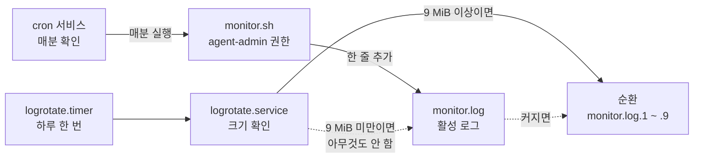
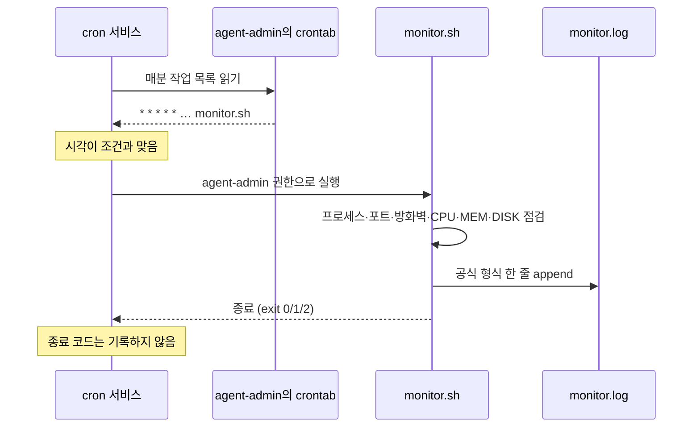
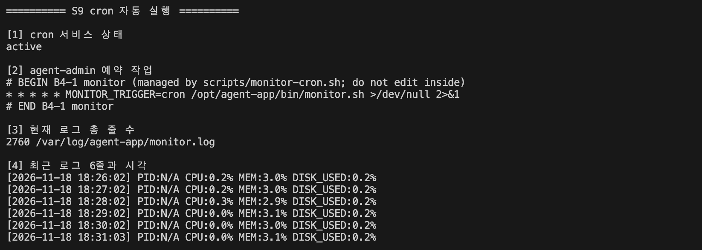
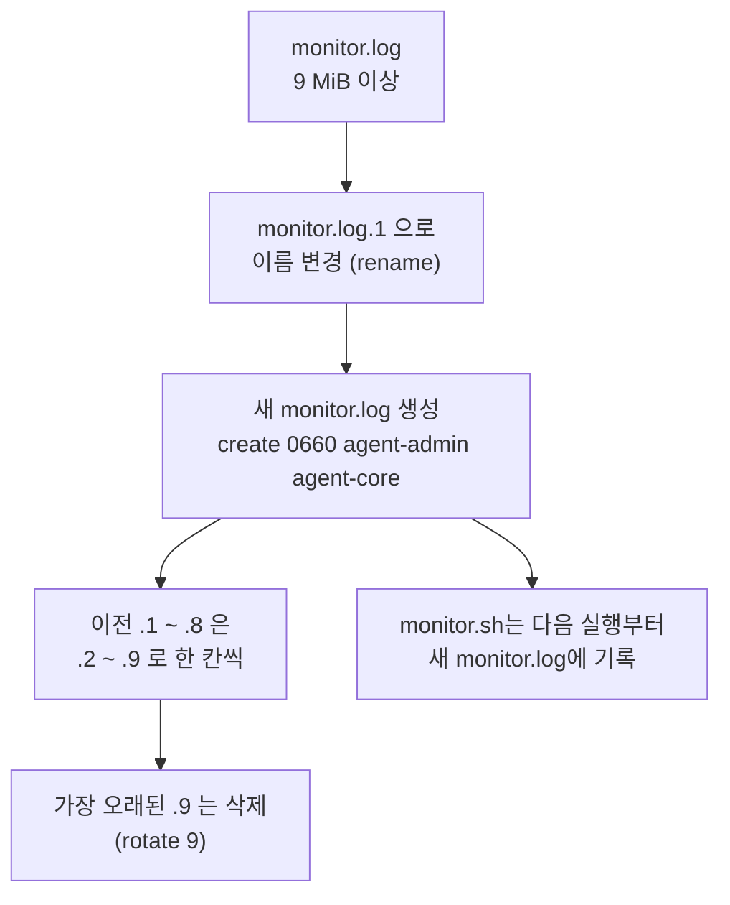
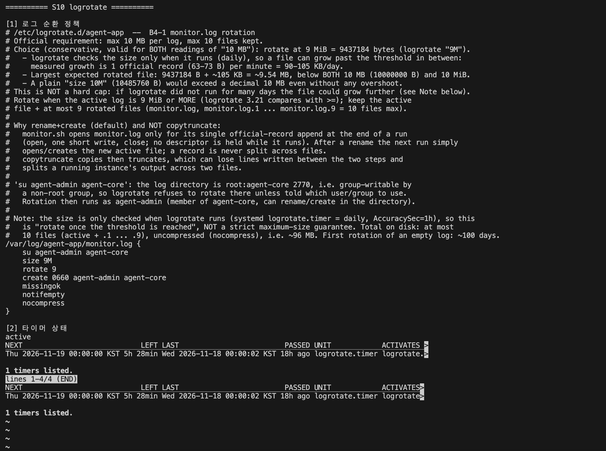
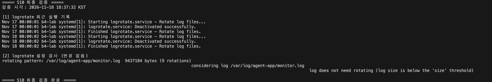

# 7강. 사람이 없어도 점검이 계속되려면?

**부제:** cron과 logrotate — 자동 실행과 기록 관리  
**학습 분야:** Linux 시스템 운영과 셸 자동화  
**연결 미션:** Codyssey B4-1 — 컴퓨터가 알아서 자기 상태를 점검하게 만들기  
**문서 상태:** v0.1 원고 / 학습 검토 — 7강 첫 원고(마지막 강의). 실제 구현(`scripts/monitor-cron.sh`, `config/`, `bin/monitor.sh`), 2026-11-13·14 기록 문서, 2026-11-18 Owner S9·S10 화면을 기준으로 썼다. **이 강의를 쓰면서 새로 실행한 명령은 없다.** 모든 수치는 기존 기록·화면에서 가져왔다.  
**선행 학습:** [3강 권한·ACL](03-users-groups-permissions-acl.md), [5강 monitor.sh Health Check](05-monitor-health-check.md), [6강 자원 사용률과 모니터링 로그](06-resources-logging.md)

> **읽는 방법**
>
> - **[기록]** 은 저장소의 설정 파일·소스·검증 기록에서 가져온 내용, **[Owner 화면]** 은 2026-11-18 Owner가 직접 촬영한 화면에서 읽은 내용, **[격리 시험]** 은 실제 로그가 아닌 **별도 시험 Machine·임시 디렉터리**에서 한 검증의 기록, **[개념]** 은 일반적인 Linux 지식이다. 기록에 없는 결과는 만들어 넣지 않았다.
> - 이 강의에서도 **Agent를 실행하지 않고, 어떤 설정도 바꾸지 않으며, 운영 로그를 건드리지 않는다.** 이 문서의 명령 중 14절에 모은 것은 "나중에 읽기 전용으로 확인하고 싶을 때"의 안내이며 이 문서를 쓰는 과정에서 실행하지 않았다.
> - 과거 설계 문서(`b4-1-cron.md`, `b4-1-log-rotation.md`)에는 **당시의 수치**(예: 실행 1회에 10줄, `size 10M`)가 남아 있다. 현재 값은 **현재 설정 파일과 최종 기록·화면**이 우선이다. 현재 `monitor.sh`는 실행마다 **공식 형식 한 줄**을 남긴다(6강 8절).
> - 근거 문서: [`scripts/monitor-cron.sh`](../../scripts/monitor-cron.sh), [`config/crontab-agent-admin.example`](../../config/crontab-agent-admin.example), [`config/etc-logrotate.d-agent-app`](../../config/etc-logrotate.d-agent-app), [`bin/monitor.sh`](../../bin/monitor.sh), [cron 기록](../b4-1-cron.md), [로그 순환 기록](../b4-1-log-rotation.md), [수행 내역서](../b4-1-final-evidence.md), [화면 증빙 안내](../evidence/screenshots/README.md).

---

## 0. 도입 — 아무도 터미널 앞에 없는 새벽 3시에도 점검은 돌아갈까?

5강에서 `monitor.sh`가 서버의 건강 상태를 점검하는 법을, 6강에서 점검 결과가 `monitor.log`에 한 줄씩 남는 법을 배웠다. 그런데 한 가지가 남아 있다.

> **`monitor.sh`를 누가 실행하는가?**

지금까지는 **사람이 터미널에 직접 입력**해서 실행했다. 하지만 서버의 건강검진은 사람이 퇴근한 밤에도, 주말에도 계속되어야 한다. 그러려면 두 가지 장치가 필요하다.

1. 정해진 시각마다 **알아서 `monitor.sh`를 실행**해 주는 장치 → **cron**
2. 그렇게 쌓이는 **로그가 끝없이 커지지 않도록 정리**해 주는 장치 → **logrotate**

### 0-1. 전체 흐름 — 구조도 1



위 그림의 왼쪽 위 사슬(cron → monitor.sh → monitor.log)이 **자동 실행과 기록**이고, 아래 사슬(timer → service → 순환)이 **기록 관리**다. 두 사슬은 서로 직접 연결되어 있지 않고, 둘이 만나는 곳은 **`monitor.log` 파일 하나**뿐이다. 이 점이 이 강의의 핵심 그림이다.

이 강의가 끝나면 다음 질문에 답할 수 있어야 한다.

1. 사람이 수동으로 실행하는 것과 cron이 정기 실행하는 것은 무엇이 다른가?
2. `* * * * *`는 무슨 뜻인가?
3. 왜 `agent-admin`의 crontab에 등록했는가?
4. `MONITOR_TRIGGER=cron`과 `>/dev/null 2>&1`은 무엇을 하는가?
5. cron은 로그를 쓰는가, `monitor.sh`가 쓰는가?
6. 로그는 왜 정리해야 하고, `size 9M`·`rotate 9`는 무슨 뜻인가?
7. logrotate는 로그 크기를 실시간으로 제한하는가?
8. S9·S10 화면은 무엇을 증명하고 무엇은 증명하지 못하는가?

---

## 1. 왜 자동화가 필요한가?

### 1-1. 수동 실행과 정기 실행

| 구분 | 사람이 직접 실행 | cron이 정기 실행 |
|---|---|---|
| 누가 시작하나 | 사람이 터미널에 명령 입력 | cron 서비스가 시각이 되면 시작 |
| 언제 | 사람이 기억하고 시간이 있을 때 | 정해진 주기마다 (B4-1은 매분) |
| 밤·주말 | 사람이 없으면 점검 없음 | 계속 점검 |
| 빠진 구간 | 점검을 잊은 시간은 **기록이 없다** | 일정한 간격으로 기록이 이어진다 |
| 용도 | 설정 직후 확인, 문제 원인 분석 | 평상시 감시, 이력 쌓기 |

핵심은 **"기록이 이어진다"** 는 점이다. 서버에 문제가 생긴 시각을 되짚으려면 그 시각 근처에 점검 기록이 있어야 한다. 사람이 가끔 실행해서는 그 기록이 듬성듬성해진다.

### 1-2. 자동화의 대가 — 로그가 쌓인다

자동화에는 대가가 있다. **매분 한 줄씩** 쌓이는 로그는 하루에 1,440줄, 한 달이면 약 4만 3천 줄이 된다. 사람이 읽지 않아도 파일은 계속 커진다. 그래서 자동 실행(cron)은 반드시 **자동 정리(logrotate)** 와 짝을 이룬다.

> **비유.** 편의점 CCTV를 생각해 보자. 카메라(= cron + monitor.sh)는 24시간 녹화한다. 하지만 저장 장치(= 디스크)는 무한하지 않다. 그래서 일정 분량이 차면 오래된 영상부터 정리하는 규칙(= logrotate)이 필요하다. 카메라가 정리까지 하지는 않는다.

---

## 2. cron이란 무엇이고 어떻게 동작할까? [개념]

### 2-1. cron은 "시계를 보는 일꾼"이다

**cron**은 Linux에서 **정해진 시각에 정해진 명령을 실행해 주는 서비스**(백그라운드에서 계속 떠 있는 프로그램, 데몬)다. 동작을 단순화하면 이렇다.

1. cron 서비스는 **매분** 깨어나 등록된 작업 목록을 훑는다.
2. 현재 시각이 어떤 작업의 **시간 조건**과 맞으면 그 작업을 **실행**한다.
3. 실행이 끝나도 결과를 판정하거나 재시도하지 않고, 다시 다음 분을 기다린다.

작업 목록은 **crontab**(cron table, 사용자별 시간표 파일)에 적는다. crontab은 **사용자마다 따로** 있어서, 작업은 **그 crontab의 주인 계정 권한으로** 실행된다.

### 2-2. 구조도 2 — cron이 한 분 동안 하는 일



그림 오른쪽 아래의 메모가 중요하다. **cron은 작업이 `exit 1`로 끝나도 그것을 장애로 취급하지 않는다.** cron에게 "실행해서 끝났다"가 곧 성공이다. 이 문제는 5절에서 다시 본다.

---

## 3. crontab의 다섯 시간 필드 [개념]

crontab의 한 줄은 **시간 조건 5칸 + 실행할 명령**이다.

```text
분 시 일 월 요일  명령
```

| 순서 | 필드 | 허용 값 | 의미 |
|---|---|---|---|
| 1 | 분(minute) | 0–59 | 몇 분에 |
| 2 | 시(hour) | 0–23 | 몇 시에 |
| 3 | 일(day of month) | 1–31 | 몇 일에 |
| 4 | 월(month) | 1–12 | 몇 월에 |
| 5 | 요일(day of week) | 0–7 (0과 7은 일요일) | 무슨 요일에 |

각 칸의 `*`는 **"모든 값"** 이라는 뜻이다. 몇 가지 예(모두 **일반적인 예**이며 B4-1에 등록된 것이 아니다):

| crontab 시간 조건 | 뜻 |
|---|---|
| `* * * * *` | **매분** (모든 분·시·일·월·요일) |
| `*/5 * * * *` | 5분마다 |
| `0 * * * *` | 매시 정각 |
| `0 0 * * *` | 매일 자정 |
| `30 2 * * 1` | 매주 월요일 02:30 |

### 3-1. B4-1의 `* * * * *`

B4-1은 다섯 칸이 **모두 `*`** 이므로 "매분"이다. 이 주기(`매분`)와 실행 계정(`agent-admin`)은 B4-1 과제의 요구값이다. 매분이라는 값이 중요한 이유는 6강의 로그 형식과 이어진다. 한 번 실행에 한 줄이 남으므로, **매분 한 줄**의 이어진 기록이 곧 "자동 실행이 되고 있다"는 증거가 된다(6절).

---

## 4. B4-1에 실제로 등록된 crontab

### 4-1. [기록] 실제 등록 내용

```text
# BEGIN B4-1 monitor (managed by scripts/monitor-cron.sh; do not edit inside)
* * * * * MONITOR_TRIGGER=cron /opt/agent-app/bin/monitor.sh >/dev/null 2>&1
# END B4-1 monitor
```

이 내용은 저장소의 [`config/crontab-agent-admin.example`](../../config/crontab-agent-admin.example)과 같고, S9 화면의 `agent-admin` 예약 작업과도 같다(6절). 세 줄의 구성은 이렇다.

| 줄 | 의미 |
|---|---|
| `# BEGIN … / # END …` | **`#`로 시작하면 주석**이라 cron이 무시한다. 이 두 줄은 "`scripts/monitor-cron.sh`가 관리하는 구역의 시작과 끝" 표시다. |
| `* * * * * MONITOR_TRIGGER=cron /opt/agent-app/bin/monitor.sh >/dev/null 2>&1` | **실제 작업.** 시간 조건 5칸 + 실행 명령 |

### 4-2. 실행 명령을 조각으로 풀기

`MONITOR_TRIGGER=cron /opt/agent-app/bin/monitor.sh >/dev/null 2>&1`

| 조각 | 의미 |
|---|---|
| `MONITOR_TRIGGER=cron` | 명령 앞에 붙은 `이름=값`은 **이 명령에만 적용되는 환경변수**다(4강). `monitor.sh`는 이 값을 읽어 **누가 실행했는지**를 기록한다. 아무 값도 없으면 수동 실행으로 취급한다. |
| `/opt/agent-app/bin/monitor.sh` | **절대 경로.** cron은 로그인한 사람처럼 설정을 불러오지 않으므로 "현재 위치" 같은 것에 의존하지 않고 전체 경로를 쓴다. |
| `>/dev/null` | 표준 출력(화면에 나올 결과)을 **`/dev/null`(받는 즉시 버리는 빈 장치)로 보낸다.** |
| `2>&1` | 표준 오류(오류 메시지)를 표준 출력과 **같은 곳으로 보낸다.** 앞의 `>/dev/null`과 합쳐 **출력과 오류 모두 버려진다.** |

### 4-3. 왜 출력을 버릴까? — 표준 출력과 cron 메일

- **[개념]** cron은 작업이 **화면에 출력한 내용이 있으면 그것을 계정의 메일로 보내려고** 한다(메일 시스템이 있다면). 출력이 없으면 아무것도 보내지 않는다.
- **[기록]** `monitor.sh`는 필요한 결과를 **스스로 `monitor.log`에 기록**한다. 그래서 화면에 나오는 상세 점검 메시지는 cron에게는 불필요하고, 버리면 메일이 생기지 않는다. 이 Machine에는 메일 전송 프로그램도 없고 `/var/mail`도 비어 있었다([cron 기록 §3](../b4-1-cron.md)).

### 4-4. 왜 `MONITOR_TRIGGER=cron`이 필요할까?

사람이 터미널에서 실행한 점검과 cron이 실행한 점검은 **같은 `monitor.sh`** 다. 둘을 구별할 표시가 없으면 "이 기록이 자동 실행인지 수동 확인인지" 알 수 없다. `MONITOR_TRIGGER=cron`을 붙이면 `monitor.sh`가 콘솔 메시지의 `START` 줄에 `trigger=cron`을 표시한다(`bin/monitor.sh` 113~116행, 5강). 수동 실행은 `trigger=manual`로 나온다(6강 S7-B 화면에서 확인).

**주의.** 현재의 공식 형식 로그 한 줄에는 `trigger` 표시가 없다(`[시각] PID:… CPU:… MEM:… DISK_USED:…`). `START`의 `trigger=cron`은 **화면에 출력되는 상세 메시지**의 항목이라, 출력을 `/dev/null`로 버리는 cron 실행에서는 어디에도 남지 않는다. 즉 **"cron이 실행했는지"는 공식 로그 줄만으로는 구별할 수 없다.** 그래서 S9에서는 crontab 등록과 **분 단위로 이어진 기록**을 함께 본다(6절).

### 4-5. 왜 `agent-admin` 계정일까?

crontab은 계정마다 따로 있으므로 **어느 계정의 crontab에 넣느냐가 곧 "누구 권한으로 실행하느냐"** 다. B4-1은 `agent-admin`의 crontab에 등록했다(root가 아니다). 이유를 정리하면:

1. **과제 요구.** B4-1은 모니터링 실행 계정을 `agent-admin`으로 정했다.
2. **로그 파일 소유자와 일치.** 운영 로그는 `agent-admin:agent-core 660`이고(6강 10절), `agent-admin`이 쓸 수 있어야 `monitor.sh`가 기록을 남긴다([기록] 로그 디렉터리는 `root:agent-core 2770`으로, `agent-core` 그룹 소속이어야 접근된다).
3. **최소 권한 원칙.** 점검에 root 권한은 필요 없다. root로 자동 실행하면, 스크립트의 오류나 악용이 곧 root 권한 사고가 된다. `agent-admin`에게는 sudo 권한이 사실상 `ufw status` 한 가지뿐이다(3강, 5강 방화벽 점검).
4. **그룹 소속 반영.** cron으로 실행된 프로세스도 `agent-admin`의 그룹(`agent-admin`, `agent-common`, `agent-core`)을 그대로 갖는다([cron 기록 §3 #6] 실측).

### 4-6. cron은 로그인 셸이 아니다 — 환경이 비어 있다

사람이 터미널에 로그인하면 `.bashrc` 등이 설정과 환경변수를 불러온다. **cron 작업은 그렇지 않다.** [기록] cron 환경을 임시로 관찰했을 때 `PATH`는 기본값, `SHELL=/bin/sh`였고 `AGENT_*` 환경변수는 **없었다**(cron 기록 §3.1). 그래서 `monitor.sh`는 두 가지를 스스로 한다.

- 설정을 `/etc/default/agent-app`에서 **직접 읽는다**(`bin/monitor.sh` 28행의 `ENV_FILE`).
- `PATH`를 **스스로 고정**한다(26행의 `PATH=/usr/sbin:/usr/bin:/sbin:/bin`).

> **정리.** "내 터미널에서는 되는데 cron에서는 안 된다"는 흔한 문제의 대부분은 **cron 환경이 사람의 로그인 환경과 다르기** 때문이다. B4-1의 `monitor.sh`는 이를 미리 대비해 외부 환경에 의존하지 않게 만들어져 있다.

### 4-7. 관리 스크립트 `scripts/monitor-cron.sh`

crontab을 손으로 `crontab -e`로 편집하면 줄이 중복되거나 다른 항목을 지우기 쉽다. 그래서 저장소의 [`scripts/monitor-cron.sh`](../../scripts/monitor-cron.sh)가 `BEGIN`~`END` 사이만 관리한다. [기록] `install`, `pause`, `resume`, `remove`, `status`를 지원하고, **여러 번 실행해도 줄이 중복되지 않으며 기존 다른 항목은 보존된다**([cron 기록 §1]). 이 스크립트는 **root 권한**으로 실행해야 한다(그렇지 않으면 `run as root (sudo)`로 종료). 이 강의에서는 실행하지 않았다.

---

## 5. cron, monitor.sh, 로그의 관계

### 5-1. 누가 무엇을 하는가

| 역할 | 담당 | 설명 |
|---|---|---|
| 매분 실행을 시작 | **cron** | 시각이 되면 `monitor.sh`를 호출 |
| 점검 수행·판정 | **`monitor.sh`** | 프로세스·포트·방화벽·CPU·MEM·DISK 점검, `HEALTHY`/`UNHEALTHY` 판정 |
| 로그에 한 줄 기록 | **`monitor.sh`** | 실행 끝에서 `monitor.log`를 열고 한 줄 append(6강 8절) |
| 크기 관리 | **logrotate** | cron도 `monitor.sh`도 하지 않는다 |

**로그를 쓰는 주체는 `monitor.sh`이지 cron이 아니다.** cron은 "실행해라"까지만 한다. 이 구분을 모르면 "cron이 로그를 만든다"고 오해하기 쉽다.

### 5-2. cron의 눈에는 `exit 1`도 "성공"이다

5강에서 `monitor.sh`는 장애를 발견하면 `exit 1`로 끝난다고 배웠다. 그런데 cron은 **종료 코드를 기록하거나 오류로 취급하지 않는다.** [기록] 실제로 cron journal에는 종료 상태·실패 관련 줄이 한 건도 없었다([cron 기록 §4]). 세 가지 상황을 구별해야 한다.

| 상황 | 의미 | 어디서 알 수 있나 |
|---|---|---|
| cron이 정상 실행 + `monitor.sh`가 `exit 1` | 점검이 **정상적으로 장애를 발견**한 것 | `monitor.sh`의 `SUMMARY result=UNHEALTHY` (콘솔 출력) |
| `monitor.sh`가 `exit 2` | **모니터링 자체**의 오류(설정·수집·로그 쓰기) | `SUMMARY result=MONITOR_ERROR`, `[ERROR]` 줄 |
| cron 자체가 실행하지 않음 | 서비스·crontab·권한 문제 | `monitor.log`에 **새 줄이 안 생김**, cron 서비스 상태 |

### 5-3. 알려진 한계 — 출력을 버려서 생기는 감시 공백 [기록]

출력을 `/dev/null`로 버리므로, **로그를 아예 쓰지 못하는 상황**(예: 디스크가 가득 참)에서는 `[ERROR] LOG` 메시지가 **어디에도 남지 않는다.** 겉으로 드러나는 증상은 "로그에 새 줄이 생기지 않는다" 하나뿐이다([cron 기록 §4]에 "알려진 감시 공백"으로 기록됨). 이것이 **최신 줄의 시각이 현재 시각과 가까운지 확인하는 것**이 중요한 이유다. 이 한계는 해결하지 않았고, 일부러 단순함을 택한 설계다.

### 5-4. `PID:N/A`의 의미

S8 화면의 최근 5줄은 모두 `PID:N/A`다. 6강 8절에서 배운 대로 이는 **그 시점에 Agent 프로세스를 확인하지 못했다**는 뜻이다. cron은 Agent와 무관하게 `monitor.sh`를 실행하므로, **Agent가 꺼져 있어도 자원 줄(CPU·MEM·DISK)은 기록**되고 PID 자리만 `N/A`가 된다. Agent가 꺼져 있다는 것은 5강의 `UNHEALTHY`(`exit 1`) 판정과 같은 상황이며 **cron의 오류가 아니다.**

---

## 6. 실제 화면 해석 — S9 cron 자동 실행 [Owner 화면]

2026-11-18 Owner가 18:33경 촬영했다. 원본: [S9-cron-2026-11-18.png](../evidence/screenshots/S9-cron-2026-11-18.png) — 상세 해석은 [증빙 안내 S9 절](../evidence/screenshots/README.md#s9--cron-자동-실행-2026-11-18).



### 6-1. 화면의 네 구역

| 구역 | 화면에 보이는 값 | 읽는 법 |
|---|---|---|
| [1] cron 서비스 상태 | `active` | cron 서비스가 **지금 실행 중**이다. 꺼져 있으면 아무 작업도 실행되지 않는다. |
| [2] `agent-admin` 예약 작업 | `# BEGIN B4-1 monitor …` / `* * * * * MONITOR_TRIGGER=cron /opt/agent-app/bin/monitor.sh >/dev/null 2>&1` / `# END B4-1 monitor` | 4절의 세 줄이 **`agent-admin`의 crontab에 실제로 등록**되어 있다. |
| [3] 현재 로그 총 줄 수 | `2760 /var/log/agent-app/monitor.log` | 지금까지 쌓인 줄 수 |
| [4] 최근 로그 6줄과 시각 | 18:26:02, 18:27:02, 18:28:02, 18:29:02, 18:30:02, 18:31:03 | **약 1분 간격**으로 줄이 이어진다. |

### 6-2. 이 화면으로 무엇을 증명하는가

- cron 서비스가 `active`이고 `agent-admin`에게 **매분 실행 작업이 등록**되어 있다 → "자동 실행될 준비가 되어 있다".
- 최근 6줄이 18:26~18:31에 **약 1분 간격으로 연속** 기록되어 있다 → "실제로 자동 실행이 이어지고 있다".
- 두 가지가 **함께** 있어야 "cron 자동 실행"이 증명된다. 등록만 있고 줄이 안 늘면 실행이 안 되는 것이고, 줄이 늘기만 하고 등록이 안 보이면 누가 실행하는지 알 수 없다.

### 6-3. 이 화면이 증명하지 못하는 것

- **줄 수의 증가 자체.** 화면에는 2760이라는 **한 시점의 값**만 있다. 증가는 연속된 시각의 줄들로 확인한 것이다.
- **그 줄을 cron이 썼다는 직접 표시.** 공식 형식 줄에는 `trigger=cron`이 없다(4-4절). 등록 + 분 단위 패턴이라는 **정황을 합쳐서** 해석한다.
- cron 서비스의 실행 기록(journal)은 이 화면에 없다. 그 확인은 [cron 기록 §3]의 2026-11-13 실측에 근거한다.
- 시각의 `:02`초는 일정하지만 마지막 줄은 `18:31:03`이다. 이는 실행 시작이 약 1초 늦거나 점검 시간이 길었던 것일 수 있으나, **원인은 화면만으로 단정하지 않는다.** 간격은 여전히 약 1분이다.
- 2760줄의 구성(모두 공식 형식인지)은 이 화면에서 알 수 없다.

---

## 7. 로그는 왜 정리해야 할까? — logrotate의 필요성

### 7-1. 얼마나 쌓일까? [계산]

6강에서 본 공식 형식 한 줄은 약 63~73 바이트다([기록] logrotate 설정 주석: 63~73 B). 매분 한 줄이면:

| 기간 | 계산 | 크기 |
|---|---|---|
| 하루 | 1,440줄 × 63~73 B | 약 90~105 KB |
| 한 달 | × 30 | 약 2.7~3.2 MB |
| 임계값 9 MiB(9,437,184 B) 도달 | 9,437,184 ÷ (90~105 KB/일) | 약 90~105일 |

[Owner 화면] S8에서 `monitor.log`는 **173,897 B**, S9에서 **2,760줄**이었다. 두 값을 나누면 줄당 평균 약 63 B로 위 추정과 맞는다(두 화면 값을 나눈 계산일 뿐, 파일 구성을 증명하지는 않는다). 173,897 B는 9 MiB 임계값의 약 1.8%이므로 **아직 순환할 때가 아니다.**

### 7-2. 방치하면 무슨 문제가 생길까? [개념]

- **디스크 고갈.** 로그가 계속 커져 디스크가 차면, 서버의 다른 기능까지 영향을 받는다(6강 5절의 디스크 사용률).
- **열기·검색이 느려진다.** 거대한 한 파일을 읽는 일은 점점 불편해진다.
- **오래된 정보와 새 정보가 섞인다.** 지금 보고 싶은 최근 기록을 찾기 어렵다.

로그를 **지워 버리면** 이 문제는 풀리지만, 과거 기록(이력)도 함께 사라진다. 그래서 **일정 기간·분량만 보관하고 오래된 것부터 정리**하는 로그 순환(rotation)을 쓴다.

> **B4-1 요구.** 공식 요구는 "로그 최대 10MB, 최대 10개 파일"이다. 이를 `size 9M`·`rotate 9`로 구현했다(8절).

---

## 8. logrotate 설정 풀이 [기록]

### 8-1. 실제 설정 파일

[`config/etc-logrotate.d-agent-app`](../../config/etc-logrotate.d-agent-app)의 실제 설정 부분이다(앞의 설명 주석은 생략). 이 파일은 Ubuntu의 `/etc/logrotate.d/agent-app`에 설치되며, S10-A 화면에서도 같은 내용이 보인다(11절).

```text
/var/log/agent-app/monitor.log {
    su agent-admin agent-core
    size 9M
    rotate 9
    create 0660 agent-admin agent-core
    missingok
    notifempty
    nocompress
}
```

첫 줄 `/var/log/agent-app/monitor.log { … }`은 "**이 파일에 대해 중괄호 안의 규칙을 적용한다**"는 뜻이다.

### 8-2. 옵션별 의미

| 옵션 | 의미 | 왜 이렇게 했나 |
|---|---|---|
| `size 9M` | 활성 로그가 **9 MiB 이상**이면 순환한다. `M`은 1024×1024바이트이므로 9M = **9,437,184 B**. [기록] 실측으로 9,437,183 B는 순환하지 않고 9,437,184 B부터 순환(logrotate 3.21은 `>=`) | 공식 "10MB"를 십진 10 MB(10,000,000 B)로 읽어도 10 MiB로 읽어도 넘지 않도록 **한 단계 낮춘** 값. 하루 증가분(약 0.1 MB)을 감안해도 순환 직전 최대 약 9.54 MB |
| `rotate 9` | 순환본을 **최대 9개** 보관한다. 활성 1개 + `.1`~`.9` = **최대 10개 파일**. 가장 오래된 것은 다음 순환 때 삭제 | 공식 "최대 10개" 충족 |
| `create 0660 agent-admin agent-core` | 순환 후 **새 활성 파일**을 이 권한·소유자·그룹으로 만든다 | 6강에서 본 `agent-admin:agent-core 660`을 순환 뒤에도 유지 |
| `su agent-admin agent-core` | 순환 작업을 **root가 아니라 `agent-admin`(그룹 `agent-core`)** 권한으로 수행 | 로그 디렉터리(`root:agent-core 2770`)가 root가 아닌 그룹에 쓰기를 허용하므로, **`su` 없이는 logrotate가 안전하지 않다며 순환을 거부**한다([격리 시험] 거부 실측). root 권한으로 쓰기 가능한 디렉터리를 만지는 위험도 피한다 |
| `missingok` | 로그 파일이 **없어도 오류 없이** 넘어간다 | 파일이 아직 없을 때 오류로 멈추지 않기 위함 |
| `notifempty` | 로그가 **비어 있으면 순환하지 않는다** | 빈 파일을 의미 없이 순환시키지 않음 |
| `nocompress` | 순환본을 **압축하지 않는다** | 단순함·읽기 편의. 대신 디스크는 최대 10파일 × 약 9.5 MB ≈ 약 96 MB까지 쓸 수 있음 |

### 8-3. 주의 — `size`에는 시간 조건이 없다

`size 9M`만 있고 `daily`·`weekly` 같은 **시간 기준 옵션은 없다.** 따라서 "크기가 9 MiB 이상이면 순환, 아니면 그대로 둔다"만 판단한다. 하루에 한 번 **검사**가 이루어지는 것은 이 옵션이 아니라 **타이머**(10절) 때문이다.

---

## 9. 활성 로그와 순환된 로그

### 9-1. 이름이 바뀌는 방식 [개념 + 기록]

순환 전에는 `monitor.log` 하나만 있다. 크기가 임계값에 이르러 순환이 일어나면 다음과 같이 **이름이 한 칸씩 밀린다.**

```text
순환 전    monitor.log (9 MiB 이상)

순환 후    monitor.log   (새 파일, 0 byte)   ← 활성 로그: monitor.sh가 계속 여기에 씀
           monitor.log.1 (직전의 활성 로그)  ← 가장 최근 순환본
           (다음 순환 때 .1 → .2, .2 → .3 … 로 밀린다)
           monitor.log.9 → 다음 순환 때 삭제
```

| 파일 | 이름 | 역할 |
|---|---|---|
| **활성 로그** | `monitor.log` | **지금 기록하는** 파일. `monitor.sh`가 매분 여기에 한 줄을 추가 |
| **순환된 로그** | `monitor.log.1` ~ `.9` | 과거 기록의 **보관본**. 숫자가 클수록 오래된 것 |

### 9-2. 구조도 3 — 순환이 일어나는 순서



(실제 내부 처리 순서는 logrotate의 구현에 따르며, 위 그림은 **결과가 어떻게 보이는지**를 학습용으로 정리한 것이다.)

### 9-3. 왜 파일을 복사해서 비우지 않고 이름을 바꿀까? [기록]

설정 파일 주석과 [로그 순환 기록](../b4-1-log-rotation.md)은 **`copytruncate`(복사 후 원본을 비움) 대신 기본 방식(이름 변경 + 새 파일 생성)** 을 택한 이유를 이렇게 설명한다.

- `monitor.sh`는 실행 **끝에서 한 번** 파일을 열고, 한 줄을 쓰고, 닫는다. 오래 열어 두지 않는다.
- 그래서 이름이 바뀐 뒤에도 문제가 없고, 다음 실행은 **새 활성 파일을 열어 이어서 쓴다.** 한 줄이 두 파일로 쪼개지지 않는다.
- `copytruncate`는 복사와 비우기 **사이에 쓰인 줄을 잃을 수** 있다.

[격리 시험] 별도 시험 Machine에서 `monitor.sh`를 30회 연속 실행하는 동안 순환을 3회 일으켰을 때, 기록 증가분은 정확히 30줄이었다(손실·중복 0)([로그 순환 기록] 작업 20). 단, 이는 **운영 로그가 아닌 시험 환경**의 결과다.

---

## 10. 누가 logrotate를 실행할까? — timer와 service

### 10-1. 두 개의 systemd 단위 [개념 + 기록]

logrotate는 스스로 시계를 보지 않는다. 시간이 되면 **systemd**(Linux의 서비스 관리자)가 실행해 준다. 여기에 두 단위가 협력한다.

| 단위 | 역할 | 비유 |
|---|---|---|
| **`logrotate.timer`** | **언제** 실행할지 정한다. [기록] `OnCalendar=daily`(하루 한 번, 자정 무렵), `AccuracySec=1h`(정확한 시각이 아니라 **최대 약 1시간 안에** 실행) | 알람 시계 |
| **`logrotate.service`** | **무엇을** 실행할지 정한다. `logrotate /etc/logrotate.conf`를 수행하고, 이 파일이 `/etc/logrotate.d/` 안의 설정들(우리 `agent-app` 포함)을 불러온다 | 알람이 울리면 해야 할 일 |

> **정리.** 타이머가 "하루 한 번" 서비스를 깨우고, 서비스가 logrotate를 실행해서 **설정 파일마다 순환할 때인지 판단**한다.

cron과 비슷해 보이지만, 우리가 만든 `monitor.sh` 작업은 **cron**이 매분, logrotate는 시스템 기본의 **systemd 타이머**가 하루 한 번 실행한다. 둘은 별도의 장치다.

### 10-2. "하루 한 번 검사"의 의미 — 엄격한 크기 제한이 아니다

[기록] `logrotate`는 **자기가 실행될 때만** 크기를 확인한다. 타이머가 하루 한 번이므로 이렇게 된다.

```text
오늘 00:00  검사: 8.99 MiB  → 임계값(9 MiB) 미만이라 그대로 둠
   (하루 동안 매분 한 줄씩 증가, 약 0.1 MB — 그 사이에 9 MiB를 넘을 수 있다)
내일 00:00  검사: 9.09 MiB  → 이제 순환
```

위 예시는 개념을 위한 **가정**이다(실제로는 아직 9 MiB에 한참 못 미침). 오늘 검사 때 9 MiB 미만이라 그대로 두었더라도, 그 직후 파일이 9 MiB를 넘을 수 있고, **다음 검사 시각까지는 아무도 막지 않는다.**

- 9 MiB에 닿는 **즉시** 순환하는 것이 아니다.
- 그래서 `size 9M`은 **"임계값에 도달한 뒤, 다음 정기 검사 때 순환"** 이지 **실시간 최대 크기 보장이 아니다.**
- B4-1은 하루 증가분이 약 0.1 MB라서 순환 직전 최대 약 9.54 MB(< 10 MB)로 본다. 그래서 9 MiB로 낮춰 여유를 둔 것이다(8절).
- 만약 logrotate가 **여러 날 실행되지 않으면** 파일은 더 커질 수 있다. 이것이 "엄격한 최대 크기 보장이 아님"이라는 한계다([수행 내역서 §2.10]).

> **취지를 오해하지 말 것.** "최대 10MB"는 "로그가 한 번도 10MB를 넘지 않는다"는 약속이 아니라, **"임계값에 도달하면 정기적으로 순환해서 10개 이하로 유지한다"** 는 정책이다.

---

## 11. 실제 화면 해석 — S10 logrotate [Owner 화면]

2026-11-18 Owner가 촬영한 두 화면이다. 상세 해석: [증빙 안내 S10 절](../evidence/screenshots/README.md#s10--logrotate-2026-11-18).

### 11-1. S10-A — 정책과 타이머 (18:33~18:34경)

원본: [S10-A-logrotate-config-2026-11-18.png](../evidence/screenshots/S10-A-logrotate-config-2026-11-18.png)



| 구역 | 화면에 보이는 값 | 읽는 법 |
|---|---|---|
| [1] 로그 순환 정책 | `/etc/logrotate.d/agent-app`의 설명 주석 + `monitor.log { su agent-admin agent-core / size 9M / rotate 9 / create 0660 agent-admin agent-core / missingok / notifempty / nocompress }` | 8절의 설정이 **Ubuntu에 실제로 설치**되어 있다. 설명 주석에는 `NOT a hard cap`, `NOT a strict maximum-size guarantee`가 적혀 있다. |
| [2] 타이머 상태 | `active` / `NEXT Thu 2026-11-19 00:00:00 KST` / `LAST Wed 2026-11-18 00:00:02 KST` (18h ago) / `logrotate.timer` | 타이머가 **켜져 있고**, 가장 최근 실행은 오늘 00:00:02, 다음은 내일 00:00이다. |

**이 화면의 한계.** 화면 아래쪽에 터미널 **페이저**(`less`, `lines 1-4/4 (END)`)의 흔적이 있어 타이머 표가 두 번 보이고, 오른쪽 `ACTIVATES` 열은 `>` 기호로 **잘려** 있다. 그래서 **실제로 보이는 범위만** 증빙으로 쓴다. `AccuracySec=1h`나 `OnCalendar=daily` 값은 타이머 단위 파일을 직접 보여 주는 것이 아니라 **설정 파일의 주석에 쓰여 있는 서술**이다.

### 11-2. S10-B — 최종 확인 (검증 시각 2026-11-18 18:37:32 KST)

원본: [S10-B-logrotate-verification-2026-11-18.png](../evidence/screenshots/S10-B-logrotate-verification-2026-11-18.png)



| 구역 | 화면에 보이는 값 | 읽는 법 |
|---|---|---|
| [1] logrotate 최근 실행 기록 | `Nov 17 00:00:01` 과 `Nov 18 00:00:02` 각각 `Starting logrotate.service` → `Deactivated successfully.` → `Finished logrotate.service - Rotate log files.` | 타이머가 **11월 17일·18일 자정**에 서비스를 실제로 실행했고 **정상 종료**했다. |
| [2] 설정 검사 (변경 없음) | `rotating pattern: /var/log/agent-app/monitor.log  9437184 bytes (9 rotations)` / `considering log /var/log/agent-app/monitor.log` / `log does not need rotating (log size is below the 'size' threshold)` | logrotate가 설정을 읽어 **9,437,184 B(9 MiB) 임계값과 순환본 9개**를 인식했고, 현재 로그는 임계값 미만이라 **순환 대상이 아니라고** 판단했다. |

`logrotate -d`의 `-d`는 **디버그(시험) 모드**다. **무엇을 할지 보여 주기만 하고 파일을 바꾸지 않는다.** 그래서 "변경 없음"이 화면에 적혀 있다.

### 11-3. S10 화면이 증명하는 것과 증명하지 못하는 것

| 구분 | 내용 |
|---|---|
| **증명하는 것** | ① 설정이 실제 설치됨(S10-A) ② 타이머 `active`, 직전·다음 실행 시각(S10-A) ③ 11-17·11-18 자정에 `logrotate.service` 정상 종료(S10-B) ④ `-d` 검사가 9437184 B·9 rotations 인식, 현재 로그는 순환 불필요(S10-B) |
| **증명하지 못하는 것** | ① **강제 순환을 실행하지 않았다.** 실제로 `monitor.log.1`이 만들어지는 순환은 이 화면에 없다. ② 두 날짜 사이 다른 날의 실행(예: 11-14~16)은 화면에 없다. ③ 현재 로그가 임계값 미만이라 **실제 순환이 일어나지 않은 것이 정상**이다. |

---

## 12. 증거의 층 — 무엇이 어디서 확인되었나

이 강의에서 가장 헷갈리기 쉬운 부분이다. **"순환이 된다"는 것을 증명하는 근거와 "타이머가 실행된다"는 근거는 서로 다른 곳에 있다.**

| 확인하려는 것 | 근거 | 종류 |
|---|---|---|
| 설정이 **올바른 값**으로 설치됨 | S10-A 화면, 저장소 설정 파일 | 운영 `b4-lab` [Owner 화면] |
| 타이머가 **자정에 실행**되고 **정상 종료** | S10-B 화면(11-17·18), 2026-11-14 `journalctl`([수행 내역서 §2.10]) | 운영 `b4-lab` |
| `-d`가 **9 MiB·9개**를 인식 | S10-B 화면 | 운영 `b4-lab` (**변경 없음** 모드) |
| 현재 로그가 **순환 불필요** | S10-B 화면(`does not need rotating`), S8(173,897 B) | 운영 `b4-lab` |
| 크기 경계(9,437,183 B 순환 안 함 / 9,437,184 B부터 순환) | [로그 순환 기록] 작업 21 | **[격리 시험]** 별도 `b4-recovery-test` Machine |
| 연속 순환 후 **파일 10개 유지**, `.10` 없음 | [로그 순환 기록] 작업 21 | **[격리 시험]** |
| 순환 후 새 파일 권한 `660 agent-admin:agent-core` | [로그 순환 기록] | **[격리 시험]** |
| 순환 중 데이터 손실 없음(30회 실행 + 순환 3회 → 증가분 정확히 30줄) | [로그 순환 기록] 작업 20 | **[격리 시험]** |
| 운영 `b4-lab`에서 **실제로 순환이 일어났는가** | — | **아니다. 일어나지 않았다.** 로그가 9 MiB 미만이라 정상 |

> **정리.** 이번 Owner 실습(S9·S10)은 **설정·타이머 실행·디버그 검증**까지다. **실제 순환이 일어나는 동작과 보존 개수**는 운영 서버가 아니라 **별도 시험 Machine**의 기록이 근거다. 두 가지를 섞어서 "운영 서버에서 순환을 확인했다"고 말하면 틀린 설명이다.

---

## 13. cron과 logrotate의 역할 비교

| 구분 | cron | logrotate |
|---|---|---|
| 하는 일 | 정해진 시각에 **명령을 실행** | 로그 파일을 **순환·정리** |
| B4-1에서 실행하는 것 | `monitor.sh` | `monitor.log` 관리 |
| 주기 | **매분** (`* * * * *`) | 하루 한 번 검사 (`logrotate.timer`, `daily`) |
| 실행 계정 | `agent-admin` | `logrotate.service`는 root, 순환 작업은 `su`로 `agent-admin:agent-core` 권한 |
| 설정 위치 | `agent-admin`의 crontab | `/etc/logrotate.d/agent-app` |
| 시간 지정 방식 | crontab의 시간 5칸 | systemd 타이머 (`OnCalendar=daily`) |
| 결과가 남는 곳 | `monitor.log`에 한 줄 (기록은 `monitor.sh`가 씀) | `monitor.log.1`~`.9` (순환본) |
| 확인 화면 | S9 | S10 |
| 한계 | 종료 코드를 기록하지 않음, 출력을 버려 쓰기 실패가 안 보일 수 있음 | **실시간 최대 크기 보장이 아님** |
| 둘의 접점 | **`monitor.log`** — cron이 쌓고 logrotate가 정리한다 | |

서로의 **일을 대신하지 않는다.** cron은 로그를 정리하지 않고, logrotate는 `monitor.sh`를 실행하지 않는다.

---

## 14. (선택) 나중에 읽기 전용으로 확인하는 방법 [실습 준비 — 이 문서에서는 실행하지 않음]

Owner가 이미 S9·S10 화면을 촬영했으므로 **추가 실습은 필요 없다.** 다만 복습용으로 아래와 같이 **읽기 전용** 명령으로 확인할 수 있다. (`B`는 `orb -m b4-lab sudo`이다. 이 문서의 어떤 명령도 설정·로그를 바꾸지 않는다. 이 강의에서는 실행하지 않았다.)

```bash
B crontab -u agent-admin -l
B systemctl is-active cron
B tail -n 3 /var/log/agent-app/monitor.log
B logrotate -d /etc/logrotate.d/agent-app
B systemctl list-timers logrotate.timer
```

| 명령 | 해석 |
|---|---|
| `crontab -u agent-admin -l` | `agent-admin`의 crontab을 **목록(`-l`)** 으로 본다. 4절의 세 줄이 보여야 한다. |
| `systemctl is-active cron` | cron 서비스가 `active`인지 한 단어로 출력한다. |
| `tail -n 3 …` | 로그의 마지막 3줄. 시각이 **현재 시각과 가까운지** 본다(5-3절). |
| `logrotate -d …` | **`-d` = 디버그.** 변경 없이 무엇을 할지만 출력한다. `9437184 bytes (9 rotations)`와 `does not need rotating`이 나와야 한다. |
| `systemctl list-timers logrotate.timer` | 타이머의 NEXT·LAST를 본다. |

**하지 않는 것:** `logrotate -f`(강제 순환), 로그 삭제·초기화, crontab 수정·삭제(`crontab -r`), cron·logrotate 설정 변경. 특히 `-f`와 `crontab -r`은 **운영 기록·설정에 되돌리기 어려운 영향**을 줄 수 있다.

---

## 15. 이해 확인 질문과 해설 (동료평가 대비)

### 1. cron은 무엇인가?
정해진 시각에 정해진 명령을 자동으로 실행해 주는 Linux 서비스다. 작업은 crontab에 적고, 그 crontab의 **주인 계정 권한**으로 실행된다.

### 2. `* * * * *`는 무슨 뜻인가?
분·시·일·월·요일 다섯 칸이 **모두 "모든 값"** 이라 **매분** 실행한다는 뜻이다.

### 3. 왜 `agent-admin`의 crontab에 등록했는가? root가 아니고?
과제가 실행 계정을 `agent-admin`으로 정했고, 로그 파일(`agent-admin:agent-core 660`)에 쓸 수 있어야 하며, 점검에 root 권한이 필요 없기 때문이다. root로 자동 실행하면 스크립트 오류가 곧 root 권한 사고가 될 수 있다(최소 권한 원칙).

### 4. `MONITOR_TRIGGER=cron`은 무엇을 하는가?
`monitor.sh`가 **누가 실행했는지**를 콘솔 메시지(`START … trigger=cron`)에 표시하게 하는 환경변수다. 단, 현재 공식 형식 로그 한 줄에는 `trigger` 표시가 없다.

### 5. `>/dev/null 2>&1`은 무엇인가? 왜 쓰는가?
표준 출력과 오류를 모두 버린다는 뜻이다. `monitor.sh`가 필요한 결과를 **스스로 로그 파일에 기록**하므로, 출력이 있을 때 cron이 보내려 하는 메일을 만들지 않으려고 쓴다. 대가는 **로그 쓰기 실패 같은 오류 메시지도 남지 않는 것**이다.

### 6. 로그는 cron이 쓰는가, `monitor.sh`가 쓰는가?
`monitor.sh`가 쓴다. cron은 실행만 시작한다.

### 7. `monitor.sh`가 `exit 1`로 끝나면 cron은 오류로 처리하는가?
아니다. cron은 종료 코드를 기록하거나 오류로 취급하지 않는다. `exit 1`은 `monitor.sh`가 정상적으로 장애를 **발견**한 것이며, cron 입장에서는 "실행되고 끝났다"이다.

### 8. 로그를 왜 정리(순환)해야 하는가? 그냥 지우면 안 되는가?
계속 쌓이면 디스크를 채운다. 그냥 지우면 과거 이력도 사라지므로, 일정 분량·개수만 보관하고 오래된 것부터 정리한다.

### 9. `size 9M`과 `rotate 9`는 각각 무엇인가?
`size 9M`은 활성 로그가 9 MiB(9,437,184 B) **이상**이면 순환, `rotate 9`는 순환본을 최대 9개 보관(활성 1 + `.1`~`.9` = 최대 10개)한다. 공식 요구 "최대 10MB, 최대 10개"를 두 해석 모두 만족하도록 9 MiB로 낮췄다.

### 10. `create 0660 agent-admin agent-core`와 `su agent-admin agent-core`의 차이는?
`create`는 순환 후 만들어지는 **새 활성 파일의 권한·소유자·그룹**이고, `su`는 **순환 작업을 수행하는 계정**이다. `su`가 없으면 root가 아닌 그룹이 쓸 수 있는 디렉터리에서 logrotate가 순환을 거부한다.

### 11. `missingok`, `notifempty`, `nocompress`는?
각각 로그 파일이 없어도 오류 없이 넘어감, 비어 있으면 순환하지 않음, 순환본을 압축하지 않음이다.

### 12. 활성 로그와 순환된 로그의 차이는?
활성 로그(`monitor.log`)는 `monitor.sh`가 **지금 쓰는** 파일이고, 순환된 로그(`monitor.log.1`~`.9`)는 이전 기록의 **보관본**이다. 숫자가 클수록 오래되었고, 가장 오래된 것은 다음 순환 때 삭제된다.

### 13. `logrotate.timer`와 `logrotate.service`의 역할은?
타이머는 **언제**(하루 한 번) 실행할지, 서비스는 **무엇을**(logrotate 실행) 실행할지 정한다. 타이머가 서비스를 깨우면, logrotate가 설정 파일들을 읽고 순환할 때인지 판단한다.

### 14. logrotate는 로그 크기를 실시간으로 9 MiB 이하로 제한하는가?
아니다. 자신이 **실행될 때만**(하루 한 번) 크기를 검사하므로, 검사 사이에 임계값을 넘을 수 있다. 임계값 도달 후 정기적으로 순환하는 정책이며, 엄격한 최대 크기 보장이 아니다.

### 15. S9 화면은 무엇을 증명하고 무엇은 증명하지 못하는가?
cron `active`, `agent-admin`의 매분 crontab 등록, 약 1분 간격으로 이어진 최근 로그를 보여 준다. 줄 수의 **증가 자체**와 "그 줄을 cron이 썼다는 직접 표시"(`trigger=cron`)는 화면에 없고, 등록 + 분 단위 패턴을 합쳐서 해석한다.

### 16. S10에서 실제로 로그 순환을 확인했는가?
아니다. S10은 **설정 설치, 타이머 active와 11-17·18 정상 실행, `-d` 검사**를 확인한 것이다. 강제 순환은 실행하지 않았고, 로그가 9 MiB 미만이라 **순환이 일어나지 않은 것이 정상**이다. 순환 동작과 보존 개수는 별도 시험 Machine의 기록이 근거다.

### 생각해 보기. S9에서 18:31:03 줄이 다른 줄(`:02`)보다 1초 늦은 이유는?
화면만으로는 **단정할 수 없다.** 실행 시작이 약간 늦었거나 점검 시간이 길었을 수 있다는 가능성만 말할 수 있다. 중요한 것은 간격이 약 1분으로 유지된다는 점이다.

---

## 16. 7강 정리와 B4-1 전체 연결

### 16-1. 한 장 요약

- **cron:** `agent-admin`의 crontab `* * * * *`로 `monitor.sh`를 **매분 실행**한다. 기록은 `monitor.sh`가 쓴다.
- **logrotate:** 하루 한 번(`logrotate.timer` → `logrotate.service`) 크기를 확인하고 **9 MiB 이상이면 순환**, 최대 10개를 보관한다. 실시간 상한이 아니다.
- **연결점:** 두 장치는 **`monitor.log` 한 파일**을 사이에 두고 만난다.
- **증빙:** S9(cron), S10(logrotate)은 Owner 화면으로 확보되어 있고, **실제 순환의 동작**은 별도 시험 기록이 근거다.

### 16-2. B4-1 입문 학습 전체 흐름

| 강 | 질문 | 이번 강의와의 연결 |
|---|---|---|
| 0~2강 | 터미널·서버·SSH·방화벽 | 서버에 안전하게 접속하고 지킨다 |
| 3강 | 사용자·그룹·권한 | `agent-admin`과 `agent-core`가 왜 필요한가 |
| 4강 | 환경변수·Agent 실행 | cron 환경에는 이 값이 없다 |
| 5강 | monitor.sh | cron이 매분 실행하는 대상 |
| 6강 | 자원 사용률·로그 | cron이 쌓고 logrotate가 정리하는 `monitor.log` |
| **7강** | **자동 실행과 기록 관리** | 모든 조각이 **사람 없이도 도는 하나의 시스템**이 된다 |

### 16-3. 남는 한계 (정직하게)

- cron은 종료 코드를 남기지 않고, 출력을 버리므로 **로그 쓰기 실패가 눈에 띄지 않을 수 있다**(5-3절).
- 공식 형식 로그만으로는 **cron 실행 여부를 구별할 수 없다**(4-4절).
- logrotate는 **실시간 최대 크기 보장이 아니다**(10-2절).
- 운영 서버에서 **실제 순환이 일어난 적은 없다**(12절). 동작은 시험 환경 기록이 근거다.
- 공식 미션 원문 전체와의 최종 대조와 제출 승인은 Owner 몫이다([수행 내역서](../b4-1-final-evidence.md) §5).

---

### 원고 확장 원칙

- 7강 v0.1은 학습 초안이며, 질문이 생기면 기존 설명을 삭제하지 않고 해당 절에 보충한다.
- 중요한 명령어는 **원문 → 구성 요소 → 전체 한국어 해석 → 결과 → 미션 연결** 순서로 설명한다.
- 기록에 없는 출력은 만들어 넣지 않는다.

### 근거 문서

- [B4-1 공식 수행 내역서](../b4-1-final-evidence.md)
- [cron 기록](../b4-1-cron.md) · [로그 순환 기록](../b4-1-log-rotation.md)
- [scripts/monitor-cron.sh](../../scripts/monitor-cron.sh) · [crontab 예시](../../config/crontab-agent-admin.example) · [logrotate 설정](../../config/etc-logrotate.d-agent-app)
- [monitor.sh 소스](../../bin/monitor.sh)
- [화면 증빙 안내](../evidence/screenshots/README.md)
- [6강 자원 사용률과 모니터링 로그](06-resources-logging.md)
- [B4-1 학습자료 목차](README.md)

**현재 상태:** 7강 v0.1 원고 / 학습 검토. 연결 증빙 S9·S10은 **화면 확보(2026-11-18)** 되어 있다.
